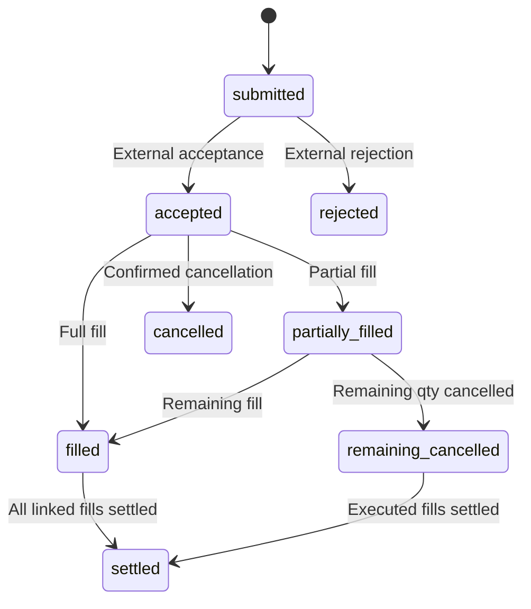

# Financial Agents in Context: Systems, Lifecycles, and Accountability

*From a user's question to reviewable research—and then, only when separately authorized, to a business effect.*

> **Scope and engineering status (October 27, 2026):** ETF-Agent is a personal fund-research and investment-tool engineering project. Solid boxes show existing responsibilities; orange dashed boxes show institutional targets such as advice admission, trading, settlement, and formal audit. Current confirmation records manage personal investment state rather than brokerage fills. The grant, order, and audit structures below are synthetic design examples; applicable institutional rules and systems determine actual business admission.

A user asks: “Do the two technology funds I hold own many of the same companies? Would investing more simply buy the same risk twice?”

A model can find information, read fund reports, perform calculations, and produce an illustrated analysis. A financial service must also answer different questions: whose portfolio and which disclosure period did it analyze? What definitions support the result? If the user then says “make that adjustment,” may the system execute it? Can someone recover the original basis three months later?

**The central architecture problem is enabling exploratory research to work alongside financial operations with explicit accountability.** Research proposes hypotheses while the investment core maintains the ledger. The model proposes actions while business systems independently verify authorization, fills, and settlement.

This article follows one portfolio review. We first define the service, map its systems, trace the separate research and business lifecycles, and then examine governance and institutional adoption. The three main diagrams answer three questions: **how systems connect, how work progresses, and how results can be traced.**

## 1. Define the service promise before choosing agent capabilities

For an investor, the product is a service, not a collection of tools. Product education, personal portfolio analysis, individualized advice, and investment operations may share a chat interface. They must not consequently share one vague authorization.

The table groups commitments useful for product design. Whether a service constitutes regulated advice, distribution, or another activity must still be assessed against the provider, substance, delivery model, and applicable rules.

| User request | Appropriate deliverable | Authorized data and effect scope |
| --- | --- | --- |
| “How do these fund categories differ?” | A sourced explanation of public product information | Public or otherwise permitted product material only |
| “Analyze overlap using my holdings” | Portfolio research within the permitted data scope | Permitted snapshots with disclosure dates and missing coverage retained |
| “Compare holding, reducing, and continuing contributions” | Scenario analysis with assumptions, constraints, and limitations | Research scenarios only; operations require new admission |
| “Carry out this plan” | A separately defined business-admission and execution process | Business systems validate exact object, authorization, and real receipts |

Our running example combines the first two services: **research duplicate exposure in specified funds, compare scenarios when appropriate, and do not operate the account.** It is a synthetic teaching example, not real customer data or a retelling of a fully qualified live run.

Once this scope is explicit, the product has a meaningful standard: deliver a readable conclusion, its basis, and its gaps; select tools only as needed; and restrict account access to the admitted grant.

## 2. The system map: four responsibility domains and their factual authority

ETF-Agent began with deterministic investment tools for portfolio imports, contribution calculations, and confirmation records. Conversation, MCP, Skills, subagents, Python, knowledge retrieval, and report delivery came later. The original investment core continues to maintain the ledger; intelligent capabilities participate through governed reads.

The project separates four domains: the investment core, a governed data boundary, agent research and delivery, and operational observation. They follow **ownership of original facts and decision rights** and can map to different modules or share a deployment.

To place a responsibility, ask: **who writes the original record, who may correct it, and who governs its retention and access?** Portfolio positions and confirmations belong to the investment core; source-read metadata and coverage to data access; Runs and publications to the agent; diagnostic events to operational monitoring. Monitoring spans workflows but owns independent diagnostic records and retention obligations. Identity and authorization are cross-cutting controls: a trusted admission process and institutional IAM grant capabilities that are checked at each access point, without inventing a fifth competing source of business facts.


[Open the full-size system map](../../visuals/en/financial-agent-system-panorama/system-map.svg)

**How to read the diagram:** blue and teal solid arrows represent principal request, data, or result handoffs. Gray dashed arrows represent bounded observations. Orange dashed boxes are institutional targets. The governance band shows how institutions implement applicable rules—not a “regulator API” called for each research request. External providers and research resources are not data or permissions the institution automatically owns.

| Responsibility domain | Core facts it holds | What it provides | Scope of authority |
| --- | --- | --- | --- |
| **Investment Core** | Accepted holdings, confirmation records, budgets, and deterministic investment rules | Inspectable investment outputs and report snapshots | Maintains investment facts; the agent owns open-ended research judgments |
| **Data-Source Boundary** | Bounded reads and projections, source identity, data time, coverage, and availability | Limited views of investment facts and external evidence | Maintains projection metadata; the original ledger stays with the core |
| **Agent Copilot** | Conversations, Runs, tool receipts, research results, and publication versions | Explanations, research, scenarios, and readable reports | Owns research and publication; source business systems own ledger writes and trading |
| **Operational Monitoring** | Sanitized operational records, errors, and report-health observations | Diagnostic and operational-review material | Owns diagnostics; decisions, source repairs, and formal audits retain their owners |

### Separate governed reads from write authority

The investment core supplies the agent through read-only projections. The agent explains holdings and deterministic outputs; changes to shares, confirmed plans, and execution records follow the authoritative core workflow. Research memory and subagent findings remain referenced evidence.

The investment core provides native confirmation and execution-recording tools to maintain personal investment state. **Those records are separate from brokerage orders and external fill receipts.** The diagram therefore treats an internal confirmation and an externally executed trade as different facts.

Market feeds, websites, PDFs, and knowledge retrieval retain their respective readers. The diagram groups them as governed inputs to explain identity, access, timestamps, and factual handoffs; integration may use different adapters.

### Institutional integration through governed interfaces

An institutional deployment also needs customer and account services, KYC and suitability, product master data, risk management, approvals, orders, and settlement. Names and organizational structures differ. The essential questions remain: who maintains customer state, admits business activity, submits orders, and updates cash and holdings from actual business reports?

The diagram identifies these as institutional targets. The agent provides a governed research and collaboration interface while the relevant institutional systems retain original customer, risk, order, and settlement records.

Our existing [six-layer request overview](https://hpoenixf.com/eff-agent-article/en/articles/017-prompt-to-answer-six-layer-panorama-v3) explains how a request moves from input to a visible answer. The four domains answer another question: **however many technical stages a request crosses, who retains the original facts and decision rights?** The two views complement each other: one traces calls, the other assigns factual authority.

## 3. The research lifecycle: autonomous follow-up and partial delivery

System boundaries explain who owns what. A lifecycle explains what happens. A financial agent first needs a research loop: admit the question, form a strategy, obtain evidence and calculations, synthesize, deliver, and review.

Research moves in an evidence-driven loop. New evidence can change the model's decomposition and prompt another read; independently useful findings may be delivered early. Actions with business effects enter a separately admitted lifecycle.


[Open the full-size lifecycle diagram](../../visuals/en/financial-agent-system-panorama/lifecycle.svg)

**The upper half represents current research mechanisms; the lower half an institutional target.** Reading the report can complete a read-only service. Orange connections take effect only after a new concrete business request and separate admission. Applicable institutional rules determine the approval sequence.

### 1. Admit a research task, not merely a message

A Conversation is a thread; a Run is a particular attempt to do research. A thread may contain several questions. A research attempt may span tool calls, subagent work, user input, disconnects, and recovery.

In the running example, the system needs to establish the target funds, the permitted account or portfolio source, the analysis period, and the restriction to analysis without execution. The system owns identity and source permissions. The model interprets what the user is trying to compare; a few keyword rules cannot replace that understanding.

The following separates **requested intent** from a **trusted grant issued on admission**. Both structures are conceptual designs, not current API contracts. A research request states its target and desired effect:

```json
{
  "question": "Compare duplicate exposure in funds A and B",
  "fund_refs": ["A", "B"],
  "portfolio_snapshot_ref": "P1",
  "requested_effect": "report_only"
}
```

Trusted admission checks the principal, accessible source, and service scope before binding a read-only grant to the Run:

```json
{
  "run_ref": "R1",
  "grant_ref": "G1",
  "subject_ref": "USER-DEMO",
  "scope": ["portfolio:P1:read", "research-report:create"],
  "valid_until": "2026-10-27T11:00:00+08:00"
}
```

`grant_ref` **references a server-side admission record**; a user-supplied field or model assertion cannot mint authority. At each protected access, the executor checks the current principal, Run, action, resource, expiration, and revocation. Subagents receive only an approved subset. Subsequent business actions require independent business authorization.

### 2. Put professional methods in Skills and research choices with the model

The model decides what to read, whether to compute, and when delegation is useful. A Skill describes how a class of research problem should be approached. Tools provide actual capabilities. The runtime manages execution identity, resources, receipts, and recovery.

Fund-overlap research establishes product and share-class identity, disclosure periods, weight denominators, and undisclosed holdings. Tracking-quality research distinguishes fund NAV returns, benchmark returns, and the corresponding calculation basis. Skills capture these rules as reviewable method inputs and outputs.

ETF-Agent's fund method bundle, iARK deep research, and associated calculations provide a foundation for organizing methods. Independent evaluation still has to establish appropriate method selection and consistently adequate financial research quality.

The main agent delegates when additional reading, computation, or an independent perspective adds value. A subagent works within the Run grant and resource subset, returning results and sources; capabilities follow the grant rather than role titles.

### 3. Preserve financial meaning between data and conclusions

Suppose funds A and B represent 40% and 20% of assets in portfolio snapshot P1. In disclosures with comparable periods and definitions, company X represents 8% and 12% of the respective fund assets. These are synthetic values.

The contribution to company X exposure from this observed portion is:

**0.40 × 0.08 + 0.20 × 0.12 = 0.056 = 5.6%**

The arithmetic is determinate, while the conclusion remains bounded by source coverage: **5.6% is the observed contribution from these comparable disclosures**. Other assets, undisclosed securities, and applicable look-through or derivative exposures may fall outside that coverage.

Record the actual disclosure date rather than the download date, preserve share-class and underlying-risk currencies separately, and retain the distinct time identities of new quotes and older holdings snapshots.

A governed result therefore needs to retain the object, source identity, data time, unit, coverage, and method. The model then explains how that result relates to the user's objective. **Authentic sources, correct arithmetic, applicable methods, and faithful conclusions are four separate checks.** See [financial numbers and reproducibility](https://hpoenixf.com/eff-agent-article/en/articles/031-fintech-data-time-and-reproducible-numbers) and the [research evidence chain, in Chinese](https://hpoenixf.com/eff-agent-article/articles/financial-agent-trustworthy-evidence-chain) for the underlying mechanisms.

A corresponding output might be summarized as follows. It remains a teaching example, not proof of source qualification:

```json
{
  "observed_exposure_pct": 5.6,
  "basis": "Obtained disclosures for A and B on a comparable basis",
  "complete_portfolio_exposure": null,
  "limitation": "Other assets and undisclosed portions are not covered",
  "business_effect": "none"
}
```

**Counterexample: retain observations and withhold an incomparable aggregate.** Suppose A reports company X as of June 30, 2026, using net-asset weights, while B reports as of September 30, 2026, using a different denominator that includes derivatives exposure. The original 5.6% aggregate is no longer comparable. Retain A’s calculation fragment with both time identities attached: A’s 40% weight in portfolio snapshot P1 × its 8% weight for X in the historic fund disclosure = 3.2%. This explains the inputs rather than asserting complete exposure on a particular date; B still requires comparable-period, comparable-denominator evidence:

```json
{
  "observed_exposure_pct": null,
  "status": "not_comparable",
  "reason_codes": ["disclosure_period_mismatch", "denominator_mismatch"],
  "partial_observations": [
    {"fund_ref": "A", "portfolio_snapshot_ref": "P1", "contribution_pct": 3.2, "disclosure_as_of": "2026-06-30"}
  ],
  "complete_portfolio_exposure": null
}
```

Currency differences also require explicit valuation and FX definitions, but a different share-class currency is not by itself grounds for rejection. Downgrade when no defensible common-basis conversion is available. **`null` means the evidence cannot support that measure; it is not zero exposure.**

### 4. Keep a local failure local to its conclusion or effect

If B's disclosure is temporarily unavailable, return `null` with a coverage gap for the complete overlap measure. A's known product facts, a method explanation, and the outstanding evidence request remain independently deliverable.

Fix a malformed citation locally while preserving independently permitted findings. Preserve private-source labels with the underlying content so restricted evidence cannot be relabeled as public.

This distinction preserves research value without sacrificing real permissions. The runtime enforces observable execution conditions and protected effects; it does not become a financial judge certifying that the research is “good enough.”

### 5. Deliver a versioned result, not just a terminated Run

ETF-Agent handles answer publication, historical delivery, and file artifacts separately. Generated text is not necessarily durably committed. A file in a workspace is not necessarily a saved, downloadable artifact. An emitted server event does not prove client rendering.

For the user, the report presents conclusions, evidence, calculation definitions, and material gaps. The system can separately recover the published revision, file identity, and delivery receipts. Useful findings can be delivered while research continues; later local failures are recorded according to their scope.

Completion criteria must name their object: execution termination, durable publication, user visibility, and financial research quality each require their own acceptance check.

## 4. The business lifecycle: research may inform an action, but cannot impersonate one

After reading the report, suppose the user asks to reduce contributions to A and move part of the budget elsewhere. The system admits this as a new business request with its own identity, checks, and authorization.

In the institutional target architecture, research is an attributable proposal input; business systems own authorization and execution. Three separate factual handoffs matter.

**First, intent enters independent authorization.** “Do it” resolves to an exact account, product, amount, proposal version, and scope. Business policy and systems enforce the relevant checks, disclosures, and staff review.

**Second, interactions produce different effects.** Providing an investment horizon adds research information; approving report sharing grants content access; authorizing an investment operation grants a business effect. Record their distinct types, objects, and versions rather than collapsing them into `approved=true`.

ETF-Agent's durable human-interaction mechanisms establish requests, responses, and handoff to original consumers. Institutional suitability, advisory approvals, and trading authorizations require their own business systems and accountable human roles.

**Third, establish effects through authoritative receipts.** Order submission, acceptance, partial fill, full fill, settlement, cancellation, and rejection are recorded separately. Business rules and confirmed external reports determine cash and position updates.

### Inspectable business requests and state transitions

The following is a **conceptual institutional-target structure**, not an ETF-Agent API. Suppose the user separately confirms a CNY 1,000 subscription to fund B. After applicable admission, the business system creates a request snapshot associated with an authorization. Changes to a recurring-contribution plan have their own effect model and should not be conflated with securities-order states:

```json
{
  "business_request_ref": "B1",
  "proposal_ref": "REPORT-1:v1",
  "account_ref": "ACCOUNT-DEMO",
  "operation": {
    "type": "fund_subscription",
    "fund_ref": "FUND-B",
    "amount": "1000.00",
    "currency": "CNY"
  },
  "authorization_ref": "AUTH-B1",
  "client_request_id": "REQ-B1",
  "order_state": "submitted",
  "effect_observation": "awaiting_receipt"
}
```

The business authorization system associates `authorization_ref` with the **exact account, product, amount, and proposal version**, and the submitter validates it independently. The presence of a similarly named string in a request or model response does not confer authority. `client_request_id` stays stable across inquiries, retries, and receipts; the business side still implements deduplication and reconciliation.

For **exchange-traded orders that support partial fills**, this simplified projection shows success and exceptions. The off-exchange fund-subscription example above follows its own acceptance and share-confirmation rules:



`settled` here is a simplified projection indicating that all fills linked to this sample order have settled. Real settlement is tracked per fill and corresponding cash or position record. If the remaining quantity is cancelled after a partial fill, the executed portion still requires settlement.

**`unknown` is a local observation about an external effect, not a brokerage order state.** A timeout, lost response, or disconnection can leave local observation `unknown` while the external order is already `accepted` or `filled`. Recovery follows this separate dimension:

| Local observation | Evidence condition | Required behavior |
| --- | --- | --- |
| `awaiting_receipt` | Submission sent, normally awaiting the first external receipt | Retain submission identity, await a receipt, and apply timeout detection |
| `known` | Trustworthy acceptance or execution receipt | Record receipt identity and advance the corresponding state |
| `unknown` | No reliable outcome after submission | Freeze automatic resubmission; retain the original `client_request_id` |
| `reconciling` | Query by original request/order identity | Check authoritative receipts and deduplicate; retain uncertainty if none is found |
| `resolved` | Trustworthy result recovered | Update the local projection; any new submission follows business idempotency rules |

When a proposal changes, recheck the exact scope of the earlier authorization. Changes to account, fund, or amount trigger the corresponding business validation.

These are acceptance requirements for a target institutional workflow. ETF-Agent research remains read-only, and the investment core’s personal confirmation records remain distinct from external brokerage receipts.

The cost of this separation is explicit business handoffs and state association. The benefit is that research can evolve rapidly without every model, Prompt, or Skill update implicitly changing the authority for moving money.

## 5. Continuity over time: old reports, original Runs, and new judgments are different

Financial research often remains useful after delivery. A month later, the user may ask: “Has overlapping exposure increased since the last review? Does the risk you identified still matter?”

Three distinct operations are possible.

| What the user wants | What the system should use | What it must not silently substitute |
| --- | --- | --- |
| Open an old report | The originally delivered revision and accessible content | Today's data silently rewriting the historical conclusion |
| Resume recoverable work | The original Run's grants, budget, checkpoint, and actual receipts | Reset allowances or replay uncertain external effects |
| Reassess using new facts | An independently admitted new Run, eligible history, and new evidence | Old holdings or source permissions automatically becoming current facts |

ETF-Agent's weekly reviews, research snapshots, and Investment Thesis work allow selected historical observations, original method outputs, hypotheses, and user corrections to be retained and read by identity. They support continued review; they are not yet a fully validated long-running autonomous research system.

Cross-period research should link reviewable source records. Memory can preserve preferences and summaries can help continue analysis; original holdings, calculations, user confirmations, and delivered reports are interpreted through their original records.

Comparisons across time must preserve financial definitions. If portfolio value rises from CNY 1 million to CNY 1.1 million and intervening cash flows are unknown, report a `null` return pending cash-flow evidence. If disclosure dates differ, label the result an observed disclosure difference until actual trading has been verified.

The durable unit of research should therefore be **a judgment with its original premises and scope, capable of being tested against new evidence**, rather than a “latest summary” that continually overwrites the past. A model-inferred thesis and a user-confirmed investment objective also need different attribution.

## 6. Regulation and audit: governance spans the lifecycle; it is not a supreme model layer

A regulatory view starts with who provides which service to whom, which rules apply, and how accountability is implemented. Technical design then distributes those requirements across identity, data access, method management, business approval, execution, and retention.

The examples concern mainland China's securities and fund-related context. Applicability requires a separate assessment of entity, business activity, and jurisdiction.

Articles 43 and 44 of the CSRC's [Measures for the Administration of Information Technology of Securities and Fund Operating Institutions](https://www.csrc.gov.cn/csrc/c106256/c1653896/content.shtml) address outsourcing responsibility, knowledge and control of important systems, and arrangements for replacing providers. They support **retaining responsibility and substantive control despite procurement**, not a blanket requirement to write all software internally.

Articles 2 and 3 of the [Measures for the Administration of Securities and Futures Investor Suitability](https://www.csrc.gov.cn/csrc/c106256/c1653849/content.shtml) define the relevant product-sales and service scope and the associated matching obligations. Research explanations, service admission, and transactions must be assessed in their actual business context. A “financial education” label or disclaimer cannot by itself remove applicable responsibility.

Article 2 of the [Interim Measures for the Management of Generative Artificial Intelligence Services](https://www.cac.gov.cn/2023-07/13/c_1690898327029107.htm) distinguishes services offered to the public in China from development and use that do not provide such public services. Internal tools should not mechanically inherit every public-service requirement; other applicable sector, data, and personal-information obligations still require separate assessment.

The table below is a limited engineering interpretation of the cited rules, useful for design review. Applicable institutions must establish the actual compliance checklist.

| Governance question | Relevant fact or control | What to inspect instead of relying on appearances |
| --- | --- | --- |
| Who may use which customer information? | Identity, account ownership, source permission, and minimum disclosure | Actual admission and reads, not Prompt declarations |
| Who maintains a research method? | Method version, applicability, change control, and evaluation | Specific inputs and outputs, not a Skill name |
| Who authorizes a business action? | Original business checks, approval, or mandate | Exact object, version, and effect, not generic “user agreement” |
| What happens when an external service fails? | Replacement, exit, recovery, and reconciliation arrangements | Preservation of original facts, not provider count |
| How can the result be examined later? | Associations among source, execution, publication, and business receipts | Available original records, not a uniformly green Trace |

### Minimum audit index: six questions, resolvable references

An institution must at least be able to link **who acted, which object, which method version, which source versions, which effect, and when**. The following is a **conceptual reference index**, not a statutory field list or an existing ETF-Agent audit API:

```json
{
  "audit_ref": "AUD-001",
  "actor_ref": "ACTOR-DEMO",
  "object_ref": "PORTFOLIO-P1",
  "run_ref": "R1",
  "grant_ref": "G1",
  "method_ref": "fund-overlap:v2",
  "source_refs": ["DISCLOSURE-A:v3", "DISCLOSURE-B:v2"],
  "publication_ref": "REPORT-1:v1",
  "authorization_ref": null,
  "business_effect_ref": null,
  "occurred_at": "2026-10-27T10:00:00+08:00"
}
```

This is a **read-only research** index, so business authorization and effect references are `null`. If a separate business action follows, it adds its own review and execution records, linked by stable object/version references and retaining event times and receipts. The index carries permission-checked references rather than duplicating source content. Formal audit also needs integrity, access-control, and retention controls under the applicable rules.

### Reviewability comes from factual handoffs


[Open the full-size evidence and accountability map](../../visuals/en/financial-agent-system-panorama/evidence-map.svg)

Horizontal connections denote identity-preserving relationships, not copying every record into an all-purpose log table. Downward connections denote authorized reads or projections, not one transaction that writes all records together. Orange elements remain institutional targets.

The initiating identity links to the original question and Run. Source records describe which material version was actually obtained. Calculations associate inputs, methods, and outputs. Publication records identify the committed text or file revision. If a business action follows, exact approvals and actual effects are linked separately.

These records can help locate the first distorted handoff. They do not reconstruct a model's unobservable internal reasoning or guarantee identical text when a probabilistic model is called again. If a source becomes unavailable, retained evidence must follow applicable retention arrangements and disclose gaps; a summary cannot manufacture an “original” document.

ETF-Agent uses Langfuse and durable invocation evidence for operational diagnosis. Publication and History retain delivery facts. Independent evaluation asks whether sources support conclusions, methods apply, and the task was actually addressed. **Record completeness, semantic correctness, and business compliance remain different judgments.**

Institutional audit additionally needs its own segregation of responsibilities, record-integrity controls, and retention regime. Ordinary logs should be minimized. Sensitive source content that genuinely needs retention requires separately governed access, retention, and deletion. Reviewability is neither indefinite collection of all customer material nor indiscriminate export of holdings and complete model inputs to external telemetry.

## 7. Three tradeoffs that determine whether the architecture can evolve

Finishing the system map is not a reason to implement every box in-house. It is a way to identify mechanisms that need stability and behaviors that should remain adaptable.

### Tradeoff one: autonomous research instead of an ever-growing fixed workflow

The model should adapt its route to the question and new evidence. The runtime owns real permissions, resources, execution identity, and durable effects. Encoding all judgments about evidence sufficiency or research completion as runtime gates can constrain exploration rather than improve research quality.

The cost is a variable research path that must be evaluated on real tasks. The benefit is avoiding a new fixed workflow for every financial question. High-impact business effects still have independent controls; research autonomy does not relax them.

### Tradeoff two: specialized financial ownership instead of a universal financial manager

Exact decimal arithmetic, portfolio scenarios, fund performance analysis, fee estimates, and contribution rules address different problems. Consistent input identity, units, and provenance are useful. Putting every metric and approval inside one Financial Manager can instead create another parallel authority.

The cost is clear contracts and maintainers across methods. The benefit is being able to return errors to the domain that actually owns them. Deterministic code can also contain algorithmic or definitional mistakes; “not calculated by an LLM” is not an exemption from recomputation and testing.

### Tradeoff three: transferable facts and responsibilities instead of owning every line of code

Model gateways, databases, workflow engines, parsers, and observability platforms may come from external products. Institutions should test whether they understand important system logic, enforce business permissions, use data lawfully, and can retain, export, and migrate historical results and execution records under the relevant arrangements.

Replaceability does not promise zero cost or identical prose after switching models. A meaningful exit exercise explains what an old report used, which operation version an approval covered, and how unresolved effects will be reconciled. Merely connecting another model API is not enough.

## 8. Adoption: prove research value before expanding business effects

ETF-Agent has engineering foundations across the four domains and numerous research-execution, result, and delivery mechanisms. Their integration does not collectively establish financial quality, long-term reliability, or institutional compliance.

For the move from a personal research tool to an institutional service, I prefer stages defined by **which business effects the system may produce**, not the number of connected models or named agent roles.

| Stage | First user value to deliver | Completion conditions to examine independently |
| --- | --- | --- |
| **Read-only research** | A readable analysis of specified funds or a portfolio question | Correct identity and sources, inspectable definitions and calculations, honest gaps, and results that can be read back |
| **Staff collaboration** | Review, correction, and historical comparison for researchers or advisers | Role permissions, version association, actual adoption of user responses, and a reasonable review burden |
| **Controlled business effects** | Admit and process operations within a defined business scope | Applicable admission, valid authorization, order and effect reconciliation, and handling of exceptions and unknowns |

The first two stages can create value without automatic trading. Conversely, generating a report or displaying a confirmation dialog is insufficient for the third. Each institution must set scope within its product and compliance boundaries.

Evaluation must also be separated. Engineering asks whether requests, data, and reports flow reliably. Research asks whether entities, dates, methods, numbers, and conclusions are correct. Business asks whether people actually use the results and whether review is affordable. Governance asks about unauthorized effects, traceability, and provider exit. Each dimension needs its own metrics and acceptance conditions.

Useful acceptance tasks should cover both normal work and consequential counterexamples. When holdings are missing, can personal conclusions be limited while public research remains available? When one disclosure fails, are valid findings retained? When a delivered report is followed by a rejected action, are both facts preserved? When an external effect is unknown, does the system avoid blind retries?

These are proposed acceptance criteria, not measured pass rates or investment returns reported by this article. The next worthwhile investment is making existing capabilities work together consistently on real financial problems, rather than continuing to expand the diagram.

## 9. Conclusion: research may be autonomous; business effects need explicit accountability

From the user view, a financial agent should deliver understandable, reviewable research with visible limitations. From the institution view, it should connect to—not replicate—the authority of customer, investment, risk, and trading systems. From the regulatory view, the institution must still implement its applicable responsibilities through actual permissions, effects, and records.

The three diagrams describe the same system. The system map assigns responsibility. The lifecycle map separates research from business effects. The evidence map makes handoffs traceable. They are not proposals to build three additional control platforms; they help test whether an existing design confuses different facts.

**Give research room to explore, give financial facts explicit ownership, and subject real business effects to independent authorization and verification.** That is a more durable architecture question than how many layers financial AI should have.

Models, protocols, and providers will change. The lasting assets are applicable financial methods, inspectable research, accurately recorded business effects, and the ability to remain accountable for them.

---

## Further reading and discussion

For the engineering foundations, continue with the [six-layer request overview](https://hpoenixf.com/eff-agent-article/en/articles/017-prompt-to-answer-six-layer-panorama-v3), [financial research evidence chain, in Chinese](https://hpoenixf.com/eff-agent-article/articles/financial-agent-trustworthy-evidence-chain), and [investment theses across research periods](https://hpoenixf.com/eff-agent-article/en/articles/agent-weekly-thesis-history-continuous-research). These develop request flow, evidence transfer, and continuity respectively; they do not expand the institutional capabilities claimed here.

The regulatory discussion links to original CSRC and CAC publications. The architecture mapping is an engineering interpretation, not legal advice or compliance certification. Diagrams and numeric examples are illustrative and are not investment advice.

[Explore financial technology topics](https://hpoenixf.com/eff-agent-article/en/fintech) · [Chinese edition](https://hpoenixf.com/eff-agent-article/articles/financial-agent-system-panorama) · [Star the article repository for future engineering notes](https://github.com/hpoenixf/eff-agent-article)
