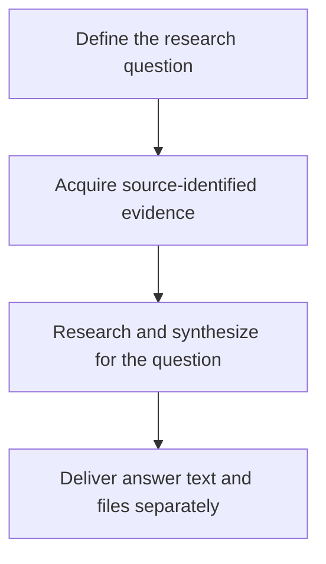
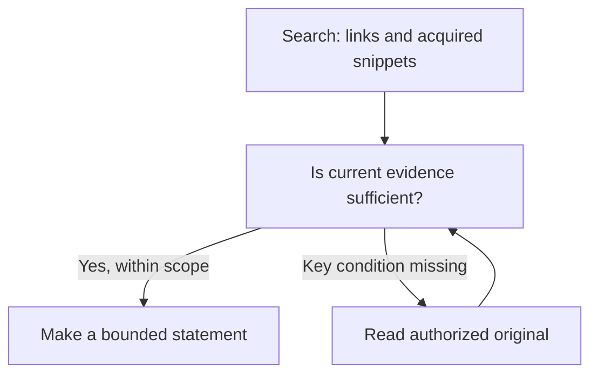

# A Trustworthy Evidence Chain for Financial Agents: Keeping the Grounds of a Conclusion Intact

> This article uses ETF Agent's overall engineering state as of October 20, 2026. Section 6 includes narrowly scoped, controlled research cases through November 6; those cases do not certify every financial method.

**A trustworthy evidence chain is not a report with more and more citation links. It is the ability to tell, even after reading, calculation, restatement and delivery, which instrument, time, definition and conditions the evidence originally described.**

When a user asks, “How has this fund I own been doing?”, an agent may start at a product website, read tables in a PDF, delegate calculations to a Python subagent and deliver an HTML report. At each transition the meaning can change: fees for the wrong share class, holdings from an older disclosure, or an omitted footnote can turn authentic source data into an unsupported interpretation.

We have separately discussed [why authentic citations do not necessarily make an answer reliable](ai-citations-do-not-prove-reliability.md). Here the system-level question is different: **after the same material passes through tools, model turns and perhaps weeks of research, how can we still establish exactly what a conclusion was based on?**

Readers interested primarily in architecture can focus on evidence consumption, financial calculations, recovery across time and the adoption conditions at the end. The intervening sections explain source identity, projection, provenance and handoffs. Throughout, **traceability is not a certificate of semantic correctness**.

## Before the Architecture: We Did Not Invent Data Lineage

Data provenance and lineage are established disciplines. The W3C's 2013 [PROV-O Recommendation](https://www.w3.org/TR/prov-o/) provides vocabulary for entities, activities, agents and derivation relationships. [OpenLineage](https://openlineage.io/docs/spec/naming/) and [Marquez](https://marquezproject.ai/docs/quickstart/) track lineage around data jobs and run events; [Google ML Metadata](https://github.com/google/ml-metadata/blob/master/docs/index.md) connects artifacts and executions in ML pipelines; [DataHub](https://docs.datahub.com/docs/features/feature-guides/lineage) supports even field-level dependency lineage. None of those ideas originated here.

Our narrower problem is how those concerns appear inside autonomous financial research. Material is no longer processed only by deterministic ETL jobs. A model may select excerpts, hand them to another agent, remove earlier content from its context, reread it after recovery, and finally use it in a published answer or downloadable file.

The chain must preserve **source relationships, actually observed content, original authorization, method assumptions and delivery outcomes**, each under its proper owner. Lineage provides valuable conceptual tools, but a derivation edge alone does not settle permissions, business applicability or distributed effects.

This article describes an adaptation of established engineering ideas to Agent Runtime. It does not claim that ETF Agent implements PROV-O, OpenLineage or a new universal lineage standard. The distinction to carry throughout is simple: knowing where a number originated does not prove that the number applies to this question, much less that an investment conclusion drawn from it is sound.

## 1. Why Financial Research Makes Provenance Harder

### Put every number back into its instrument and time

“How is this fund doing recently?” already contains two unresolved terms: *which fund* and *when*.

A product may have several share classes. Fund NAV is not the same as an exchange-traded price. Price indexes, total-return indexes, ETFs and feeder funds can treat dividends, pricing and costs differently. Every number can come from a reputable provider and yet the resulting comparison can still be invalid.

Time has multiple layers too. Retrieving a document today does not mean that its data are current. A report published today can disclose holdings as of an earlier quarter. A locally displayed date may not match the end of an overseas trading session. Cross-market products such as QDII funds introduce additional lags between market trading and NAV disclosure.

We therefore keep source-publication time, data-as-of time and the research cutoff distinct. “Just found by search” is not a freshness definition. Two fields named “return” still need matching periods, currencies and dividend conventions.

These distinctions determine the validity of later calculations. Combining holdings from different dates as though they were one snapshot can produce a synthetic overlap between two historical portfolios. Subtracting fees from a NAV that already reflects them changes the modeled quantity. Python may calculate flawlessly after the mistake has already been made.

### Source authority has a limited scope

Research combines different kinds of facts. An asset manager's documents establish what the product disclosed about investment objectives or applicable fees at a given time. Market feeds provide observations of particular fields. Authorized account data describe the user's holdings. Python yields derived results under specified inputs and methods.

Those facts can support a shared argument without being interchangeable. A public page quoting the same amount as an account does not prove ownership. A fee schedule can support an estimate but not prove an actual deduction. Calculated correlation alone does not establish that future risk has fallen.

The useful question is therefore **what claim is this source entitled to support?** “Official” is a valuable provenance attribute, not permission to apply every statement to every account, period or financial interpretation. Preserve the original value, source, applicable instrument and time together so that their relationship remains inspectable.

### Incomplete evidence is still useful, as long as it stays incomplete

Financial material frequently has partial coverage. Top-ten holdings are not the whole fund; identified companies are not every underlying asset; a product with a known NAV does not necessarily have all its risk factors observed.

Research can still progress. Disclosed holdings may reveal obvious repetition. Applicable fee terms can rule out an irrelevant comparison. Unknown tail holdings become a condition to revisit later. The danger is that partial material becomes a seemingly complete fact during summarization.

A source says “within the disclosed holdings.” A summary shortens that to “within the holdings,” and the final report upgrades it to “across the entire portfolio.” The prose becomes smoother while the scope of the claim expands at each handoff.

This is why financial research must carry data time, method assumptions, coverage and access restrictions into an agent's exploration. The user also wants more than source collection: what the new fund changes, whether a simpler alternative exists, when to defer a decision, and which future events should trigger reassessment. Those judgments require evidence **and** a statement of what still conditions them.

## 2. Follow One Fund Research Task Through the System

### Turn a user's question into research dependencies

Consider a teaching scenario with no real personal holdings. A user already owns several broad-market and technology-themed funds and is considering adding an ETF. They want to compare diversification, costs and main risks—and to retain a report that can be inspected later. Design-only steps are distinguished from implemented behavior where they matter.

First, Main must interpret *diversification*. Does the user want less concentration in one market, less exposure to a small group of companies, or simply a simpler set of holdings? Those aims do not imply the same recommendation.

Even without recommending an allocation amount, the research can identify three related questions: What exposure does the new product actually add? What costs and risks accompany that exposure? Which changed facts would invalidate the original reasoning?

The portfolio comes from an authorized personal-data entry. Product information is checked against public disclosures. Index methods and holdings reports are consulted as needed. Calculation waits for applicable inputs, while independent public-source checks can proceed without blocking one another.

This organization governs tool choice. If structured data already contains an official document link, read it rather than searching again. If the fee conditions are absent, find the applicable source. If the dates cannot be aligned, limit the comparison. Agent autonomy consists in making these bounded research decisions.

### Evidence travels a long way before the user sees a report

A representative route begins with a web search and ends in historical readback.

Search finds a product page; the page points to an official PDF; the PDF supplies holdings tables and fee footnotes. Selected table content is stored as a versioned result. Main passes the relevant input to a Python subagent, which returns derived quantities with their restrictions. Main synthesizes them. As the research grows, older text may leave the immediate context while the original results remain addressable. An answer then passes through Publication; a separately prepared HTML report may be saved for authenticated download. When the user comes back, they should receive the original version, not a silently rewritten one.

**Figure 1 — From “How is this fund doing?” to a report that can be read again.** Identify the instrument, share class and period; gather public and authorized personal facts; compute where useful; deliver text and, when requested, a file.

The overview has four phases, each with a distinct role:

1. **Define the question.** Main identifies the instrument, share class, relevant period and intended comparison.
2. **Acquire sources.** Read actual PDF text, tables and notes from public documents, and permitted portfolio facts from their own entry point. Preserve values, units, timestamps, limitations and original dependencies in versioned results.
3. **Research and synthesize.** Main may consume results directly or select inputs for bounded Python calculations. Derived results return with methods and missing conditions. Context fitting preserves source identities while the research continues.
4. **Deliver along two paths.** Answer text is prepared and committed as a versioned publication. When a report file is needed, content, tables, charts and references are rendered and the final bytes are saved as an Artifact for authenticated access. Historical answer readback and file readback refer to their respective original versions.

The following sections expand source reading (Figure 2), specialist handoff (Figure 3) and the two delivery paths (Figure 5). This outline does not require public research to be delegated, every context cleanup to produce an LLM summary, or every HTML report to use Python. A file's save, download and later readback are different observations.

Each arrow changes how information is used: a URL becomes acquired content; content becomes selected input; input becomes a result; local results become a judgment; and the judgment becomes a persisted, readable delivery.

### Connect the activities to one user question

Without a shared research question, a tool-oriented agent may produce three unrelated artifacts: a product description, a calculation table and a list of risks. Each might be correct, while the user still cannot tell whether the proposed ETF helps.

Does the sector exposure in the product description correspond to companies already overweight in the overlap table? Could fees alter the choice? Does a currency risk listed for the new product add risk relative to the existing portfolio, or merely repeat it?

Main must place partial results into the same comparison. Calculations describe differences within known coverage, documents establish where conditions apply, and risk analysis identifies gaps. This is why an evidence chain is more than citation markers appended at the end: it lets the next operation consume what the preceding one actually established.

A changed user request must also be recognized. Moving from “understand overlap” to “allocate additional cash” introduces different constraints and methods. Research without trading authority cannot turn report delivery into a live transaction.

## 3. How Acquired Material Becomes Reusable Research Evidence

### Search results are leads—and sometimes limited evidence

A search response can contain two different things. A link is a lead for further investigation; a snippet is text actually acquired and may support a suitably limited claim. A clear, permitted snippet may answer a simple question. Verifying the effective date of a fee, a share-class condition or the definition of holdings usually requires reading the source document.

When a product page is cleaned for reading, attachment links may sit outside the main text, in navigation or sidebars. The reader therefore retains both body content and candidate links. Retaining an attachment link does **not** mean its attachment has been read. [Web Research: From Search to Deep Reading](021-agent-web-research-from-search-to-deep-reading.md) describes that mechanism; here its importance is the difference between discovery and acquired evidence.

### What was read limits what can be claimed

Finding a PDF is not the same as locating and reading the relevant evidence inside it. A fee can appear in a paragraph while its applicability appears in a footnote. Holdings numbers may be in a table, but column headings and notes define what those numbers mean. Extracting the numeric cells alone often discards part of the required evidence.

In an earlier reading investigation, a first window did not include the crucial later page; a subsequent read obtained the body and footnote. That taught us to distinguish search hits, scan coverage and content actually delivered. If no match is found, say where the system looked; do not let “not found in the inspected range” become “not present anywhere in this PDF.”

Tables have similar limits. Layout coordinates in a PDF do not automatically encode table semantics. The [pypdf text extraction documentation](https://pypdf.readthedocs.io/en/stable/user/extract-text.html) explains difficulties caused by PDF layout and the absence of an explicit semantic structure. Accordingly, our reading approach can combine text, structured table extraction and page images as appropriate, recording which representations and ranges were actually delivered.

Images provide another view, not an automatic truth oracle. Scanned text may be recognized; chart colors, shapes or qualifications may still be misinterpreted. More visual access expands what the agent can examine and increases the number of interpretations that need independent checking.

**Figure 2 — Decide whether to read further or make a bounded statement.** Snippets and original content retain their respective identities; the model assesses whether the evidence is sufficient for the actual question.

The decision has three practical branches:

- A link remains a navigation lead. An actually acquired snippet can be stated within its observed scope; if it omits a key condition, follow the approved original-reading path.
- The reader may acquire paragraphs and footnotes, tables and units, or images. It need not perform every modality on every document. Each acquired portion keeps its content, date, page location, units and restrictions.
- Main then checks what the material establishes. If the required conditions are met, make a bounded claim. If more reading is possible, use the source location or cursor to continue. If the gap cannot currently be closed, say what is missing and narrow the conclusion.

These are complementary evidence representations, not a mandatory three-stage pipeline. More data do not eliminate the separate need to decide whether that data supports the claim.

The details are developed in [PDF: From Text to Evidence](024-agent-pdf-from-text-to-evidence.md). Along the complete chain, every downstream statement must remain tied to material that was actually acquired.

### Evidence identity must follow the content, not just the URL

A document address can stay unchanged while its content changes. When text is split, projected into a shorter view or used as a citation, we must preserve the original version, the selected range and the present representation as different facts.

In [W3C PROV-O](https://www.w3.org/TR/prov-o/) terms, a fund annual report could be an Entity; reading and extraction could be Activities; the extracted holdings snapshot a new Entity; and a Python calculation another derived Entity. Relationships such as `prov:used`, `prov:wasGeneratedBy` and `prov:wasDerivedFrom` help explain how these elements depend on one another. This is a conceptual comparison, **not** a claim that our implementation stores RDF/OWL or exposes a PROV-O-compatible interface.

Even a perfectly recorded edge saying “this overlap table was generated from these two holdings tables” cannot prove that their reporting dates match. It does not show that the top ten constitute the complete portfolio, nor grant a later Run access to the original account. Financial methods, coverage checks and actual authorization must answer those questions independently.

For example, a page citation must refer to the page relationship of the content actually returned to the model. A parser knowing the original page number does not mean that the coordinates survived slicing or redaction unchanged. If the URL later serves different bytes, old research cannot silently refer to the new edition.

Result references, answer citations and file identities also have different purposes. A result reference allows precise rereading or selection as calculation input. An answer citation lets the user inspect source support. A file identity identifies persisted delivery bytes. They can be related, but possession of one does not confer the other capabilities.

Authorization comes from the execution environment. A Run and its safe recovery may retain its original grants and source dependencies. A *new* research Run requires separate admission. Missing, deleted, unauthorized or identity-mismatched content must remain unavailable; an old citation cannot manufacture missing original bytes or new permission.

At this point, source content has entered the research process together with instrument identity, timestamps, versions, read coverage and limits on use. It still needs interpretation, but the next consumer can at least answer: *What exactly did I receive, and where did it come from?*

## 4. Store Original Results Outside the Model's Current Context

### A holdings table need not be pasted into every model turn

Deep research can accumulate multiple reports, holdings tables and calculation outputs. Copying everything into every prompt consumes context with repeated data and debugging details. We separate **the durable identity of a result** from **the projection currently shown to the model**. The original result remains in controlled storage; a consumer can read selected columns, text passages or authorized calculation input appropriate to the question.

An overlap comparison may need only instrument IDs, disclosure dates, coverage and weights. It does not need to send a fee document repeatedly or make the model manually transcribe a long price series. Still, the system must be able to establish which portion the model actually received and whether that portion was complete for its intended use. A reference is not a new grant to read the underlying material.

[Externalized Tool Results and Input Completeness](tool-results-outside-model-context.md) explains this design in detail. The concern here is whether subagents, computations and citations can use the same source identities even as representations change.

### Rereading must recover the same original

Once content is externalized, a model can say “read that result again.” The runtime must verify that the reference still denotes the same bytes and selection conditions.

If a fee file is later updated, the new file can become new evidence; it cannot silently replace the edition used in an earlier study. If refresh fails, retain the failure and the old version identity. Do not merely assign the old data a new retrieval timestamp and call it fresh.

This resembles a cache but extends beyond ordinary caching. The derived overlap table must still identify its two inputs, selected records and missing mappings, because those relationships determine when the calculation can be reused.

An explicitly requested read in the present turn also has to reach the actual model input. A tool cannot be marked successful while a subsequent capacity transformation leaves the model only an opaque pointer and implies it received the full text. Older results may leave the working context; the delivery status of a new read must remain accurate.

### Changing representation cannot create a new source

We encountered a representative handoff issue: the producer and the validator applied different capacity rules, so the same legitimate source result was later rejected. Neither the data nor the authorization had changed. The consumer's reconstruction of the representation was inconsistent.

This favors shared interpretation of result identity, format and capacity rather than each consumer independently reinventing what a result should look like. Large outputs, selected views and reference placeholders otherwise develop subtle differences.

Mechanical context fitting can replace older resident text with its original identity and an exact reread location. It does **not** manufacture a new semantic summary; it only changes whether source material remains directly resident in the current prompt. LLM summarization carries a different responsibility, discussed below.

For Main, the result store is a versioned archive. The working desk need not hold every document, but the catalog must lead back to the precise original. That analogy describes access, not authority: the original research scope and content identity still govern every read.

Material can leave the current context and enter the local context of another agent. The most consequential handoff now moves from Main to Child.
