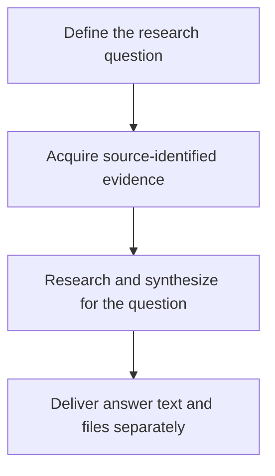

# A Trustworthy Evidence Chain for Financial Agents: Keeping the Grounds of a Conclusion Intact

> This article uses ETF Agent's overall engineering state as of October 20, 2026. Section 6 includes narrowly scoped, controlled research cases through November 6; those cases do not certify every financial method.

**A trustworthy evidence chain is not a report with more and more citation links. It is the ability to tell, even after reading, calculation, restatement and delivery, which instrument, time, definition and conditions the evidence originally described.**

When a user asks, “How has this fund I own been doing?”, an agent may start at a product website, read tables in a PDF, delegate calculations to a Python subagent and deliver an HTML report. At each transition the meaning can change: fees for the wrong share class, holdings from an older disclosure, or an omitted footnote can turn authentic source data into an unsupported interpretation.

We have separately discussed [why authentic citations do not necessarily make an answer reliable](ai-citations-do-not-prove-reliability.md). Here the system-level question is different: **after the same material passes through tools, model turns and perhaps weeks of research, how can we still establish exactly what a conclusion was based on?**

Readers interested primarily in architecture can focus on evidence consumption, financial calculations, recovery across time and the adoption conditions at the end. The intervening sections explain source identity, projection, provenance and handoffs. Throughout, **traceability is not a certificate of semantic correctness**.

## Before the Architecture: We Did Not Invent Data Lineage

Data provenance and lineage are established disciplines. The W3C's 2013 [PROV-O Recommendation](https://www.w3.org/TR/prov-o/) provides vocabulary for entities, activities, agents and derivation relationships. [OpenLineage](https://openlineage.io/docs/spec/naming/) and [Marquez](https://marquezproject.ai/docs/quickstart/) track lineage around data jobs and run events; [Google ML Metadata](https://github.com/google/ml-metadata/blob/master/docs/index.md) connects artifacts and executions in ML pipelines; [DataHub](https://docs.datahub.com/docs/features/feature-guides/lineage) supports even field-level dependency lineage. None of those ideas originated here.

Our narrower problem is how those concerns appear inside autonomous financial research. Material is no longer processed only by deterministic ETL jobs. A model may select excerpts, hand them to another agent, remove earlier content from its context, reread it after recovery, and finally use it in a published answer or downloadable file.

The chain must preserve **source relationships, actually observed content, original authorization, method assumptions and delivery outcomes**, each under its proper owner. Lineage provides valuable conceptual tools, but a derivation edge alone does not settle permissions, business applicability or distributed effects.

This article describes an adaptation of established engineering ideas to Agent Runtime. It does not claim that ETF Agent implements PROV-O, OpenLineage or a new universal lineage standard. The distinction to carry throughout is simple: knowing where a number originated does not prove that the number applies to this question, much less that an investment conclusion drawn from it is sound.

## 1. Why Financial Research Makes Provenance Harder

### Put every number back into its instrument and time

“How is this fund doing recently?” already contains two unresolved terms: *which fund* and *when*.

A product may have several share classes. Fund NAV is not the same as an exchange-traded price. Price indexes, total-return indexes, ETFs and feeder funds can treat dividends, pricing and costs differently. Every number can come from a reputable provider and yet the resulting comparison can still be invalid.

Time has multiple layers too. Retrieving a document today does not mean that its data are current. A report published today can disclose holdings as of an earlier quarter. A locally displayed date may not match the end of an overseas trading session. Cross-market products such as QDII funds introduce additional lags between market trading and NAV disclosure.

We therefore keep source-publication time, data-as-of time and the research cutoff distinct. “Just found by search” is not a freshness definition. Two fields named “return” still need matching periods, currencies and dividend conventions.

These distinctions determine the validity of later calculations. Combining holdings from different dates as though they were one snapshot can produce a synthetic overlap between two historical portfolios. Subtracting fees from a NAV that already reflects them changes the modeled quantity. Python may calculate flawlessly after the mistake has already been made.

### Source authority has a limited scope

Research combines different kinds of facts. An asset manager's documents establish what the product disclosed about investment objectives or applicable fees at a given time. Market feeds provide observations of particular fields. Authorized account data describe the user's holdings. Python yields derived results under specified inputs and methods.

Those facts can support a shared argument without being interchangeable. A public page quoting the same amount as an account does not prove ownership. A fee schedule can support an estimate but not prove an actual deduction. Calculated correlation alone does not establish that future risk has fallen.

The useful question is therefore **what claim is this source entitled to support?** “Official” is a valuable provenance attribute, not permission to apply every statement to every account, period or financial interpretation. Preserve the original value, source, applicable instrument and time together so that their relationship remains inspectable.

### Incomplete evidence is still useful, as long as it stays incomplete

Financial material frequently has partial coverage. Top-ten holdings are not the whole fund; identified companies are not every underlying asset; a product with a known NAV does not necessarily have all its risk factors observed.

Research can still progress. Disclosed holdings may reveal obvious repetition. Applicable fee terms can rule out an irrelevant comparison. Unknown tail holdings become a condition to revisit later. The danger is that partial material becomes a seemingly complete fact during summarization.

A source says “within the disclosed holdings.” A summary shortens that to “within the holdings,” and the final report upgrades it to “across the entire portfolio.” The prose becomes smoother while the scope of the claim expands at each handoff.

This is why financial research must carry data time, method assumptions, coverage and access restrictions into an agent's exploration. The user also wants more than source collection: what the new fund changes, whether a simpler alternative exists, when to defer a decision, and which future events should trigger reassessment. Those judgments require evidence **and** a statement of what still conditions them.

## 2. Follow One Fund Research Task Through the System

### Turn a user's question into research dependencies

Consider a teaching scenario with no real personal holdings. A user already owns several broad-market and technology-themed funds and is considering adding an ETF. They want to compare diversification, costs and main risks—and to retain a report that can be inspected later. Design-only steps are distinguished from implemented behavior where they matter.

First, Main must interpret *diversification*. Does the user want less concentration in one market, less exposure to a small group of companies, or simply a simpler set of holdings? Those aims do not imply the same recommendation.

Even without recommending an allocation amount, the research can identify three related questions: What exposure does the new product actually add? What costs and risks accompany that exposure? Which changed facts would invalidate the original reasoning?

The portfolio comes from an authorized personal-data entry. Product information is checked against public disclosures. Index methods and holdings reports are consulted as needed. Calculation waits for applicable inputs, while independent public-source checks can proceed without blocking one another.

This organization governs tool choice. If structured data already contains an official document link, read it rather than searching again. If the fee conditions are absent, find the applicable source. If the dates cannot be aligned, limit the comparison. Agent autonomy consists in making these bounded research decisions.

### Evidence travels a long way before the user sees a report

A representative route begins with a web search and ends in historical readback.

Search finds a product page; the page points to an official PDF; the PDF supplies holdings tables and fee footnotes. Selected table content is stored as a versioned result. Main passes the relevant input to a Python subagent, which returns derived quantities with their restrictions. Main synthesizes them. As the research grows, older text may leave the immediate context while the original results remain addressable. An answer then passes through Publication; a separately prepared HTML report may be saved for authenticated download. When the user comes back, they should receive the original version, not a silently rewritten one.

**Figure 1 — From “How is this fund doing?” to a report that can be read again.** Identify the instrument, share class and period; gather public and authorized personal facts; compute where useful; deliver text and, when requested, a file.

The overview has four phases, each with a distinct role:

1. **Define the question.** Main identifies the instrument, share class, relevant period and intended comparison.
2. **Acquire sources.** Read actual PDF text, tables and notes from public documents, and permitted portfolio facts from their own entry point. Preserve values, units, timestamps, limitations and original dependencies in versioned results.
3. **Research and synthesize.** Main may consume results directly or select inputs for bounded Python calculations. Derived results return with methods and missing conditions. Context fitting preserves source identities while the research continues.
4. **Deliver along two paths.** Answer text is prepared and committed as a versioned publication. When a report file is needed, content, tables, charts and references are rendered and the final bytes are saved as an Artifact for authenticated access. Historical answer readback and file readback refer to their respective original versions.

The following sections expand source reading (Figure 2), specialist handoff (Figure 3) and the two delivery paths (Figure 5). This outline does not require public research to be delegated, every context cleanup to produce an LLM summary, or every HTML report to use Python. A file's save, download and later readback are different observations.

Each arrow changes how information is used: a URL becomes acquired content; content becomes selected input; input becomes a result; local results become a judgment; and the judgment becomes a persisted, readable delivery.

### Connect the activities to one user question

Without a shared research question, a tool-oriented agent may produce three unrelated artifacts: a product description, a calculation table and a list of risks. Each might be correct, while the user still cannot tell whether the proposed ETF helps.

Does the sector exposure in the product description correspond to companies already overweight in the overlap table? Could fees alter the choice? Does a currency risk listed for the new product add risk relative to the existing portfolio, or merely repeat it?

Main must place partial results into the same comparison. Calculations describe differences within known coverage, documents establish where conditions apply, and risk analysis identifies gaps. This is why an evidence chain is more than citation markers appended at the end: it lets the next operation consume what the preceding one actually established.

A changed user request must also be recognized. Moving from “understand overlap” to “allocate additional cash” introduces different constraints and methods. Research without trading authority cannot turn report delivery into a live transaction.
