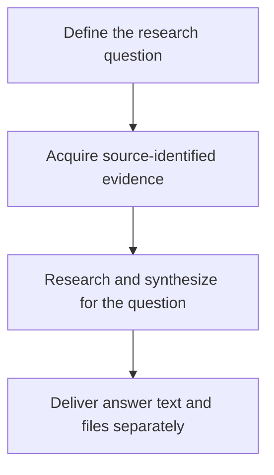
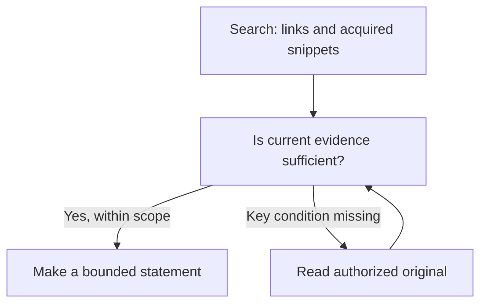
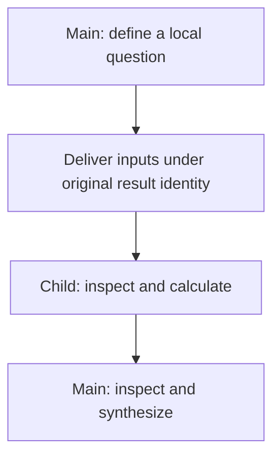
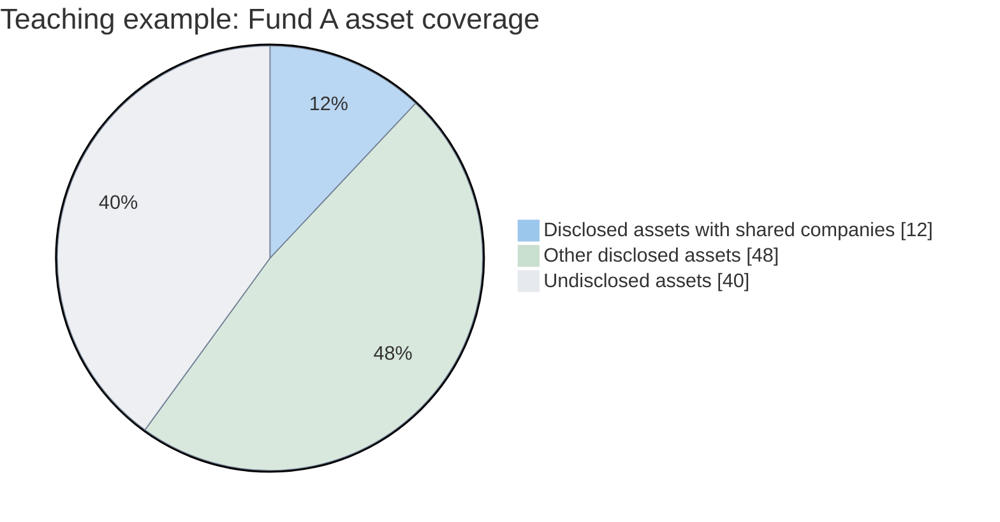
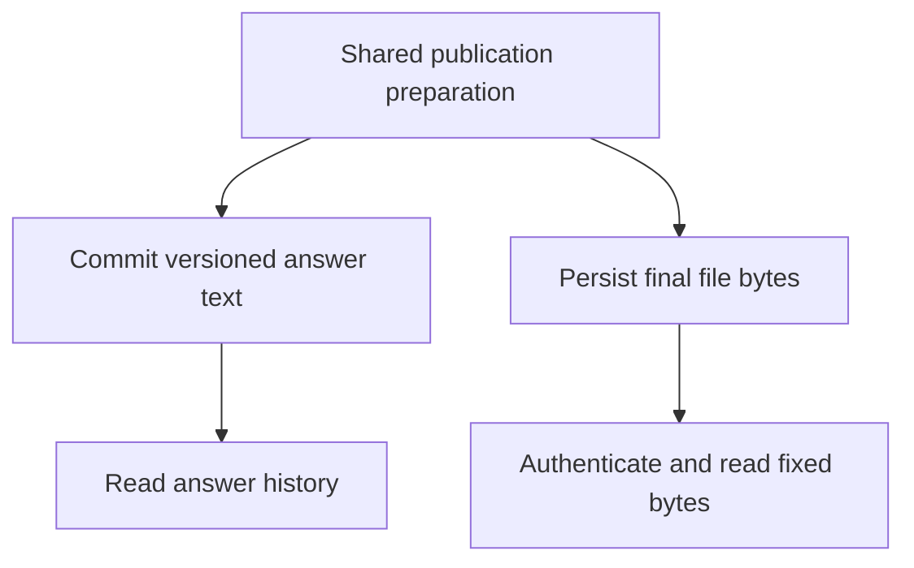
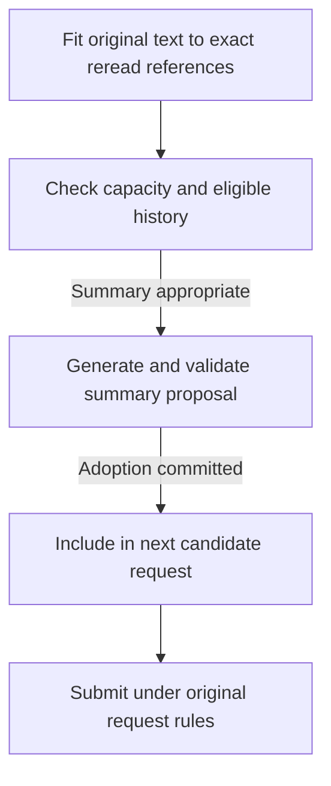
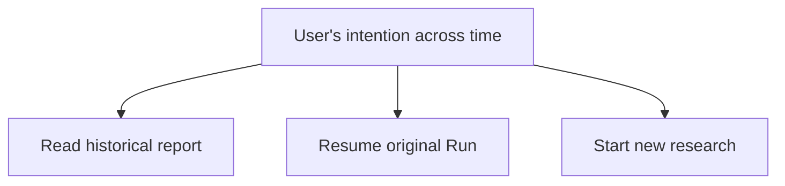

# A Trustworthy Evidence Chain for Financial Agents: Keeping the Grounds of a Conclusion Intact

> This article uses ETF Agent's overall engineering state as of October 20, 2026. Section 6 includes narrowly scoped, controlled research cases through November 6; those cases do not certify every financial method.

**A trustworthy evidence chain is not a report with more and more citation links. It is the ability to tell, even after reading, calculation, restatement and delivery, which instrument, time, definition and conditions the evidence originally described.**

When a user asks, “How has this fund I own been doing?”, an agent may start at a product website, read tables in a PDF, delegate calculations to a Python subagent and deliver an HTML report. At each transition the meaning can change: fees for the wrong share class, holdings from an older disclosure, or an omitted footnote can turn authentic source data into an unsupported interpretation.

We have separately discussed [why authentic citations do not necessarily make an answer reliable](ai-citations-do-not-prove-reliability.md). Here the system-level question is different: **after the same material passes through tools, model turns and perhaps weeks of research, how can we still establish exactly what a conclusion was based on?**

Readers interested primarily in architecture can focus on evidence consumption, financial calculations, recovery across time and the adoption conditions at the end. The intervening sections explain source identity, projection, provenance and handoffs. Throughout, **traceability is not a certificate of semantic correctness**.

## Before the Architecture: We Did Not Invent Data Lineage

Data provenance and lineage are established disciplines. The W3C's 2013 [PROV-O Recommendation](https://www.w3.org/TR/prov-o/) provides vocabulary for entities, activities, agents and derivation relationships. [OpenLineage](https://openlineage.io/docs/spec/naming/) and [Marquez](https://marquezproject.ai/docs/quickstart/) track lineage around data jobs and run events; [Google ML Metadata](https://github.com/google/ml-metadata/blob/master/docs/index.md) connects artifacts and executions in ML pipelines; [DataHub](https://docs.datahub.com/docs/features/feature-guides/lineage) supports even field-level dependency lineage. None of those ideas originated here.

Our narrower problem is how those concerns appear inside autonomous financial research. Material is no longer processed only by deterministic ETL jobs. A model may select excerpts, hand them to another agent, remove earlier content from its context, reread it after recovery, and finally use it in a published answer or downloadable file.

The chain must preserve **source relationships, actually observed content, original authorization, method assumptions and delivery outcomes**, each under its proper owner. Lineage provides valuable conceptual tools, but a derivation edge alone does not settle permissions, business applicability or distributed effects.

This article describes an adaptation of established engineering ideas to Agent Runtime. It does not claim that ETF Agent implements PROV-O, OpenLineage or a new universal lineage standard. The distinction to carry throughout is simple: knowing where a number originated does not prove that the number applies to this question, much less that an investment conclusion drawn from it is sound.

## 1. Why Financial Research Makes Provenance Harder

### Put every number back into its instrument and time

“How is this fund doing recently?” already contains two unresolved terms: *which fund* and *when*.

A product may have several share classes. Fund NAV is not the same as an exchange-traded price. Price indexes, total-return indexes, ETFs and feeder funds can treat dividends, pricing and costs differently. Every number can come from a reputable provider and yet the resulting comparison can still be invalid.

Time has multiple layers too. Retrieving a document today does not mean that its data are current. A report published today can disclose holdings as of an earlier quarter. A locally displayed date may not match the end of an overseas trading session. Cross-market products such as QDII funds introduce additional lags between market trading and NAV disclosure.

We therefore keep source-publication time, data-as-of time and the research cutoff distinct. “Just found by search” is not a freshness definition. Two fields named “return” still need matching periods, currencies and dividend conventions.

These distinctions determine the validity of later calculations. Combining holdings from different dates as though they were one snapshot can produce a synthetic overlap between two historical portfolios. Subtracting fees from a NAV that already reflects them changes the modeled quantity. Python may calculate flawlessly after the mistake has already been made.

### Source authority has a limited scope

Research combines different kinds of facts. An asset manager's documents establish what the product disclosed about investment objectives or applicable fees at a given time. Market feeds provide observations of particular fields. Authorized account data describe the user's holdings. Python yields derived results under specified inputs and methods.

Those facts can support a shared argument without being interchangeable. A public page quoting the same amount as an account does not prove ownership. A fee schedule can support an estimate but not prove an actual deduction. Calculated correlation alone does not establish that future risk has fallen.

The useful question is therefore **what claim is this source entitled to support?** “Official” is a valuable provenance attribute, not permission to apply every statement to every account, period or financial interpretation. Preserve the original value, source, applicable instrument and time together so that their relationship remains inspectable.

### Incomplete evidence is still useful, as long as it stays incomplete

Financial material frequently has partial coverage. Top-ten holdings are not the whole fund; identified companies are not every underlying asset; a product with a known NAV does not necessarily have all its risk factors observed.

Research can still progress. Disclosed holdings may reveal obvious repetition. Applicable fee terms can rule out an irrelevant comparison. Unknown tail holdings become a condition to revisit later. The danger is that partial material becomes a seemingly complete fact during summarization.

A source says “within the disclosed holdings.” A summary shortens that to “within the holdings,” and the final report upgrades it to “across the entire portfolio.” The prose becomes smoother while the scope of the claim expands at each handoff.

This is why financial research must carry data time, method assumptions, coverage and access restrictions into an agent's exploration. The user also wants more than source collection: what the new fund changes, whether a simpler alternative exists, when to defer a decision, and which future events should trigger reassessment. Those judgments require evidence **and** a statement of what still conditions them.

## 2. Follow One Fund Research Task Through the System

### Turn a user's question into research dependencies

Consider a teaching scenario with no real personal holdings. A user already owns several broad-market and technology-themed funds and is considering adding an ETF. They want to compare diversification, costs and main risks—and to retain a report that can be inspected later. Design-only steps are distinguished from implemented behavior where they matter.

First, Main must interpret *diversification*. Does the user want less concentration in one market, less exposure to a small group of companies, or simply a simpler set of holdings? Those aims do not imply the same recommendation.

Even without recommending an allocation amount, the research can identify three related questions: What exposure does the new product actually add? What costs and risks accompany that exposure? Which changed facts would invalidate the original reasoning?

The portfolio comes from an authorized personal-data entry. Product information is checked against public disclosures. Index methods and holdings reports are consulted as needed. Calculation waits for applicable inputs, while independent public-source checks can proceed without blocking one another.

This organization governs tool choice. If structured data already contains an official document link, read it rather than searching again. If the fee conditions are absent, find the applicable source. If the dates cannot be aligned, limit the comparison. Agent autonomy consists in making these bounded research decisions.

### Evidence travels a long way before the user sees a report

A representative route begins with a web search and ends in historical readback.

Search finds a product page; the page points to an official PDF; the PDF supplies holdings tables and fee footnotes. Selected table content is stored as a versioned result. Main passes the relevant input to a Python subagent, which returns derived quantities with their restrictions. Main synthesizes them. As the research grows, older text may leave the immediate context while the original results remain addressable. An answer then passes through Publication; a separately prepared HTML report may be saved for authenticated download. When the user comes back, they should receive the original version, not a silently rewritten one.

**Figure 1 — From “How is this fund doing?” to a report that can be read again.** Identify the instrument, share class and period; gather public and authorized personal facts; compute where useful; deliver text and, when requested, a file.

The overview has four phases, each with a distinct role:

1. **Define the question.** Main identifies the instrument, share class, relevant period and intended comparison.
2. **Acquire sources.** Read actual PDF text, tables and notes from public documents, and permitted portfolio facts from their own entry point. Preserve values, units, timestamps, limitations and original dependencies in versioned results.
3. **Research and synthesize.** Main may consume results directly or select inputs for bounded Python calculations. Derived results return with methods and missing conditions. Context fitting preserves source identities while the research continues.
4. **Deliver along two paths.** Answer text is prepared and committed as a versioned publication. When a report file is needed, content, tables, charts and references are rendered and the final bytes are saved as an Artifact for authenticated access. Historical answer readback and file readback refer to their respective original versions.

The following sections expand source reading (Figure 2), specialist handoff (Figure 3) and the two delivery paths (Figure 5). This outline does not require public research to be delegated, every context cleanup to produce an LLM summary, or every HTML report to use Python. A file's save, download and later readback are different observations.

Each arrow changes how information is used: a URL becomes acquired content; content becomes selected input; input becomes a result; local results become a judgment; and the judgment becomes a persisted, readable delivery.

### Connect the activities to one user question

Without a shared research question, a tool-oriented agent may produce three unrelated artifacts: a product description, a calculation table and a list of risks. Each might be correct, while the user still cannot tell whether the proposed ETF helps.

Does the sector exposure in the product description correspond to companies already overweight in the overlap table? Could fees alter the choice? Does a currency risk listed for the new product add risk relative to the existing portfolio, or merely repeat it?

Main must place partial results into the same comparison. Calculations describe differences within known coverage, documents establish where conditions apply, and risk analysis identifies gaps. This is why an evidence chain is more than citation markers appended at the end: it lets the next operation consume what the preceding one actually established.

A changed user request must also be recognized. Moving from “understand overlap” to “allocate additional cash” introduces different constraints and methods. Research without trading authority cannot turn report delivery into a live transaction.

## 3. How Acquired Material Becomes Reusable Research Evidence

### Search results are leads—and sometimes limited evidence

A search response can contain two different things. A link is a lead for further investigation; a snippet is text actually acquired and may support a suitably limited claim. A clear, permitted snippet may answer a simple question. Verifying the effective date of a fee, a share-class condition or the definition of holdings usually requires reading the source document.

When a product page is cleaned for reading, attachment links may sit outside the main text, in navigation or sidebars. The reader therefore retains both body content and candidate links. Retaining an attachment link does **not** mean its attachment has been read. [Web Research: From Search to Deep Reading](021-agent-web-research-from-search-to-deep-reading.md) describes that mechanism; here its importance is the difference between discovery and acquired evidence.

### What was read limits what can be claimed

Finding a PDF is not the same as locating and reading the relevant evidence inside it. A fee can appear in a paragraph while its applicability appears in a footnote. Holdings numbers may be in a table, but column headings and notes define what those numbers mean. Extracting the numeric cells alone often discards part of the required evidence.

In an earlier reading investigation, a first window did not include the crucial later page; a subsequent read obtained the body and footnote. That taught us to distinguish search hits, scan coverage and content actually delivered. If no match is found, say where the system looked; do not let “not found in the inspected range” become “not present anywhere in this PDF.”

Tables have similar limits. Layout coordinates in a PDF do not automatically encode table semantics. The [pypdf text extraction documentation](https://pypdf.readthedocs.io/en/stable/user/extract-text.html) explains difficulties caused by PDF layout and the absence of an explicit semantic structure. Accordingly, our reading approach can combine text, structured table extraction and page images as appropriate, recording which representations and ranges were actually delivered.

Images provide another view, not an automatic truth oracle. Scanned text may be recognized; chart colors, shapes or qualifications may still be misinterpreted. More visual access expands what the agent can examine and increases the number of interpretations that need independent checking.

**Figure 2 — Decide whether to read further or make a bounded statement.** Snippets and original content retain their respective identities; the model assesses whether the evidence is sufficient for the actual question.

The decision has three practical branches:

- A link remains a navigation lead. An actually acquired snippet can be stated within its observed scope; if it omits a key condition, follow the approved original-reading path.
- The reader may acquire paragraphs and footnotes, tables and units, or images. It need not perform every modality on every document. Each acquired portion keeps its content, date, page location, units and restrictions.
- Main then checks what the material establishes. If the required conditions are met, make a bounded claim. If more reading is possible, use the source location or cursor to continue. If the gap cannot currently be closed, say what is missing and narrow the conclusion.

These are complementary evidence representations, not a mandatory three-stage pipeline. More data do not eliminate the separate need to decide whether that data supports the claim.

The details are developed in [PDF: From Text to Evidence](024-agent-pdf-from-text-to-evidence.md). Along the complete chain, every downstream statement must remain tied to material that was actually acquired.

### Evidence identity must follow the content, not just the URL

A document address can stay unchanged while its content changes. When text is split, projected into a shorter view or used as a citation, we must preserve the original version, the selected range and the present representation as different facts.

In [W3C PROV-O](https://www.w3.org/TR/prov-o/) terms, a fund annual report could be an Entity; reading and extraction could be Activities; the extracted holdings snapshot a new Entity; and a Python calculation another derived Entity. Relationships such as `prov:used`, `prov:wasGeneratedBy` and `prov:wasDerivedFrom` help explain how these elements depend on one another. This is a conceptual comparison, **not** a claim that our implementation stores RDF/OWL or exposes a PROV-O-compatible interface.

Even a perfectly recorded edge saying “this overlap table was generated from these two holdings tables” cannot prove that their reporting dates match. It does not show that the top ten constitute the complete portfolio, nor grant a later Run access to the original account. Financial methods, coverage checks and actual authorization must answer those questions independently.

For example, a page citation must refer to the page relationship of the content actually returned to the model. A parser knowing the original page number does not mean that the coordinates survived slicing or redaction unchanged. If the URL later serves different bytes, old research cannot silently refer to the new edition.

Result references, answer citations and file identities also have different purposes. A result reference allows precise rereading or selection as calculation input. An answer citation lets the user inspect source support. A file identity identifies persisted delivery bytes. They can be related, but possession of one does not confer the other capabilities.

Authorization comes from the execution environment. A Run and its safe recovery may retain its original grants and source dependencies. A *new* research Run requires separate admission. Missing, deleted, unauthorized or identity-mismatched content must remain unavailable; an old citation cannot manufacture missing original bytes or new permission.

At this point, source content has entered the research process together with instrument identity, timestamps, versions, read coverage and limits on use. It still needs interpretation, but the next consumer can at least answer: *What exactly did I receive, and where did it come from?*

## 4. Store Original Results Outside the Model's Current Context

### A holdings table need not be pasted into every model turn

Deep research can accumulate multiple reports, holdings tables and calculation outputs. Copying everything into every prompt consumes context with repeated data and debugging details. We separate **the durable identity of a result** from **the projection currently shown to the model**. The original result remains in controlled storage; a consumer can read selected columns, text passages or authorized calculation input appropriate to the question.

An overlap comparison may need only instrument IDs, disclosure dates, coverage and weights. It does not need to send a fee document repeatedly or make the model manually transcribe a long price series. Still, the system must be able to establish which portion the model actually received and whether that portion was complete for its intended use. A reference is not a new grant to read the underlying material.

[Externalized Tool Results and Input Completeness](tool-results-outside-model-context.md) explains this design in detail. The concern here is whether subagents, computations and citations can use the same source identities even as representations change.

### Rereading must recover the same original

Once content is externalized, a model can say “read that result again.” The runtime must verify that the reference still denotes the same bytes and selection conditions.

If a fee file is later updated, the new file can become new evidence; it cannot silently replace the edition used in an earlier study. If refresh fails, retain the failure and the old version identity. Do not merely assign the old data a new retrieval timestamp and call it fresh.

This resembles a cache but extends beyond ordinary caching. The derived overlap table must still identify its two inputs, selected records and missing mappings, because those relationships determine when the calculation can be reused.

An explicitly requested read in the present turn also has to reach the actual model input. A tool cannot be marked successful while a subsequent capacity transformation leaves the model only an opaque pointer and implies it received the full text. Older results may leave the working context; the delivery status of a new read must remain accurate.

### Changing representation cannot create a new source

We encountered a representative handoff issue: the producer and the validator applied different capacity rules, so the same legitimate source result was later rejected. Neither the data nor the authorization had changed. The consumer's reconstruction of the representation was inconsistent.

This favors shared interpretation of result identity, format and capacity rather than each consumer independently reinventing what a result should look like. Large outputs, selected views and reference placeholders otherwise develop subtle differences.

Mechanical context fitting can replace older resident text with its original identity and an exact reread location. It does **not** manufacture a new semantic summary; it only changes whether source material remains directly resident in the current prompt. LLM summarization carries a different responsibility, discussed below.

For Main, the result store is a versioned archive. The working desk need not hold every document, but the catalog must lead back to the precise original. That analogy describes access, not authority: the original research scope and content identity still govern every read.

Material can leave the current context and enter the local context of another agent. The most consequential handoff now moves from Main to Child.

## 5. What Exactly Passes Between Agents?

### When is delegation worthwhile?

In a fund comparison, Main retains the user's objective, share-class identity and time definitions. Child receives a narrower task only when that local work justifies a separate context. “Check ongoing and one-time fees for this product, preserving share class, channel, effective date and original conditions” is more useful than “research this fund.”

The distinction between Web, PDF and Python specialists is primarily about **research emphasis**, not an obligatory pipeline partitioned by file format. An authorized Web Child may follow an approved PDF link and inspect tables or notes under its existing grant. For one straightforward read, Main may be the better choice. An additional Child incurs execution time, context cost and handoff risk; specialist count alone is not a measure of research quality.

### Hand off the material that was acquired, not just a claim of completion

Main knowing that a holdings table exists does not prove that Child received the table. PDF text, tables and footnotes can originate in different read ranges. A common filename cannot turn these limited observations into “the whole document was read.”

Original result identity, selected content, source access rights, units, disclosure date and coverage restrictions must travel with the delegated work through an actually readable result entry.

**Figure 3 — Select original results, delegate a bounded calculation and let Main inspect the returned work.** This is a handoff map, not a guarantee that calculation succeeded.

Three checks make this meaningful:

1. **Original inputs.** Main selects admitted results; Child reads those exact materials under the research identity. It must not invent missing fields from a summary or guess the filesystem path of another Child's output.
2. **Local execution.** A Python Child first checks sample scope, instrument mapping and method preconditions, then calculates. On failure it returns the failure and missing conditions. A sandbox constrains execution but does not dissolve permissions on private source data. See [Python: From Tool to Computational Workbench](agent-python-compute-workbench-evolution.md).
3. **Actual consumption.** Child returns the derived result, original evidence, definitions and limits. Main must really read and use those results to answer the initial question. If a fee condition and a holdings disclosure establish different risks, the final answer should explain their relative implications—not append two specialist reports without synthesis. Conflicting sources require revisiting the original instrument, date and coverage.

That is why delegation is useful here: **isolate the local process without severing provenance or transferring Main's responsibility for the complete answer**. Broader mechanisms for specialist execution, recovery and profiles are discussed in [Subagent Panorama: Independent Context, Specialist Work and Real Handoffs](agent-subagent-context-specialization.md).

## 6. Correct Arithmetic Still Requires a Valid Financial Method

### First identify the denominator of overlap

Suppose Python has received its selected inputs and completed a calculation. Return to the user's original concern: what is meant by “shared holdings”?

In a **teaching example**, Fund A's disclosed top-ten holdings account for 60% of its total assets. Of that disclosed subset, 20% by weight consists of companies also appearing in Fund B. The 20% is measured against *A's disclosed subset*, so it represents 12% of all assets in Fund A.

That establishes one fact about the identified portion: at least that known portion of A is invested in companies appearing in both disclosures. It says nothing about the matching amount in B, omits A's undisclosed 40%, and does not automatically define a symmetric weighted fund-overlap metric.

A common weighted intersection calculation, for example, sums the smaller of the two comparable asset weights for each shared holding. To compute that quantity, we need comparable weights on both sides, their coverage and an accurate entity mapping. Matching company names alone do not establish the result.

Python will implement whichever method we actually specify. The method must first answer: which asset layer is being compared, what is the denominator, how are unknown holdings represented, and are the dates comparable?

**Figure 4 — Restore the denominator to Fund A's full assets.** Disclosed holdings account for 60%; 20% of that subset represents 12% of the entire fund. The remaining disclosed holdings account for 48%, and undisclosed assets remain 40%.

| Asset scope in the teaching example | Share of Fund A's total assets |
| --- | ---: |
| Disclosed assets associated with companies appearing in both funds | 12% |
| Other assets within the disclosed holdings | 48% |
| Undisclosed holdings | 40% |

View the same teaching numbers as a complete pie chart

The 48% must **not** be relabeled “confirmed non-overlap.” The unknown 40% does not disappear merely because the known portion can be calculated. This chart describes Fund A's disclosure coverage; it does not give the complete bilateral weighted overlap.

### Disclosure coverage and portfolio-value coverage are distinct

Suppose a portfolio has ten funds and the agent retrieves documents for nine. That does not prove that 90% of portfolio assets were covered: the missing fund might hold a large share of the money. Conversely, reading only a few dominant funds may cover much of the value while their constituent disclosures remain incomplete.

Fund-list coverage, valuation coverage, look-through disclosure coverage, identity-mapping coverage and time coverage are different dimensions. Reducing them all to a single “completeness” score loses information necessary for interpretation.

Look-through may traverse several layers: the user owns a fund, which owns another product, which owns companies. Multiplying weights across identified layers describes known capital relationships. Aggregation must choose a consistent layer so parent and child assets are not double-counted. Multiple appearances of the same underlying company can be analyzed together without erasing real capital merely because it appeared under several accounts or share classes.

Unknown holdings must remain unknown. Renormalizing an observed sample to 100% is legitimate for a **clearly labeled sample analysis**, but it cannot be presented as a complete look-through of the entire portfolio. The agent can report findings supported within observed coverage while keeping the remainder explicit.

### Fees represent three different kinds of fact

Fee calculations have a similar structure.

One number may be a **hypothetical assumption**, used for sensitivity analysis. Another may be an **estimate derived from applicable product terms**. A third may be an **actual deduction reported in an execution or account receipt**. All three can be numeric; they do not assert the same thing.

A terms-based estimate requires the share class, channel, effective period, charging base, holding period and, where relevant, tiers, rounding and debit timing. Without a decisive condition, keep the hypothetical scenario explicitly hypothetical; do not promote it into a claimed actual fee.

An annual fee-drag simulation must be distinguished from a one-time subscription or redemption cost. NAV may already incorporate some charges, and subtracting them again risks double counting. If fees enter a cash-allocation proposal, a single qualified fee breakdown should enter the relevant cash identity once, not be independently recomputed by several consumers.

These are domain-method questions. A safely executed script can implement the wrong formula for the question, and a well-sourced table can be used with the wrong denominator. Provenance, execution facts and domain applicability must connect while retaining their separate owners.

### A concrete comparison with another financial implementation

FinRobot V2 provides a useful comparison. In its pinned [equity research DCF pipeline](https://github.com/AI4Finance-Foundation/FinRobot/blob/2717499b8e30f242640af08c14c13c2d45/finrobot_desktop/finrobot/engine/pipelines/equity_research.py#L520), code assembles financial inputs and performs deterministic valuation and sensitivity calculations, which then inform later analysis and narrative. The source supports an observation about division of labor; it does not, by itself, certify valuation assumptions or the eventual investment view.

The transferable choice is to give financial methods explicit inputs and maintenance responsibility, then let the model interpret eligible results. Equity DCF and fund holdings or fee analysis apply to different instruments. FinRobot's implementation is not evidence that ETF Agent's remaining financial-numeric work has passed acceptance.

### What was designed, what was actually checked, and what remains

As this chain developed, the team formed a common design for financial numbers and indicators. Numeric foundations handle unit-bound values, explicit conversion, precision and residuals. Portfolio, fee and look-through domains own their applicable methods. Source adapters preserve original values and timestamps; result handling retains identity and dependencies.

The design also distinguishes calculation precision, settlement precision and presentation precision. Monetary amounts can require exact decimals; statistical methods may use floating point under explicit tolerances. Different currencies cannot simply be added. Ratio-to-percentage-point conversions must follow actual definitions rather than guesses based on numeric magnitude.

**At the original October 20, 2026 source checkpoint, P0 cash, fee and look-through repairs and subsequent federated-indicator convergence were still planned work.** That historical state should not be silently relabeled “the entire financial numeric system has passed” because one later synthetic scenario was checked.

A subsequent, more concrete handoff was tested on November 5–6. In one controlled Run, synthetic Root holdings and two editions of Web disclosure passed through real local Python methods, a method composer, report persistence and HTTP readback. The calculation retained **known exposure and a 92% unknown remainder**, and rejected reusing the old calculation selection under the changed disclosure. This establishes a narrowly scoped input-version and calculation-compatibility behavior for that path. It does **not** qualify every cash or fee method, every currency and timing combination, natural-model method selection or real-account financial correctness. For the general dependency principle, see Section 6 of [What to Trust in Agent Engineering](agent-trust-from-claims-to-commitments.md).

We have not added a universal financial veto switch. If a required input is absent, the affected calculation can be unavailable with a reason. An optional diagnostic that has not run or is temporarily unavailable need not erase independently valid research text. Diagnostics identify gaps; original domain owners repair their methods; the existing publication mechanism controls answer delivery.

Main still has a job after receiving correct arithmetic. It must use the numbers faithfully, preserve their conditions and explain what they mean for the user's question. [Financial Data: Time, Definitions and Reproducibility](031-fintech-data-time-and-reproducible-numbers.md) discusses the gap between true source values, numerical correctness and final interpretation. Our focus here is how each of these enters one coherent research conclusion.

## 7. Carry Evidence and Its Conditions into the Final Answer

### Citations point to material; interpretation connects it to the question

By this point Main has public fee terms, known portfolio data, derived calculations and explicit limitations. It must now answer the original question: **what would adding this ETF actually change?**

A useful answer can start with observed overlapping holdings, state the coverage limitation, and then explain the relevance to the user's aim. Companies appearing in both disclosed subsets suggest that the new investment may not create entirely new company-level exposure for that portion. Industry, market and currency risks still need separate analysis. If the goal is to reduce concentration in one sector, the comparison may need to return to the entire portfolio rather than focus on two fund names.

Citations help readers inspect disclosures and calculations. They cannot substitute for the reasoning that connects instrument choice, investment objective, methods and evidence. A numbered citation at the end of every sentence is not a method of financial validation.

[Designing Agent Citations: From Host-Issued References to Revision-Safe Independent Review](ai-citations-do-not-prove-reliability.md) covers this distinction independently. At delivery time the responsibility remains clear: citation binding retains source identity while Main owns the explanation of why a finding matters.

### Answer text acquires a version when it is published

A model producing text does not, by itself, establish that the user has a durable, readable answer.

Publication is the separate answer-delivery responsibility. Ordinary model text and explicit publication requests enter a shared preparation path. It prepares text and references, optionally produces a preview and records a versioned commit.

Preview, persistence and client visibility are different facts. A server may stream useful content before storage completes. Later revision requires knowing which block, revision and position in the original answer were changed. If subsequent research fails, independently committed earlier content should retain its existing identity.

This is particularly useful in financial research. An answer might first present verified fee terms, then add a qualified computation, then correct a condition. These can be related revisions within one study without requiring all local tasks to finish before the user sees any useful result.

The details of preparation, replacement and recovery are in [Publication: Why Answers Need Their Own Delivery System](019-agent-answer-publication.md).

### Local defects should produce accurately scoped outcomes

Suppose the fee explanation is independently supported by permitted evidence, but one citation marker is malformed. The associated link can be omitted or marked unverifiable while the legitimate answer text remains deliverable.

Two truths are preserved: text was generated; citation binding for that marker did not succeed. There is no reason to force another full research turn merely to repair optional metadata. But the runtime must not guess an unknown citation ID and silently bind it to a different source.

A different rule applies when the text actually depends on unauthorized private material or its protected content identity cannot be established. The original owner still restricts that effect. Deleting source relationships or relabeling personal data as public cannot cure an authorization failure. Local degradation protects **independently authorized work**, not access rights that were never granted.

Similarly, an unavailable calculation can be reported as one missing component. A failed file export need not erase already committed answer text; it should be described as an undelivered attachment. The system should make the usable portion and the missing portion visible without converting either into a fictitious success.

### A downloadable report must end in bytes the user may actually obtain

When a user wants an HTML report, a model can assemble static HTML directly or use authorized Python when a calculation or batch transformation genuinely requires it. Not every report needs to pass through a Python call.

Both routes use common publication preparation and the Artifact path for durable files. Preparation handles answer content and references. Artifact handling validates and saves the final file bytes and records their fixed identity; authenticated download returns the corresponding content.

A file existing in a workspace proves only that a temporary artifact exists there. Successful persistence establishes a durable file. Download adds another check: is this requester authorized to read the specific file version? Knowing its URL is a location fact, not permission to read its bytes.

A historical file has a time meaning of its own. Downloading an old report should not require its past holdings to satisfy today's freshness requirement. Authorized sharing is limited to an identified recipient and fixed report version; it does not grant access to the entire account or every underlying source.

[Why Saved HTML Can Still Fail Delivery](agent-html-evolution-challenges.md) studies this path more closely. The relevant guarantee here is modest but important: a user obtaining a financial report should get the *same persisted file*, under the right authorization. Opening that file does not certify the correctness of its financial reasoning.

If text persistence and HTML persistence use different durable resources and a business rule requires them to succeed together, the system faces a classic **dual-write consistency** problem. The [Transactional Outbox pattern](https://microservices.io/patterns/data/transactional-outbox.html) addresses difficulties in atomically updating database state while publishing messages; [Saga](https://learn.microsoft.com/en-us/azure/architecture/patterns/saga) coordinates local transactions with compensation or recovery. They are useful comparisons, not evidence that this delivery path implements either pattern. Nor must every answer wait for its optional attachment to succeed.

Our adopted delivery semantics establish text and file results **separately**. If text was committed but file persistence failed, report partial delivery. If an acknowledgement was lost, preserve the unknown state and reconcile the original operation identity. **Downloading is a later authorized read, not the second write in a dual-write transaction.** Even saved bytes require authorization and version checks when read.

**Figure 5 — Answer text and files leave distinct delivery facts.** They share preparation, but text commit, file persistence and download are not one transaction or one kind of success.

The two paths must be settled independently. Text may be previewed, but only a versioned commit establishes persistence. Invalid optional citations can degrade locally, while protected sources cannot be disclosed through that fallback. An HTML file needs final stored bytes and a fixed identity; the later download checks requester and content version. Persistence, possession of a URL and authorized byte readback are different facts.

File failure cannot revoke independently committed answer text. Both outputs retain their own success, failure or unknown outcomes. The diagram does not imply an atomic transaction or that a readable report establishes correct investment reasoning.

## 8. What Should Survive When Research Crosses Time?

### First distinguish two kinds of context transformation

**Mechanical fitting** replaces older material that need not remain resident with its original identity and an exact reread location. It does not generate a new interpretation. **Semantic summarization** asks a model to compress settled work into versioned derivative text, potentially losing dates, definitions, user corrections or counterevidence. That summary cannot stand in for the original source or an execution receipt.

A later ETF Agent turn must still be able to locate exact evidence and preserve the original user input and source eligibility. [Main Context Compaction Without Rewriting Facts](agent-main-run-context-compaction.md) explains capacity triggers, summary adoption and recovery; here we care specifically about preserving the instrument, time and dependencies of financial material.

### Summaries must be useful without pretending to be originals

In this design, a summary helps research continue while the original result remains under its original read path. When exact numbers or wording matter, read the actual result again. If those source bytes are unavailable, preserve the absence rather than reconstructing imaginary originals from a summary.

Provenance must survive context transformation. Replacing an original text block with an exact reference does not make the source disappear. Likewise, summarizing private content cannot wash away its original access dependencies merely because the summary is a newly generated string.

A summary being triggered, generated, committed as adopted, and included in the next actual model request are different events. Attempting compaction does not prove that the next model consumed it. Persisting a summary does not prove every important qualification survived.

Controlled tests of Main compaction cover capacity pressure, numeric and PDF references, and cold recovery. Multiple rounds of compaction during very long research still require checking semantic, citation and financial-number consistency across time.

**Figure 6 — Fit earlier exact results before conditionally generating a derivative summary.** Proposal, committed adoption and actual subsequent model input are distinct steps.

The decision sequence is: **first fit exact-reread original results**. Only when genuine capacity pressure remains and eligible history exists should a lossy summary be considered. If generation, identity checks or adoption fails, retain the original source and let existing capacity policy decide what can continue. Even after adoption, verify that the proposed summary actually entered the next model request.

Neither a summary nor an old reference upgrades stale financial data into current evidence. Figure 6 is conditional: it does not say every Run compacts, that fallback always dispatches successfully, or that summarization has been certified semantically faithful.

### Historical reading, same-Run recovery and new research

When a user reopens a report days later, they are first reading a historical result. Preserve the then-committed answer revision, original references and fixed file identity. Do not insert updated market numbers into that version without explaining why the old conclusion is being changed.

FinRobot's pinned [research instructions](https://github.com/AI4Finance-Foundation/FinRobot/blob/2717499b8e30f242640af08c14eaecf3b9a2fb/finrobot_desktop/finrobot/engine/instructions.md#L42) make a related distinction: upside estimates in historical reports use the price recorded at report time as their denominator, while current watchlist views may use live prices. This is a documented instruction, not a claim that we verified all real executions of that project.

Historical conclusions can be understood against the prices recorded at their time. New market prices produce new observations. They do not silently rewrite the arithmetic base of the old report.

If the user asks, “Compare again using today's material,” the agent is performing **new research**. The old report may be read as an identified reference, but the new Run requires its own admission and evidence appropriate to the current question. Previously valid calculation assumptions are not automatically refreshed by opening the old file.

**Same-Run recovery** is different. It continues an interrupted but eligible operation under the original authorization, receipts and checkpoints. It must reconcile already executed effects rather than asking a model to guess what happened. A committed answer can be reread; a preview does not establish persistence; an outcome whose dispatch status is unknown must not be repeated blindly.

There is bounded evidence from controlled real-model source reading, Child calculations, publication and same-Run Memory replay, as well as combinations of a scripted model transport with real CPython and new PostgreSQL readback connections. These observations cover distinct source, execution, delivery, replay and persistence paths; they are **not** one uninterrupted end-to-end production run.

For a user, continuity therefore has three different meanings: inspect what was concluded at the time, resume the original work, or reassess using new facts. Separating them preserves history while allowing conclusions to evolve.

**Figure 7 — Three user intents across time.** Historical reading, resuming an original execution and starting new research consume different facts.

- **Read a historical report.** History and delivery paths verify the original commit, version and read permission, then return the historical text, file and limitations. They do not replace them with today's data.
- **Resume an original Run.** The original recovery entry reconciles grants, receipts and checkpoints. Already committed effects are reread under the same identity; the next safe action continues within the original limits; unknown effects go back to their owner for resolution. Recovery does not invent a new execution history.
- **Start new research.** A new Run obtains separate admission and newly applicable source material and produces a new result and report version. Historical work can inform the analysis but does not transfer its old grants.

These branches describe user intentions, **not** a new recovery state machine. Historical viewing must not become an implicit data refresh, resuming must not redo settled side effects, and a new task must not inherit the authorization of an older Run.
