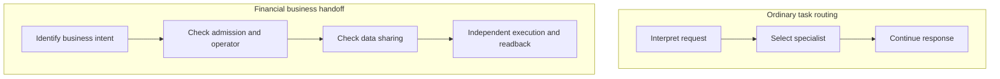
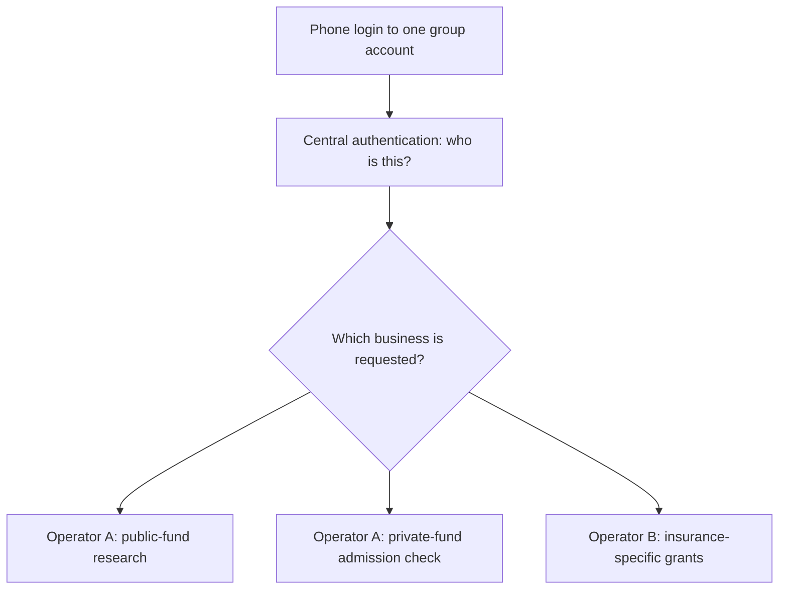
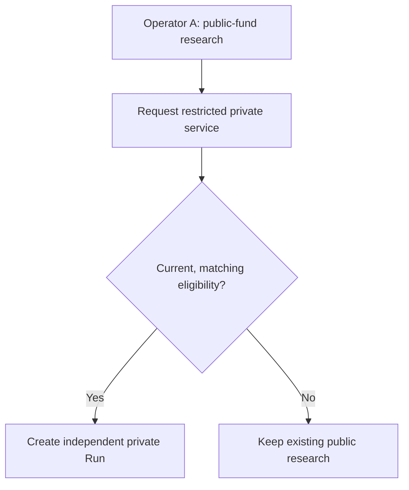
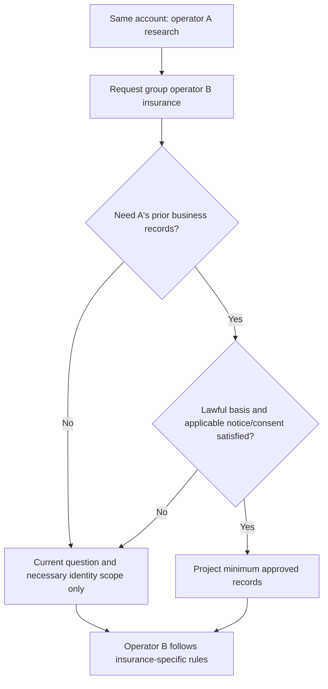
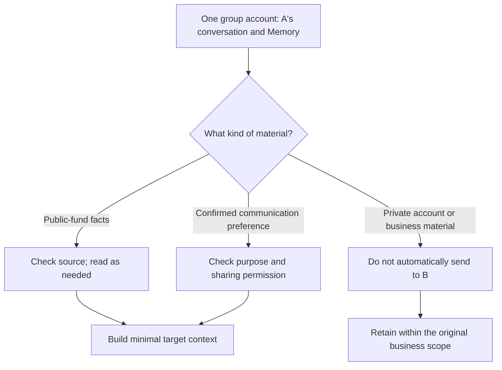
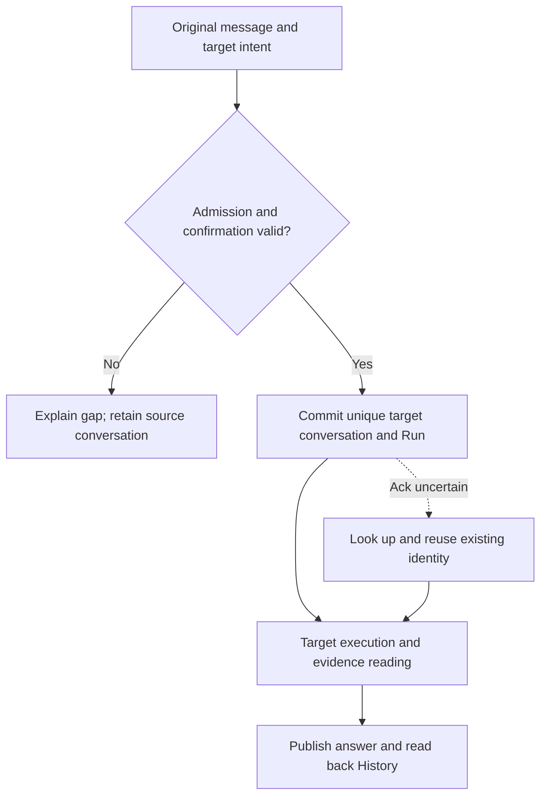

# Trusted Handoffs Between Financial Business Agents: Why a Router Is Not Enough

*One financial group, one phone-number login, and three business lines: why must customer information not flow freely between agents?*

> **Scope**: This essay draws on ETF Agent's controlled synthetic prototype, reviewed as of November 1, 2026. The customers, group-internal business operators A/B, products, and eligibility records below are illustrative: A serves public and private funds, while B serves insurance. Tests established bounded business handoffs, limited data access, result readback, and cross-process recovery using a deterministic scripted gateway. They **did not** establish compliance for a live financial institution, investment quality using a live language model, an integrated public insurance demo, or production-grade dynamic revocation. Regulations are cited to explain design considerations, not as legal advice for a specific institution.

A customer signs into a financial group’s wealth platform with a phone number and compares two public funds. The customer then asks: "Can we include private-fund products in the comparison?" A little later: "What if I also need long-term insurance protection?" **The customer remains in the same group account throughout**, without registering separate accounts for each Agent.

In an ordinary multi-agent product, these look like two intent switches: public-fund specialist → private-fund specialist → insurance specialist. Selecting the right expert may be enough to continue the dialogue. In this financial group, however, **authentication answers who the customer is, not which business services the customer may enter or which prior records may be reused for another purpose**. Silently passing holdings, private-fund eligibility, risk assessments, and the full chat to the insurance Agent would mistake one group login for blanket permission to share information.

That is why we designed a **trusted handoff**: **the model interprets what the customer wants; trusted business systems establish who may take over, what may be transferred, and what has actually happened.**

## 1. Compare it with ordinary Agent handoffs first

An ordinary Router or Handoff is not an inferior pattern. A service assistant can hand a refund request to a refund expert; a research assistant can hand a PDF task to a document specialist. OpenAI's [Agents SDK Handoffs](https://openai.github.io/openai-agents-python/handoffs/) provide `input_filter`, `on_handoff`, and conditional handoff enablement. Developers can add authorization checks in callbacks. Standard handoffs take place **within one Run**, with the existing history forwarded by default unless it is explicitly filtered.

Our point is **not** that general frameworks lack all security mechanisms. Instead, a business handoff can carry independent responsibilities that cannot be derived solely from a model's tool choice.

| Question | Typical agent switch | Financial trusted handoff in this essay |
| --- | --- | --- |
| Why switch? | Route a task to a capable expert | Enter a business with distinct admission, data, or responsibility |
| Who selects the destination? | Router/model interprets intent | Model proposes; trusted configuration verifies |
| What may be shared? | History/tools configured by the developer | Source, purpose, operator, and Run grant determine each permitted item |
| What happens to login identity? | The same task identity often continues | One phone-number account stays signed in, but each business evaluates its own admission, context, and grants |
| Is a new conversation needed? | The same Run may continue | A separate Conversation and target Run when responsibility changes; **not a new customer account** |
| When is consent needed? | Determined by the workflow | Separately assess switching, inter-controller data disclosure, sensitive information, and business actions |
| What happens after a failure? | Conversation or graph recovery | Read back the committed handoff using the same source/target identity to prevent duplicate work |

**Figure 1 — The responsibilities of two handoff styles.** One is a typical task-routing pattern; the other adds financial business controls. They are not mutually exclusive frameworks.



If the task only moves from explaining NAVs to making a chart within the same trusted scope, an ordinary Router or Agent-with-Skills is usually enough. **One login does not mean every intent needs a new business conversation.** Extra handoff contracts become worthwhile when **admission, information-use purposes, permissions, confirmation responsibilities, or durable business effects** truly change.

## 2. One group account, two business operators, three service lines

The synthetic setting is a **single financial group** with a common wealth entry point. A customer signs in once with a phone number. Central login authenticates the person; it does not merge public-fund, private-fund, and insurance records into a shared database any Agent may freely read.

| Business within the group | Operator | Agent | Business-specific controls |
| --- | --- | --- | --- |
| Public-fund research | **A** | `fund-cn` | Authorized public-fund sources, not private account permissions |
| Private-fund research | **A** | `private-cn` | Separate admission and eligibility for restricted business |
| Insurance protection | **B** | `insurance-cn` | Insurance-specific purpose and grants; A's private history isolated by default |

Operators A and B **belong to the same group**, while retaining different business responsibilities. The prototype cannot establish whether they are separate legal persons or personal-information processors. That depends on the actual corporate and data-processing arrangement. `operatorId=A/B` is an engineering isolation attribute, not a legal conclusion. A stable group account scope can identify the same customer without sending the raw phone number to the model as a cross-business authorization token.

**Figure 2 — One login, separate business access.** The arrows show potential service entry, not permission to access or disclose any existing business records.



### Act one: public to private funds within A — admission changes

The customer wants to include private products alongside two public funds. A private-fund specialist is the appropriate destination, but wanting a private product does not automatically authorize access to restricted product information or targeted solicitation.

Articles 18–20 of China's [Regulations on the Supervision and Administration of Private Investment Funds](https://www.mee.gov.cn/zcwj/gwywj/202307/t20230710_1035724.shtml) constrain private fundraising, transfers, qualified investors, and promotion. The [Measures for the Administration of Suitability of Securities and Futures Investors](https://www.csrc.gov.cn/csrc/c106256/c1653849/content.shtml) require regulated operators to understand investors and products, perform suitability matching, and restrict unsuitable marketing. Thus when a user enters a business workflow involving **restricted product materials, targeted promotion, or sales services**, admission must rely on trusted evidence rather than a model inferring "high-net-worth investor" from chat history.

This is not a claim that every public question about private-fund regulations requires investor qualification. **The prototype conservatively gates the entire private target Run. That is its engineering policy, not a verbatim statutory requirement.**

In this scenario A's private Run starts only after receiving matching, unexpired, synthetic `eligible` evidence. It may use designated read-only methods to consult public-fund facts, but it does not inherit every public-fund tool; conversely, the public-fund agent cannot automatically read private customer information.

**Figure 3 — One account does not replace private-fund admission within A.** An unsuccessful check leaves the public-fund research accessible rather than forcing a private Run.



### Act two: insurance with B in the same group account — purpose and responsibility change

The customer remains signed in and asks about insurance protection. The insurance Agent is provided by **operator B within the same financial group**. B may receive the authenticated account scope and current question, but it does not automatically gain A's assets, private holdings, suitability assessments, or Memory. **One group and one phone-number account do not imply one data-processing purpose or a blanket legal basis for sharing prior business records.**

Article 6 of China's [Personal Information Protection Law](https://www.miit.gov.cn/jgsj/zfs/fl/art/2022/art_515a4b20c12f430eab54bb4f56d89f56.html) requires clear purposes and data minimization. Articles 13–14 concern lawful grounds and consent. Article 23 requires notice and separate consent **when personal information is provided to another personal information processor**. Articles 28–29 establish additional protections for sensitive information such as financial accounts. **Whether A and B are separate processors depends on their actual legal and processing relationship. Even if they are divisions of one processor, using information for a new business purpose is not automatically justified by a single phone-number login.**

Accordingly, the prototype defaults to **explicit switching confirmation plus isolation of prior business history** for the **group-internal A → B handoff**. The customer stays in the same account, sees that B's insurance service is taking over, and does not automatically transmit A's records. Sharing any prior information requires an item-by-item assessment of necessity, lawful grounds, and applicable notice or consent requirements under the real processing arrangement. A few confirmed, purpose-compatible communication preferences may be shared if the trusted policy allows it; even "respond in Chinese" may constitute personal information when linked to an identifiable customer.

For instance, asking "What does critical-illness insurance generally cover?" does not call for private-fund holdings. If the customer instead requests a protection budget informed by assets, the application should first decide **which limited asset data is necessary and whether a minimally sufficient summary can lawfully be shared**. It should not forward A's entire conversation. This is an illustrative business decision, not proof of a working insurance-advice capability.

**Figure 4 — A to B within one group: switching and sharing records are different decisions.** B may take over using the same login while prior business data remains isolated by default.



The prototype's lightweight HTTP demo mainly exercises **A's public-to-private handoff**. The **A → B insurance** path is verified only in separate synthetic PostgreSQL/HTTP scenarios. **It simulates one financial group and one account system, not a connection to an unrelated external insurer**, and is not a complete public-facing product.

## 3. Connect regulation to business actions, not vague compliance labels

Financial Agent design does not become compliant merely by inserting a generic "compliance check" node. The important question is **which organization must do what, when the check happens, and what evidence remains available afterward**.

| Business question | Reference as of 2026-11-01 | Engineering response in this case |
| --- | --- | --- |
| May this customer enter restricted private-fund business? | Private-fund Regulations, Arts. 18–20; Securities/Futures Suitability Measures, Arts. 3 and 22 | New target Run obtains trusted eligibility; chat text cannot certify admission |
| Is the product or service suitable for the customer? | Securities/Futures Suitability Measures, Arts. 6, 18, and 24–25 | Business rules own assessment, risk disclosures, applicable confirmation, and associated records |
| May operator A records be used for group operator B insurance under one login? | Personal Information Protection Law, Arts. 6, 13–14, 21, 23, 28–29 | Establish the actual processing relationship and purpose; evaluate lawful grounds, required notice/consent, and minimum necessary fields; login alone is no permission |
| Can a new insurance service proceed with the customer's needs? | [Measures for the Administration of Suitability of Financial Institution Products](https://policy.mofcom.gov.cn/claw/clawContent.shtml?id=103294), effective February 1, 2026 | The insurance business separately owns customer assessment and product matching; private-fund eligibility cannot replace insurance suitability |
| Can financial AI automatically take high-impact actions? | NFRA [Guiding Opinions on the Safe Development and Application of AI in Banking and Insurance](https://policy.mofcom.gov.cn/claw/clawContent.shtml?id=106182), issued June 18, 2026 | For applicable banking/insurance scenarios, classify risk and design admission, human oversight/intervention, and exit or fallback |

The 2026 NFRA guidance specifically concerns institutions within the **banking and insurance** regulatory scope. It should not be misrepresented as one universal directive for all securities and fund agents. It is particularly relevant to group operator B's insurance scenario because it addresses high-risk AI admission, intervention, traceability, data protection, and business continuity. **For applicable scenarios it classifies as high risk, item (16) requires approval by the institution’s risk management committee before implementation, while item (17) requires human oversight and intervention at key stages.**

Four types of permission must not be collapsed into a single "I agree" button: **confirmation of business switching, consent to disclose personal information, acknowledgement of product risk disclosures, and final authorization for a transaction or contract**. Each may have a distinct purpose, legal basis, and effect. The typed human handoff confirmation exercised by the prototype implements only one such control and does not substitute for the others. Nor do the regulations prescribe Manifest, Run, MCP, or three specific history-sharing modes.

## 4. What should the destination be allowed to inherit?

A general chat product might pass the whole transcript to the next agent to avoid asking the same questions again. In financial business we first classify the information's source and purpose, then ask what is necessary for the new operator.

**Figure 5 — From inheriting the whole transcript to purpose-limited selection.** The categories illustrate this prototype's design; actual processing still requires source permissions and an appropriate lawful basis.



Controlled scenarios implement `isolated`, `selective`, and `full` history projections. Importantly, `full` means the **complete permitted source set**, not every message regardless of identity and source access. Group-internal, cross-operator A → B handoffs default to `isolated`, even under the same login. The original user message retains provenance. Previously committed assistant content must come from an inspectable published result; summaries, tool caches, or unverified Memory entries cannot impersonate authorized primary information.

Permissions are directional. When explicitly granted, a private Run can call a public supplier's two synthetic read-only methods, `public_fund__get_fund_profile` and `public_fund__get_nav_history`, using reviewed fund identifiers and bounded dates. That does not give the public-fund Run permission to read private holdings, nor should the public supplier receive the full private conversation. **Reusing public research facts does not mean sharing private account authority.**

## 5. "Switched successfully" is not a single business event

From the customer's perspective, four events are easy to confuse: **the destination exists, its Run has executed, an answer has been committed, and the evidence and result can be read back**. A single green "success" marker should not silently combine them.

**Figure 6 — Submission, execution, and uncertain acknowledgements.** If a page closes after the destination was created, the application should recover the original task instead of blindly creating a duplicate.



Unlike a handoff contained within a single Run, the source conversation remains unchanged and the destination has its own Conversation and Run. The client must subscribe to the existing target Run when revisiting it rather than submitting a similar-looking new message. The source message, destination, and action identity form an inspectable idempotency relationship. An unknown acknowledgement requires a lookup, not an assumption that the operation failed.

For cross-process recovery, the prototype persists admitted business identity, configuration, and permission versions in synthetic PostgreSQL state, then resumes the **same** Run after a separate process starts. An admitted older Run follows its frozen grant and stopping rules; a **new** private Run reads current eligibility again. This is neither instantaneous revocation during an ongoing Run nor exactly-once execution for irreversible actions such as trading.

## 6. How to reproduce the idea without copying an entire Runtime

You do not need every internal module to adapt the principle. Start with five pieces of trusted business information:

1. **Identity:** the server authenticates one customer scope through the phone-number login, then binds each business request to an operator, domain, and Agent. Reuse account authentication, not business permissions inferred from a phone number.
2. **Admission:** eligibility or suitability is checked from trusted sources before entering restricted services; a model prediction is not proof.
3. **Handoff decision:** exact destination, data-sharing purpose and fields, required confirmations, and the source request they authorize.
4. **Execution:** a separate target Run where tools, sources, and budgets are defined anew, with exact methods and parameters checked at the trusted Host. Manifest-like configuration limits maximum capability but does not replace a particular Run grant or data-source permission.
5. **Result and recovery:** stable target identity, recorded side effects, publication and inspectable evidence; retries first read existing effects.

The synthetic HTTP entry can express destination intent through the current user message’s `businessHandoffTarget.agentId`; it is not an authorization grant by itself. A tiny illustrative contract communicates the shape (it is not an entire security protocol or deployable implementation):

```json
{
  "source": { "operator": "A", "domain": "public-fund" },
  "target": { "operator": "A", "domain": "private-fund" },
  "admission": "trusted-eligibility-required",
  "history": "selective",
  "execution": "new-conversation-and-run"
}
```

Practical follow-up research remains necessary: mapping one phone-number account to a stable customer scope without exposing the raw number, granting permissions independently by business, time-bounding eligibility evidence, checking each data source, distinguishing intra-group disclosures from entrusted processing, and recovering effects without duplicates. Start with **A's public-to-private path**, then test **A → B insurance under the same group login**, without building a universal policy engine first.

Three useful external starting points address different pieces of this problem:

- [OpenAI Agents SDK — Handoffs](https://openai.github.io/openai-agents-python/handoffs/): expert transfer, callbacks, filtering, and the important **same-Run** semantics.
- [LangGraph — Thinking in LangGraph](https://docs.langchain.com/oss/javascript/langgraph/thinking-in-langgraph): explicit control flow, state, human interrupts, and checkpoints, to which your application adds business admission and data policy.
- [NIST SP 800-162 — ABAC](https://csrc.nist.gov/pubs/sp/800/162/upd2/final): reasoning about subjects, resources, actions, and conditions, without assuming that an ABAC design automatically satisfies financial law.
- [Open Policy Agent (OPA)](https://www.openpolicyagent.org/docs): an optional public implementation reference for evaluating structured subject/resource/action policies. **OPA was not adopted by this prototype.**

These references cover **orchestration, durable execution, access control, and policy decisions**. None is an out-of-the-box compliant handoff for Chinese financial products. Our implementation's particular choice was to reuse the existing owners of Conversation, Run, MCP Host, Memory, and Recovery instead of inventing a second authorization center.

Developers with authorized access to the private prototype can enable the local lightweight synthetic demo using `DEMO_BUSINESS_HANDOFF=true npm run demo:api` and follow the repository's internal runbook. The demo is not a customer-ready private eligibility service, complete group-internal A → B insurance integration, or production compliance workflow. The public `open-etf-agent` repository should not be described as already shipping an equivalent multi-business implementation.

## 7. The goal is continuity of business responsibility

This customer remains in **one financial group and one phone-number account** throughout. Public-fund research continues; restricted private services require their own admission; and moving to group operator B for insurance does not authorize copying A's private holdings or chat history just because "it is the same customer." Only a clearly defined purpose, legal grounds, and minimal sharing scope can justify sending specific records. Even after the destination exists, execution, evidence, and recovery remain separate facts.

We were never trying to make a Router complicated. **An ordinary Handoff transfers the next task; a financial trusted Handoff may also transfer a conditional business responsibility.** Keep simple routing when all work stays within one permission scope. Introduce auditable, rejectable, recoverable business handoffs only when the rules, information, or accountable operator actually change.

---

*Further reading: [Models understand; code authorizes](/articles/011-model-understands-code-authorizes) · [From investment research to advisory and trading](/articles/030-fintech-from-research-to-investment-advice) · [Durable human interaction](/articles/agent-durable-human-interaction-response-adoption). Regulatory references must be interpreted for the institution actually involved; operators A/B, the single group account, products, and test results here are synthetic.*
