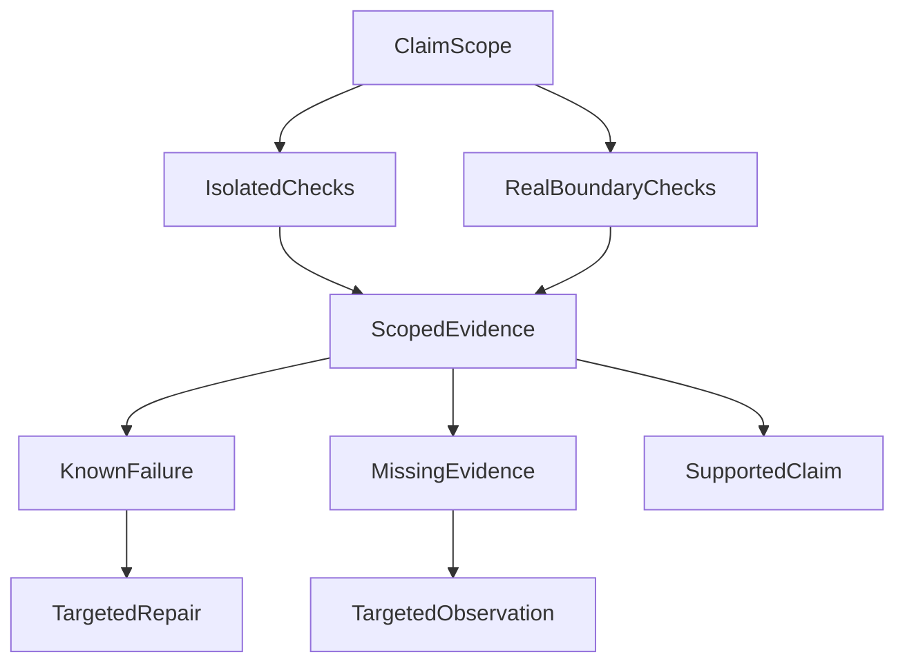

# Do Green Tests and a Model Response Mean the Agent Succeeded?

**Green means a particular check passed under particular conditions. It does not automatically establish that the user's task was completed.** Agent evaluation should first identify the boundary examined, the exact content judged, and the tasks included in the denominator—then compare quality and cost.

This does not mean rerunning an entire research workflow after every change. It means matching evidence to claims: local checks for local logic, actual handoffs for cross-process effects, and actual outputs for model quality. Otherwise, an accurate test statistic can support an inaccurate product conclusion.

In our early evaluations, the server had an answer candidate, the automated judge returned a verdict, and the run was even marked `completed`. Following the frontend path showed that candidate existence, server transmission, browser receipt, and display were not the same fact.

The historical cases below explain how to avoid that confusion. They are not a current model ranking or a complete production acceptance result.

## 1. First Ask What the Green Check Actually Reached

Mocks control inputs, dependencies, and time, making them useful for examining local logic. Real-dependency checks start processes, connect to databases, or cross network boundaries. Both matter, but they answer different questions.

We observed a focused mock suite pass while broader acceptance work remained incomplete. The useful distinction was not which count looked better. The smaller check had never reached the unsettled handoffs.

A command-line timeout check provided a more concrete counterexample:

| Value in the original controlled window | Amount | Meaning |
| --- | --- | --- |
| Unit-side default | 45 seconds | The default configuration seen by the local test |
| Actual model-side propagated value | 80 seconds per call | The limit passed into the subsequent invocation |
| Governance cap | 60 seconds | The upper bound declared at that time |

The mock never actually waited 80 seconds. Checking only the default could therefore miss a propagated value that exceeded the cap. A whole-task deadline and a per-call timeout also have different starting points and scopes; a long wait is not a reason to raise every limit together.

That window located the issue and a repair direction, but did not collect a post-fix rerun. It remains a failing observation, not a pass written retrospectively.

**Verify the behavior a caller actually depends on, not merely the configuration or return value easiest to inspect.** A database-handoff claim needs evidence reaching the database. A change to a pure function does not require rerunning every external dependency to establish its local behavior.

## 2. Do Not Average Away Different Kinds of Failure

An agent request may pass through task interpretation, material acquisition, candidate generation, publication, transmission, and display. A valid protocol does not establish understanding. A tool response does not establish applicable evidence. A good answer may still fail delivery.

Evaluation should distinguish at least these questions:

| Layer | What must be established |
| --- | --- |
| Protocol | Whether the response can be parsed |
| Research and evidence | Whether the task was understood and the required eligible material obtained |
| Answer | Whether the content is accurate, appropriate, and supported |
| Delivery | Whether actual content reached server transmission, client receipt, or display |

Some requirements cannot be averaged away. Fluent language does not compensate for missing essential material. An unsent answer should not receive an attractive overall score because its server-side draft reads well.

Failure and uncertainty also differ. `failed` means evidence establishes that a requirement was not met; `inconclusive` means the evidence is insufficient to decide. The former calls for repair, the latter for a relevant observation. Assigning both zero mixes infrastructure gaps into assessments of model capability.

This does not prohibit comparison. It establishes whether candidates meet the requirements of the intended role before comparing quality, reliability, latency, and cost. A missing optional capability must not become a veto on every possible use.

## 3. The Denominator Can Silently Change the Conclusion

Consider a hypothetical evaluation of 30 questions. Twenty remain unfinished within the observation window because of queues, timeouts, or tool problems. Nine of the ten completed questions return nonempty content.

“Nine of ten completed samples returned an answer” is accurate. Reporting a “90% success rate” changes the denominator and additionally substitutes nonempty output for task success.

Unfinished questions may be longer, more complex, and require more tools or corrections. They are not necessarily missing at random. Evaluating only completed cases can exclude the samples most likely to reveal a weakness.

Freeze the question set, data snapshot, code revision, model version, configuration, and original denominator before evaluation. Changed conditions belong to their own observation window. Comparing versions is legitimate; pooling different conditions into a more flattering single experiment is not.

The practical rule is simple: **account for every planned task before discussing the quality of the completed subset.** Unfinished, failed, unknown, and usable-answer outcomes should retain their respective places rather than disappear from the statistics.

## 4. The Judge Must Know Which Answer It Is Evaluating

Automated evaluation commonly takes a server-side candidate and asks a model to assess facts, formatting, citations, and expression. That can evaluate candidate quality. A streaming product must additionally determine whether the user received that candidate.

Publication may reject a complete draft, or transmission may deliver only its first half. Even a server-side send record does not establish complete client receipt or display.

Keep three objects distinct: the model candidate, the actual server-emitted body, and evidence of client receipt and rendering. An evaluation claiming to assess a delivered answer should reconstruct its material from actual outbound content events in order, rather than substitute the most complete saved draft.

If a stream ended early, reconstruction must preserve that incompleteness. A fuller draft saved later cannot rewrite the original delivery. Client acknowledgments, sequence numbers, or rendering receipts can justify a stronger delivery conclusion. Without them, stop at the accurately supported statement that the server sent the material.

**The identity and scope of the scored object matter more than a sophisticated scoring formula.** That is one difference between agent-product evaluation and a pure model benchmark: product results also pass through a real delivery system.

## 5. When the Evaluator Is Wrong, Correct the Judgment Without Rewriting Events

We also encountered mechanical misclassification caused by a fixture or validation contract. Correcting the evaluator changed judgments for affected samples, while genuine failures remained.

Overwriting the old scores would obscure why the original evaluation failed, why a later examination changed it, and whether apparent progress came from the model, runtime, or measurement instrument.

A better approach preserves original results, appends corrections, and generates a revised view. Each correction identifies the original run, input revision, affected cases, old and new judgments, and the reason. Further errors can be corrected through another addition rather than rewriting history into its latest interpretation.

The purpose is not another audit ritual. It is to preserve a valid basis for comparison: **a changed execution result and a changed understanding of the same result are different kinds of progress.**

### The Judge Returned Full Marks—Why Can the Result Still Be Inconclusive?

A scoped multi-agent investment-research evaluation in late October 2026 preserved two distinct counterexamples. In one set, the Judge returned a complete assessment, but some cited passages could not be located in the material actually provided to the grader. This is not merely a lower score; **the grader's evidence could not yet be reconstructed**. In another set, a grader awarded full marks, but assessment and generation used the same model and did not meet that comparison's predefined independence requirement. Full marks describe the returned grading result, not independent verification of answer quality. Neither observation establishes that multiple agents outperform a single Main.

A usable grading receipt needs three separate checks: **did the grading invocation settle, can its supporting references be found in the actual grading input, and do the grader and samples meet the independence and comparability conditions chosen before the run?** Passing the first does not establish the other two. When evidence cannot be located or a required control is missing, retain the original review and an inconclusive status, with a specific plan for additional observation. Do not mislabel an unqualified review as proof that the research itself never ran.

These bounded records do not provide a publicly replayable, fully matched live-model comparison or a comparable improvement estimate. The lesson here is **qualification of grading evidence**, not a claim about multi-agent success rates or performance gains.

## 6. Building a Small Agent Evaluation Set You Can Actually Reuse

The previous sections explained why green checks, answer candidates, and user outcomes must not be conflated. The practical follow-up is: **after the next code change, what evidence tells us the same class of failure has not returned?**

There is no need to build another evaluation platform first. Start with a confirmed historical failure, retain inputs that can be legally reconstructed, and add a few ordinary-path cases and adjacent counterexamples. Each case needs at least the following contract:

| What to retain | Why it matters |
| --- | --- |
| **Task identity** | Stable case ID, original user question, and intended business task—not merely a rewritten prompt. |
| **Reconstructable input** | Sanitized source snapshot, effective dates, model/code/tool versions, and authorized scope; freeze changing data for comparisons. |
| **Object being evaluated** | The tool effect, candidate answer, server-emitted text, or evidence of client display. Each needs its own identity. |
| **Criteria and grader** | Code-checkable invariants, questions for an LLM judge, and situations requiring domain-expert review. Separate hard requirements from optional quality. |
| **Execution and observation** | Completion, known failure, unknown status, budget, latency, and missing evidence, preserving the complete planned task set. |

For illustration, a **synthetic fund-fee comparison case** could have this compact contract. It is not a measured result from the current system and contains no client holdings:

```json
{
  "caseId": "fund-fee-asof",
  "question": "Compare two funds' fees using the supplied documents and explain effective-date differences",
  "snapshot": "fixtures/synthetic-fees-v1.json",
  "requiredEvidence": ["feeA", "feeB", "effectiveDate"],
  "mustNotDo": ["placeOrder"],
  "gradeTarget": "server_emitted_answer"
}
```

The **code-based checks** are that no order execution receipt exists without trading authorization, that each number carries an identifiable source and effective date, and that the judged answer matches the actual emitted content. An **LLM judge** can assess whether the explanation mixes time frames or fee conventions and whether the original question is answered, using concrete calibration examples. **Human reviewers** concentrate on grader disagreements, conflicting evidence, and high-impact errors that might influence real trading decisions. A judge's claim of "good citation coverage" does not substitute for source identity or recomputing the numbers.

### Minimal workflow: freeze, run, attribute, review

1. **Freeze the task set and conditions.** Retain stable IDs and replayable snapshots. Compare candidate and baseline versions under the same authorized inputs; changed conditions need a separately labelled observation window.
2. **Choose the necessary depth.** Check authorization, persistent receipts, and arithmetic invariants deterministically first. If a change affects model-visible inputs or research strategy, run targeted real-model tasks. A claim about user outcomes requires evidence reaching the relevant delivery surface.
3. **Keep every planned case in the denominator.** Report completed, failed, and unknown cases separately. Score answer quality within completed cases, but do not relabel that ratio as overall task success.
4. **Separate three kinds of change.** An actual change in product behavior, a repair to Judge parsing or labeling, and better observation records each need their own evidence. Retain original verdicts and append reasoned corrections.
5. **Calibrate model graders with human examples.** Review disagreements and high-risk cases first. The judge itself needs comparable inputs and inspectable grading rules.
6. **Only compare sufficiently matched windows.** Keep quality, cost, latency, and failure modes visible. When required observations are missing, report a localized fix or provisional finding, not a verified system-level gain.

This is not an obligation to attach a new dashboard to every article or run an expensive full-model benchmark on every pull request. Regression depth and frequency follow the risk and the behavior changed. Sufficient evidence for a deterministic invariant does not require performative extra inference runs.

### External practices: what do we add?

[Anthropic's guidance on agent evaluations](https://www.anthropic.com/research/demystifying-evals-for-ai-agents) combines code, model, and human graders and emphasizes isolated execution and measurable outcomes. [OpenAI's agent workflow evaluation guide](https://developers.openai.com/api/docs/guides/agent-evals) distinguishes trace grading for diagnosis from datasets and repeated eval runs for comparisons. These are useful building blocks; we do not need to invent a new scoring framework.

The additional point drawn from our own delivery failures is **alignment between the declared outcome and the exact evaluated artifact**. When the claim is "the user received a reliable answer," the judged content must correspond to what was sent or displayed—not the most complete draft saved inside a trace. Traces help diagnose failed transitions; they cannot create missing client acknowledgment evidence. This is a difference in our evaluation scope, not a claim that those external tools are incapable of delivery verification.

## 7. Decide Whether Comparison Is Valid Before Deciding Which Model Is Better

Before publishing a model conclusion, I now ask three questions: Are the experimental conditions and original denominators comparable? Has a requirement explicitly necessary for this use failed? Which critical facts remain unknown?

When conditions differ, explain the difference. When a necessary requirement fails, record ineligibility for that use. When a critical fact is unknown, retain a provisional conclusion. Quality, reliability, latency, and cost comparisons become interpretable after those distinctions.

This need not become another universal runtime gate. It is first a sequence of engineering and evaluation judgments:



Select the two kinds of checks according to the claim; not every change needs both. Evidence may support a bounded conclusion, reveal a defect, or leave an observation missing. Sufficient existing evidence need not be rerun merely to edit a report when behavior has not changed.

### A Recorded Research Answer Still May Not Support A/B

The October 2026 financial research evaluation retained an actual C04 answer and reopenable original records. A separate scoped path used **public synthetic disclosures** through real Tool, containerized Python, result references, and an isolated PostgreSQL Human checkpoint reopened in a different process. It confirmed that stored source and computation results could be read without rerunning effects. That is evidence for **persistence and recovery**, not a qualified model comparison.

The real C04 had only one candidate. Immutable model-version and configuration identities were incomplete, and no appropriately matched alternative existed: **0/1 real comparable pairs**. Synthetic A/B/C cases tested the comparator itself: a single controlled difference can qualify, but two simultaneous changes, missing repetitions, or unknown configuration must not. A correct synthetic comparator cannot create a missing real control group.

The responsible report may therefore say: retain the original research and defer any claim of model improvement. Original answers, independent arithmetic references, source eligibility, human and automated judgments, and known or unknown costs have separate evidence requirements. A higher mean without the right identity and denominator is not a sound reason to switch models.

Engineers should state the behavior their change intends to establish. Evaluation designers should freeze inputs and denominators and give judges the actual content corresponding to the claim. Decision-makers should treat failures, unknowns, and quality differences separately.

**The value of testing is not a green dashboard. It is knowing what to repair, which evidence to collect, and which decision can now be made with confidence.**

For every green result, ask which revision, input, boundary, and actual content it establishes something about. This is [method 5, “Choosing verification and diagnosing failure”](/en/principles#method-5). Keeping conclusions within their supporting evidence prevents local success from being prematurely declared product success.

## Further Reading

[Spec and Evidence Workflows](026-agent-spec-evidence-workflow.md) discusses retaining and correcting original observations. [The Expensive Part of AI Coding Is Deciding What Deserves Verification](ai-coding-judgment-and-verification.md) discusses allocating verification effort according to the consequences of error.

More essays are available in [ETF Agent Engineering Notes](https://github.com/hpoenixf/eff-agent-article). Stars and discussion are welcome.
