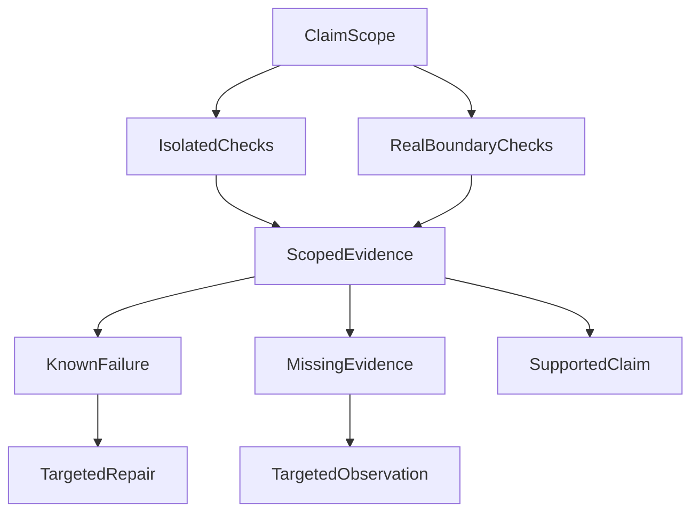

# Do Green Tests and a Model Response Mean the Agent Succeeded?

**Green means a particular check passed under particular conditions. It does not automatically establish that the user's task was completed.** Agent evaluation should first identify the boundary examined, the exact content judged, and the tasks included in the denominator—then compare quality and cost.

This does not mean rerunning an entire research workflow after every change. It means matching evidence to claims: local checks for local logic, actual handoffs for cross-process effects, and actual outputs for model quality. Otherwise, an accurate test statistic can support an inaccurate product conclusion.

In our early evaluations, the server had an answer candidate, the automated judge returned a verdict, and the run was even marked `completed`. Following the frontend path showed that candidate existence, server transmission, browser receipt, and display were not the same fact.

The historical cases below explain how to avoid that confusion. They are not a current model ranking or a complete production acceptance result.

## 1. First Ask What the Green Check Actually Reached

Mocks control inputs, dependencies, and time, making them useful for examining local logic. Real-dependency checks start processes, connect to databases, or cross network boundaries. Both matter, but they answer different questions.

We observed a focused mock suite pass while broader acceptance work remained incomplete. The useful distinction was not which count looked better. The smaller check had never reached the unsettled handoffs.

A command-line timeout check provided a more concrete counterexample:

| Value in the original controlled window | Amount | Meaning |
| --- | --- | --- |
| Unit-side default | 45 seconds | The default configuration seen by the local test |
| Actual model-side propagated value | 80 seconds per call | The limit passed into the subsequent invocation |
| Governance cap | 60 seconds | The upper bound declared at that time |

The mock never actually waited 80 seconds. Checking only the default could therefore miss a propagated value that exceeded the cap. A whole-task deadline and a per-call timeout also have different starting points and scopes; a long wait is not a reason to raise every limit together.

That window located the issue and a repair direction, but did not collect a post-fix rerun. It remains a failing observation, not a pass written retrospectively.

**Verify the behavior a caller actually depends on, not merely the configuration or return value easiest to inspect.** A database-handoff claim needs evidence reaching the database. A change to a pure function does not require rerunning every external dependency to establish its local behavior.

## 2. Do Not Average Away Different Kinds of Failure

An agent request may pass through task interpretation, material acquisition, candidate generation, publication, transmission, and display. A valid protocol does not establish understanding. A tool response does not establish applicable evidence. A good answer may still fail delivery.

Evaluation should distinguish at least these questions:

| Layer | What must be established |
| --- | --- |
| Protocol | Whether the response can be parsed |
| Research and evidence | Whether the task was understood and the required eligible material obtained |
| Answer | Whether the content is accurate, appropriate, and supported |
| Delivery | Whether actual content reached server transmission, client receipt, or display |

Some requirements cannot be averaged away. Fluent language does not compensate for missing essential material. An unsent answer should not receive an attractive overall score because its server-side draft reads well.

Failure and uncertainty also differ. `failed` means evidence establishes that a requirement was not met; `inconclusive` means the evidence is insufficient to decide. The former calls for repair, the latter for a relevant observation. Assigning both zero mixes infrastructure gaps into assessments of model capability.

This does not prohibit comparison. It establishes whether candidates meet the requirements of the intended role before comparing quality, reliability, latency, and cost. A missing optional capability must not become a veto on every possible use.

## 3. The Denominator Can Silently Change the Conclusion

Consider a hypothetical evaluation of 30 questions. Twenty remain unfinished within the observation window because of queues, timeouts, or tool problems. Nine of the ten completed questions return nonempty content.

“Nine of ten completed samples returned an answer” is accurate. Reporting a “90% success rate” changes the denominator and additionally substitutes nonempty output for task success.

Unfinished questions may be longer, more complex, and require more tools or corrections. They are not necessarily missing at random. Evaluating only completed cases can exclude the samples most likely to reveal a weakness.

Freeze the question set, data snapshot, code revision, model version, configuration, and original denominator before evaluation. Changed conditions belong to their own observation window. Comparing versions is legitimate; pooling different conditions into a more flattering single experiment is not.

The practical rule is simple: **account for every planned task before discussing the quality of the completed subset.** Unfinished, failed, unknown, and usable-answer outcomes should retain their respective places rather than disappear from the statistics.

## 4. The Judge Must Know Which Answer It Is Evaluating

Automated evaluation commonly takes a server-side candidate and asks a model to assess facts, formatting, citations, and expression. That can evaluate candidate quality. A streaming product must additionally determine whether the user received that candidate.

Publication may reject a complete draft, or transmission may deliver only its first half. Even a server-side send record does not establish complete client receipt or display.

Keep three objects distinct: the model candidate, the actual server-emitted body, and evidence of client receipt and rendering. An evaluation claiming to assess a delivered answer should reconstruct its material from actual outbound content events in order, rather than substitute the most complete saved draft.

If a stream ended early, reconstruction must preserve that incompleteness. A fuller draft saved later cannot rewrite the original delivery. Client acknowledgments, sequence numbers, or rendering receipts can justify a stronger delivery conclusion. Without them, stop at the accurately supported statement that the server sent the material.

**The identity and scope of the scored object matter more than a sophisticated scoring formula.** That is one difference between agent-product evaluation and a pure model benchmark: product results also pass through a real delivery system.

## 5. When the Evaluator Is Wrong, Correct the Judgment Without Rewriting Events

We also encountered mechanical misclassification caused by a fixture or validation contract. Correcting the evaluator changed judgments for affected samples, while genuine failures remained.

Overwriting the old scores would obscure why the original evaluation failed, why a later examination changed it, and whether apparent progress came from the model, runtime, or measurement instrument.

A better approach preserves original results, appends corrections, and generates a revised view. Each correction identifies the original run, input revision, affected cases, old and new judgments, and the reason. Further errors can be corrected through another addition rather than rewriting history into its latest interpretation.

The purpose is not another audit ritual. It is to preserve a valid basis for comparison: **a changed execution result and a changed understanding of the same result are different kinds of progress.**

## 6. Decide Whether Comparison Is Valid Before Deciding Which Model Is Better

Before publishing a model conclusion, I now ask three questions: Are the experimental conditions and original denominators comparable? Has a requirement explicitly necessary for this use failed? Which critical facts remain unknown?

When conditions differ, explain the difference. When a necessary requirement fails, record ineligibility for that use. When a critical fact is unknown, retain a provisional conclusion. Quality, reliability, latency, and cost comparisons become interpretable after those distinctions.

This need not become another universal runtime gate. It is first a sequence of engineering and evaluation judgments:

Select the two kinds of checks according to the claim; not every change needs both. Evidence may support a bounded conclusion, reveal a defect, or leave an observation missing. Sufficient existing evidence need not be rerun merely to edit a report when behavior has not changed.

Engineers should state the behavior their change intends to establish. Evaluation designers should freeze inputs and denominators and give judges the actual content corresponding to the claim. Decision-makers should treat failures, unknowns, and quality differences separately.

**The value of testing is not a green dashboard. It is knowing what to repair, which evidence to collect, and which decision can now be made with confidence.**

For every green result, ask which revision, input, boundary, and actual content it establishes something about. This is [method 5, “Choosing verification and diagnosing failure”](/en/principles#method-5). Keeping conclusions within their supporting evidence prevents local success from being prematurely declared product success.

## Further Reading

[Spec and Evidence Workflows](026-agent-spec-evidence-workflow.md) discusses retaining and correcting original observations. [The Expensive Part of AI Coding Is Deciding What Deserves Verification](ai-coding-judgment-and-verification.md) discusses allocating verification effort according to the consequences of error.

More essays are available in [ETF Agent Engineering Notes](https://github.com/hpoenixf/eff-agent-article). Stars and discussion are welcome.
