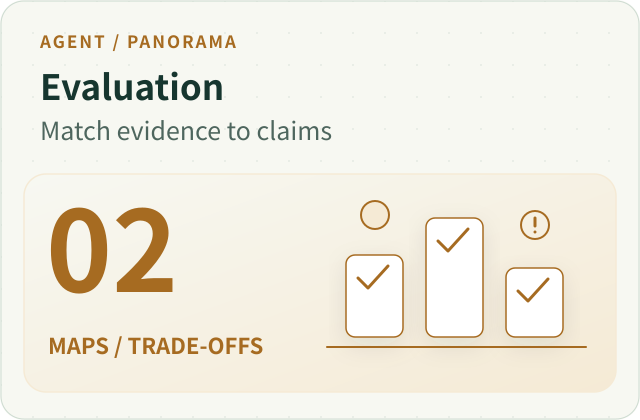
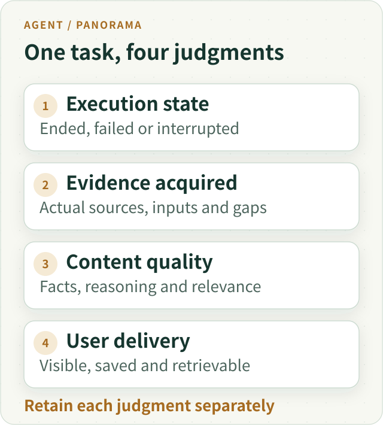
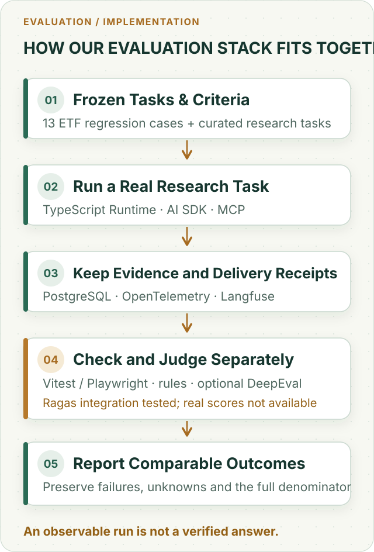
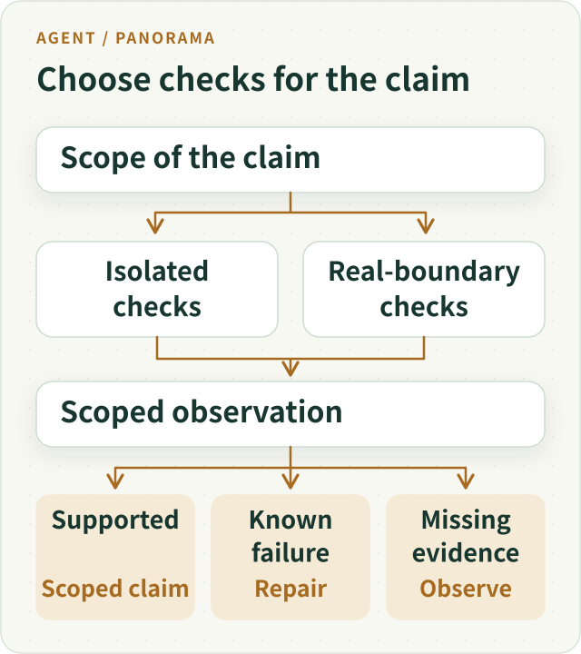

# Agent Evaluation Panorama: From Green Tests to Real Task Value



**Green means a particular check passed under particular conditions. It does not automatically establish that the user's task was completed.** Agent evaluation should first identify the boundary examined, the exact content judged, and the tasks included in the denominator—then compare quality and cost.

This does not mean rerunning an entire research workflow after every change. It means matching evidence to claims: local checks for local logic, actual handoffs for cross-process effects, and actual outputs for model quality. Otherwise, an accurate test statistic can support an inaccurate product conclusion.

In our early evaluations, the server had an answer candidate, the automated judge returned a verdict, and the run was even marked `completed`. Following the frontend path showed that candidate existence, server transmission, browser receipt, and display were not the same fact.

The historical cases below explain how to avoid that confusion. They are not a current model ranking or a complete production acceptance result.

To make those decisions reusable, this panorama also brings together lessons from our RAG retrieval, specialist contribution, trace coverage, model grading and cost studies. The point is not to discard metrics: it is to know **what each one measures, which handoff is still unobserved, and when the evidence actually warrants a change of design**.

## The Map: Evaluate the Task Completed by Model and System Together

Suppose one research configuration uses Main directly and another delegates to three specialists. Judging only final prose can miss a tool that never executed, a specialist that never received input or an answer that was never saved. Judging only execution can miss a neatly finished task that answered the wrong question.

A useful evaluation retains four coordinates: **what executed, what evidence was obtained, how the content should be judged, and what the user received.** They explain one another without collapsing into a universal green badge.



*Figure 1. A failed Run can leave useful prose; a completed Run can contain a wrong conclusion. These are evaluation perspectives, not four new runtime approval layers.*

The article follows a claim through sample design, execution, answer identity and interpretation. Engineering tests examine deterministic contracts; live-model evaluation examines open-ended performance; user observation examines delivered value. These complement one another rather than requiring every change to climb a fixed ladder of expensive checks.

## What We Actually Used: Each Tool Has a Distinct Job

These examples come from the ETF Agent engineering evaluation workflow, not scores produced by a single off-the-shelf benchmark. The main research execution is owned by a **Node.js / TypeScript Research Runtime**—the program that manages model requests, tool use, and task state. The evaluation runner selects cases and records results around that runtime instead of creating a second execution system.



*Figure 2. This is a responsibility map, not five new approval gates. Neither models nor graders can replace original sources or delivery receipts.*

| Technology or mechanism | Responsibility in evaluation |
| --- | --- |
| **Research Runtime, AI SDK, MCP** | Execute model, retrieval and calculation work through Main and Child agents and retain each Run (one identified task execution); MCP is a protocol for connecting tools. |
| **Golden Dataset, curated research cases, custom evaluation runner** | Freeze questions, source revisions, expected behavior, repetitions and the complete planned denominator for bounded comparisons. |
| **Vitest, Playwright, PostgreSQL** | Check deterministic behavior, actual browser delivery, database persistence and cross-process handoffs. |
| **OpenTelemetry, Langfuse** | Use traces (records of model/tool steps in a request) to diagnose failures, timing and cost signals. A trace does not prove answer quality or client display. |
| **Business-rule validation, LLM-as-Judge, human review, optional DeepEval** | Evaluate numeric and authorization constraints, grounding, answer quality and high-risk disagreements separately. Model grades cannot override a confirmed rule violation. |
| **Ragas (optional; no qualified live quality scores yet)** | Provide specialized metrics for retrieval-augmented generation (RAG, answering after retrieving source material). Only limited SDK/isolation integration has been qualified so far, as explained below. |

These are not a pipeline that automatically certifies success. For example, Langfuse may show that a model call finished and PostgreSQL that content was saved, but only actual outbound text and suitable client receipts justify stronger claims about what the user received. The public [Open ETF Agent](https://github.com/hpoenixf/open-etf-agent) demonstrates a smaller, separately runnable set of mechanisms; it is not a complete open-source reproduction of this private evaluation system.

## 1. First Ask What the Green Check Actually Reached

A **mock** is a controllable fake dependency: for example, a fake market-data API that always returns a known price instead of calling a live service. Mock tests make local logic repeatable, but cannot prove the real API, network or database works. Real-dependency checks start processes, connect to databases, or cross network boundaries. Both matter, but they answer different questions.

We observed a focused mock suite pass while broader acceptance work remained incomplete. The useful distinction was not which count looked better. The smaller check had never reached the unsettled handoffs.

A command-line timeout check provided a more concrete counterexample:

| Value in the original controlled window | Amount | Meaning |
| --- | --- | --- |
| Unit-side default | 45 seconds | The default configuration seen by the local test |
| Actual model-side propagated value | 80 seconds per call | The limit passed into the subsequent invocation |
| Governance cap | 60 seconds | The upper bound declared at that time |

The mock never actually waited 80 seconds. Checking only the default could therefore miss a propagated value that exceeded the cap. A whole-task deadline and a per-call timeout also have different starting points and scopes; a long wait is not a reason to raise every limit together.

That window located the issue and a repair direction, but did not collect a post-fix rerun. It remains a failing observation, not a pass written retrospectively.

**Verify the behavior a caller actually depends on, not merely the configuration or return value easiest to inspect.** A database-handoff claim needs evidence reaching the database. A change to a pure function does not require rerunning every external dependency to establish its local behavior.

### First Prove That the Injected Fault Really Happened

In another recovery test, the fixture claimed an old Worker (a background execution process) had stopped, but still let that Worker write checkpoints and run its finalization. The recovery code correctly rejected an unsealed request. That rejection was not proof of a bad recovery mechanism—the test had failed to create its claimed failure condition.

The later controlled test kept a real, inspectable checkpoint and then blocked subsequent writes by the old Worker before observing the recovering owner. Capacity tests deserve the same discipline: rather than subtracting an arbitrary 4,000 bytes, first measure how much of the actual result is removable. **Validate a test's preconditions before interpreting either red or green.** This is a lesson from controlled fixtures, not a claim that the corresponding interruption occurred to production users.

## 2. Do Not Average Away Different Kinds of Failure

An agent request may pass through task interpretation, material acquisition, candidate generation, publication, transmission, and display. A valid protocol does not establish understanding. A tool response does not establish applicable evidence. A good answer may still fail delivery.

Evaluation should distinguish at least these questions:

| Layer | What must be established |
| --- | --- |
| Protocol | Whether the response can be parsed |
| Research and evidence | Whether the task was understood and the required eligible material obtained |
| Answer | Whether the content is accurate, appropriate, and supported |
| Delivery | Whether actual content reached server transmission, client receipt, or display |

Some requirements cannot be averaged away. Fluent language does not compensate for missing essential material. An unsent answer should not receive an attractive overall score because its server-side draft reads well.

Failure and uncertainty also differ. `failed` means evidence establishes that a requirement was not met; `inconclusive` means the evidence is insufficient to decide. The former calls for repair, the latter for a relevant observation. Assigning both zero mixes infrastructure gaps into assessments of model capability.

This does not prohibit comparison. It establishes whether candidates meet the requirements of the intended role before comparing quality, reliability, latency, and cost. A missing optional capability must not become a veto on every possible use.

### A Valid Citation Is Not a Verified Claim

Our [citation-reliability essay](ai-citations-do-not-prove-reliability.md) gives a useful example. If six names overlap in two funds' top-ten holdings, the evidence supports **overlap in the disclosed top ten**. Without complete holdings, individual weights and the investor's allocation to the two funds, it does not establish that the whole portfolio has “severe duplication.” A real citation, correct page and accurately copied number do not automatically support the inference or answer the user's actual question.

Deterministic code should check source identity, money calculations, dates, permissions and ledger invariants. An LLM grader or human reviewer can then inspect whether a decisive conclusion follows from those facts, including the missing caveats. And when only a particular rejection stage is known, report **the last confirmed blocker**, not an invented root cause. Otherwise a publication-validation failure can be repeatedly misdiagnosed as a model-provider defect.

## 3. The Denominator Can Silently Change the Conclusion

Consider a hypothetical evaluation of 30 questions. Twenty remain unfinished within the observation window because of queues, timeouts, or tool problems. Nine of the ten completed questions return nonempty content.

“Nine of ten completed samples returned an answer” is accurate. Reporting a “90% success rate” changes the denominator and additionally substitutes nonempty output for task success.

Unfinished questions may be longer, more complex, and require more tools or corrections. They are not necessarily missing at random. Evaluating only completed cases can exclude the samples most likely to reveal a weakness.

Freeze the question set, data snapshot, code revision, model version, configuration, and original denominator before evaluation. Changed conditions belong to their own observation window. Comparing versions is legitimate; pooling different conditions into a more flattering single experiment is not.

The practical rule is simple: **account for every planned task before discussing the quality of the completed subset.** Unfinished, failed, unknown, and usable-answer outcomes should retain their respective places rather than disappear from the statistics.

### The same runs can have three different outcomes

The specialist research evaluation recorded on October 30–31, 2026 illustrates the distinction. Of 120 planned runs, 59 had ended and 61 had not executed. Planned runs are not completed evidence; separate executions of repeated questions are not distinct questions.

Original Runtime states were 42 completed and 17 failed. Separately, 48 runs had visible answers with confirmed persistence, including 6 failed Runtime runs. Automated evaluation recorded 40 inconclusive and 19 failed outcomes. These describe execution, delivery observations, and evaluation judgments—not interchangeable measures of financial correctness.

Partial saved text after failure is not whole-task completion; normal termination is not independently verified answer quality. The complete quality comparison remains unfinished. Preserve failures and unexecuted cases under their original identities. The new [contribution-evidence article](agent-subagent-contribution-evidence.md) and [trace-completeness case](agent-trace-complete-observation-gaps.md) examine the respective handoffs.

### Another Hidden Denominator: Which Events Were Never Collected?

Queries for all 59 Runs in that campaign returned `complete`. Independent inspection nevertheless found **17 missing model-turn outputs** and tool-protocol observation gaps in 41 Runs; the observer reported 851,339 omitted events. These are **observer-reported protocol events**, not 851,339 failed tool calls. They cannot identify which particular tool effect did or did not happen.

The [trace-completeness study](agent-trace-complete-observation-gaps.md) explains the mechanism: one streamed tool call can produce many fragments and exhaust a bounded event collector. Reading all stored pages does not restore events never collected. The follow-up distinguishes omitted fragments from other omitted protocol events under the same limits, rather than promising an unlimited trace. Missing classifications in historical recordings remain unknown, not zero.

**Query pagination, model-content capture, tool-lifecycle observation and original execution/delivery must be reported separately.** When a trace has gaps, consult original action receipts, committed publication revisions and actual subsequent model inputs. Observability is a diagnostic view, not the sole authority on execution.

### Explain Repeated Trials, Success Rates and Uncertainty Together

Repeating one task reveals variability but does not create task diversity. Ten tasks run three times should be described as ten distinct tasks and thirty trials. A rate across trials should retain the relationship among repeated attempts at one task.

Sometimes we care whether several attempts yield at least one usable answer; sometimes we need one delivery to work reliably. The former is often expressed with `pass@k` (the fraction of tasks with at least one passing result among k generated candidates); the latter is closer to single-attempt reliability or success across repeated attempts. Generating several candidates and selecting one has a different cost and user experience from waiting for one real outcome. They should not share an unqualified success-rate headline.

In a **purely illustrative example**, A passes eight of ten shared tasks and B passes nine. That describes this batch. We still need to inspect which tasks differ, repeat stability, and matching inputs and budgets. It does not establish improvement across all research. Where appropriate, report paired differences and intervals, preserving task grouping when repeated trials are correlated.

Keep cost next to quality. More budget producing better answers can be a useful configuration, but improvement cannot automatically be attributed to multi-agent architecture. Name a whole-configuration comparison honestly. To isolate a mechanism, hold other conditions as steady as possible and preserve failures and unknown charges. Estimate cost only for the portion with known usage and prices.

Cost also has identity and denominator traps. One logical request may produce several physical dispatch attempts; the same attempt may appear in a trace, gateway receipt, report view and attachment view. **Duplicate observations must not be charged twice; missing usage is not zero; and cost views referencing shared work are not additive.** The [cost-attribution essay](agent-report-cost-attribution.md) separates execution budget, request estimates, allocation of shared work and an actual supplier invoice.

## 4. The Judge Must Know Which Answer It Is Evaluating

Automated evaluation commonly takes a server-side candidate and asks a model to assess facts, formatting, citations, and expression. That can evaluate candidate quality. A streaming product must additionally determine whether the user received that candidate.

Publication may reject a complete draft, or transmission may deliver only its first half. Even a server-side send record does not establish complete client receipt or display.

Keep three objects distinct: the model candidate, the actual server-emitted body, and evidence of client receipt and rendering. An evaluation claiming to assess a delivered answer should reconstruct its material from actual outbound content events in order, rather than substitute the most complete saved draft.

If a stream ended early, reconstruction must preserve that incompleteness. A fuller draft saved later cannot rewrite the original delivery. Client acknowledgments, sequence numbers, or rendering receipts can justify a stronger delivery conclusion. Without them, stop at the accurately supported statement that the server sent the material.

**The identity and scope of the scored object matter more than a sophisticated scoring formula.** That is one difference between agent-product evaluation and a pure model benchmark: product results also pass through a real delivery system.

### Sometimes the Collector, Not the Product, Broke the Stream

One CLI evaluation encountered an SSE (server-sent event) stream where the `CR` and `LF` newline bytes landed in different network chunks. Normalizing each chunk independently broke event framing and falsely reported a missing terminal event. The correction accumulates bytes and parses complete events, then correlates observations by the original Run and publication revision. A broken stream parser does not establish that the model failed to finish.

A separate failure occurred when client observation timed out before the authorized research runtime deadline. Extending the observation window can repair a “client gave up too early” symptom without improving research quality. Persistence can also still be settling immediately after streaming ends; take a separately timed readback under the original identity instead of overwriting the original collection failure with a later success.

## 5. When the Evaluator Is Wrong, Correct the Judgment Without Rewriting Events

### Ten Models Failed Together Because Their Shared Rubric Was Wrong

In September 2026, all ten Worker candidates failed one mechanical output-format case (0/10), even though they all passed a neighboring two-decimal-format case. Inspecting the raw answers showed that the models put opening and closing markers on their own lines—a reasonable readable format. The **test fixture** (prepared inputs and expected results) instead required markers to touch the first and last fields. A shared grading assumption was rejecting valid formatting.

After correcting the format contract and ensuring the invocation received its intended timeout setting, the targeted ten-case diagnostic rerun achieved **9/10** strict passes. This did not make ten models suddenly smarter, nor did it retroactively validate the entire 700-observation matrix. Correlated failure on one case should trigger inspection of raw responses, examples and the grader before eliminating a full group of models.

Overwriting the old scores would obscure why the original evaluation failed, why a later examination changed it, and whether apparent progress came from the model, runtime, or measurement instrument.

The adopted correction **retained the original 700 observations and attached source-digest-bound replacements for exactly the ten affected cells**. The other 690 source observations stayed unchanged, and four prior infrastructure gaps remained visible. Each correction identifies the case, original judgment, revised judgment and reason. The result remained provisional and incomplete; a local repair did not license publication of a final model leaderboard.

The purpose is not another audit ritual. It is to preserve a valid basis for comparison: **a changed execution result and a changed understanding of the same result are different kinds of progress.**

### Calibrate the Judge Before Giving It Authority

A related lesson from our [AI Coding and verification study](ai-coding-judgment-and-verification.md) is that an LLM grader should be tested against **human-locked good and bad examples** before being trusted to grade open-ended answers. One historical Reviewer study used 20 sanitized synthetic packets (ten acceptable, ten flawed), a frozen rubric, ten candidate profiles and five repetitions—1,000 completed grading cells.

Completion did not produce an eligible evaluator. The prespecified requirements included zero unsafe acceptance of dangerous answers, a low rate of rejecting acceptable answers, valid structured output, issue recognition and overall discrimination. **No candidate met every required threshold**, so we did not relax the gates merely to install a Reviewer or publish a final recommendation. Blinded human review was still pending; changing the reference labels would require a new Gold version and a new comparable experiment.

This Reviewer Gold is not the same artifact as the ETF provider-free regression set discussed later. The former **calibrates the grader**; the latter checks stable domain behavior. A model's skill at writing answers does not qualify it to review another answer independently, and a grader's verdict does not acquire authority over financial facts or tool permissions.

### The Judge Returned Full Marks—Why Can the Result Still Be Inconclusive?

A scoped multi-agent investment-research evaluation in late October 2026 preserved two distinct counterexamples. In one set, the Judge returned a complete assessment, but some cited passages could not be located in the material actually provided to the grader. This is not merely a lower score; **the grader's evidence could not yet be reconstructed**. In another set, a grader awarded full marks, but assessment and generation used the same model and did not meet that comparison's predefined independence requirement. Full marks describe the returned grading result, not independent verification of answer quality. Neither observation establishes that multiple agents outperform a single Main.

A usable grading receipt needs three separate checks: **did the grading invocation settle, can its supporting references be found in the actual grading input, and do the grader and samples meet the independence and comparability conditions chosen before the run?** Passing the first does not establish the other two. When evidence cannot be located or a required control is missing, retain the original review and an inconclusive status, with a specific plan for additional observation. Do not mislabel an unqualified review as proof that the research itself never ran.

These bounded records do not provide a publicly replayable, fully matched live-model comparison or a comparable improvement estimate. The lesson here is **qualification of grading evidence**, not a claim about multi-agent success rates or performance gains.

## 6. Building a Small Agent Evaluation Set You Can Actually Reuse

The previous sections explained why green checks, answer candidates, and user outcomes must not be conflated. The practical follow-up is: **after the next code change, what evidence tells us the same class of failure has not returned?**

There is no need to build another evaluation platform first. Start with a confirmed historical failure, retain inputs that can be legally reconstructed, and add a few ordinary-path cases and adjacent counterexamples. Each case needs at least the following contract:

| What to retain | Why it matters |
| --- | --- |
| **Task identity** | Stable case ID, original user question, and intended business task—not merely a rewritten prompt. |
| **Reconstructable input** | Sanitized source snapshot, effective dates, model/code/tool versions, and authorized scope; freeze changing data for comparisons. |
| **Object being evaluated** | The tool effect, candidate answer, server-emitted text, or evidence of client display. Each needs its own identity. |
| **Criteria and grader** | Code-checkable invariants, questions for an LLM judge, and situations requiring domain-expert review. Separate hard requirements from optional quality. |
| **Execution and observation** | Completion, known failure, unknown status, budget, latency, and missing evidence, preserving the complete planned task set. |

For illustration, a **synthetic fund-fee comparison case** could have this compact contract. It is not a measured result from the current system and contains no client holdings:

```json
{
  "caseId": "fund-fee-asof",
  "question": "Compare two funds' fees using the supplied documents and explain effective-date differences",
  "snapshot": "fixtures/synthetic-fees-v1.json",
  "requiredEvidence": ["feeA", "feeB", "effectiveDate"],
  "mustNotDo": ["placeOrder"],
  "gradeTarget": "server_emitted_answer"
}
```

The **code-based checks** are that no order execution receipt exists without trading authorization, that each number carries an identifiable source and effective date, and that the judged answer matches the actual emitted content. An **LLM judge** can assess whether the explanation mixes time frames or fee conventions and whether the original question is answered, using concrete calibration examples. **Human reviewers** concentrate on grader disagreements, conflicting evidence, and high-impact errors that might influence real trading decisions. A judge's claim of "good citation coverage" does not substitute for source identity or recomputing the numbers.

### Golden Dataset: Reference Criteria Are Not Proof of Model Competence

A **Golden Dataset** is more than a JSON file of questions. Each case needs a reviewable expected behavior or reference: required sources, source-linked numbers, refusal conditions and a definition of completion. Open-ended research does not necessarily have one uniquely worded correct answer.

The project already has the versioned **`etf-golden@v1` with 13 sanitized ETF cases**. Its provider-free checks cover task routing, entity recognition, evidence and citations, numeric consistency, freshness disclosure and the rule that evaluation must not silently mutate the investment ledger. These are stable engineering regression fixtures—not evidence that the live model answered 13 questions correctly. A separate curated research-question catalogue and reviewed task criteria support recorded research evaluation. They are not a single cohort of live-model scores.

A less obvious condition is **exposure**. Cases repeatedly used for prompt or runtime debugging can still test regressions, but cannot automatically support claims about unseen tasks. For that, a held-out set must be isolated before tuning, with evidence of which case, criterion and revision the tested system had access to. Unknown exposure means unknown generalization, not an implied clean holdout.

Similarly, keep three claims separate: “the reference arithmetic has been independently checked,” “the model's actual answer has been verified,” and “the item was unseen during tuning.” A hypothetical fund-return reference can have an exact formula and reviewed result without proving any model answer correct or qualifying as a blind test.

### Can Ragas or DeepEval Grade Everything for Us?

[Ragas](https://docs.ragas.io/en/latest/concepts/metrics/available_metrics/) provides evaluation metrics for **retrieval-augmented generation (RAG)**, in which the system retrieves source material before answering. In a fund-fee comparison, four familiar metrics ask:

| Metric | Question answered |
| --- | --- |
| Context Precision | Are genuinely useful retrieved passages ranked ahead of less useful ones? |
| Context Recall | Did retrieval supply the key information needed by the reference answer? This typically needs reference evidence. |
| Faithfulness | Can the response's factual claims be supported by the actual retrieved passages? |
| Response Relevancy | Did the response directly answer the user's question? |

These measures can help distinguish “retrieval missed the material” from “the model had the material but produced a poor answer.” They do not replace independent financial arithmetic, tool authorization or proof of actual delivery. In particular, **a passage discovered after the Run must not be substituted for what the Run actually retrieved** when grading its faithfulness.

As of **October 30, 2026**, the optional **DeepEval** adapter had produced bounded real historical-case reviews under explicit data admission. The **Ragas 0.4.3** adapter had qualified an isolated Python environment, SDK and sample schema, plus some synthetic execution checks; its four actual RAG quality metrics remained **unassessed in the operator-facing evaluation path**. Real Ragas judge scoring, matched-case comparison with DeepEval and agreement with human reviewers are not completed findings.

A third-party grader is itself an execution program. A single DeepEval metric may generate multiple underlying model requests, all of which must pass the original Host's authorization, budgets, physical-attempt recording and unknown-outcome handling. In one bounded historical first pass, **nine of twelve** approved cases returned scores; three remained indeterminate after a `borderline` value violated the expected enumeration. Later rechecks did not erase those first-pass failures. **An SDK that runs, a metric that returns a value, and a score qualified for model selection are three different accomplishments.**

In short, the Golden Dataset defines **the questions and acceptable criteria**; Ragas and DeepEval supply **some diagnostic judgments**; a model-selection conclusion still depends on exact recorded evidence, independence, exposure and the complete denominator.

### Why Can Research Fail After Retrieval Scores Look Excellent?

A [separate RAG evaluation](rag-retrieval-evaluation-evidence.md) produced a striking figure: twelve fixed questions, each with the same pool of 48 synthetic passages. Two were labeled positive and two negative; **the remaining 44 passages were deliberately unjudged**. BM25 achieved a Recall@10 of 1 for the labeled positives. That demonstrates retrieval of those constructed positives within the top ten. It does not make the unjudged passages irrelevant or establish 100% recall of the actual corpus.

With real ETF disclosures, new complications emerged: ranking whole PDF pages against smaller chunks is not a matched comparison; different document vintages can share words without supporting the same historical claim; and Host permission to use Knowledge does not establish that a tool definition reached the model request. Even when a `read_tool_result` search returns all literal match locations, the model may not have received the surrounding passages. If a response presents a dated document change as a current market conclusion, fixing source time and reasoning matters more than merely raising the retrieval threshold.

In another live-model financial-knowledge RAG evaluation, after the offline retrieval and document-reader fixes, **only four of twelve research tasks met the predefined three-repeat automated acceptance condition**, with human review pending. This describes that cohort's specific acceptance gate, not a general accuracy rate for RAG. The distinct checkpoints are **retrieval metrics → actual tool consumption → evidence supporting answer claims → complete task value**. Ragas can diagnose parts of the earlier chain; it cannot certify the final one automatically.

### Minimal workflow: freeze, run, investigate, review

1. **Freeze the task set and conditions.** Retain stable IDs and replayable snapshots. Compare candidate and baseline versions under the same authorized inputs; changed conditions need a separately labelled observation window.
2. **Choose the necessary depth.** Check authorization, persistent receipts, and arithmetic invariants deterministically first. If a change affects model-visible inputs or research strategy, run targeted real-model tasks. A claim about user outcomes requires evidence reaching the relevant delivery surface.
3. **Keep every planned case in the denominator.** Report completed, failed, and unknown cases separately. Score answer quality within completed cases, but do not relabel that ratio as overall task success.
4. **Separate three kinds of change.** An actual change in product behavior, a repair to Judge parsing or labeling, and better observation records each need their own evidence. Retain original verdicts and append reasoned corrections.
5. **Calibrate model graders with human examples.** Review disagreements and high-risk cases first. The judge itself needs comparable inputs and inspectable grading rules.
6. **Only compare sufficiently matched windows.** Keep quality, cost, latency, and failure modes visible. When required observations are missing, report a localized fix or provisional finding, not a verified system-level gain.

This is not an obligation to attach a new dashboard to every article or run an expensive full-model benchmark on every pull request. Regression depth and frequency follow the risk and the behavior changed. Sufficient evidence for a deterministic invariant does not require performative extra inference runs.

### External practices: what do we add?

[Anthropic's guidance on agent evaluations](https://www.anthropic.com/research/demystifying-evals-for-ai-agents) combines code, model, and human graders and emphasizes isolated execution and measurable outcomes. [OpenAI's agent workflow evaluation guide](https://developers.openai.com/api/docs/guides/agent-evals) distinguishes trace grading for diagnosis from datasets and repeated eval runs for comparisons. These are useful building blocks; we do not need to invent a new scoring framework.

The additional point drawn from our own delivery failures is **alignment between the declared outcome and the exact evaluated artifact**. When the claim is "the user received a reliable answer," the judged content must correspond to what was sent or displayed—not the most complete draft saved inside a trace. Traces help diagnose failed transitions; they cannot create missing client acknowledgment evidence. This is a difference in our evaluation scope, not a claim that those external tools are incapable of delivery verification.

### The Evaluator Can Change a Long Task Before Measuring It

The evaluation script is part of the system. If the product permits long research but the script silently adds a shorter deadline, lower request count or smaller tool budget, it measures those extra restrictions. That can be an intentional stress test, but it is not the default live environment.

A historical investigation found this mismatch: Runtime still believed request capacity remained while an outer evaluator blocked the next physical transport. Research ended early. Convey the real limit through existing admission and budget interfaces instead of attributing hidden restrictions entirely to the model.

Offline replay has a scope too. Frozen pages and fake tools make regression reproducible; live connections observe current services. Replay does not establish current retrieval, while live changes can make before/after samples incomparable. Choose by the question. Neither upgrade every offline task to a costly run nor substitute offline success for a live-capability claim.

After a long evaluation, inspect late Child-agent work, requests still held, committed answers not yet read back, and unknown settlement. They reveal resource and lifecycle behavior. Do not clear them merely to tidy the scorecard.

## 7. Decide Whether Comparison Is Valid Before Deciding Which Model Is Better

Before publishing a model conclusion, I now ask three questions: Are the experimental conditions and original denominators comparable? Has a requirement explicitly necessary for this use failed? Which critical facts remain unknown?

When conditions differ, explain the difference. When a necessary requirement fails, record ineligibility for that use. When a critical fact is unknown, retain a provisional conclusion. Quality, reliability, latency, and cost comparisons become interpretable after those distinctions.

This need not become another universal runtime gate. It is first a sequence of engineering and evaluation judgments:



*Figure 3. Missing evidence calls for observation; known failure calls for repair. Both retain the original sample identity.*
Select the two kinds of checks according to the claim; not every change needs both. Evidence may support a bounded conclusion, reveal a defect, or leave an observation missing. Sufficient existing evidence need not be rerun merely to edit a report when behavior has not changed.

### A Specialist's Text Reaching Main Does Not Establish Added Value

Our [specialist-contribution study](agent-subagent-contribution-evidence.md) checked the actual handoffs in 59 research Runs: **75 readable final specialist submissions**, of which **70** had at least one sampled text excerpt matching a later Main model input. This is evidence that some specialist content reached Main. Calling `70/75` a “specialist adoption rate” or multi-agent quality gain would be a category error.

For an important claim, trace **original Child submission → later Main input → final assertion → original source**. Main may have seen a source earlier, or received a caveat without retaining it in the answer. Text exposure, semantic use and causal improvement require different evidence. To compare single-Main and multi-specialist setups, freeze task, source date, model and total resource budget; then review the final delivered answers blindly.

### A Recorded Research Answer Still May Not Support A/B

The October 2026 financial research evaluation retained an actual C04 answer and reopenable original records. A separate scoped path used **public synthetic disclosures** through real Tool, containerized Python, result references, and an isolated PostgreSQL Human checkpoint reopened in a different process. It confirmed that stored source and computation results could be read without rerunning effects. That is evidence for **persistence and recovery**, not a qualified model comparison.

The real C04 had only one candidate. Immutable model-version and configuration identities were incomplete, and no appropriately matched alternative existed: **0/1 real comparable pairs**. Synthetic A/B/C cases tested the comparator itself: a single controlled difference can qualify, but two simultaneous changes, missing repetitions, or unknown configuration must not. A correct synthetic comparator cannot create a missing real control group.

The same caution applies to spending: a shared retrieval or physical model request can appear in several specialist and report views; missing usage or settlement permits only a **known subtotal**, not a complete report price. “Equal budget per specialist” and “equal total budget” are different experiments—the former can give a multi-agent configuration more resources by construction. Without matched answer quality and cost scope, an attractive spending curve cannot establish efficiency.

The responsible report may therefore say: retain the original research and defer any claim of model improvement. Original answers, independent arithmetic references, source eligibility, human and automated judgments, and known or unknown costs have separate evidence requirements. A higher mean without the right identity and denominator is not a sound reason to switch models.

Engineers should state the behavior their change intends to establish. Evaluation designers should freeze inputs and denominators and give judges the actual content corresponding to the claim. Decision-makers should treat failures, unknowns, and quality differences separately.

**The value of testing is not a green dashboard. It is knowing what to repair, which evidence to collect, and which decision can now be made with confidence.**

For every green result, ask which revision, input, boundary, and actual content it establishes something about. This is [method 5, “Choosing verification and diagnosing failure”](/en/principles#method-5). Keeping conclusions within their supporting evidence prevents local success from being prematurely declared product success.

## Further Reading

[Panorama Series](/en/panorama) · [Chinese edition](/articles/honest-agent-evaluation).

[Spec and Evidence Workflows](026-agent-spec-evidence-workflow.md) discusses retaining and correcting original observations. [The Expensive Part of AI Coding Is Deciding What Deserves Verification](ai-coding-judgment-and-verification.md) discusses allocating verification effort according to the consequences of error.

This panorama draws on the complete arguments in our [RAG retrieval evaluation](rag-retrieval-evaluation-evidence.md), [specialist-contribution evidence](agent-subagent-contribution-evidence.md), [trace completeness study](agent-trace-complete-observation-gaps.md), [citation support analysis](ai-citations-do-not-prove-reliability.md), [failure attribution](agent-failure-is-a-boundary-problem.md), [Langfuse observations](025-agent-langfuse-from-trace-to-trustworthy-observability.md) and [report cost attribution](agent-report-cost-attribution.md). Those essays retain their deeper mechanisms and cases.

More essays are available in [ETF Agent Engineering Notes](https://github.com/hpoenixf/eff-agent-article). Stars and discussion are welcome.