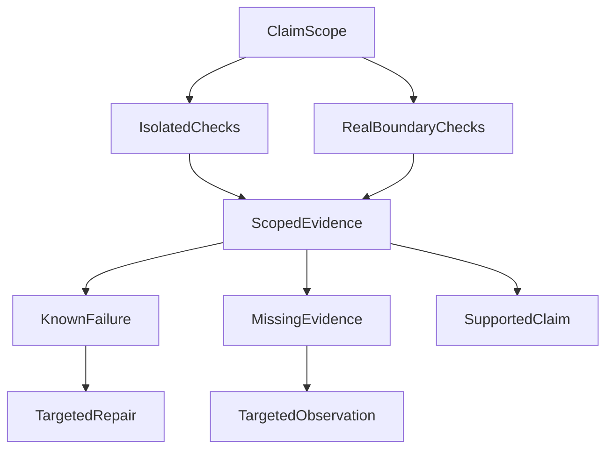

# Do Green Tests and a Model Response Mean the Agent Succeeded?

During early model evaluations for an agent, I encountered a puzzling situation.

The server had an answer candidate, the automated judge returned a verdict, and the Run was even marked completed. From the evaluation report alone, the request looked finished.

Following the frontend delivery chain revealed a different story. The existence of a candidate does not mean it was sent. Even a server-side send event does not prove the browser fully received and rendered the response.

I used to treat those states as nearly interchangeable. The most misleading evaluation reports do exactly that: **collapse success at different levels into one pass status**. A score may look good while the actual delivery path has serious gaps.

So what are we evaluating, and on what basis can we say an agent request actually succeeded?

This article brings together two questions: did the engineering test cross the boundary it claims to verify, and did the model evaluation inspect the material actually delivered? The cases belong to their original historical verification windows. They explain a method; they are not a catalog of current evaluation modules, commands or model rankings.

## First Establish Which Boundary the Test Actually Crossed

In another engineering-verification window, a focused mock suite recorded **32/32 passes**, while a broader collection had completed only **8 of 11 items**. Both observations can be true without jointly establishing that the system is ready. The first exercises isolated logic; the second exposes gaps in the declared acceptance scope.

Mock tests control inputs, external dependencies and time. They are useful for locating logic defects. Real-dependency checks actually start processes, connect to isolated databases, or cross standard-I/O and loopback-network boundaries. Each pass supports only the boundary it reached.

Three questions must remain separate:

| Dimension | What to record | What it must not be mistaken for |
| --- | --- | --- |
| Observed evidence | What happened on which revision and environment; record not collected when nothing ran | A real observation automatically means behavior passed |
| Follow-up work | An established defect or a specific missing observation, with a targeted next step | Unknown means failed, or every check must be rerun |
| Adoption decision | Whether the evidence supports completion or release within the declared scope | A local pass means the entire product was delivered |

A real execution can establish that a boundary **did not hold**. Its evidence is valid while the behavioral outcome is a failure. “Verified” must not silently become “passed,” and uncollected evidence must not become zero failures.

This does not require every small change to invoke real external dependencies. Match verification to the claim. Appropriate deterministic tests can establish local logic. A claim about a process, database or network handoff needs evidence crossing that boundary. Sufficient existing evidence need not be rerun merely because a report is being edited while behavior remains unchanged.

### Why Must Three Timeout Values Be Read Together?

A command-line timeout check supplied a concrete counterexample. In the original controlled window, the unit-side default was **45 seconds**, the model setting was propagated as **80 seconds per call**, and the governance cap was **60 seconds**. The mock never actually waited for 80 seconds, so reading the default alone concealed a propagated value that exceeded the cap.

A whole-task deadline and a per-call timeout constrain different things. The repair direction was to align clock origins, scopes and propagation semantics—not simply raise every limit after observing a long wait.

This is a teaching representation of that record, not the current runtime protocol:

```json
{
  "boundary": "per-call timeout propagation",
  "unitDefaultTimeoutSec": 45,
  "modelTimeoutSec": 80,
  "governanceCapSec": 60,
  "observation": "the propagated per-call value exceeds the stated cap",
  "boundaryHolds": false,
  "postFixRerun": "not collected in this window"
}
```

The original window contained no post-fix rerun. Identifying a repair direction does not turn the failing record into a pass. A timeout report should show the default, the actual propagated value and the cap together, along with their clock semantics. Those numbers are not interchangeable.

## Completed Describes One Program State

In ordinary HTTP APIs, success versus failure may appear relatively straightforward. An agent request has a much longer path.

After the user submits a question, Runtime asks the model to research and answer. The candidate passes through publication, the server sends it, and the client receives and displays it. Each handoff establishes only its own facts: candidate generation, server send, client receipt and UI rendering need separate observations.

```text
User question
→ Planning
→ Tool calls
→ Evidence assembly
→ Candidate answer
→ Quality checks
→ Streaming delivery
→ Client reception and display
```

These stages do not all pass or fail together.

A JSON object may be valid while planning misunderstands the task. A good plan may fail to invoke a necessary tool. A successful tool invocation may return stale evidence. A fluent candidate may be rejected at publication. A stream may terminate halfway through. Or the server may record a complete send without enough client evidence of a complete render.

An isolated success=true cannot preserve these distinctions.

I now separate the questions:

| Layer | What we need to establish |
| --- | --- |
| Protocol | Can the system parse the response? |
| Planning | Did the model understand the task and evidence requirements? |
| Evidence | Was the required eligible data actually obtained? |
| Answer | Is the final content accurate, safe and supported? |
| Delivery | Did the content actually enter the user-facing delivery path? |

Success in one layer does not certify the next. HTTP 200 does not establish answer quality. completed does not prove the user saw an answer.

## I No Longer Rush to Compute One Overall Score

It is tempting to rate protocol, planning, tool calls and answer quality separately, then compute a weighted 82, 87 or 91.

Some properties should not be averaged away.

If a model writes beautiful prose but lacks essential evidence, language quality must not compensate for that gap. If no answer was ever sent, an excellent server-side candidate should not receive an attractive overall score.

I prefer a vector of outcomes:

```text
Protocol = pass
Planning = pass
Evidence = inconclusive
Answer = not_evaluated
Delivery = pass
```

It is less visually impressive but much more diagnostic: protocol and planning worked; the delivery mechanism ran; evidence was not closed, so the run cannot support claims about answer quality.

The term **inconclusive** is important. It does not mean “failed, but politely.”

Failed means we have enough evidence that a requirement was violated. Inconclusive means the evidence is insufficient to decide. The appropriate next actions differ: repair an established failure, but collect evidence for an inconclusive outcome.

Treating both as zero risks ranking models by infrastructure noise rather than model quality.

## The Denominator Can Be More Deceptive Than the Score

A subtle trap occurs when **the denominator silently shrinks**.

Suppose we planned 30 test questions. Twenty remain unfinished within the observation window because of queues, timeouts or tool problems. Of the ten that completed, nine returned nonempty content.

This statement is accurate:

> Nine of ten completed samples returned an answer.

This one is not equivalent:

> The success rate was 90%.

The twenty unfinished cases may be precisely those requiring long context, multiple tools, repeated correction or complex reasoning. They are not necessarily missing at random.

Only evaluating completed cases measures performance **conditional on already having finished**, not performance on the original suite.

We therefore freeze the denominator and the experiment identity before a run:

```json
{
  "suite": "agent-cases-v1",
  "sourceHash": "sha256:...",
  "revision": "git-revision",
  "modelId": "provider/model-version",
  "profile": "live-read-only",
  "attempt": 1
}
```

Change the suite, code, model version or environment and you have a different comparison window. You may compare windows, but you cannot pool them into a flattering new percentage while pretending conditions remained identical.

This convention makes dashboards less appealing. It also keeps the hardest and most informative unfinished samples from disappearing.

## The Judge May Not See What the User Received

This is the most important distinction to me.

Many automated evaluations inspect a candidate on the server. The candidate goes to a judge that checks claims, formatting, citations or tone, then returns a verdict.

That is technically legitimate. But in a streaming product we must ask:

**Did the judge rate the same content the user actually received?**

Maybe not. Publication could reject a complete candidate. The first half of a stream could be delivered before a timeout loses the second half.

Even if a server records send, without a client ACK, receipt event or render evidence, the strongest defensible claim may be:

> The server recorded sending this material.

Not:

> The user definitely saw the entire answer.

An evaluation should distinguish at least three representations:

```text
Model candidate
     ↓
Actual server-emitted content
     ↓
Client receipt / display evidence
```

The middle representation is often the easiest to reconstruct reliably: concatenate the actual outbound content events in order.

If the client produces ACKs, message sequence numbers or rendering receipts, they can support stronger statements about the final level. Without them, do not rename “sent” to “seen” just to make a metric look more satisfying.

### Reconstructing Server-Delivered Content

A streaming answer is an **event history**, not merely one final string.

For example:

```text
run started
tool call
tool result
text delta #1
text delta #2
text delta #3
terminal
```

The text given to an evaluator should be reconstructed from **actual outbound text delta events**, rather than copied from a saved candidate that might never have been delivered.

This exposes a common false green:

> The judge marked the answer complete, but the client-side path received only the first half.

If a stream ended early, the evaluated delivery should contain only bytes or text actually emitted before interruption. A better server-side draft written afterward cannot rewrite that run's original history.

This is why agent evaluation differs from a conventional language-model benchmark: it evaluates a **distributed delivery process** as well as model output.

## The Evaluation System Can Be Wrong Too

What happens when the evaluator itself has a defect?

We encountered such a case. One class of outputs was mechanically failed because of an issue in the test fixture or validation contract. Correcting evaluation logic substantially changed verdicts for affected samples, while some genuine failures remained.

The simplest approach is to overwrite the old results. That destroys the explanation of why they failed originally and why a later review changed them.

We chose an append-only ledger model:

```text
Unmodified raw evaluation result
           +
Append correction
           ↓
Compute a revised view
```

A correction must identify the original evaluation, affected cases, old and new verdicts, the reason for changing them, and the identity of the original inputs and versions.

In shorthand:

```text
RevisedView = RawLedger + ValidCorrections
```

The essential rule is that RawLedger remains unchanged. A further correction can be appended if the first correction proves wrong.

This matters for model tuning. Otherwise a leaderboard that has been silently revised several times cannot reveal whether an apparent improvement came from the model, Runtime, or the evaluator itself.

## Do Not Merge Different Verification Windows into One Score

A passing mock suite and unfinished broader acceptance work can both be true. The relevant question is not which count looks better but which dependency boundary each check actually crosses. Database, network, model-output and user-visible delivery behavior cannot borrow credit from unrelated local checks.

The evaluator can itself misclassify outcomes, so keep original observations and later corrections distinct. Repair confirmed defects and collect missing observations without indefinitely expanding verification merely to produce a green dashboard.

## Release Model Conclusions Only After Three Gates

We eventually stopped trying to invent a complex universal score and asked three gate questions first.

### 1. Are we comparing the same experiment?

Do the test suite, code, model, configuration, data snapshot and denominator line up? If not, do not compute a direct ranking.

### 2. Did a hard requirement fail?

Protocol, security, privacy, required evidence and delivery can all be hard gates. If a condition already declared necessary for this comparison fails, unrelated high scores cannot make the candidate eligible for that role. An optional capability gap must not silently become a veto on every possible use.

### 3. Are important states still unknown?

If a critical requirement remains inconclusive, keep the candidate provisional. Collect evidence before announcing a winner.

Only after these checks do quality, reliability, latency and cost become meaningful comparison metrics.

```text
if not same_experiment:
    return inconclusive

if hard_gate_failed:
    return not_eligible

if hard_gate_unknown:
    return provisional

return compare_quality_reliability_latency_cost()
```

This looks less sophisticated than an all-in-one intelligence formula. I trust it more because it cannot let “95 points” conceal the fact that the answer never went out.

## Stop Each Conclusion at the Boundary Its Evidence Supports

Start with the claim's scope, select the relevant tests, and interpret observations within that scope:



The two kinds of checks are selected according to the claim. Every change need not run both. Evidence may support a scoped conclusion, establish failure, or remain insufficient. Targeted repair and targeted observation are therefore different next steps.

Completed, candidate text, judge pass, server send and client display are different facts. Mock passes and real-dependency observations are different evidence. Preserve those distinctions before comparing model quality, reliability, latency and cost.

**When a result is green, first ask which boundary, revision and actual content it establishes something about.** A number can be correct while the conclusion drawn from it exceeds the evidence.

This evaluation approach follows [method 5, “Choosing verification and diagnosing failure”](/en/principles#method-5): deterministic contracts deserve focused boundary checks, while model and user outcomes need proportionate real-world comparisons. A conclusion must not exceed the version, input and delivery scope the evidence actually covered.

## Further Reading

For how original execution observations are retained and corrected during development, see [Spec and Evidence Workflows](026-agent-spec-evidence-workflow.md). More essays are available in the [GitHub engineering collection](https://github.com/hpoenixf/eff-agent-article).
