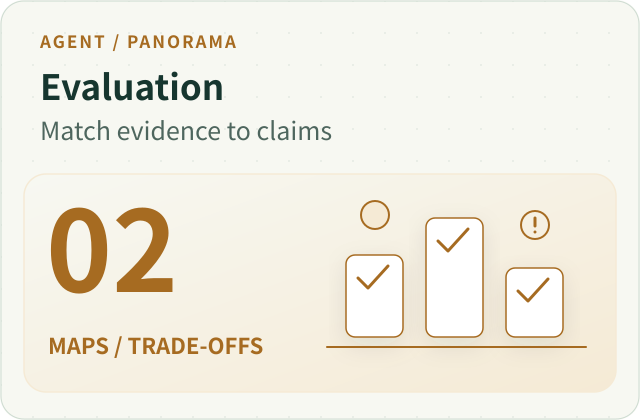
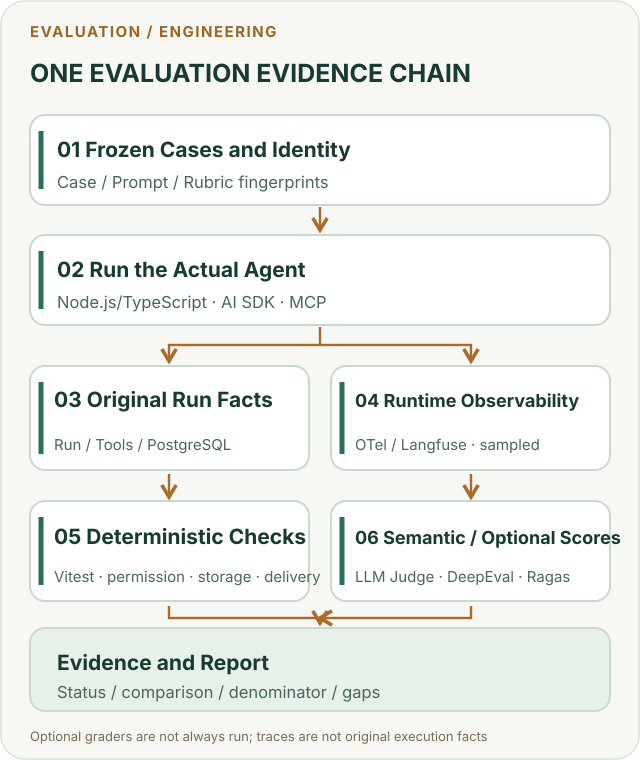
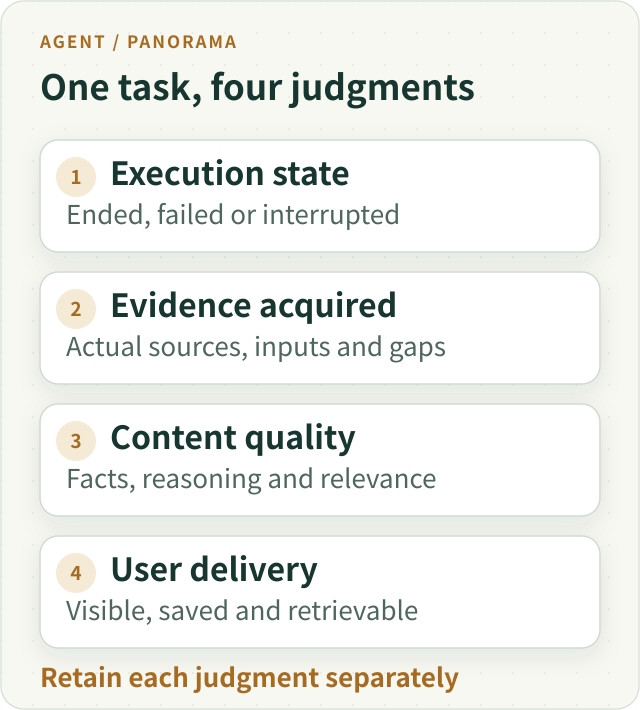
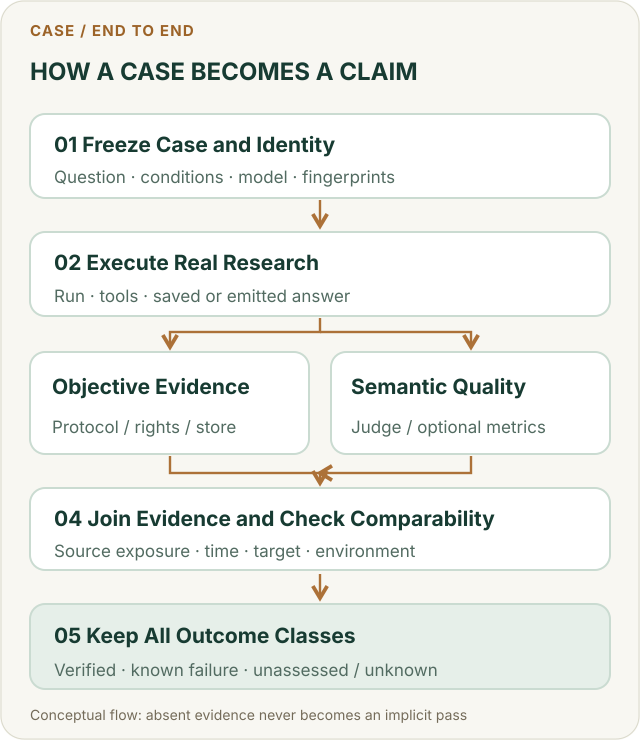

# Agent Evaluation Panorama: From Green Tests to Real Task Value

There is an appealing screenshot that engineers eventually learn to distrust: all tests are green, the Agent Run is marked completed, Langfuse shows a clean model-and-tool trace, and the quality review says 85/100. Put two versions side by side and it seems natural to conclude that one is better.

In ETF Agent's engineering evaluations we saw why that conclusion can fail. In a bounded two-ETF research review, most of the necessary conditions held, but one calculation applied an inapplicable stamp-duty rule to secondary-market trading. Another assessment produced fluent review commentary yet pointed to supporting material that could not be located in what the reviewer actually received. In an earlier protocol exercise, ten different models failed the same criterion, and the error was in the shared formatting rule rather than in all ten models.

The question is not whether testing matters. It is **what each part of the testing system can actually establish**. A unit test establishes a programmed invariant. An API response establishes an observed response. A trace reconstructs some of the runtime behavior. An LLM judge offers a scoped semantic assessment. Combining these facts is necessary, but it does not automatically establish that the user received the right result.

This article opens the engineering system behind those judgments. We will follow the versioned question catalogue, the Node.js execution harness, Vitest and PostgreSQL, OpenTelemetry and Langfuse, a structured custom judge, optional DeepEval and Ragas, and the evidence-linked report. “Current” refers to the implementation and recorded observations checked in early November 2026; it is not a claim that every optional evaluator runs in production or that the full internal system is present in the public teaching repository.

## 1. A Map of the System: Evaluation Is an Evidence Pipeline, Not One Judge

For a conventional API, response assertions and database state can often capture the central behavior. An agent can search, read PDFs, calculate, call multiple tools, delegate research, survive interruption, publish partial content, and continue in the background. Some failures occur between the source and a factual claim; others occur between saved content and what the browser shows.

A useful evaluation must therefore perform six connected but distinct jobs. **Freeze the task:** identify cases, turns, input versions, model configuration, business criteria, and the planned population. **Execute:** invoke the actual Agent under permitted conditions, not a made-up stand-in that merely resembles it. **Observe:** collect runtime, tool, source, persistence, and delivery evidence. **Grade:** use deterministic checks for facts that code can prove and semantic or human review where interpretation is needed. **Check comparability:** establish that results belong to a meaningful comparison. **Report:** retain passing, failing, inconclusive, and unassessed outcomes, including why a claim is or is not supported.

Here is the technology map, organized by the decision it supports rather than by what happens to be installed:

| Stage | Technology and module | Why it exists | What it cannot certify |
| --- | --- | --- | --- |
| Case definition | Curated Question Set, JSON views, content hashes | Stable prompts, tags, prerequisite turns and denominators | The cases were executed |
| Execution | Node.js/TypeScript, custom CLI runner, AI SDK, original Agent Runtime | Run real cases and capture their lifecycle | An ended Run fulfilled the user task |
| Engineering verification | Vitest, isolated PostgreSQL and task-specific browser tests | Protocol, persistence, recovery, permissions and UI behavior | Offline mocks reflect live model quality |
| Observability | OpenTelemetry, Langfuse, original Run/tool/publication records | Trace call paths, usage, latency, and incidents | A remote trace contains the whole truth |
| Semantic review | AI SDK, Zod, a purpose-built judge Skill | Structured judgments of grounding, coverage, freshness, safety and clarity | Financial or execution authority |
| Optional metrics | Isolated DeepEval, Ragas 0.4.3, local bge-m3 | Supplementary response and retrieval assessments | Full research task completion |
| Reporting | Evaluation Evidence Loop and structured reports | Link identity, outcomes, reasons, and comparability | Permission to rewrite the original facts |

The architectural decision is not “we built a proprietary alternative to Langfuse.” We did not give Langfuse sole ownership of historical run facts, nor did we promote any LLM grade into the final authority for a financial task. The existing application continues to own execution and publication records. Evaluators consume appropriately admitted data and add limited judgments. New graders should expand the evaluation layer, not retroactively change what a Run did.

## 2. Start with a Versioned Question Catalogue, Not a Dashboard

“Compare these two ETFs” can be a different task a week later: market conditions change, available reports change, and the user may be pointing back to a previous turn. If test questions are copied manually between scripts, two batches can have different inputs while appearing to be identical experiments.

ETF Agent keeps one versioned Curated Question Set. A case has a stable ID, revision, text, tags, conversation group, turn index, and projections for supported runners. The question identity includes a content hash, and the complete catalogue has its own hash. When a prompt, prerequisite, or view changes, an old score cannot silently retain the identity of an unchanged test.

The current catalogue description specifies a default 14-case core that spans ETF concepts, numeric calculations, NAV timing, like-for-like comparison, correction of dates, public product versus personal portfolio boundaries, refusal to execute trades, stale evidence, and multi-turn references. Additional tagged cases stay in the same catalogue. Fourteen describes a selected core at the verified snapshot, not every test in the system, and not fourteen demonstrated successes.

Multi-turn identity matters more than it first appears. Imagine a second turn asking, “What about the other one?” If the runner extracts it from its conversation, the model's confusion is a test-setup defect, not a valid capability result. The catalogue selector includes prerequisite turns and checks ordering and executor support. It should refuse an incompatible plan rather than silently run a subset.

The catalogue also separates regression from capability evaluation. Regression asks whether a previously supported behavior still works; capability evaluation deliberately probes harder or newly possible work. Combining them into one percentage hides both regressions and frontier progress. Reference criteria likewise need care: finance research often has verifiable conditions and multiple defensible phrasings rather than one mandatory paragraph. The fixed facts are the instrument, data window, material risks, required coverage, and authorized behavior—not the exact prose.

The project exposes question selection and execution commands such as questions:list, questions:check, and questions:run. The old 6/24-question live slices are explicitly retired in the relevant legacy runner. Before allowing real provider dispatch, the safe workflow is to inspect which cases and prerequisite turns were selected, validate capability and configuration, and obtain the actual authorization for model and data use.

## 3. Why a Runner Must Exercise the Actual Agent, Not Just the Model

For a tool-using Agent, a polished answer from a direct model call does not demonstrate that the actual product read market data, checked a share class, used the right calculation, respected permissions, or saved a report. Testing only the text model can be useful for prompt experiments, but it is not the same task as evaluating the application.

The custom Runner sits around the existing Runtime. It prepares the evaluation environment, chooses versioned cases, starts admitted requests, observes completion and failure modes, binds results to their original identities, and creates a scoped report. The original Runtime still performs the research. This distinction prevents an evaluation harness from accidentally reimplementing a simplified Agent whose success has little relationship to the deployed application.

Two kinds of execution coexist. The main self-test CLI connects cases, actual responses, independent review, and recorded outcomes. Separate bounded live probes can answer narrower questions, such as whether an expected tool was selected within a strict step and time budget. A three-case live smoke check is useful evidence about those three behaviors—not a headline score for the entire finance research system. Fixed-evidence verification can also validate specific contracts without calling a provider.

The runner must take infrastructure seriously. Real evaluations can create conversations, write state, save outputs, and collide with concurrent runs. The self-test orchestration includes controlled port selection, per-run artifact directories, database preparation and cleanup, and handling for interrupted evaluations. When a process is interrupted, the correct result is to preserve an inconclusive record and attempt bounded cleanup, not quietly erase that trial.

Real application runs cost more than pure tests: they can involve service startup, databases, networks, model usage, and external variability. That is why the runner is another validation layer rather than a replacement for Vitest. A trivial syntax fix may only need static checking. Model routing, evidence acquisition, tool permissions, and publication changes may justify deeper integration and live tests.

Every result needs to answer four simple questions: which case was selected, which model and configuration actually ran, which Run was entered, and which exact answer was scored. Without those links, a well-designed report can be visually convincing but fundamentally ambiguous.

## 4. Vitest, PostgreSQL, and the Browser Prove Different Things

Many important Agent defects do not require paid model calls to reproduce. A tool appears despite an explicit prohibition; cancellation sends a new request; an answer revision is overwritten; recovery treats an unconfirmed message as finished; the judge schema accepts an illegal value. Such conditions belong in deterministic tests first.

ETF Agent uses TypeScript and Vitest for contract and execution-branch checks. Code assertions are fast, repeatable, and usually more authoritative for objective facts than an LLM's interpretation of logs. If a permission policy forbids a write tool, inspect the permission facts and observed invocation. If a schema has to reject duplicate identifiers, validate that structure directly. If an investment calculation has a defined unit and input date, compare it with a controlled computation—not with a guessed answer from a reviewer.

PostgreSQL adds a different proof surface. In-memory stores are excellent for unit testing but may miss real uniqueness constraints, migrations, transaction behavior, retries, concurrent writers, and reads after restart. The self-test runner can use an isolated PostgreSQL database and remove it after the evaluation, checking selected persistence paths through the application's actual storage interface. Failure to prepare or clean that database is an environment problem; a good text answer cannot offset it.

The client provides yet another boundary. A server may persist a Publication and emit SSE data while a browser never adopts the new revision, refreshes the wrong history, or loses content during reconnection. To claim that the user saw an answer, a suitable client observation or end-to-end test is required. The repository has Playwright-related testing capability, but the presence of a package **does not prove that every evaluation included browser-level delivery acceptance**.

Consider a single published revision. Vitest can check the rule that a duplicate revision must not be published twice. A real database test can show that the saved revision survives restart. A browser check can establish that the UI actually displays the right revision instead of overwriting it with older data. Without the last test, “server persistence verified; client rendering not assessed” is a strong and accurate result. “Delivery passed” would overstate it.

This layered approach is conditional, not ceremonial. A stateless text classifier does not need a PostgreSQL farm and browser suite just to appear sophisticated. The appropriate tests follow the task's actual side effects and handoffs.

## 5. OpenTelemetry and Langfuse: See the Process Without Replacing the Facts

Final answer text cannot explain where a research run spent its time, whether a tool retry occurred, which read failed, or how many model calls contributed to the outcome. ETF Agent uses Langfuse through OpenTelemetry to associate a Run with trace spans for generations, tool activity, and other observed phases. Trace relationships make it possible to inspect a latency or cost anomaly without reconstructing every event from narrative logs.

This is especially useful when investigating changes. If a new version is slower, one can inspect whether it waited for models, called more tools, read larger documents, or spent longer in the scoring path. Run/request correlation permits targeted lookup of observations rather than broad searches across unrelated logs.

But remote observability has a decisive limit: **events may be sampled, delayed, duplicated, or unavailable**. A query that successfully reads every available page does not establish that the original producer recorded every event. The implementation distinguishes query completeness from the broader source-capture question, and keeps some export or observation states explicitly unconfirmed.

Suppose a model invocation and settlement appear in the original durable records, but the corresponding Langfuse observation is absent. That is not enough to claim the invocation never happened. First ask whether tracing was sampled, delayed, lost, or mis-correlated. Conversely, a replayed or duplicated observation does not become a second model execution simply because it appears twice in a dashboard.

We separate the two chains. The original Runtime and Store own the execution and persistence facts they can substantiate. Langfuse provides diagnostic inspection and selected telemetry. The evaluation report says whether those chains were linked and what is still missing. A useful trace is evidence, but it is not a universal truth source.

Cost attribution follows the same rule. Token usage plus configured prices may support an estimate; provider settlement is a different fact. Retries, uncertain dispatch, subscription accounting, and shared budgets complicate the mapping. Without complete usage or billing evidence, the result should say unknown, not $0 merely because a dashboard lacks a row.

## 6. Publication and the Client: Which Text Did the Judge Actually Grade?

A long research job can have multiple text objects: a model candidate, a prepared report, a saved publication revision, an emitted answer part, and the content the browser finally shows. These objects may differ. The first job of a grader is to bind itself to the right one.

Imagine a model generating ten polished sections. Publication accepts only the first five before the task is interrupted. A judge that reads the complete ten-section working draft may accurately describe candidate quality, but it cannot establish that the user received a complete report. A partial yet valid saved publication should not disappear because a later Run ended unsuccessfully.

A server-emitted SSE chunk is likewise not proof of client adoption. A history endpoint containing a final revision does not establish what an earlier browser session displayed. Claims must stop at the observed surface: candidate generated, publication saved, content emitted, client received, or client rendered. A report can state “scored saved publication revision” or “scored model candidate,” but should not silently substitute one object for the other.

This is not an argument for adding language-based vetoes to the production path. Publication already has its own application responsibility. Evaluation has a narrower job: identify the exact artifact covered by each claim and keep its Run, request, revision, and observed boundaries attached.

A surprising number of evaluation errors are object-substitution errors rather than arithmetic errors. A candidate is updated but the grade still points to an old answer. A retry creates a better answer that gets assigned to the earlier trial. A reviewer is handed new sources and then reports that the original Agent had already read them. Once the scored artifact is allowed to drift, even excellent grading logic becomes difficult to audit.

## 7. Deterministic Validators: Do Not Ask an LLM to Guess Objective Facts

A more capable judge model is tempting because it seems able to classify everything. But many finance Agent requirements are not subjective: a tool was or was not authorized, a database state changed or did not, a schema was valid or invalid, a protected value leaked or did not, and a calculation matches its declared inputs or not.

Those belong to deterministic verification through the source of the fact. Tool receipts establish observed invocations, storage records establish managed state, permission rules determine authority, and controlled calculations establish numeric relations under declared units and dates. An Agent saying “I did not trade” is not evidence that no write tool was called. An answer containing the words “according to the source” does not prove that the source was read.

Deterministic checks can also be misused. A brittle regex for a phrase can reject a valid answer that expresses the point differently. ETF Agent's evaluation contracts deliberately avoid inferring open-ended semantic conclusions from arbitrary answer wording. Exact protected strings or mechanically required formats can be checked when a case explicitly declares them. Groundedness and financial semantic correctness need separate review, not a disguised keyword test.

This division is important for a finance example. Two responses may omit a phrase the fixture expects. One still correctly distinguishes trading venue and fee applicability; the other applies the wrong regime. A phrase matcher cannot reliably distinguish them. In the opposite direction, a response can contain every expected term and still be wrong.

We therefore separate hard authority and protocol conditions, semantic quality, and experimental eligibility. A good style score cannot cancel unauthorized tool use. Passing all objective checks does not imply that the research thesis is correct. Each check should carry only the authority its actual evidence allows.

## 8. A Structured Custom LLM Judge: What It Measures and Why It Can Be Wrong

Open-ended research still requires interpretation. Explaining the differences between on-exchange ETF transactions and off-exchange subscription, for example, cannot be validated by exact text equality. ETF Agent has a dedicated judge implemented with the AI SDK, Zod structured output, and a specific evaluation Skill.

The reviewed judge defines five dimensions: **grounding**, **completeness**, **freshness**, **safety**, and **clarity**. It returns a verdict, an overall score between 0 and 100, confidence, dimension scores, and explicit issue codes. The corresponding implementation uses a 70-point floor and a 0.70 confidence floor. These are concrete policy values for that evaluation path, **not a universal finance-correctness threshold or an assertion about all current release gates**.

The structure matters because an unexplained 75/100 is hard to act on. “Missing requested fee details” suggests answer planning; “source date undisclosed” points to evidence and temporal handling; “evidence mismatch” calls for checking exposure and citation support; unauthorized execution belongs in objective permission review. A useful evaluation names a failure mode rather than merely ranking prose.

Zod verifies the **shape** of a review, not its truth. Invalid JSON, truncated output, schema failure, unavailable providers, weak confidence, and claims whose cited material cannot be located must be represented. The defensible result can be abstain, not-evaluated, or inconclusive. Automatically converting every judge failure to zero quality—or treating malformed output as a pass—confuses evaluator availability with model competence.

Independence requires more than changing the API endpoint. A generator and reviewer using the same model family can share assumptions and blind spots. The evaluation record therefore needs judge identity, protocol, rubric, model parameters, and its human calibration status. Particularly consequential finance judgments need domain review where the automated judge lacks a trustworthy reference.

The reviewer must also see the correct answer and only the permitted evidence. A citation marker or source ID is not a semantic proof. Post-hoc source addition may assist a new review, but it cannot establish what the original researcher or original judge actually saw.

## 9. DeepEval: Reuse Standard Metrics, Keep the Adapter Optional and Isolated

Not every general-purpose grading metric should be reimplemented. DeepEval offers answer-relevancy, faithfulness, and configurable GEval-style assessments that can challenge the custom reviewer's conclusions from a different angle. Its role in this system is supplemental diagnosis of recorded answers, not a substitute for the original application's contract checks.

The adapter is deliberately separate from the normal Agent server, publication, and recovery flow. Evaluations start from retained responses. Before approved nonprivate material reaches an external reviewer, exact input content and source excerpts are reviewed and bound to a content fingerprint. The worker has restricted access, bounded requests, input limits, and deadlines. Errors preserve the original denominator and mark scoring unavailable rather than assigning product failure.

There was also an instructive third-party packaging problem. The project recorded cases where npm distributions of the TypeScript DeepEval SDK could not execute the required metrics as shipped. The remedy was an unmodified source build at a pinned upstream commit with integrity hashes, rather than quietly patching vendor behavior. **The grader itself is software that needs qualification.** Its version and provenance are part of the experiment.

A bounded diagnostic eventually produced valid scores for 11 of 12 distinct selected cases; unavailable scores and earlier failures remained recorded. This demonstrates actual metric execution in that scope. It does not establish perfect human agreement, full research success, automatic production deployment, or Task Completion on trials that did not provide an authorized full trajectory.

DeepEval is therefore an optional evaluation lens. When independent generic scoring is useful and data access is authorized, it can be activated. If a task needs only objective checks, the ordinary Agent and test suite should continue without installing the external evaluator.

## 10. Ragas: Relevancy, Faithfulness, Retrieval, and Answer Accuracy Are Different Questions

Ragas provides a more specialized breakdown of retrieval-augmented generation. The current engineering path runs pinned Ragas 0.4.3 in an isolated Python execution environment. Judge requests pass through the existing controlled Host rather than giving the Python process application credentials. Embedding calls use the configured local bge-m3 service.

A crucial correction to the earlier article and figure: Ragas was **not** still waiting for its first real metric score. On November 3, 2026, the repository recorded actual response-relevancy scoring for ten retained answers. The original partial research statuses were not overwritten. A separately retained answer-accuracy recheck produced a score for one case, while a controlled five-metric context demonstration was a different example—not an eleventh success in the ten-answer batch.

The metrics answer different questions:

| Metric | Question | What a high score still cannot prove |
| --- | --- | --- |
| Response Relevancy | Does the answer address the question? | The facts and finance conclusions are right |
| Faithfulness | Do supplied contexts support answer claims? | The contexts are authoritative, complete, and current |
| Context Precision | Are relevant retrieval contexts ranked well? | The answer used them correctly |
| Context Recall | Do the retrieved contexts cover reference requirements? | The generator actually consumed all useful evidence |
| Answer Accuracy | Does the answer agree with an independent reference? | The reference applies to another date or market rule |

A response can be highly relevant and financially wrong. A report can discuss ETF trading costs in an impressively detailed way while applying a fee rule for the wrong venue. Relevancy alone cannot detect the regime mismatch. That requires verified domain rules and a review of the specific claim.

The inputs also matter. Faithfulness requires the retrieval contexts that are actually authorized for grading. Reference-based accuracy needs an independently supplied reference. **Do not fabricate context or a reference from the answer being judged** and then use it as proof. Missing inputs leave dependent metrics unassessed. Scores from different contexts or case populations must not be averaged into a fictional product success rate.

The cost of this path is tangible: Python environments, pinned dependencies, model and embedding usage, timeout management, and private report artifacts. Use it when retrieval and grounded synthesis are the real problem. It is not an all-purpose gate for tool authority, persisted side effects, or client-visible delivery.

## 11. Why Financial Research Requires Business-Specific Verification

For a sentiment or writing-style classifier, consistency and tone may be the primary goals. Financial research adds harder object and temporal constraints. On-exchange trades and off-exchange subscriptions, share classes, benchmark definitions, currencies, and NAV dates cannot be conflated because their names sound similar.

The original bounded two-ETF review had four necessary checks, of which three held while one applied a stamp-duty rule outside its appropriate secondary-market context. The lesson is not that the prose needed more cautionary language. The correct verification asks for instrument identity, venue, rule applicability, its effective time, and reliable support for the actual calculation. “This fee exists” and “this fee applies to this transaction” are distinct propositions.

Source time has multiple meanings. A financial report may describe an earlier business period, be published later, and be fetched later still. Business as-of time, publication time, and acquisition time should not collapse into one arbitrary date. The model should be judged against what was legitimately knowable under the task's time constraints. This three-time distinction is a necessary design lens, not a claim that every historical component has finished migrating to one uniform timestamp schema.

Evidence also has levels. A document can be discovered, fetched, parsed, made visible to the model, consumed by the actual Run, cited in a publication, and semantically supportive of an individual claim. One level does not certify the next. Source hashes help identify bytes; they do not establish that the information applies to this fund, time, or trading rule.

Requirements should be proportionate. Static public explanations need less infrastructure than portfolio calculations and transaction-adjacent decisions. Yet even a fully scored research report does not authorize trading. Research quality, approval to transact, and actual account state remain distinct business responsibilities.

## 12. Evaluation Evidence Loop: Why One Boolean Is Not Enough

Real evaluation populations contain cases that resist pass/fail compression: completed execution with poor content, provider disconnection before a usable answer, a valid answer whose judge failed, or two well-scored runs with incompatible settings. They require different remediation.

ETF Agent's Evaluation Evidence Loop uses independent dimensions. Execution status can be completed, failed, or inconclusive. Judgment can be pass, fail, abstain, or not-evaluated. Eligibility can be eligible, ineligible, or unverified. Identity includes run and cell references, case and repeat, requested/effective model, provider, protocol, and hashes for the manifest, fixture, tool contract, prompt, scorer, and rubric. Comparability has its own reasons.

Here is **an explanatory example, not an export of the complete production schema**:

~~~json
{
  "caseId": "C-example",
  "caseRevision": 3,
  "evaluationRunId": "study-demo-01",
  "target": "saved-answer-revision",
  "executionStatus": "completed",
  "judgement": "fail",
  "eligibility": "eligible",
  "comparability": "comparable",
  "findings": [
    {
      "layer": "research-quality",
      "code": "WRONG_APPLICABLE_FEE_RULE",
      "basis": "criterion-review"
    }
  ],
  "delivery": "saved-only",
  "clientRendered": "not-observed"
}
~~~

Execution completed; the semantic result failed a specific requirement; the case can still be eligible for inclusion in the planned quality experiment. Eligibility does not say it is safe to release. If no semantic reviewer actually assessed it, judgment should be not-evaluated rather than an implicit pass derived from the absence of hard-rule violations.

Failures also need typed attribution. An unauthorized tool is a permission finding. A reviewer timeout is an evaluator issue. A failed test database is a harness or infrastructure issue. When causality cannot be established, retain unknown or a tie rather than blaming the model automatically.

The point is not to invent a new database, scheduler, or state machine for every distinction. A stable identity and immutable-enough evidence contract can compose existing records. Additional graders can add findings without rewriting a historical model invocation or publishing event.

## 13. One Case End to End: How the Pieces Exchange Evidence

Let us connect the components through a single task: “Compare the costs and tracking differences of two ETFs for a specified date.” This is a **teaching reconstruction of the verified responsibilities**, drawing on the recorded tax-rule failure. It is not a claim that a single production Run with all these illustrative fields existed.

**First, freeze the case.** Select the case revision, instruments, venue, time window, required source and business conditions, model configuration, prompt, and rubric. Include prerequisite conversation turns. This stage must not silently dispatch a paid model call; it first establishes what is being evaluated.

**Second, execute the original Runtime.** The runner starts an admitted research request. Depending on the task and authorization, the Agent may use market data, portfolio tools, web/PDF readers, or calculations. The evaluation harness does not grant extra access merely because the run is labelled a test. The runtime records the request, observed tool effects, and terminal state.

**Third, bind the scored object.** The Agent may have a candidate draft, a partially saved publication, and emitted content. Choose the exact target and its revision. A more complete later working draft cannot be substituted for what was saved earlier. If only partial content exists, the report should represent the partial boundary.

**Fourth, collect observations.** The original Run and Store describe executed work and persisted effects. Langfuse/OpenTelemetry help inspect generations, tools, timing, and usage. Missing telemetry remains a coverage question unless stronger records establish the action did not occur. Finding a document on disk after the fact does not prove the original model used it.

**Fifth, check objective conditions.** Verify authorizations, protocol, required tool or source records, calculable numeric requirements, and prohibited side effects. If a trading-fee rule is incompatible with the instrument and venue, preserve that specific finding rather than hiding it inside a good average score.

**Sixth, evaluate semantics where inputs permit.** The custom judge checks grounding, coverage, freshness, safety, and clarity. Approved nonprivate recorded data may additionally be assessed with DeepEval. When real retrieval contexts or independently authored references exist, selected Ragas metrics may be used. Missing contexts should not be invented to make a metric run.

**Finally, join and report.** Keep execution, quality, eligibility, missing evidence, cost and timing distinct. One completed candidate supports a diagnosis, not an A/B verdict. Two candidates with different evidence windows may not support a causal ranking. Every useful report should indicate the next appropriate action: fix business logic, repair retrieval, improve observability, revise the grader, or run a valid controlled comparison.

The key property of the pipeline is that every stage can stop at the level it actually knows. An answer with missing exposure evidence is not grounded by assertion. A saved publication with no client observation is not a proven rendered answer. Two individual judge scores are not automatically a comparative experiment.

## 14. Three Sources of False Improvement: Denominator, Configuration, and Grader

**Changing the denominator** can manufacture a headline. If 100 cases were planned and 60 completed, with 54 passes among those completed cases, it is legitimate to describe the assessed-completion rate as 90%. It is not legitimate to describe the entire planned experiment as a 90% success without disclosing the 40 other cases. Never-dispatched items, interruptions, and missing reviews belong in the original population with their actual status.

**Changing conditions** can do the same. The same prompt may be executed with different model versions, tool surfaces, token limits, source snapshots, budgets, or cache state. A multi-agent design that reads more reports and spends three times the budget may produce a richer answer, but that does not isolate the causal value of expert collaboration. If the experiment did not control or record those differences, the correct conclusion is a limited observation.

**Changing the grader** is the most surprising case. In one historical formatting-protocol evaluation, ten models received 0/10 strict passes. Review showed that a shared criterion incorrectly rejected valid line-separated markers. Rechecking the same original ten outputs under the corrected rule yielded 9/10, with the remaining genuine formatting failure retained. The models did not suddenly improve; the measurement changed.

A trustworthy system retains both interpretations, along with the old observations and the scorer/rubric versions. Otherwise a chart implies dramatic model improvement that never happened.

For A/B comparison, run both candidates on the same selected cases, establish comparable source windows and resource conditions, record repeats and all unsuccessful attempts, and disclose external variability. If there is only one candidate, one valid result, or two incompatible conditions, a diagnostic report is more accurate than a forced winner.

## 15. Latency and Cost: Unknown Is Not Zero

Quality is only part of product usefulness. For research tasks, time and cost determine whether a method can be used repeatedly. Measuring only model-generation milliseconds misses queueing, source reads, document parsing, tool invocation, retries, scoring, and publication. Long-running tasks also need meaningful distinctions between first useful delivery, final completion, and independently valid partial content.

A useful performance report links its duration to actual run and request identities. How many model generations were needed? Which tools dominated the timeline? Did later steps accumulate more context? Was the published answer delayed after generation ended? A tiny sample cannot establish an operational p95; it can only report the sampled observations and their coverage.

Financial cost needs the same restraint. Token usage times listed price is an estimate. Provider settlement is separate. Retry ambiguity, uncertain dispatch, shared billing, and subscription terms can break the equality. If there is evidence of a call but not of a billed amount, report unknown, not $0. Zero is appropriate only when supported by actual zero-cost execution in the declared scope.

The evaluator also consumes resources. If each Agent answer is judged several times or goes through Ragas generations and local embeddings, those are **evaluation costs**, not original Agent costs. Combining them in one number corrupts model cost-efficiency comparisons. Reducing evaluation work may save experimentation money without making the product cheaper.

Timeout policy can even change what appears to be model capability. A deep research Run interrupted by an unrealistically short evaluation deadline may be a harness limitation. Increasing the deadline and retrying can be a valid new experiment, but it cannot retroactively make the original attempt successful. Preserve both trial identities and their different budgets.

## 16. Four Engineering Lessons from Real Evaluation Problems

**Ten models failed because of a shared grader bug.** The root issue was not a collective collapse in model ability. A brittle common format criterion rejected valid text. Reviewing the original outputs and versioning the repaired rubric prevented the score change from becoming fictional model progress. This is why evaluators themselves need regression tests and independent calibration.

**An ETF research answer applied an inapplicable fee rule.** The failure was specific to business semantics: instrument, trading venue, and applicable regulation. Good fluency and generally relevant retrieval do not rescue that claim. A finance evaluation has to identify which exact necessary criterion failed and why.

**Multi-agent collaboration did not automatically demonstrate incremental value.** Some reviewer citations could not be located; some graders were not independent of the generator; other trials lacked a qualified alternative arm or stable configurations. Specialist interaction may be real while the improvement claim remains unverified. Demonstrating incremental value requires a valid baseline and evidence that Main actually consumed useful specialist contributions.

**Later retrieved material did not become original-Run exposure.** A source found after evaluation can inform an additional human review. A SHA-256 digest can establish which file bytes were used in that later process. Neither proves that the original researcher or judge saw the file. Provenance is a statement about an earlier event, not a story revised whenever more material arrives.

These cases involve very different subsystems but point to the same debugging rule: identify the owner of the defect before choosing a repair. Product behavior is repaired in the product; bad rubric logic is repaired in the grader; missing observations require evidence work; invalid comparisons require a new experimental design. None should be fixed by silently editing another subsystem's historical facts.

## 17. Build or Buy? Start with the Smallest Complete Evaluation

Langfuse already supports traces, datasets, experiments, scores, code evaluators, and human review. LangSmith offers experiment and regression workflows. DeepEval and Ragas provide useful metrics. For many applications, a standard platform and a carefully chosen dataset are sufficient. Rebuilding a complete observability backend and evaluation dashboard merely because the project contains an Agent may create more maintenance than insight.

A good initial system is deliberately small. Choose five to ten representative cases. Freeze the question and configuration identity. Execute them through the actual product boundary. Save results and failed attempts. Add a few objective checks. Review open-ended quality manually. The first target is to answer “which case, which run, what happened, and why,” not to accumulate scores.

Add versioned multi-turn selection and denominator discipline when repeated or multi-model comparison becomes common. Add persistence and client delivery checks when tasks have real side effects and asynchronous publication. Add Ragas when retrieval quality becomes a measurable bottleneck; add an independent judge when semantic assessment warrants its cost. Those integrations should follow observed problems, not a checklist of fashionable tooling.

There is also a positive case for restraint. No retrieval means no reason to fabricate contexts for faithfulness metrics. One candidate does not require an A/B tournament. A database assertion is preferable to a model grade when the database fact is available. Missing price evidence means the cost field can stay unknown. Missing client observation means the claim stops at server delivery.

Release gates should protect named risks. Tests protect protocol and objective invariants. Fixed regression suites catch known behavior loss. Periodic live evaluation checks model and system interaction. Human review calibrates subtle finance semantics. A threshold is useful only within the contract it actually measures; it is not a universal certificate of business value.

## 18. From an Engineering Stack to a Decision We Can Defend

Return to the research report that started this article. We can establish its selected case and version, show how the Node.js Runner entered the actual Agent, explain which invariants Vitest or a real database could verify, trace selected operations through OpenTelemetry/Langfuse, score an admitted answer with the custom judge, and optionally add DeepEval or Ragas results. The value of these technologies is not that their names form an impressive list. It is that **none of them needs to claim authority beyond its own observation**.

A useful report should allow a reader to find the original task, effective configuration, run and answer identity, source exposure, objective findings, semantic criteria, unknowns, comparability conditions, and the next repair to make. A small set of explainable failures is often more actionable than a beautiful chart of averages.

We now find it more useful to think of Agent evaluation as a system for turning non-deterministic behavior into **limited, reviewable engineering decisions**. It will not make research deterministic or establish investment returns. It can, however, prevent a different and more avoidable failure: releasing a complex Agent because a single pass rate made the team believe it knew something it had never measured.

## Further Reading and Sources

This is an engineering panorama, not a public deployment guide to the complete internal research product. The full internal source, credentials, and unredacted run records are not implied to be public. For deeper explanations, see [observability](025-agent-langfuse-from-trace-to-trustworthy-observability.md), [citation evidence](ai-citations-do-not-prove-reliability.md), [subagent contribution](agent-subagent-contribution-evidence.md), and [cost attribution](agent-report-cost-attribution.md). The core mechanism is explained here without requiring those follow-up articles.

Useful primary references for general-purpose evaluation are [Langfuse Evaluation Concepts](https://langfuse.com/docs/evaluation/core-concepts), [Ragas Metrics](https://docs.ragas.io/en/stable/concepts/metrics/available_metrics/), [DeepEval documentation](https://deepeval.com/docs/faq), and [Anthropic's guide to evaluating agents](https://www.anthropic.com/research/demystifying-evals-for-ai-agents). Their general tools and guidance should not be misrepresented as verification of the ETF Agent-specific observations described above.

More articles: [ETF Agent Engineering Notes](https://github.com/hpoenixf/eff-agent-article).
