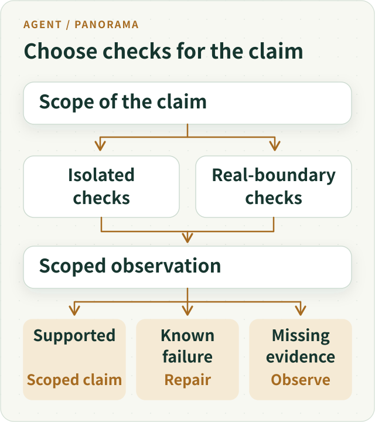

# Agent Evaluation Panorama: From Green Tests to Real Task Value

A fund-research report completed, was saved, and received an LLM judge score. Surely we can now compare two agent designs. But a closer review found an ETF secondary-market trading-cost rule misapplied to stamp duty; elsewhere a seemingly excellent judge response cited material that could not be located in the judge's actual input.

**The unusual problem with agent evaluation is that execution, readable evidence, a score, and a user-visible answer can all exist while supporting different conclusions.** Compress them into one success rate, and the evaluation itself becomes a source of fiction.

Rather than listing successive bug fixes, this essay follows the final design decisions behind one question: *what are we evaluating, which surprising failures mattered, how do established frameworks handle the common case, and why does financial research need additional guarantees?*

## 1. Decide What Is Being Evaluated Before Choosing a Scoring Formula

An agent's work has at least four distinct outcomes: **execution** under the expected contract, **evidence** that was actually obtained and can be reopened, **content** that addresses the task, and **delivery** that reached a particular surface. One cannot stand in for another.

A model may create an excellent full draft, but Publication might accept only its first two sections. A judge looking at the full draft is scoring a model candidate, not the text the user received. Conversely, a Run that ends partial may have saved independently valid, useful material. A terminal success does not certify the answer, and a terminal interruption does not erase committed work.

The scored object therefore needs an original Run, request and publication revision, plus the exact saved or emitted content and its observation surface. Claim client reception or rendering only when there are corresponding client facts—not merely an HTTP send or a later complete draft.

## 2. Surprise One: Ten Models Failed Together Because the Grader Was Wrong

In an earlier output-protocol exercise, ten candidates all failed (0/10). The actual outputs placed markers on valid separate lines, but the fixture expected markers to be adjacent to fields. Correcting the protocol criterion and reviewing those same ten outputs changed strict passes to 9/10.

**The models did not suddenly improve; the grading contract had misclassified valid behavior.** Replacing the historical scores would erase whether behavior changed or our interpretation of the unchanged responses changed.

The denominator can be equally deceptive. Suppose 100 runs were planned and 60 finished. A pass rate among assessed runs is not a pass rate over the plan. Missing dispatches, timeouts, unavailable saved answers and unresolved reviews must remain visible. Even a query marked `complete` may mean only that all available pages were read, not that the producer captured every model turn.

We preserve original case identities, the planned denominator and unassessed observations. A known failure of a necessary condition is **fail**; missing information remains **unassessed/inconclusive**. The first calls for product or criterion repair, the second for targeted evidence collection.

## 3. Surprise Two: A Source in the Same Run Does Not Necessarily Support This Criterion

In a bounded review of one real two-ETF study, three necessary checks passed while the secondary-market stamp-duty assumption failed. The error was not arithmetic; the system had applied the wrong trading regime to the instrument.

A more subtle issue appeared afterward. Two quarterly reports being readable in the same Run does not mean both support each scoring item. Finding an exchange guidance page *after* the assessment does not make it original evidence the model or judge had used.

Our criterion-level review therefore:

- Binds the original Run, question, scored answer and **criteria frozen before the work**;
- Distinguishes actual same-Run Reader associations from explicitly supplied post-review material;
- Matches supplemental local files by declared SHA-256 byte fingerprint, without converting a later file into past model exposure or claiming that identical bytes establish semantic support;
- Explains each failure or unknown while keeping the original overall verdict intact.

**Newly available review material can inform a new judgment, but cannot revise the provenance of an earlier one.** The acquisition point and role of that evidence still matter.

## 4. Surprise Three: A Perfect Judge Score Can Still Make Comparison Invalid

In a separate multi-agent research study, some judge responses contained unlocatable citations. Others returned perfect scores while using the same model as the generator, contrary to the comparison's predeclared independence requirement. Settled evaluation calls were not sufficient independent measurements.

Another real evaluation retained one candidate but lacked immutable model/configuration identities and a properly matched alternative arm. Saving the report, recomputing its arithmetic, and completing a judge review could not manufacture the missing control group. A comparison needs matched questions, data dates, source windows, resource budgets and inspectable versions. “This model was good” does not imply “multi-agent outperformed a single Main.”

The evaluator can also alter the workload it intends to measure. A too-short client deadline may stop observing while the original task is still legitimately running. Adjusting the configuration or adding calls to repair the evaluation changes the comparison conditions. Fix the observation system and retain historical results; do not retroactively relabel older trials as equivalent to new ones.

## 5. The Final Evaluation Path

Freeze the task and required conditions, execute through the original runtime, bind the **actual saved or emitted artifact** to its source and request identities, apply deterministic checks for machine-verifiable invariants, and reserve semantic support for qualified model or human review. Compare only after both sample sets are eligible.

| Question | Evidence to inspect | Typical confusion |
| --- | --- | --- |
| Did the model/tool execute? | Original runtime invocation and effect receipts | Missing Trace is not failed execution |
| Which material entered this analysis? | Reader result, revision and actual model input | A candidate source is not necessarily exposed |
| Is the conclusion justified? | Fixed business rules, recomputation, original passages and scoped review | Citations and scores do not repair bad premises |
| What did the user receive? | Publication, server-emitted content and available client observations | A fuller draft is not the delivered revision |
| Which design is better? | Frozen denominator, model/configuration, resource scope and matched controls | Two incomparable averages cannot support causal claims |

These are **evaluation distinctions, not additional runtime veto gates**. Insufficient evidence for a comparison normally leaves the *comparison* undecided; it does not invalidate independently authorized, already delivered content.

## 6. How Industry Platforms Help—and Why We Added Source-Specific Constraints

[Langfuse](https://langfuse.com/docs/evaluation/core-concepts) stores Scores on traces, observations, sessions and dataset runs, supporting human annotation, code checks and LLM judges. [LangSmith](https://docs.langchain.com/langsmith/evaluation-types) supports datasets, regression tests and comparative experiments. These platforms organize **evaluation workflow and result records**. [Ragas](https://docs.ragas.io/en/latest/concepts/metrics/available_metrics/) and tools such as DeepEval can help assess retrieval and response properties.

We are not replacing those services with a new universal scoring platform. We still use ordinary traces, datasets, original executions and available evaluation methods. The application-specific part answers **whether this particular financial conclusion is eligible**: original answer identity, frozen criteria, source exposure at that moment, applicable calculation units, trading-cost rules, and a strict difference between historical evidence, supplemental review and overall verdict.

A generic score object can store “pass.” It cannot, by itself, determine whether an ETF on a given venue is subject to a particular trading tax. For a tone classifier, a normal dataset and framework may suffice. For reproducible investment research, original evidence and domain rules remain part of evaluation correctness.

## 7. A Small, Useful Evaluation Starts with One Actual Error

The minimum case contract should identify the judged object, necessary conditions and comparison qualifications. This is a **synthetic teaching example**, not the implementation's production schema:

~~~json
{
  "caseId": "etf-cost-asof",
  "question": "Compare trading costs of two ETFs as of a specified date",
  "sourceSnapshot": "synthetic-market-rules-v1",
  "mustCheck": ["instrument_type", "trading_venue", "fee_rule_asof"],
  "target": "saved-publication-revision",
  "unknownPolicy": "keep-unassessed"
}
~~~

Start from a confirmed mistake, freeze the source and rubric, add one normal and one adjacent negative case, and rerun under a comparable model/configuration/resource window. Read the final report for **comparison eligibility** before reading means, costs and confidence.

This follows [method 5, “Verification and failure attribution”](/en/principles#method-5): distinguish product defects, measurement defects and missing evidence before deciding on a deterministic regression, a live-model comparison or human review.

**Evaluation is not a certificate issued to a model. It is a way to decide whether to repair product behavior, repair the judge, obtain missing sources, or defer comparison.**

## Further Reading

For distinct mechanisms, see [citation provenance](ai-citations-do-not-prove-reliability.md), [specialist contribution](agent-subagent-contribution-evidence.md), [observability](025-agent-langfuse-from-trace-to-trustworthy-observability.md) and [report cost attribution](agent-report-cost-attribution.md). They carry the implementation details that need not be repeated here.

More essays: [ETF Agent Engineering Notes](https://github.com/hpoenixf/eff-agent-article).