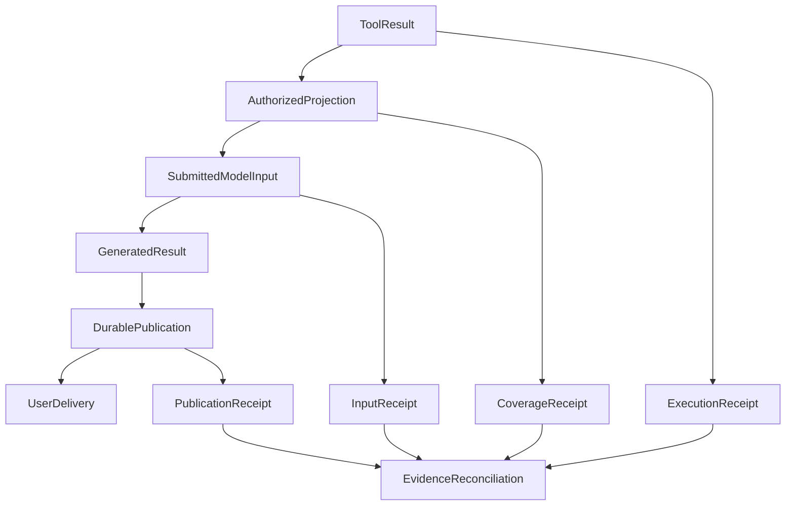

# Local Improvements Are Not System Progress: How Do We Know an Agent Actually Got Better?

We once encountered a very concrete problem: an MCP tool returned 50 portfolio positions, but the model saw only 20. Its answer consequently left out the user's gold position.

The immediate fix was straightforward. We located the intermediate result projection and raised the generic item limit from 20 to 60. The relevant contract checks then passed. It seemed like the end of the story.

But this left us with a harder question: **If the model can now see more records, has its investment research capability actually improved?** It might produce a more complete answer. It might also spend more time processing a larger context, miss a different piece of evidence, or still fail to deliver a usable result.

Many apparent improvements to a complex agent occur first at a local point: a tool returns more content, a trace displays more turns, or an evaluator reports fewer errors. Those changes are real and often important. They have not necessarily propagated into user value.

That experience led us to a ninth architecture principle:

> **A local improvement is not necessarily system progress. Judge benefits by end-to-end outcomes and explain local changes through verifiable causal links. Observability and evaluation help us understand the system; they do not replace its underlying facts.**

## 1. Three different ways a system can appear to improve

The phrase “optimization succeeded” can describe three very different events:

| What changed | What actually improved | What we still need to ask |
| --- | --- | --- |
| **A local mechanism** | The tool projection retains more records; a contract no longer fails | Did the change reach the next model request that was actually submitted? |
| **Measurement and diagnosis** | Trace gaps are visible; a judge can emit parseable scores | Did execution or answer quality change? |
| **The complete task** | The user receives a correct, complete, usable result | Did this come with more latency, expense, or risk? |

The first two are not worthless. Without reliable projections and observations, it can be difficult even to diagnose the third. The error is a category mistake: **an intermediate metric is a diagnostic signal, not an automatic claim about the final outcome.**

The [Google SRE discussion of service-level objectives](https://sre.google/sre-book/service-level-objectives/) makes a related point: start with the behavior users actually care about, then select suitable indicators, rather than promoting whichever metrics are easiest to collect into objectives. Agents add another difficulty: the response must not only arrive but also be useful for the particular research task.

## 2. A wider tool projection can merely move the bottleneck

In the portfolio incident, the MCP query had not failed. Its source-side coverage said 50/50, but the generic model-facing projector still enforced a 20-item limit on arrays and object keys. The source was complete while **the model's actual input was incomplete**.

We chose a bounded repair. The generic limit became 60, selected default capacities were increased, and hard limits and sensitive-field filtering remained intact. The old bound was not irrational: it had existed to control input size. Relaxing it did not establish a new rule that every tool result should be copied into context without limit.

The repair supports a specific conclusion: the identified projection truncation was adjusted under the checked conditions. It does not, by itself, establish that:

- the model made full use of the additional records in subsequent real turns;
- the investment facts, interpretation, or recommendation in a complete report became correct;
- the larger context carried no additional token, latency, or distraction costs.

A later episode provided a useful contrast. During context optimization, a bounded test fixture showed older web bodies being compacted, prompting concern that production research might lose evidence. Comparing that fixture with the effective production configuration and submitted-input projection showed that the observed capacity pressure came from the test setup. We did not invent a new summarizer or reading mechanism to fix an unconfirmed production bottleneck.

Together, these episodes suggest the same method: **locate where loss really occurred, and determine whether the proposed change touches the real execution path.** Raising a limit can fix correctness, or simply increase cost. A bottleneck visible in a fixture may not exist in the default production configuration.

For the mechanics of externalized results, explicit reads, and coverage, see [Why Tool Results Do Not All Belong in Model Context](tool-results-outside-model-context.md).

## 3. Better observation does not automatically make execution more reliable

The second illusion is subtler because we use dashboards to show that engineering work succeeded.

When we first integrated Langfuse, we verified that a synthetic trace appeared correctly. Later, long research runs exposed a separate problem: the application had a cap on captured request and response bodies. Oversized content could become missing values in a read projection, and in an extreme case an entire model turn disappeared from the list. “The query has finished” on a page was not the same as “every executed turn was captured.”

The repair did not infinitely increase log capacity. Instead, it preserved **bounded evidence of absence**: the identity of a call known to have occurred, which side of its body was missing, and the known reason. Older records without those receipts remained unknown.

This made observation more trustworthy. It did not cause the model to execute an additional tool in the past or automatically deliver the answer the user had missed.

The same distinction applies to a successful span. A completed model request or trace span describes the operation that span represents. Whether evidence reached the next model request, an answer was durably published, or the user obtained the text or file remains a question for those respective parts of the system.

What we need is not a bigger “success dashboard.” We need stable identities that let us reconcile **execution receipts, actual model inputs, publication records, and delivery results**. An absent observation does not prove execution never happened; a present observation does not prove the user's research task was completed.

For the capture gaps, restoration, and diagnostics, see [From Traces to Trustworthy Observability](025-agent-langfuse-from-trace-to-trustworthy-observability.md).

## 4. Fewer red evaluation lights can leave answer quality unchanged

On another occasion, an independent judge repeatedly failed to produce parseable strict JSON. It was tempting to read the red lights as evidence that the worker model was unfit.

Separating the worker from the judge revealed that some failures came from **the judge's own output budget**. Raising it from 1,200 to 3,200 eliminated the associated format failures. But worker answers that were only a few dozen characters long and failed to cover the question were still rejected.

From the evaluation system's perspective, some failures disappeared. The answers under evaluation did not magically become longer, gain supporting evidence, or finish the research.

A team looking only at one aggregate pass rate could misreport that measurement repair as a model upgrade. It might then keep optimizing prompts and guardrails around a misleading signal, producing a recurring cycle of “one more improvement” with no credible change in user outcomes.

An evaluation therefore needs to distinguish at least three outcomes: **product behavior improved; the measurement mechanism was corrected; or the current evidence cannot settle the question.** Uncertainty is not another failure to assign to the model, nor something to drop from the denominator to manufacture progress.

For denominators, actual delivery, and failure attribution, continue with [What Does a Green Test Really Prove?](honest-agent-evaluation.md).

## 5. How can we tell whether an improvement propagated through the system?

I prefer to treat a change as an effect that must travel through a chain, rather than a local percentage we can immediately celebrate:

This is a **generic reasoning diagram**, not a demand that every agent add the same fields, database, or central manager. Reconcile the receipts that the real system already owns. If no client receipt exists, a server-side commit must not be described as verified user delivery.

Consider changing a 20-item projection limit to 60.

**First, check the point of change.** Does the same source collection remain intact in the new projection? Did authorization, redaction, or hard limits regress? Deterministic contract checks can answer those questions.

**Next, check propagation.** Did the model's next *actually submitted request* receive full records, a summary, or only a reference? If the request was prepared but not submitted, projection success is not proof that the model consumed it.

**Finally, check the task and its costs.** Does the same kind of portfolio question still omit the gold position? Are coverage and sources correct? Have input tokens, latency, or optional-tool costs worsened? When the claim is a quality improvement, compare matched tasks and data versions rather than subtracting success rates from incompatible runs.

The point is not to invent one universal “overall score.” It is to know **where the benefit occurred, where risks moved, and what changed for the actual task**.

## 6. This does not mean rerunning the entire research workflow for every change

There is a serious objection: if every field change, receipt repair, or monitoring adjustment requires repeated paid-model experiments, agent development becomes prohibitively slow.

That concern is valid. The ninth principle is not a new approval committee, and it does not require an expensive end-to-end benchmark for every pull request.

Match evidence to the uncertainty of the change:

- For **deterministic invariants** such as identity binding, authorization, and no silent truncation, focused contract checks can establish whether the local repair holds.
- For changes that affect actual model inputs, research strategy, or result selection, inspect the real submission seam. Claims about answer quality require comparable task samples.
- For high-consequence delivery, durable effects, or financial calculations, cross the necessary real dependencies in proportion to risk. A mock green result cannot substitute for the relevant user outcome.

Some local fixes are mandatory for safety or correctness even before a business benefit can be measured. They need not be postponed. We simply have to name their achievement accurately rather than pre-claiming an unverified gain.

What should stop is a different habit: steering every new optimization by a green dashboard without asking what that dashboard actually measured.

## Conclusion: Progress must be confirmed along the outcome chain

Expanding a tool projection improves what can be seen. Trustworthy traces improve our ability to explain execution. Repairing a judge improves its ability to express a judgment. All three changes are valuable, but their value is different.

Agent engineering should not aim to make every local metric individually maximal. It should make complete tasks better within trustworthy constraints, while remaining willing to say, “this time we only fixed measurement,” or “we do not yet know whether the system improved.”

**Local optimization makes one stretch of the road smoother. End-to-end outcomes tell us whether we reached the destination.**

---

This is [Principle 9: Local improvements are not system progress](/en/principles#principle-9). It complements [Principle 5 on context projections](/en/principles#principle-5) and [Principle 8 on user-task success](/en/principles#principle-8): one asks where facts live, another asks whether the task finished, and this one asks **how we know a change really made things better**.
