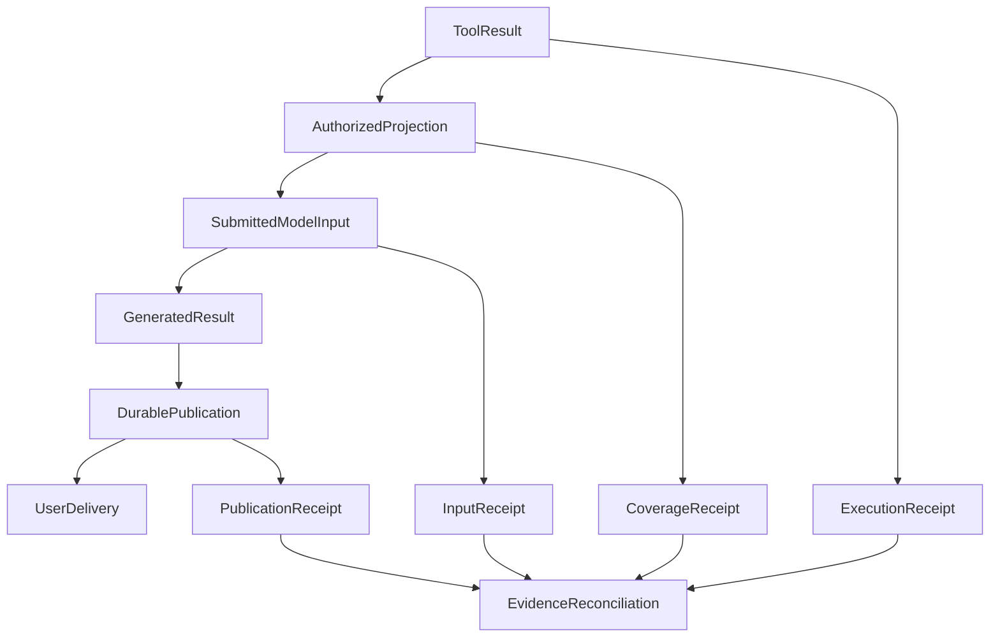

# Local Improvements Are Not System Progress

Suppose a receipt-recognition tool needs smaller uploads. A compression step reduces an image from 4 MB to 1 MB, cutting the amount of data transferred.

Then the amount 126.80 is recognized as 128.80. The file is smaller, but the user has more checking to do.

This is a teaching simulation. Image sizes, amounts, and subsequent events are illustrative. The practical lesson is: **follow an optimization through to the user's original task, and inspect where its costs move.** An intermediate metric can improve without establishing that the change should be kept.

## 1. State What This Change Is Supposed to Improve

The user needs a date and amount that can be checked against the receipt. Uploading the image is one step in that task.

“Keep the file below 1 MB” and “make receipt information easier to verify” are different requirements. File size can establish the first. The second requires comparing the actual recognition result with the original image.

A team focused only on compression may keep increasing it until small text becomes unreadable. A team looking only at an overall success rate may struggle to locate an error. Both levels matter; their relationship needs to be explicit.

The Google SRE chapter on [service level objectives](https://sre.google/sre-book/service-level-objectives/) discusses choosing indicators around behavior users care about, including the distinction between user experience and available server-side proxies. The same reasoning applies here: identify the desired result before selecting intermediate observations.

A sentence in the existing task is enough: reduce image-transfer overhead while preserving the legibility of small amounts, then check the date and amount displayed on the final page. Compression rate can no longer silently replace the user goal.

## 2. Follow the Same Image Along the Actual Path

Start by comparing the stages an image passes through. There is no immediate need for a composite scoring system.

| Location | Concrete check |
| --- | --- |
| Compressed file | Is it smaller, with small text and decimal points still legible? |
| Input actually received by the recognizer | Is this the new file, an old cached copy, or another thumbnail? |
| Recognition result | Do the date and amount match the original values checked beforehand? |
| User page | Does it show this result and allow inspection of its corresponding original? |

A compression-function test may pass while the upload button still follows the old route. Recognition may be correct while the page shows an earlier cached result. Inspecting the compressed file alone cannot distinguish these faults.

Expected amounts should come from samples checked independently beforehand. Another output from the same recognizer is not an independent answer: both runs may make the same mistake.

The repair should address the cause of 126.80 becoming 128.80. If compression damages a decimal point, adjust it or preserve sufficient clarity for that image type. If the page shows an old result, repair the association. Increasing retries and celebrating one fortunate answer leaves the cause unresolved.

## 3. Distinguish Three Kinds of Progress

The investigation can produce three useful but different outcomes.

**A local repair.** The compressed image retains its decimal point, and the relevant samples are legible. This fixes a concrete defect. Whether recognition and presentation also improve requires following the remaining path.

**A measurement correction.** An evaluation script previously classified every PNG as a failure and now supports them. Scores change, but the actual recognition output for an unchanged image does not. Preserve the old evaluator's error and restore a consistent comparison before attributing a gain to the model.

**A user-task improvement.** Across comparable receipt samples, transfer overhead falls, final dates and amounts remain verifiable, and waiting or manual correction does not become unacceptable. This addresses the original task.

All three are worth doing. A retrospective saying only “recognition upgraded successfully” makes the next maintainer guess which one occurred.

## 4. The Same Distinctions Appear in ETF Agent's Real Materials

We recorded a holding omission in which a tool returned 50 entries, but intermediate preparation sent only 20 to the model. The answer omitted gold holdings. Raising the generic entry limit to 60, while retaining hard capacity limits and sensitive-field handling, repaired that specific truncation point.

That establishes a bounded input repair at the time. It does not alone establish better investment research. The subsequent model request, use of the additional entries, and report content still need examination. See [external results and completeness](tool-results-outside-model-context.md).

Another problem concerned observation. Capture gaps for long inputs and outputs made some execution content, and even turns, invisible on readback. Adding missing-content markers improves investigation; it does not make an earlier model execute again. See [trustworthy observability](025-agent-langfuse-from-trace-to-trustworthy-observability.md).

An independent evaluator also lacked enough output budget to produce parseable scores. Increasing its budget removed the corresponding format failures. The working model's short answer still failed to cover the task. Repairing the measuring instrument and improving the answer must be recorded separately.

A counterexample mattered too. A bounded test compressed web content, but inspection of the production configuration did not establish the same bottleneck on the default research path. We therefore did not add another summarization mechanism. Exposing a possible test branch and establishing a current production problem are different findings.

The image example explains these relationships. The real materials explain why we began asking which level an improvement actually reaches.

## 5. Greater Completeness Can Cost More

Suppose some images return to a higher resolution to preserve text. Upload size increases, but amount recognition becomes more reliable. This can be a worthwhile choice. A larger file does not alone establish regression.

Conversely, better recognition does not justify ignoring waiting time, invocation cost, or manual corrections. State the trade-off: which images need what clarity, what additional cost follows, and whether another approach is equally effective for less cost.

Agents face similar choices when accepting more result content, expanding tool descriptions, or adding a reviewing model. Richer descriptions may aid selection while adding input overhead; removing necessary guidance may make tools harder to use correctly. Token reduction does not justify silently shrinking an admitted tool set or dropping required protections.

Permission, privacy, and investment-execution constraints must hold first. Higher speed or quality cannot compensate for violating them. Tradeable objectives can then be compared on similar tasks.

## 6. Make the Comparison Useful

For the compression change, retain relevant samples: clear images, small amounts, angled photographs, and images already blurred at the source. Choose the sample size for the question being investigated; do not invent a universal threshold.

Compare versions with the same inputs and independently checked dates and amounts. Keep recognizer versions and task requirements comparable where possible. Record actual file size, final content, duration, and invocations. When model outputs vary, add observations appropriate to the decision rather than relying on one fortunate result.

Do not quietly remove indeterminate images from the denominator, or treat “correct amount” and “any output” as the same passing condition. If evaluation rules change, restore comparability before discussing gains.

If the evidence currently establishes only that decimal points survive, record that local repair. Correctness defects need not wait for long-term benefit statistics. Broader gains can remain unverified.

For an agent, the original diagram expresses the same investigation order: obtain a tool result, prepare authorized input, submit it to the model, generate and save a result, then inspect delivery. The associated records support comparison; they do not declare success for other stages.

The nodes retain the system's handoff names. This is an analytical illustration, not a requirement to create matching fields or databases. Use existing records to compare what happened within the same task.

## 7. Describe Completion at the Level the Evidence Reaches

A precise truncation repair can begin with focused tests. Changes to actual input or recognition methods require checking the relevant execution path. Claims about user experience or research quality require task comparisons appropriate to those claims. Running an expensive full experiment for every edit would also slow development.

A compression task can state: retain the problematic original and its checked values; locate the loss in compression, recognition, or presentation; modify the condition causing it; verify that counterexample first; then use representative samples to examine correctness and added cost.

Completion should be equally concrete: decimal points now survive compression; the page now displays the result for the corresponding file; or this round only repaired the evaluation script. State whichever is supported instead of covering them all with “the system improved.”

**A local optimization can become system progress when we can explain what changed, whether it reached the user, and where additional costs appeared.**

## Further Reading and Discussion

This article develops [Principle 9: Local Improvements Are Not System Progress](/en/principles#principle-9), alongside [facts in context](/en/principles#principle-5) and [user-task success](/en/principles#principle-8). For evaluation criteria, see [testing and evaluation](honest-agent-evaluation.md). For optional-capability overhead, see [code and system evolution](code-cheaper-systems-harder-to-evolve.md).

Share counterexamples in the [public GitHub collection](https://github.com/hpoenixf/eff-agent-article), and consider a Star if the article helps your work.
