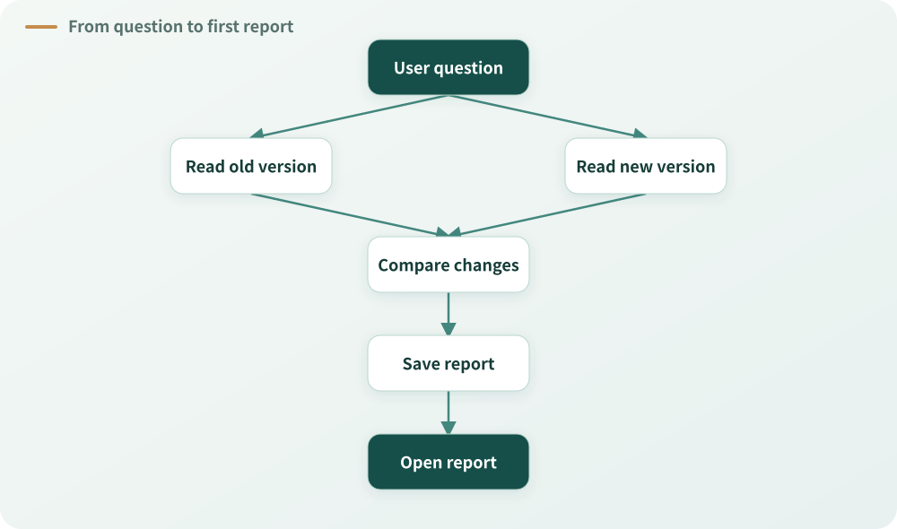
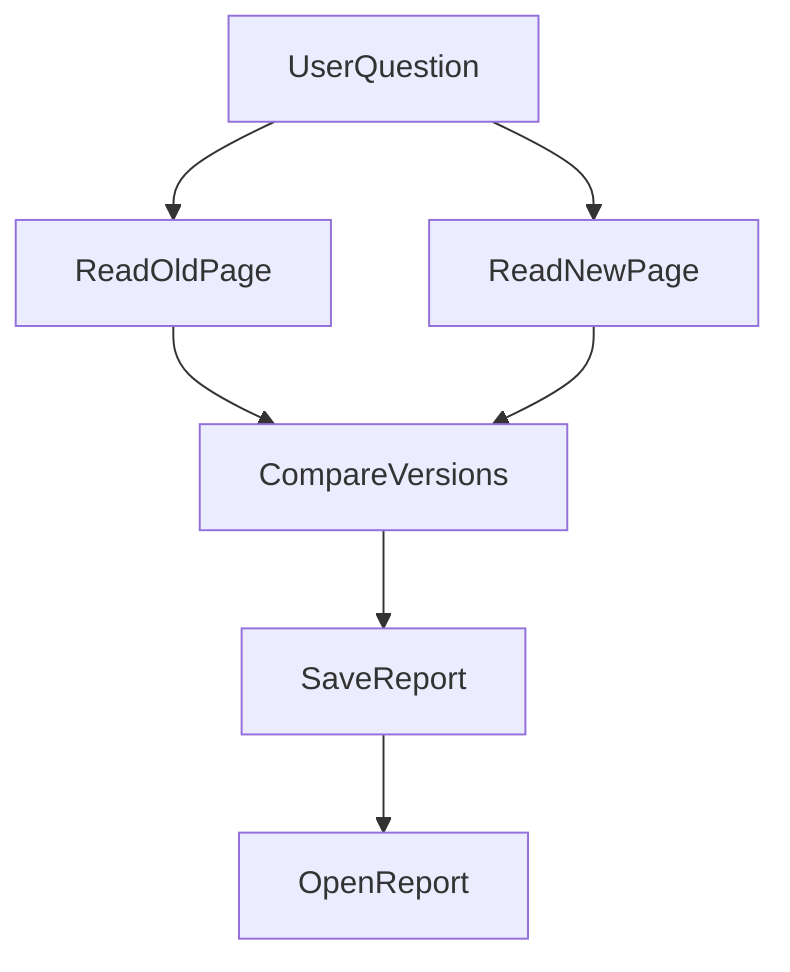
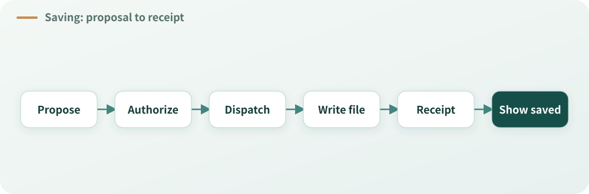
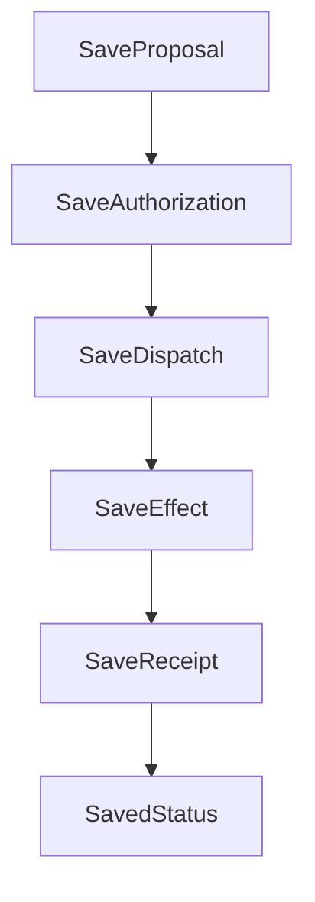
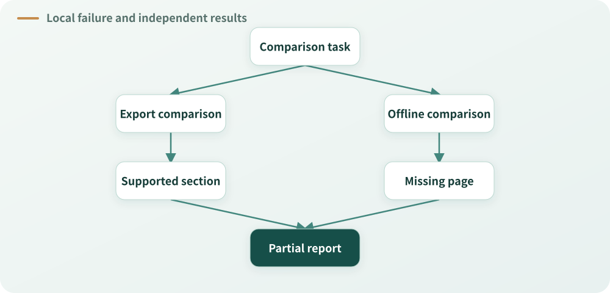
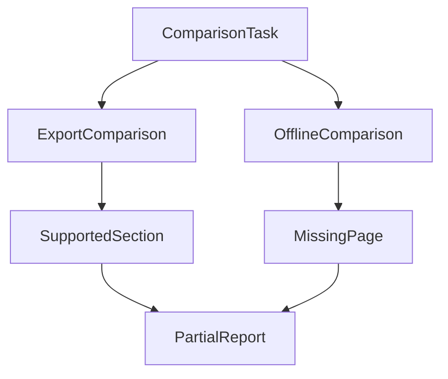
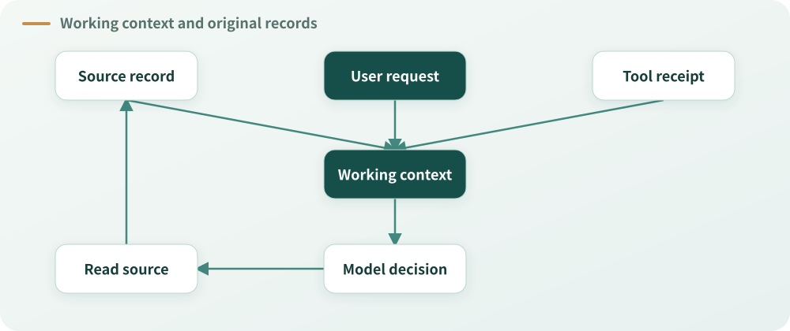
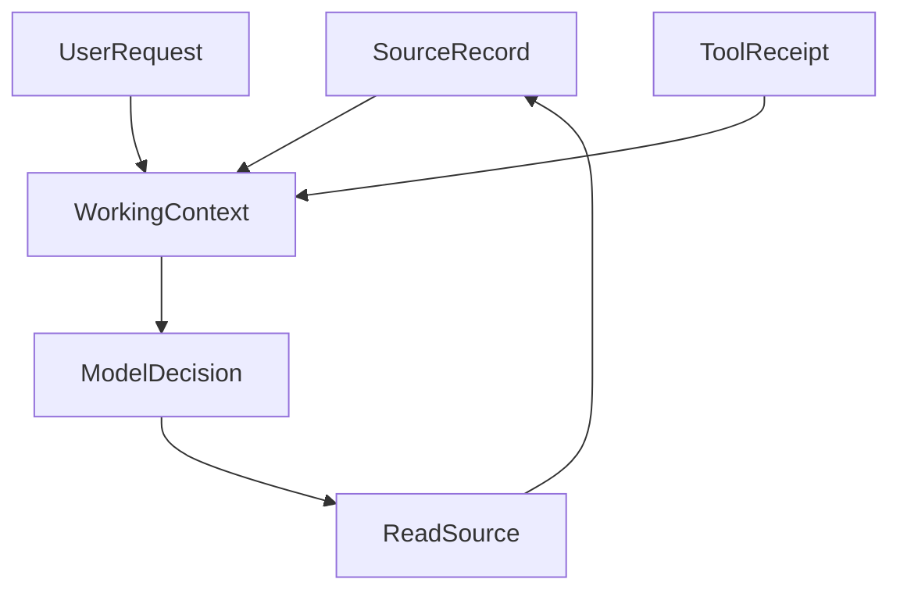
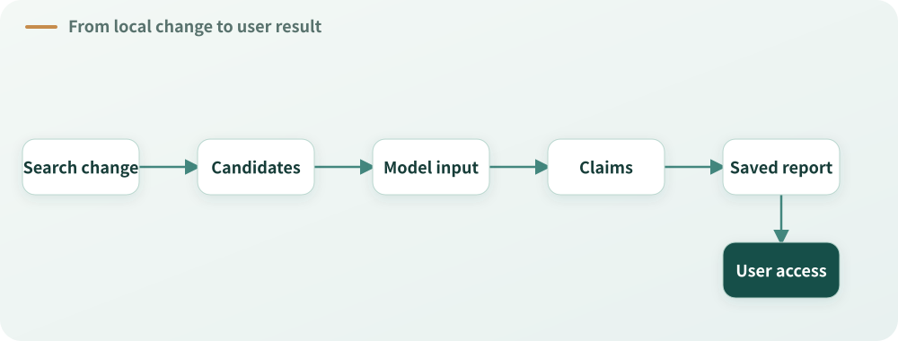
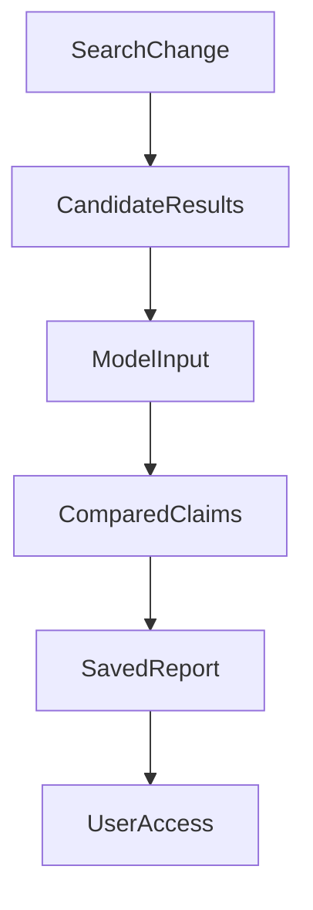

# Nine Architecture Judgments Behind One Report


## The user only wants to know what changed

A team is evaluating a new version of a note-taking product. A colleague brings two documents: A describes the old version, and B describes the new one. They want to know what changed, especially in export formats, offline use on the free plan, and the number of records that can be exported at once. They also want a report with sources they can check, saved so they can open it again in a few days.

The task seems small. Each document has four pages. The old version exports only Markdown; the new version adds PDF. Neither version includes activity history in its exports. The free plan can view already-cached pages offline, but editing requires a connection. The new version's enterprise plan adds offline editing. The free-plan export limit rises from 1,000 to 5,000 records per export: an increase of 4,000, to five times the original limit.

We want an agent to help compare them. It can read documents, interpret the differences, cite the sources, and save a report. The model understands language; tools obtain material; the runtime arranges those actions. Connecting those pieces looks like enough.

Design raises a succession of questions. Can the model access both documents? When it says “the report is saved,” how does the system know a file exists? If one page of the new document cannot be read, may the completed text still be delivered? What happens when a summary drops the words “free plan”? If a search component improves in isolation, how do we know the report improved?

All these questions concern the same report. They are not nine components to build in sequence, but nine kinds of judgment that may arise along one user task. Good architecture connects model understanding, system decisions, and actual effects so that the user receives the result they need.

The two product documents in this article are fictional. Their contents and the code example come from the public [Agent Harness Lab](https://github.com/hpoenixf/agent-harness-lab), which includes runnable document-comparison and report-saving examples and uses a simulated gateway by default. To examine design choices, we introduce hypothetical failed reads, uncertain saves, and growing document collections. These events did not necessarily occur in one run, and the project does not necessarily implement every mechanism discussed.

Start with the materials. Every example below returns to this comparison:

| Comparison | Document A: 1.0 | Document B: 2.0 | Important condition |
| --- | --- | --- | --- |
| Export formats | Markdown | Markdown and PDF | Neither export includes activity history |
| Free-plan offline use | View cached pages; editing needs a connection | View cached pages; editing needs a connection | B's enterprise plan separately supports offline editing |
| Free-plan export limit | 1,000 records per export | 5,000 records per export | Up 4,000 records, to five times the original |

These numbers are document contents, not system performance metrics. We will use them to examine calculations, conditions, and citations.

## 1. Deliver the first useful result

Starting from components makes it easy to create a long list: a parser, search service, research planner, task queue, report template, citation validator, file store, recovery service, and evaluation platform. Each may have a plausible purpose. The colleague's immediate question is simpler: can the new version export PDF?

Narrow the task to page 2 of A and B. A supports Markdown; B supports Markdown and PDF. Both say exports omit activity history. The report can state that PDF export was added while activity history remains excluded, cite the two versions and pages, and save the result for the user to open.



<details>
<summary>View Mermaid source</summary>



</details>

*Figure 1: The shortest path to a first report. Two reads feed the comparison; after saving, the user still needs to be able to open it.*

This is a checkable starting point: the user asks, the system obtains material, the model or example program compares it, and a report brings the result and sources to the user. It does not prove the system can handle hundreds of long documents or that a real model can solve every comparison, but the user can inspect this result.

A first deliverable is not permission to disguise missing quality. Its scope can be small, but it must be obtainable and must not hide known conditions. “PDF was added” answers part of the question; if the user explicitly asked whether history is exported, omitting the shared exclusion cannot be excused as a first phase. State what the result covers rather than treating absent material as nonexistent.

Compare two choices. One implements reading short documents and saving the report first. The other starts with a universal research platform for every format. The first exposes whether the user can actually open, understand, and check a report. The second can be justified when many sources, accounts, or concurrent tasks already exist; without those conditions, it may make the first result depend on mechanisms that have not yet shown their value.

We can discuss future formats, recovery, and history while implementing the first usable path first. Later capabilities are not denied; they simply do not automatically block the first result. Authorization, document identity, and whether a save actually happened affect this report directly and cannot be omitted in the name of a minimal version.

This becomes our reference point. Every added capability should improve a part of the user's task or protect a real boundary. More components, tidier directories, and more runs do not by themselves make the report more useful.

## 2. The model understands; the system decides what can be done

The colleague asks, “Can the new version edit offline? I only care about the free plan.” The model needs to understand that “new” means B, that the free plan limits the answer, and that viewing cached pages differs from offline editing. B mentions both free and enterprise plans. Assigning the enterprise capability to the free plan is wrong.

Understanding language and context belongs to the model. It might read page 3 first, then retrieve the corresponding old-version passage, or explain both sets of conditions side by side. Its research need not be hard-coded into a keyword table. A program that answers “yes” merely because it sees “offline editing” misses the qualifying plan; one that extracts words adjacent to “free plan” may still miss their relationship.

Understanding a task does not authorize broader access. Documents A and B are the materials made available for this task. Whether a tool is enabled or an account may read a file is an execution fact governed by the granted scope. The model can propose a page to read; saying “I have permission” does not bring another user's private file into scope.

This does not mean software must never process language. Search can find candidates by keyword; format validation can check whether a page is a valid integer; structured inputs can support a deterministic calculation. The question is whether a technique performs a bounded operation with an objective basis or impersonates the final judge of user meaning, evidentiary sufficiency, or authorization.

For example, search may use “free plan” to locate page 3. Whether that page answers the question requires interpretation. A successful read proves that material was returned, not that the model understood it. Two citations do not by themselves prove the conclusion is supported.

The model's semantic role does not oblige the program to accept every call. A request for page 0 can fail page validation; an attempt to read outside the authorized scope can be rejected by the boundary responsible for that read. The denial should constrain that effect, not automatically declare the entire report worthless. Other authorized material and independent lawful work remain subject to their own conditions.

The smallest example makes the read parameters concrete. The following is an **excerpt from the actual project**: a simulated gateway proposes these two calls in a predetermined order. It does not prove that a real model will always select these pages.

```javascript
{ id: 'read-a', name: 'read_page', args: { documentId: 'manual-a-v1', page: 2 } },
{ id: 'read-b', name: 'read_page', args: { documentId: 'manual-b-v2', page: 2 } },
```

The execution entry checks the document and page, then returns text and source identity. The model proposes which page to read; the execution result records what was returned. See [desk.mjs in the Lab](https://github.com/hpoenixf/agent-harness-lab/blob/aa14b6a/examples/document-desk/src/desk.mjs).

A useful design question is: **Does this judgment depend on meaning, or on a fact the system owns?** Whether the free plan supports offline editing depends on the question, original text, and context. Whether the read was authorized depends on the grant. Whether page 3 was returned depends on the tool receipt. Combining all three into one boolean makes errors harder to explain.

## 3. Put responsibility where the fact is known

After the first report, the team wants each conclusion to open its source. Several things now happen: the model organizes the comparison; a reader returns text and page numbers; a source record preserves the read's identity; a publication component saves the visible report; the interface displays it and opens source passages on request.

A single “report manager” may look convenient but can become a relay for everything. To show a citation, it learns a parser's private IDs. To decide whether the model may continue, it copies runtime state. To control downloads, it guesses whether a file exists. A manager's name does not give it authority over those facts.

Instead, trace where each fact originates, who can change it, and what others need. The document reader knows which page it returned. The result store preserves the original text and location. The runtime knows whether a call was dispatched and what receipt came back. Publication knows which report version was committed. The interface reads that version and opens the associated source.

Handoffs remain necessary. A report can keep a source reference without copying a reader's entire internal state. The interface can request a source window without knowing how a PDF parser recognizes fonts. The model can select among acquired sources, but writing an ID cannot invent a read. Identity, text, and page must trace back to an actual result.

An owner need not be a separate service, and this is not a demand for a new responsibility register. Ownership asks who has the final decision over a particular fact or effect. One module can own several responsibilities, and existing modules can own new ones. Clear handoffs and the absence of duplicated authority matter more than creating a layer for its name.

Suppose two reads run in parallel, one for each version. Each can track its own progress, but neither should independently copy and recalculate the whole task's shared budget. Both could see the same remaining allowance and spend it twice. If the runtime already owns the shared resource record, children should obtain actual capacity through it instead of building competing ledgers.

Ownership also helps diagnosis. If B's page 3 is missing from the report, the model may never have requested it; authorization may have denied the call; the tool may have failed; the result may not have reached the model's context; or the model may have seen it and ignored the free-plan condition. All can look like a missing condition, but they call for different repairs. Another model assurance cannot fix a missing tool result. Repeating the read cannot automatically fix a misunderstanding after the original was already visible.

Trace facts and handoffs before deciding how to split directories. A useful module encapsulates knowledge, causes of change, and decision rights, not merely a few lines moved into a new file.

## 4. Preparing to save is not the same as a saved report

After reading the text, the colleague asks to save it for later. The model proposes a save; the runtime confirms the destination is within scope; a file service starts writing. The page then says “report saved.”

At least four different things sit behind that sentence: the model proposed a save, the system authorized it, a request was dispatched, and the service completed the write and returned a checkable result. One function or several processes can organize these steps, but they are not the same fact.



<details>
<summary>View Mermaid source</summary>



</details>

*Figure 2: From a proposal to a saved status. Arrows show handoffs, not guaranteed success. If the receipt is lost after dispatch, the effect may have happened and still needs reconciliation.*

Consider an interruption: the service wrote the file, but the connection broke before the runtime recorded the receipt. On recovery, there is no local success record. That means the local system does not know; it does not prove the file was never written. Creating it again might produce a duplicate, while announcing success would lack evidence.

One option is to establish an action identity before execution so that an idempotent service recognizes retries. Another is to query the service by the original identity when it supports status lookup. If neither safe retry nor lookup is available, retain the outcome as unknown. The system can say that the text exists but the file's save status is not confirmed, instead of inventing a successful download.

Not every ordinary function needs a complex transaction protocol. Ask whether an action has a durable effect, whether repetition matters, and whether the receiver already supports idempotency or lookup. Recomputing an in-memory value and creating a report in an external system have different consequences.

The same distinction applies to interface copy. “Saving” may be based on dispatch; “saved” needs the save result; “available to download” also needs a usable read path. A successful save does not automatically prove that another device can open the file: permissions, location, contents, and environment may affect reading. Select checks appropriate to the product promise rather than making one “success” state cover all stages.

For a model, “I saved the report” is a sentence. For the system, it cannot substitute for evidence that the file exists. For the user, each status should describe what actually happened.

## 5. One missing page: should the whole report disappear?

Extend the task to offline conditions. A's page 3 was read; B's page 3 is temporarily unavailable. The page 2 export comparison is complete and has both sources. What should the system do?

A tempting design is a final check requiring every requested page to succeed; one failure rejects the whole report. It avoids presenting an incomplete comparison as complete and is easy to implement: return an error if any part fails.

It also gives a local failure veto power over unrelated results. Failure to compare B's offline conditions does not invalidate the sourced export comparison. The user may prefer that supported section now, accompanied by a clear statement that the offline comparison cannot yet be confirmed.



<details>
<summary>View Mermaid source</summary>



</details>

*Figure 3: Two branches of one report. In this hypothetical case, export claims have both sources while the offline comparison lacks the new page. The report keeps the former and marks the latter unknown. An authorization or content-identity issue affecting the report still belongs to the relevant owner.*

The response should follow the affected promise. The reader may report that B's page 3 was not obtained; it should not infer that the entire comparison is worthless. The model can decide, in light of the user's request, to deliver the supported export comparison, identify the offline gap, or explain that the central question cannot be answered. The publication owner handles the visibility of text and sources within its own responsibility.

If the only question was “can the new free plan edit offline?” and the only relevant page was unavailable, unrelated pages cannot make a complete answer. The system may explain the missing evidence or continue with other permitted sources; it cannot present a guess as fact. Local failure handling preserves independent lawful work and makes the gap available to the appropriate decision maker.

There is an important counterexample. If text contains private content belonging to another user and never authorized for this run, removing the citation does not make that content public. Permission and content identity are real boundaries. The relevant publication and authorization owners must handle the affected effect using objective facts. Keeping lawful text is not permission to bypass those protections or let the model declare the material public.

Attachments have similar distinctions. If the text was committed but CSV conversion failed, the interface can preserve the independently authorized text and explain that the attachment is unavailable. If the sole requested deliverable was the CSV and no file exists, the user task is not complete. The same failure has different implications because the promises differ.

Review a denial by asking: what effect is it protecting? Does this module own the decision over that effect? Does the denial spread to unrelated content? Find a path that should still continue: when one new-version page fails, can already-read old material remain available? If one attachment fails, can independent text remain? If one citation cannot open, do other valid citations survive?

This is not a demand to ignore errors. Cancellation, genuine unauthorized access, conflicting file identity, and unknown external effects require appropriate protection. The point is to apply that protection to the effect actually owned, rather than treating total failure as automatically correct.

## 6. Context is a desk; records are the materials cabinet

Two short documents can fit into one model request. As the colleague asks about offline use, saving, and export limits, the model reads pages, calculates values, and revises drafts. Repeatedly sending every passage, tool result, draft, and interaction increases cost and can bury the current question.

The runtime therefore assembles context: the current request, necessary method instructions, relevant passages, and references back to original records. Long material not needed this turn can move out and be retrieved later. Context resembles a desk arranged for today's work, not the sole cabinet containing everything.

Suppose a compressed summary says “the new version supports offline editing” and omits “enterprise plan.” If the original passage is discarded and only the summary remains, the next answer may assign that capability to the free plan. Concision has changed a condition that matters.

Or a summary says “the report is saved” because it summarized the model's plan while the save call had not finished. Fluent wording cannot sign a file service's receipt. Whether saving happened still depends on the original action identity and receipt; without reliable evidence the state may be unknown.

Context compaction has two questions. What does the model need to continue: the user's original restrictions, important material obtained so far, open questions, and available tools? And which facts may the summary not redefine: original versions, source identities, authorization, tool results, save receipts, and committed report versions? A summary can point to these records, but cannot promote its own interpretation into them.



<details>
<summary>View Mermaid source</summary>



</details>

*Figure 4: Working context selects from original material, the user's request, and tool receipts. The model can return to the original record when it needs to check. These arrows denote use or retrieval; a summary does not become the original.*

A return path matters. If the summary says “check the offline condition on page 3,” the model or user needs a way to find the correct version and original passage. If it is unavailable, preserve that gap rather than reconstructing a quotation from an old summary. Search works similarly: candidate snippets locate material, while the need to read surrounding context depends on the question. Ranking alone does not prove a claim.

This does not require keeping every byte forever or rereading everything every turn. Retention, privacy, and capacity depend on the product's actual contract. The architectural point is narrower: shortening the working view must not quietly change what happened or erase an explicit user restriction.

## 7. After a disconnect: continue or start again?

The colleague closes the page during comparison and returns the next day. The browser may have disconnected while the task continued. The service process may have stopped. Or the file service may have saved the report while the runtime failed to receive its receipt. To the user, all may look like “I came back and cannot see the result.” To the system, they differ.

If the task is still running, reconnect to existing progress and committed results rather than starting new research because the old connection ended. If execution stopped and recovery is supported, use the original task identity, saved state, and actual receipts to decide where to continue. Acquired results, actions not yet executed, and uncertain effects must remain distinct.

The common mistake is treating “I cannot see success” as “I can repeat it.” Rereading an authorized static public document may have limited cost. Creating a file, sending a message, or initiating a paid task can produce a duplicate effect. Recovery should choose rereading, idempotent retry, status lookup, or an unknown outcome based on the actual effect, not wrap every action in the same retry.

Suppose a save has a stable identity and the service can query it. A recovery process can confirm the report already exists and return the true receipt to the current view. If the service lacks that ability, say the save is unconfirmed and avoid creating another file without a basis. Previously generated text that may be displayed can remain an independent result, but it is not evidence of a successful file download.

Recovery must retain recorded scope and original restrictions. A request limited to the free plan cannot quietly become an enterprise-plan answer because a new process received an incomplete summary. When a system has an explicit run-authorization contract, recovery follows the recorded grant; a new run independently establishes its own admission. Products may differ in how external resource revocation, expiry, and later actions work. This case cannot promise a rule for every external protocol.

Recovery has a cost. A single-process demonstration lasting seconds may only need a clear final file. A long-running research task with concurrent workers and external writes may require stricter identity, ownership, and reconciliation. Do not build a distributed task platform before the need exists; once it does, “try again” is not a substitute for handling uncertain effects.

## 8. When should we add another module?

Suppose B's export table grows long and the model sees only the first half, omitting an important restriction. The team proposes another agent to review completeness after report generation. The idea sounds reasonable, but we do not yet know why the omission occurred.

If the reader returned a continuation position that the runtime failed to pass on, repair that handoff first. If the original text reached the model and it still missed a requested condition, investigate understanding, research methods, instructions, or evaluation. If the model wrote the condition correctly but the final report lost it, inspect saving and display. Another reviewer is not the automatic first repair for all three.

Additional review has conditions under which it can be valuable. On high-cost tasks, independent checking may catch omissions in a first draft. It also adds calls, waiting, material transfer, and potentially conflicting opinions. A reviewer who never sees the right page may confidently give a wrong judgment; a failed review cannot become “no issues found.” Show where review helps before routing every simple question through it merely because another layer looks safer.

Costs also appear when a capability is not used. A rarely used feature may add tool descriptions, longer instructions, or another selection to every request; configuration, state, tests, and eventual removal still need maintenance. A longer parser invoked only for one format may have a smaller overall impact.

Test an abstraction with a concrete change. If the team frequently adds export formats, a clear formatting interface may make such extensions easier. If a particular first version only needs a Markdown report and no credible need for multiple formats exists, factories, registries, and inheritance for five imagined formats may distribute one simple change over more files.

File count is not the verdict. A new format may reasonably change a generator and composition point; a capability involving private downloads may naturally cross authorization and persistent-file boundaries. Ask which locations must understand the change and which unrelated locations are forced to. How many forwarding layers must a reader traverse to understand a save? Do those layers protect identity, permission, or failure semantics, or merely rename the same call?

For this same report, make the discussion concrete. The costs below are **questions to measure**, not measured results from the case:

| Hypothetical change | Kind | What to inspect |
| --- | --- | --- |
| Add a format to an existing export family | Similar extension | Beyond the generator and composition point, must unrelated modules understand the format? |
| Add private-file downloads | New dimension | Are permission, file identity, and user access paths required? |
| Change synchronous reading to asynchronous | Contract change | Do consumers assume an immediate result? How are failure and unfinished work represented? |

Fewer files are not always better. Necessary boundaries deserve clear homes. Look for parts that add no independent value to this change but force repeated navigation or expose internal details to consumers.

Examine duplication in the same way. Two `try/catch` blocks do not necessarily share a responsibility: a read failure may require a missing-source notice; an attachment failure may require preserving text and explaining why download is unavailable. Combining them in a generic handler with many switches may hide different semantics. Conversely, formats that truly share a saving contract and change for the same reason may benefit from a shared implementation.

Minimal sufficiency does not mean minimum lines. Reliable saving may need an idempotent identity; private reads need authorization; long tasks may need durable state. Explain what complexity protects and why an existing owner cannot handle it more simply. Necessary complexity should live where the problem is understood, neither erased for appearances nor spread to every caller.

## 9. Why does replacing a reader affect old reports?

The colleague later asks to use web pages or a parser that can handle scanned PDFs. We now need to choose an interface.

If publication depends directly on one parser's private page objects, cache paths, or ordering, replacing it may force changes in model calls, saving, and the source viewer. A cleaner new extraction does not help an old report if its references can no longer identify the material.

Start with what consumers need: the authorized document, its version, returned content and location, missing portions, and a way to retrieve the original by identity later. Parsers may use different internal formats; their shared result should express those necessary facts. An interface is not simply a copy of the first implementation's methods. It should support what the consumer needs to do.

An interface can be worthwhile with one implementation: it can isolate an external dependency, state an authorization or testing boundary, and limit assumptions about internals. Conversely, several implementations do not make an interface sound if it bakes the first tool's synchronous behavior, complete reads, or private error codes into every consumer. The number of implementations is a clue; whether the contract survives a real change is the question.

Suppose the old reader returns text synchronously and the new one must wait asynchronously. If the interface insists on immediate return, a developer might return an empty string first and fill it after the operation completes. The caller receives emptiness and may conclude that the page has no text. The dangerous part is a failure disguised as a successful empty result. The contract must express when work completes and how failure is represented, rather than hiding limitations behind a neat type name.

Replacement is not only routing new tasks to new code. How do old report references find their original material? Are existing tasks still using the old reader? Do historical reports depend on its output format? A capability can stop admitting new tasks while preserving necessary readers for existing results. Only after consumers and durable data have a path can complete removal be considered.

Similarly, disabling an optional search index should leave the direct read path for two short documents usable. A few necessary composition points are normal; forcing every module to know an index's private flags, errors, and recovery logic makes future replacement and removal expensive.

The thing to remove is an unnecessary mechanism and its dependencies, not the user's existing report, source identity, or an effect that really occurred. A capability's ability to retire is different from permission to erase history.

## 10. A clickable citation does not prove a claim

The report is saved. Each citation opens and the page shows the source version. Is the comparison reliable? Not yet.

Consider: “The new free plan supports offline editing,” citing B's page 3. The citation identifies the correct document and opens successfully, but the original says free-plan editing requires a connection and enterprise supports offline editing. Correct source identity does not guarantee a correct claim; the model combined conditions for different plans.

Now consider export limits. A is 1,000 and B is 5,000. “An increase of 5,000” is wrong even though both original values exist. The increase is 5,000 minus 1,000, or 4,000 records; the new limit is five times the old. Software can calculate from explicit numbers and a formula, but someone still needs to establish that both inputs describe the same object, definition, and comparison condition.

**Calculation illustration:** the inputs come from page 4 of the two example documents. This demonstrates the relationship; it is not an excerpt from the project source.

```javascript
const oldLimit = 1000; // A: free plan, maximum per export
const newLimit = 5000; // B: free plan, maximum per export

const increase = newLimit - oldLimit; // 4000 records
const multiple = newLimit / oldLimit; // 5 times
```

Subtraction is easy. The critical question is whether both inputs mean “free plan, per export, number of records.” If one were a daily limit and the other a per-export limit, the calculation would still produce a number but would not support this comparison.

A subtler case: the answer correctly says the free plan cannot edit offline but cites B's page 2. A reader finding page 3 cannot retroactively make the displayed citation support the sentence. The source contains an answer and the cited source supports this claim are different judgments.

Review the report separately for whether it preserves the user's request; whether relevant material was actually acquired and entered the working process before the answer; whether key claims are supported by their cited text; whether explicit calculations are correct; and whether the file can actually be obtained. Each needs its own evidence. “The model finished normally” cannot replace them.

The project uses a simulated gateway by default. It is useful for repeatedly checking tool calls, saves, and reads, but scripted demonstration behavior cannot prove a real model will always choose the right material. The repository also keeps [a small real-run record of two models on four tasks](https://github.com/hpoenixf/agent-harness-lab/tree/aa14b6a/docs/live-runs/2026-10-25): delivery checks for reports, source pages, and attachments passed, while assisted content review found an unsupported addition and a broad comparison that omitted pages while claiming completeness. There was only one run per model per task, and the author has not signed off each content observation. The sample cannot compare general model capability.

These observations show why delivery and content must be separated. A file can exist and a report can have sources while its conditions still require review. Equally, a content review finding no obvious issue does not prove the download path works or that all future tasks will be correct.

## 11. One improved step does not prove a better report

The team expands search from a small set of candidates to more potentially relevant pages. Local checks show that candidates are returned. Can we now claim the report has better coverage?

That depends on what happens next. Which candidates did the model actually receive? Was the free-plan condition on page 3 among them? Were snippets truncated? Did the model read surrounding context? Did the final report use the material or repeat only pages 2 and 4? A larger candidate set can also increase context cost and waiting time, or make the key condition harder to notice.

Separate three levels. First, search behavior changed: for some inputs it returned candidates previously absent. Second, measurement may have changed: a logging repair may reveal which pages the model received. Third, the complete user task may have improved: the report is more complete or easier to check, or arrives faster without reducing quality. The first two may be real improvements but do not establish the third.



<details>
<summary>View Mermaid source</summary>



</details>

*Figure 5: To assess whether a search change affects the final report, follow candidates, actual model input, claims, saving, and user access. Any handoff can have a gap.*

Comparisons need understandable conditions. If documents, questions, models, and tool scopes all change, the answer difference is hard to attribute to search. Start with representative tasks: export formats, free-plan offline conditions, export limits, and saving and reopening. Record actual model inputs, tool behavior, report, and file result; then inspect what changed. Real models vary. A small sample can reveal concrete problems, but cannot establish a general success-rate change.

This does not require an expensive model comparison for every line of code. A page-number serialization or filename-encoding fix can start with a focused engineering check. A claim that a new research method improves answer quality needs real task observations proportionate to that claim. Without a comparable baseline, report what the current sample showed rather than inventing an improvement percentage.

Consider trade-offs too. More candidates may reduce omissions but increase cost. Ending earlier may shorten the wait while leaving research incomplete. Extra review may catch a condition but add delay or error. Choose a balance suited to the task, but do not trade away real permission or privacy protections for a better quality metric.

The first question is “what is user success?”: a readable, checkable, obtainable report that answers the request. The second is “did this change make that success more reliable or economical?” The first defines the target; the second tests the contribution.

## 12. Bring the nine judgments back to the report

Return to the colleague. They still want to know what the new version adds, what the free-plan conditions are, and whether the report can be saved. They need not see the number of internal modules or learn every architectural term. The design determines whether they receive a checkable result or a fluent promise with missing conditions and an inaccessible file.

Along that path, the nine judgments come together:

1. **The model interprets; the system owns objective facts.** The model explains conditions; the system handles authorization, calls, receipts, and saved outcomes.
2. **Put complexity with the right owner.** Reading, sources, execution, and publication own their respective facts; consumers do not create a competing authority.
3. **Record proposal, authorization, execution, and effect separately.** Wanting to save, being permitted to save, dispatching, and receiving a file receipt are different.
4. **Keep local failure local.** One missing page or attachment should not automatically erase independent lawful results; real authorization and identity protections remain.
5. **Context is a working view.** Summaries and search candidates support continued research; they cannot rewrite original material, user restrictions, or receipts.
6. **Use a minimal sufficient mechanism.** Locate the gap before choosing local repair, reuse, or a new mechanism; do not simplify away necessary protection.
7. **Make capabilities introducible, replaceable, and retireable.** New readers use necessary contracts; old tasks and reports retain a path; private details do not spread.
8. **Internal success must match the user task.** Model completion, file saving, user download, and correct conclusions require their own evidence.
9. **Test local improvement against the whole.** Better search, logging, or review first proves only its local change; continue observing the complete task.

These are different perspectives for design and diagnosis, not nine runtime gates. Choose those relevant to the problem. A simple report can use a simple structure. A task spanning permissions, durable effects, recovery, and multiple consumers needs enough machinery for that real complexity.

When someone proposes another module for the report, ask: what will the user gain? What fact or responsibility does the module own? Does it tax ordinary paths even when unused? If replaced, what happens to existing reports and running tasks? How will we know the change helps the user obtain a better result?

Those questions do not always lead to “do not add it.” Sometimes reliable saving, access control, or recovery is necessary. The answer should come from the real task, concrete boundaries, and checkable effects, not a preference for an architectural shape.

Starting with one comparison report, we are still addressing one problem: when a model can propose its next step, how does the system let it obtain material within scope, form judgments, leave real effects, and return a result to the user? Architecture principles matter because they keep that path understandable, inspectable, and changeable as it grows.
