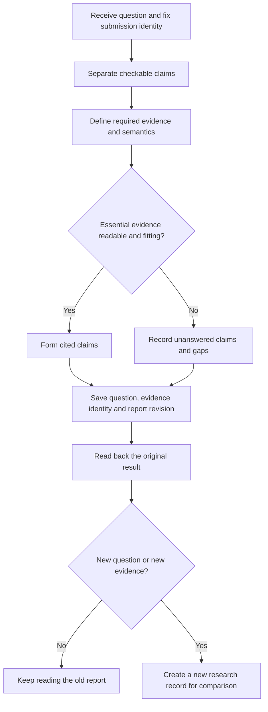

# From Answers to Trust: Preserve the Conditions Behind a Research Claim

<LearningPathNav />

On Friday, you ask an agent for an ETF weekly report: check product terms in the prospectus, describe this week's exchange-price movement, and see whether the issuer explained a relevant change. The agent reads the prospectus and finds some search results, but the market-data service is down and one original page cannot be opened.

A polished report full of figures would risk making things up. Declaring the entire task a failure would discard the material already verified. Monday poses a harder question: prices are available again, and the webpage has changed. When you reopen Friday's report, are you looking at **what the agent actually knew on Friday**, or at a new answer assembled from today's sources?

These appear to be separate problems—tool failures and saved history—but they share one premise:

**A research agent does not deliver a block of text. It delivers a record of the conditions under which its claims were supportable.**

Evidence determines what can be said now. History lets a reader check later why those words could be said then.

## 1. Users need bounded judgments, not the appearance of completeness

Ordinary chat answers optimize for relevance, fluency and speed. Research has an additional obligation: show what supports a conclusion, how far that support reaches, and what remains unresolved.

Even “this ETF performed better this week” might mean the exchange-traded price increased, the fund NAV increased, or an investor's total return including reinvested distributions improved. Those are distinct claims with different data and calculation requirements.

The unit of evaluation should therefore be **each checkable claim**, not whether the report was generated at all.

| What is being delivered | What fluent prose alone cannot tell you |
| --- | --- |
| A conclusion | Which original source and passage support it |
| A figure | The metric definition, date coverage and comparability |
| An explanation | Whether it is a disclosed fact or the agent's inference |
| An uncertainty | Which part lacks sufficient evidence |
| A historical result | The original question, evidence version and published text |

A compact model is:

> **Trustworthy research delivery = supported claims + explicit unanswered portions + a readable record of that moment.**

“Trustworthy” here does not mean necessarily correct. It means the result can be examined, challenged and revised without erasing its provenance.

## 2. The question—not the tool—decides whether evidence is optional

We can split the weekly report into three independently checkable questions:

| Subquestion | Evidence needed | What happened | Permissible response |
| --- | --- | --- | --- |
| What terms appear in the prospectus? | A readable original with a known version | Original read | Cite the relevant passage and limit the claim to that version |
| How did exchange closing prices change this week? | A valid series with dates and exchange-price semantics | Market data unavailable | Omit the figures and state that the movement was not verified |
| What did the issuer say about a change? | A verifiable original statement | Search hit, but original unreadable | Describe the lead, not an issuer statement presented as verified |

The essential distinction is that **an optional integration does not make the evidence optional for every claim**.

Wind can be disabled in the default research path. But if a claim requires its market-data series, that claim must not be published without suitable evidence. If the user primarily asks what the prospectus says, on the other hand, a market-data outage should not invalidate the terms already checked.

Successful tool execution is not enough either. The optional Wind query introduced in [Open ETF Agent v0.38.0](https://github.com/hpoenixf/open-etf-agent/releases/tag/v0.38.0) returns **unadjusted daily exchange closes** for an exchange-listed ETF. Those are not fund NAVs, and they are not automatically total returns with distributions reinvested. Treating “prices retrieved” as “returns established” would still be an evidence error.

For each claim, an agent therefore needs to distinguish **what source was actually read, which metric it represents, the time to which it applies, and what conclusion it can support**. A search hit, a summary, a calculation and an original document cannot acquire equal evidentiary standing merely by appearing in the same context.

## 3. Graceful degradation must narrow the claim

In conventional services, degradation can mean omitting a field, using cached data or throttling a feature. Research agents need a stricter rule. A missing field may make a UI less complete, but a missing source may invalidate a conclusion.

Before deciding what to return, ask which claims depend on the unavailable evidence:

- **Missing corroboration:** retain a conclusion already supported by sufficient original evidence, and disclose the missing cross-check.
- **Missing essential evidence:** do not publish that claim; if it was the user's sole core question, say the question could not be answered.
- **Wrong metric or source semantics:** a successful call does not justify substituting a related but different measure.
- **A specifically required original:** do not silently replace it with a third-party retelling; report that the original could not be checked.

A defensible report might say:

> The supplied version of the prospectus was checked, and the terms quoted below are supported by that document. An exchange-price series could not be retrieved, so this report does not assess weekly price movement. Search returned a potentially relevant issuer statement, but the requested original could not be read, so its contents are not treated as verified.

This is not an excuse for half an answer. It keeps the **verified portion separate from what remains unknown**. Appending “for informational purposes only” to an otherwise unsupported full report is not evidence-aware degradation.

It is also why tool success rate is a weak proxy for research quality: ten successful searches may not retrieve the one original the user required; one correctly verified original may be enough for a narrow, useful conclusion.

## 4. History must preserve what was known then—not regenerate it

The first problem was what can be said today. The second is what a reader can inspect next week.

Imagine reopening Friday's report on Monday, after a page has changed and the market feed is back. **If the agent silently researches again and overwrites the original text, history has become a new report wearing an old date.**

A published research result needs at least three distinguishable identities:

1. **Submission identity:** the question and payload the user actually submitted. A newer unsent draft is not part of that request.
2. **Execution and evidence identity:** what that Run actually accessed, which originals were read or unavailable, and their time, version or verifiable references.
3. **Delivery identity:** the saved body and report revision. Independently reopening it should not quietly start another research task.

This is why retries matter to research integrity. In the [v0.39.0 local GUI](https://github.com/hpoenixf/open-etf-agent/releases/tag/v0.39.0), when a browser does not receive a submission acknowledgement, retry uses the unacknowledged request's original message identity and payload—not whatever draft is now in the composer. Retaining identity on the client is necessary; preventing duplicate execution end to end also requires the server to recognize the same submission.

Two user actions must remain distinct: **read an old report** to inspect the historical result, or **research with new evidence** to create a new result that can be compared against the old one. The latter must not retroactively change the former.

If an original source becomes unavailable or access is revoked, an agent should not quietly substitute a convenient live page. It should retain permissible original evidence or a stable source identity where possible, and disclose which material can no longer be reopened. Historical traceability is not unlimited permission to retain or reread every source.

The following is a **design-principle diagram**, not a state machine claimed to be fully implemented by any one public release:



The decisive point occurs before publication: **unsupported text cannot become fact merely because it was saved; a published report cannot become a different historical fact merely because it was rerun.**

## 5. Turn evidence and history into one acceptance exercise

Open ETF Agent offers bounded observations of different parts of this contract. The opt-in Wind query provides a data-semantics example. The [v0.39.0 offline GUI](https://github.com/hpoenixf/open-etf-agent/blob/v0.39.0/docs/local-gui.md) demonstrates reopening reports and source excerpts. Later, [v0.41.0](https://github.com/hpoenixf/open-etf-agent/releases/tag/v0.41.0) added opt-in online research and web-source paths. Each verifies a limited slice. **They must not be combined into a claim that a real model can reliably perform complete ETF research.**

The historical half is easy to try yourself. With Node.js 26.8.1–26.x, use bundled synthetic sources at the fixed v0.39.0 tag:

```bash
git clone --branch v0.39.0 --depth 1 https://github.com/hpoenixf/open-etf-agent.git
cd open-etf-agent
npm ci --ignore-scripts --no-audit --no-fund
npm run gui -- --project ./test-output/local-gui --port 4179
```

Open the local address printed by the command. Create a conversation, generate a sample report and inspect its citations. Stop the service, restart it with **the same project directory**, and reopen History to check the original question, body and sources. The default example is scripted over synthetic data. It neither fetches live prices nor establishes model reasoning quality.

A real research agent also needs the evidence half. The following are **proposed regression cases**, not claims that the offline GUI above has passed them all:

| Injected condition | Acceptance criterion |
| --- | --- |
| An optional original webpage fails to load | Publish claims still supported by sufficient originals; narrow or retract claims relying on the unread page |
| An essential price series is missing | Do not invent figures or substitute NAV, quotes or stale data for the requested series |
| Only a search snippet is available | Do not claim the requested original was verified; retain a checkable gap |
| Server received a submission but acknowledgement was lost | Retry with the original identity and payload, without accidentally creating a second research task |
| The source changes before the old report is reopened | Preserve the old text and evidence identity; place new material in a new research record |

These cases reduce to two questions: **Was this claim qualified for publication at the time? Is the text I can read now still that publication?**

Both must hold. Otherwise, history is just a stack of chat screenshots, and citations are decoration.

## Conclusion: Reliable research does not eliminate gaps; it keeps them visible

Evidence addresses the breadth of a claim: which sources, definitions and conditions support it. History addresses continuity over time: after a week, a restart or a new source, can we still identify the judgment made at that moment?

They are not two agent features bundled for convenience. Together they enforce the research contract: **say only what the evidence supports, and preserve why it supported what you said.**

That brings an agent closer to the kind of research users can question, revise and compare over time—more than simply adding another integration.

Continue with [From the Command Line to a Research Workspace: How to Pick Up Where You Left Off](open-etf-agent-research-workbench.md) for conversation follow-ups, daily comparisons and independent workspaces. This article focuses on evidence eligibility and historical integrity.
