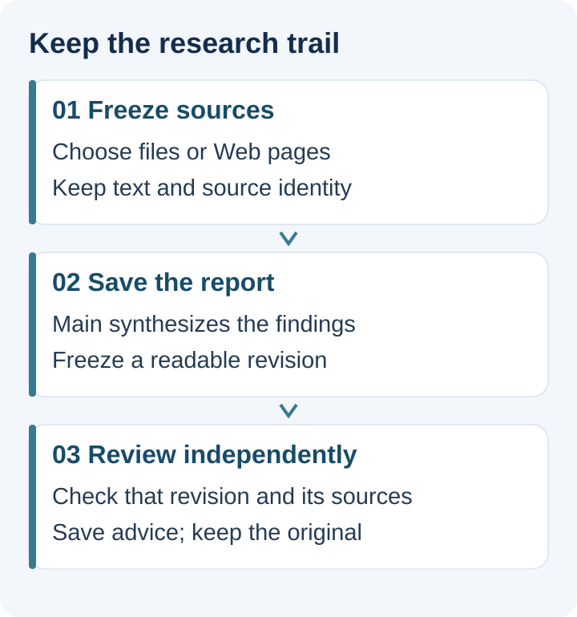
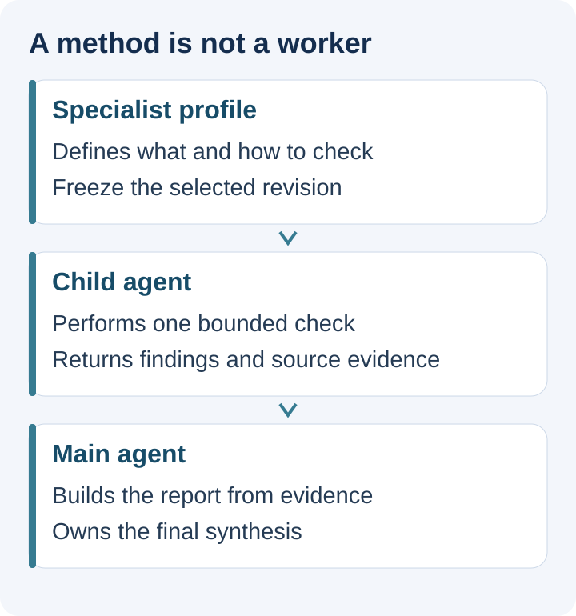
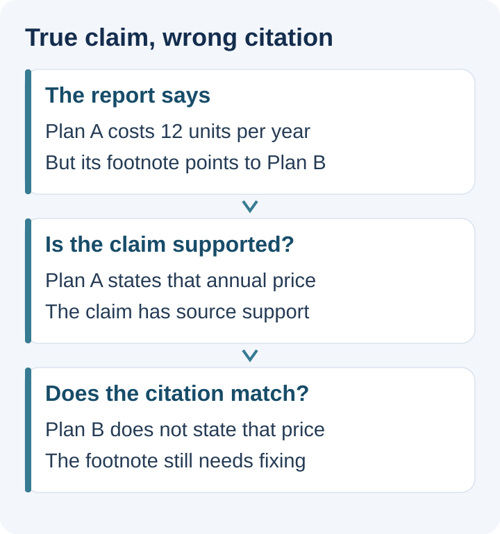
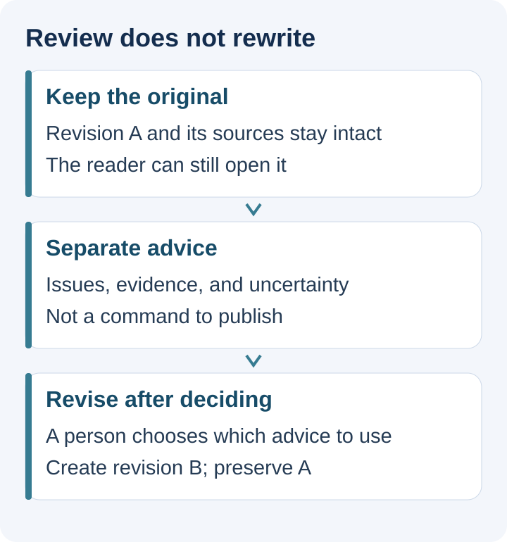

# After the report: source checks, specialist work, and independent review

<LearningPathNav />

Your agent has written its first report, and you can reopen it after closing the program. The natural next question is: **which statements in this report deserve another look?**

Typing “check it more carefully” can help. But as reports grow, sources change, or someone else takes over, we need more precise answers. Which draft was checked? Which original passages were available? After a problem was identified, was the original report silently changed?

[The first workshop](https://hpoenixf.com/eff-agent-article/en/articles/open-etf-agent-research-project-workshop) brought in your own sources and retained a research project and report. This installment takes the next step: supplement the material with selected Web pages, use a specialist method for a bounded check, and independently review the saved report.

The interfaces below belong to **released Open ETF Agent v0.28.0**, commit `b34750d1515982dbaaaf4c1aa4da4c380173d753`. Three modules handle source acquisition, research delegation, and review of a finished report. The service terms in this example are teaching material, not actual product prices. Real research requires your own model service and explicit authorization for data and cost. The article also includes a rehearsal path that makes no external model calls.

> Validation boundary: the default review prepare/run/read lifecycle was exercised with no external model calls; cold readback matched and the original report stayed unchanged. Provider configuration and live report-generation instructions were checked against source and interface documentation, not claimed as a fully executed live end-to-end tutorial.

## Start with a question the sources can answer

Instead of a long financial filing, compare two fictional export-service descriptions:

- Plan A costs 12 units per year. Export is available only while authorization remains valid.
- Plan B includes 3 free exports per month. Each export from the fourth onward costs 2 units. Offline use is unavailable.

You want to know: “If I export twice per month, what are the costs and restrictions of each plan?”

A useful report must distinguish at least three things. Plan A's billing period is annual, while Plan B's free allowance is monthly. “Free” is conditional on usage. Features absent from both sources cannot become product facts merely because they seem plausible.

If a report says “Plan A costs only 12 units per month and allows exports at any time,” we can locate the errors. If it says “Plan B is better for you,” we also need to ask whether your offline requirements are known. The first case mainly concerns facts; the second also concerns the assumptions behind a recommendation.



*One research path leaves three kinds of output. Review advice can guide a later edit, but it cannot replace the original material.*

## 1. Freeze the material for this research task

Use a new v0.28 working directory alongside the v0.24 project from the previous exercise. Do not apply upgrade commands directly to your only copy of an old project. Keeping source code separate from research material makes old results easier to preserve.

```bash
git clone https://github.com/hpoenixf/open-etf-agent.git open-etf-review
cd open-etf-review
git checkout v0.28.0
npm ci --ignore-scripts --no-audit --no-fund
npm run build
mkdir -p ../review-workshop
```

Use Node.js 26.8.1–26.x. Prepare `live-config.json` following the [project entry documentation](https://github.com/hpoenixf/open-etf-agent/blob/v0.28.0/docs/research-project.md), using the model endpoint and credentials you have already authorized. Enable only the `report` and `child` capabilities required here. Do not add scheduling, PDF support, or arbitrary plugins: this version does not support unrestricted combinations of those capabilities.

Initialize the new project, then import two explicitly selected text files. Complete the configuration using that project documentation; the teaching terms below are not themselves a configuration file.

```bash
node src/research-cli.mjs project init \
  --project ../review-workshop/project --config ../review-workshop/live-config.json
printf 'Plan A: 12 units per year; export requires valid authorization.\n' > ../review-workshop/a.txt
printf 'Plan B: 3 free exports per month; each export from the fourth costs 2 units; offline use is unavailable.\n' > ../review-workshop/b.txt
printf '["../review-workshop/a.txt","../review-workshop/b.txt"]\n' > ../review-workshop/files.json
node src/research-cli.mjs source import \
  --project ../review-workshop/project --files ../review-workshop/files.json \
  > ../review-workshop/import.json
MANIFEST=$(node --input-type=module -e \
  'import fs from "node:fs"; console.log(JSON.parse(fs.readFileSync("../review-workshop/import.json","utf8")).manifestSha256)')
```

Each set of terms is saved as a short text file and imported through an explicit file list. **Local files and public Web pages are two ways to admit sources; they do not require separate research mechanisms afterward.**

If you have suitable public HTML pages, put their exact URLs in `selected-urls.json` and acquire them explicitly:

```bash
node src/research-cli.mjs source acquire \
  --project ../review-workshop/project \
  --acquisition selected-terms-01 \
  --urls ../review-workshop/selected-urls.json \
  --approve-public-fetch
```

The returned `manifestSha256` identifies this batch of material. Select it explicitly when submitting research. Successful acquisition does not automatically make it the input of the next task. The same URL may have different text tomorrow; today's source identity tells you what today's report used.

This Web module accepts a bounded set of public HTTPS pages and checks redirects and robots rules. It does not search the Internet, log into sites, execute page JavaScript, or fetch remote PDFs. If material requires login or dynamic rendering, stop at that boundary and use a file you are authorized to obtain. Do not treat the boundary as an obstacle to bypass. The [Web source contract](https://github.com/hpoenixf/open-etf-agent/blob/v0.28.0/docs/web-sources.md) explains the supported scope.

The easily overlooked benefit is changing “I saw that page” into “this report used this material.” Sources retain the original URL, acquisition time, and content identity. Reopening the saved report does not fetch the page again merely to display a citation.

## 2. Turn “research carefully” into a specific method

Now that we have material, why add a specialist profile?

Because “be careful” does not specify how to check. “Compare these terms” can become an explicit method: preserve each claim's subject, time, scope, and conditions; do not declare a contradiction simply because dates differ; retain gaps when evidence is missing.

The specialist profiles introduced in v0.27 store this kind of method. A specialist name does not create expertise or grant additional access. Start with the repository's built-in comparison method so that your first exercise does not require tuning both the method and the system.

The following Node command only creates a configuration file. It does not call a model.

```bash
node --input-type=module <<'JS'
import { writeFileSync } from 'node:fs';
import { CLAIM_COMPARISON_METHOD } from './src/child.mjs';
writeFileSync('../review-workshop/profile.json', JSON.stringify({
  name: 'Terms check',
  description: 'Compare costs, periods, and usage conditions in original sources',
  enabled: true,
  method: CLAIM_COMPARISON_METHOD
}, null, 2));
JS

node src/research-cli.mjs specialist init \
  --project ../review-workshop/project
node src/research-cli.mjs specialist create \
  --project ../review-workshop/project \
  --id terms-checker \
  --profile ../review-workshop/profile.json
```

The first created revision is 1. Save the selection as `specialists.json`:

```json
{
  "profiles": [{"profileId": "terms-checker", "revision": 1}],
  "maxChildren": 1
}
```

Selecting a fixed revision matters. A task submitted today should use today's method. Editing the specialist catalog tomorrow must not silently change the standard for today's unfinished work.



*A profile defines the method; Child performs the work. The main agent receives derived advice and still needs the original sources to make its judgment.*

Write the question into `question.txt`, for example: “Compare the billing periods and restrictions in these terms. If needed, ask the terms-checking specialist to read the originals, distinguish facts, calculations, and unknowns, cite sources, and save a report.” Submit only after approving the provider, material, and cost:

```bash
node src/research-cli.mjs run submit \
  --project ../review-workshop/project \
  --run terms-report \
  --question ../review-workshop/question.txt \
  --manifest "$MANIFEST" \
  --specialists ../review-workshop/specialists.json \
  --report-delivery artifact-required@1 \
  --approve-provider --approve-data --approve-cost

node src/research-cli.mjs run work \
  --project ../review-workshop/project --run terms-report
node src/research-cli.mjs run report \
  --project ../review-workshop/project --run terms-report \
  > ../review-workshop/report-receipt.json
```

`MANIFEST` must contain the value actually returned by import or acquisition. If you switch to Web acquisition, update that variable explicitly. The report receipt includes the report, `directory`, and `revision.revisionId`. The latter two identify the input for review.

Configuring a specialist does not guarantee that the model will call it. First inspect whether delegation actually occurred and whether Child read the originals. Then examine how the main agent used its advice. An ON switch alone cannot establish that specialist collaboration caused a change in the report. With very short terms, letting the main agent handle the task itself may be simpler.

## 3. Start a separate review after saving the report

Draft generation and report review work well as separate activities. Generation adds information and organizes conclusions. Review needs a stable object so it can identify what is wrong with a particular sentence.

What is frozen here is **the report revision and its bound original sources**. Review does not search for new material to rescue an old citation, nor does it promote a specialist summary into original evidence.

Extract the exact identities from the receipt, then prepare review:

```bash
SOURCE_DIR=$(node --input-type=module -e \
  'import fs from "node:fs"; console.log(JSON.parse(fs.readFileSync("../review-workshop/report-receipt.json","utf8")).directory)')
REVISION=$(node --input-type=module -e \
  'import fs from "node:fs"; console.log(JSON.parse(fs.readFileSync("../review-workshop/report-receipt.json","utf8")).revision.revisionId)')

node src/report-review-cli.mjs prepare \
  --session ../review-workshop/review-demo \
  --source "$SOURCE_DIR" --revision "$REVISION" \
  --request terms-review-demo
node src/report-review-cli.mjs run \
  --session ../review-workshop/review-demo \
  --run review-terms-review-demo
node src/report-review-cli.mjs read \
  --session ../review-workshop/review-demo \
  --run review-terms-review-demo
```

**The commands above rehearse the review lifecycle without external model calls.** `prepare` verifies and freezes the material. By default, `run` returns an explicitly synthetic demonstration result. You can practice preparation, persistence, and cold readback, but empty findings do not mean a model examined the report, much less that it found no problems.

For real review, supply a trusted `--gateway-module /absolute/path/host-gateway.mjs` to both `prepare` and `run`. The module integrates the existing Gateway, admission controls, and budget management. It exports `gatewayBinding` and `createGateway({session, directory, runId})`; the latter returns `{gateway, close}`. This is executable code reviewed by the operator, not code supplied by report text or a model. See [real Gateway integration](https://github.com/hpoenixf/open-etf-agent/blob/v0.28.0/docs/report-review.md#real-gateway-integration) for the interface.

Use a new, explicitly approved request identity for the real path, such as `terms-review-live`. Do not replace the configuration of a completed synthetic rehearsal and rerun it as live work. Once accepted, a request identity must not silently bind to different input. **There is currently no universal wizard that configures the entire review integration simply by accepting an API key.** If a trusted Gateway is not yet connected, complete the zero-model exercise first, or manually check the issues in the next section.

The entire serialized review request is limited to 48,000 UTF-8 bytes, including the report, sources, and metadata. This is not a separate allowance of 48KB for the report body alone. Oversized input is explicitly rejected, not silently truncated. Start with a short report so you can inspect each finding, not to optimize a score.

## 4. Separate “this claim has evidence” from “this citation is correct”

Suppose a report says “Plan A costs 12 units annually,” but cites a page about Plan B.

The source collection contains text supporting the claim, so the statement may be correct. Yet the material a reader opens through its footnote does not support it, so the citation is still wrong. Checking only one of these dimensions misses the other.



*This is a teaching example. Useful review advice identifies a specific report passage and source excerpt, rather than merely assigning an overall score.*

For each finding, Review retains material support, actual citation correspondence, reasoning, source excerpts, and uncertainty. It also records the original span in the report so the reader can locate the issue.

Valid coordinates establish only that “this text exists at this location.” They do not establish correct model interpretation. You still need to check:

- **Numbers and units:** Did “12 per year” become “12 per month”?
- **Conditions:** Did “available while authorization is valid” become “available at any time”?
- **Evidence strength:** When the original is silent, does the report say “not specified” rather than “explicitly unsupported”?
- **Citation location:** If the source collection contains the fact, does the report actually cite that source?

A useful finding makes it easier to return to the original and decide. Reasserting that “the report is inaccurate,” without a location or evidence, saves little work even when the tone is confident.

## 5. Keep two outputs before deciding to create a third

After reading the review, retain both the original report and the review result. Create a new report version only after deciding to adopt a suggestion.



*Completing review is not an automatic publication condition. Even after a new report is created, an earlier review still belongs to the revision it examined.*

This has a practical benefit: reviewers can be wrong too. If review directly overwrites the text, you must determine whether the original was wrong or the edit damaged something correct. Separate outputs let you accept or reject suggestions individually, or add sources and research again.

This relates to the evaluator–optimizer pattern in Anthropic's [Building effective agents](https://www.anthropic.com/engineering/building-effective-agents): separate generation from feedback when criteria are sufficiently clear and feedback can improve the result. This article takes a narrower step: produce independent advice without automatically entering a repeated editing loop. It provides less automation, but avoids turning “the reviewing model says to change this” directly into permission to act.

For a short question with only two sentences of source material, manual comparison may be more economical than building a workflow. Separation becomes useful when you repeatedly review the same kind of report, preserve original drafts, hand work to another person, or need to know which suggestions were adopted.

## What you should take away

Try a small exercise: introduce a billing-period error, a misplaced citation, and a missing condition into a teaching report. Write down your own evidence first, then see whether a reviewing model locates the issues. Do not count only correct detections; also check whether it invents new accusations.

This version's independent review has real-model execution records. The complete combination of Web acquisition, specialist work, report generation, and Review has separate integration coverage using synthetic networking and model replies. These establish different facts and cannot be combined into a claim that one complete real public-Web workflow was verified. When you substitute your own sources and service, check your own execution path.

The endpoint is not “the report is certified.” It is a fixed source set, an original report you can revisit, and review advice about that specific report. You now have a clearer basis for deciding whether to revise it.

To distinguish the roles further, read the [Expert, Subagent, Review, and Judge responsibility map](agent-expert-subagent-review-judge.md). To carry research from today into tomorrow, read the [relationship between Task, Session, Run, Worker, and Schedule](agent-task-session-run-worker-schedule.md).


<!-- introductory-series-links:start -->

## Getting started: continue in order

Previous: [Expert, Subagent, Review, Judge: If They All Use Another Model, Why Are They Different?](agent-expert-subagent-review-judge.md).

Next: [From a Question to a Visible Answer: ETF Agent's Six-Layer Request Lifecycle](017-prompt-to-answer-six-layer-panorama-v3.md).

<!-- introductory-series-links:end -->
