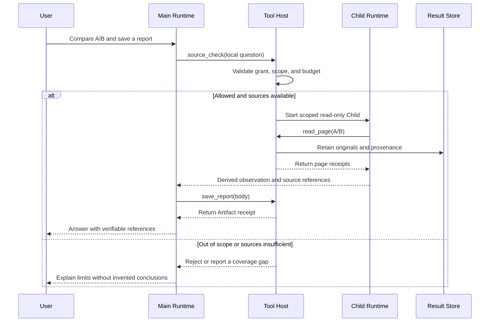
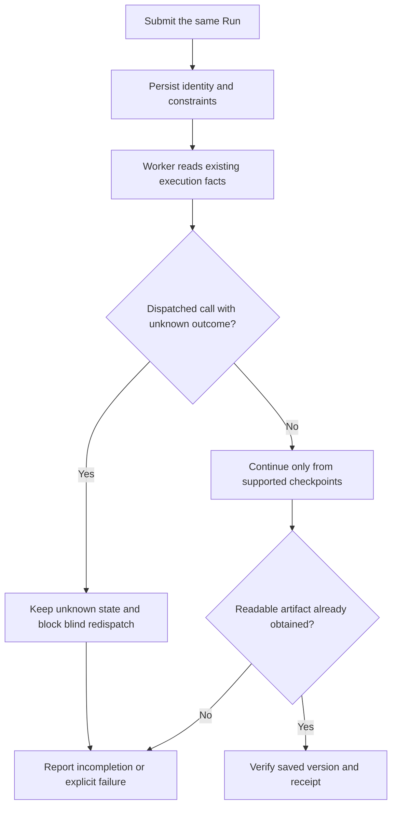

# Agent Deep Dive: From One Report to Durable Execution and Specialist Collaboration

<LearningPathNav />

The first two articles explained how AI chooses the next step in a loop and what ten modules do. Now take another step: **How does the same work continue when information passes through several tools, another process takes over execution, or another assistant handles part of the task?**

This is one reading path through Open ETF Agent from v0.10 to v0.15. The original system-design article and the new specialist walkthrough are combined here at the original URL. The [original v0.10 edition](https://github.com/hpoenixf/eff-agent-article/blob/a377164e53e5f63b7a6114d54e2635c084dfbbcd/en/articles/open-etf-agent-v010-system-design.md) remains available as a fixed snapshot.

We will examine three questions: how information becomes a report, how execution continues, and how a specialist contributes. These are independent examples sharing the same execution foundation. Default public commands use synthetic material and scripted model actions while executing actual tools, storage, and process handoffs.


## Six-layer capability map: deeper handoff contracts

Building on the intermediate modules, this map **highlights** `source_check` Main/Child delegation, the Child's restricted tools, original evidence versus derived judgments, reproducible ResultRef calculations, and actual report readback. Muted chips are previously introduced building blocks; select a solid chip for pinned source code.

<PanoramaViewer src="/eff-agent-article/visuals/learning-stage-maps/deep-en.svg" label="Deep-dive six-layer map: source evidence, durable execution, Main/Child handoff, and report readback" :source-links="true" :canvas-width="2240" :canvas-height="1110">
<div class="v3-owner-map-scroll">
  <object class="v3-owner-map" type="image/svg+xml" data="/eff-agent-article/visuals/learning-stage-maps/deep-en.svg" role="img" aria-label="Deep-dive six-layer map: source evidence, durable execution, Main/Child handoff, and report readback">
    <a href="https://hpoenixf.com/eff-agent-article/visuals/learning-stage-maps/deep-en.svg">Open the six-layer SVG map</a>
  </object>
</div>
</PanoramaViewer>

**Do not combine the demos into a single Run:** the v0.15 `source_check` specialist, v0.10 ResultRef calculation, and durable Worker are separate examples. L6 here means CLI readback, not a delivered Web UI.

## Four kinds of continuity before we begin

Writing a report is not the same as building a reliable agent application. The difference is not simply more tools. It is **which facts survive when work crosses modules, processes, and assistants**.


The four chains show facts that must survive; they are not one pipeline already executed by a single teaching command. Delivery continuity makes the first three useful to the reader. Complete continuity and failure descriptions remain below.

<details>
<summary>Read the complete relationships and text reference</summary>

| Continuity | From and to | What breaks if the handoff fails |
| --- | --- | --- |
| **Evidence** | Original source → Result → deterministic calculation → reported number | A plausible number no longer traces to its operands |
| **Execution** | User task → Session → Worker → Runtime | A restarted process repeats effects or resumes the wrong task |
| **Responsibility** | Scoped question authorized by Main → Child tool calls → Main adoption | An assistant elevates an unauthorized read or unsupported summary into a conclusion |
| **Delivery** | Report content → storage receipt/Publication → user-visible version | The model says “done” while the file or UI still shows old content |

</details>

The fourth kind, delivery continuity, is what makes the first three valuable to a user. It does **not** claim that the v0.15 teaching CLI contains a complete online publication system. The v0.10 calculation and Worker, and v0.15 Child, are **separate runnable mechanism examples**. We compare them through a common architectural lens; no single command executes all these stages.

First, consider a conceptual sequence where a specialist checks sources and hands them back to Main. Requests and receipts are distinct. This is an architecture explanation, not a sequence exported from a live trace.

**Read the collaboration in order without zooming:**

1. The user asks Main to compare A/B and save a report. Main requests `source_check(local question)` from Tool Host.
2. Tool Host validates the grant, tool scope, and budget before taking one of the following branches.

**When execution is allowed and sources are available:**

1. Tool Host starts a scoped, read-only Child.
2. Child asks Tool Host to perform `read_page(A/B)`.
3. Tool Host retains originals and provenance in Result Store, then returns page receipts to Child.
4. Child returns a derived observation and source references to Main, not a replacement for original evidence.
5. Main requests `save_report(body)` from Tool Host; Tool Host returns an Artifact receipt to Main.
6. Main answers the user with verifiable references.

**When the request is out of scope or sources are insufficient:** Tool Host returns a rejection or coverage gap to Main. Main explains the limits to the user without inventing conclusions. This branch does not enter the success path above.

The original diagram below retains every participant and message direction: solid arrows are requests or actions; dashed arrows return receipts, observations, or answers.

<details>
<summary>View the complete collaboration sequence (zoom available)</summary>



</details>

Each receipt answers a different question. A page receipt identifies source material; a Child statement is interpretation based on that material; a storage receipt establishes a retained artifact. **They cannot be collapsed into one “agent succeeded” flag.**

## 1. How do source data and calculations reach a report?

Start with the small v0.10 example. A synthetic table has three values: **100, 999, and 250**, all in USD with a data date of 2026-10-01. The task compares the first and last rows. The middle value, 999, is not an operand.

Passing 100 and 250 to a calculator is straightforward. Once a model explanation, report, and CSV follow, the numbers also need to retain their origin.

The capability connects the steps: **read the source table → select two rows → calculate once → use the same result in the next model input, report, and CSV.**

`read_comparison` retrieves the source and Result retains the original content. A calculation request refers to that result and identifies the selection and row positions. The calculator reads the saved source values, producing a difference of 150, a current-to-baseline ratio of 2.5, and a relative increase of 150%, while retaining units, currency, and date.

The report and CSV draw their values from that calculation. A reader can trace a reported number back to the computation and then to the original rows. The model still explains what the numbers mean.

The design choice is practical: existing tools already read, calculate, and save. Add the reference relationships that let one result continue through them. The [original proposal](https://github.com/hpoenixf/open-etf-agent/blob/ff5b9273ef0d239e804f61792702cd2e94174be7/openspec/changes/result-reference-consumption/proposal.md) records that reasoning.

<details>
<summary>Further detail: v0.10 selection and numerical definitions</summary>

The request has this shape; the read tool returns the actual `resultRef`:

```json
{
  "resultRef": "result reference returned by reading the source table",
  "selection": { "offset": 0, "limit": 3 },
  "baselineRow": 0,
  "currentRow": 2
}
```

The selection must cover both operands. Reading only the first two rows does not supply the third. Date, currency, and denominator requirements also remain attached to the computation. The numerical section comes from the calculation; free-form conclusions still require interpretation against the sources.

The [independent-readback record](https://github.com/hpoenixf/open-etf-agent/blob/ff5b9273ef0d239e804f61792702cd2e94174be7/docs/verification/result-consumption-independent.safe.json) checks original report and CSV output. Gateway-encoding checks establish that material entered a request, not that a live model understood it correctly.

</details>


### Trace one reported number backward to the source

Start with the report's “150% increase” and walk backward. Does the report reference a calculation? Did that calculation use row one (100) and row three (250)? Was row three in the acquired selection, and were the dates and currency comparable?

Here is a **conceptual contract** for review, not the exact v0.10 API:

```text
report.claim
  -> calculation(resultRef, baselineRow=0, currentRow=2)
  -> sourceSelection(offset=0, limit=3)
  -> original rows [100, 999, 250], USD, 2026-10-01
```

Keeping 999 in the window is intentional. **“The tool read 999” is not the same as “the calculation used 999.”** Treating every selected row as an operand produces a wrong change; dropping row identities makes even a correct number difficult to reproduce.

| Boundary case | Expected behavior | What must not happen |
| --- | --- | --- |
| Selection covers rows 0 and 1 only | Report currentRow=2 as unavailable | Ask the model to guess the third row |
| Baseline is zero | Mark ratio/growth as undefined under the method | Divide by zero silently or produce infinity |
| Currency, date, or measurement basis differs | State the mismatch and request normalized inputs if necessary | Subtract incomparable values |
| Result reference is absent or source no longer authorized | Stop that computation and explain the gap | Allow the model to fabricate a reference |

These are **application correctness requirements**, not claims that every guard exists in the fixed implementation. The v0.10 example and independent readback record demonstrate only the actual selection, computation, and report/CSV consistency checks they cover. The model interprets what a change might mean; it does not manufacture computational facts.

## 2. Who continues after the submitting process exits?

A short task can finish within one command. Longer work can separate submission from execution: register a task first, then let a Worker take it over.

Three familiar modules divide the work:


Submission and execution can use separate processes while retaining the same explicitly selected task. This illustrates the existing handoff, not a promise that arbitrary historical checkpoints can resume.

<details>
<summary>Read the complete relationships and text reference</summary>

| Part | Responsibility |
| --- | --- |
| Session | Retain the task, its progress, and execution conditions |
| Worker | Drive one explicitly selected task |
| Runtime | Continue the existing model-and-tool loop |

</details>

Worker reuses Session's execution records and calls the same runtime. The [single-Run proposal](https://github.com/hpoenixf/open-etf-agent/blob/ff5b9273ef0d239e804f61792702cd2e94174be7/openspec/changes/v09-single-run-worker/proposal.md) narrowed the design to this clear path instead of adding another layer of task state.

The command window and research task can then have separate lifecycles. A later process takes over the same task with its allowed scope, consumed budget, and original deadline.

The original article's `durable-publication` example demonstrates that handoff. It runs separately from the calculation example, giving a second view of the same foundation.

<details>
<summary>Further detail: boundaries of continued execution</summary>

Continuation relies on existing execution facts and supported checkpoints. Dispatched requests with unknown outcomes are not automatically replayed; stopping a Worker does not itself cancel the user's task. Committed answer bodies and saved files retain their own identities through later task changes.

v0.10 uses `tool-host@2`. Persisted `tool-host@1` snapshots cannot be resumed or replayed by the newer runtime, including snapshots of already terminal Runs. Before an upgrade, let active tasks finish on their original version or isolate the old code and data. Independent reading of Results, Artifacts, and Publications is separate from execution recovery. The [upgrade checklist](https://github.com/hpoenixf/open-etf-agent/blob/d943dd8452e4a97fbca5e5c74537a05655e73837/docs/upgrade-guide.md) preserves these conditions; its synthetic old-label tests do not constitute acceptance of a real old-snapshot migration.

</details>


### Why can “run it again” make correctness worse?

Imagine Worker dispatches a report write and disconnects before receiving the receipt. Three realities are possible: nothing was written, the write succeeded without a retained receipt, or a confirmed failure was recorded. **The process exiting** does not distinguish them.

A continuation must establish the original task identity, its constraints, and the last provable checkpoint. Starting a new process is not evidence that the previous effect may safely be replayed.



This is a **safe-recovery decision sketch**, not the complete v0.10 Worker state machine. At minimum, distinguish:

| Known fact | Does it imply retry is safe? | Why |
| --- | --- | --- |
| Result is saved and independently verifiable | No repeat effect is needed | A repeated write might overwrite content |
| Explicit failure receipt and retryable operation | Recheck prerequisites first | Original authorization, budget, and deadline still apply |
| Dispatched with unknown outcome | **Do not blindly redispatch** | The external effect may already have happened |
| Old checkpoint incompatible after upgrade | Do not treat it as resumable by the new version | Persisted execution protocols are versioned |

If tools write to external systems, production engineering must also consider business idempotency keys, effect queries, and compensation. “At least once” cannot imply “exactly once.” These are further design concerns, **not claims of already shipped behavior** in the demonstration release.

## 3. Add a specialist: how do two loops cooperate?

v0.15 adds one serial source-checking specialist. Return to the introduction's Atlas Notes task: Main compares the guides, while Child focuses on free-export limits and conditions.

The original material remains small: A's free edition exports CSV with a 120-row limit; B supports CSV and Markdown with a 300-row limit; both require an internet connection. These facts come from the [fixed synthetic documents](https://github.com/hpoenixf/open-etf-agent/blob/74bd5aa455ccaeb2994eb22aa744affde660bfa2/fixtures/documents.json).

Remember the route: **Main requests a check → Child reads A/B → original pages and observations return to Main → Main assembles a report.**

### Main starts with a tool call

[specialist-demo.mjs](https://github.com/hpoenixf/open-etf-agent/blob/74bd5aa455ccaeb2994eb22aa744affde660bfa2/src/specialist-demo.mjs) prepares Main's task and tools. The example chooses `source_check`, delegating the free-export limits and common online requirement.

From Main's loop, this resembles selecting a page-reading tool: propose an action and receive its result. In this case, the tool runs a more narrowly focused assistant internally.

### Child runs with its own material

[specialist-child.mjs](https://github.com/hpoenixf/open-etf-agent/blob/74bd5aa455ccaeb2994eb22aa744affde660bfa2/src/specialist-child.mjs) establishes the handoff. Child receives the overall question, the specific checking request, and the permitted A/B documents. Its only tool is `read_page`; Main organizes the final report.

[child.mjs](https://github.com/hpoenixf/open-etf-agent/blob/74bd5aa455ccaeb2994eb22aa744affde660bfa2/src/child.mjs) calls the project's existing `run`. Both assistants share the execution mechanism, with separate task input and context.


This is the single serial source-checking specialist in v0.15. Child reads only scoped A/B pages; it does not save or publish the main report. Default actions are scripted, not a real-model capability evaluation.

<details>
<summary>Read the complete relationships and text reference</summary>

| Child turn | Action | Newly acquired material |
| --- | --- | --- |
| First | Read A's first page | A's formats, limit, and condition |
| Second | Read B's first page | B's corresponding content |
| Third | Return a checking observation | Inspected material and observations |

</details>

Each tool result enters the next turn's input. With a live model, the model chooses subsequent actions from current material. The default example uses fixed actions to make the connections easy to inspect.

### Main receives the material and continues its next turn

Child returns original pages alongside its observation. Think of a colleague handing over an investigation note with the source documents attached. Main can use the highlighted points and the underlying material in its report.

This enters Main's context as the result of `source_check`. The default sequence then selects `save_report` and returns its final answer:


Once evidence returns to Main, this Child task has ended. Originals and derived observations enter Main context; Main then composes and saves the report before its final answer. No parallel specialist scheduler is implied.

<details>
<summary>Read the complete relationships and text reference</summary>

| Main progression | Where Child participates |
| --- | --- |
| First turn: call `source_check` | Child reads A/B and returns observations with original pages |
| Second turn: organize the handoff and call `save_report` | This specialist task has finished |
| Third turn: give the final answer | — |

</details>

**AI still chooses task actions, the runtime still drives the loop, and tools still execute operations; together they now coordinate two cooperating tasks.** Session links parent and child, Result retains original material, and report storage preserves the output. The modules from the Intermediate article form a concrete path here.


## 4. How do we prove a Child did not turn an observation into a source?

Adding another assistant does not create another source of truth. Main owns the overall task; Child handles an explicitly delegated local question. Child does not receive “all the user's permissions.” It receives a limited set of tools, documents, and execution budgets under the original task.

In the [fixed v0.15 implementation](https://github.com/hpoenixf/open-etf-agent/blob/74bd5aa455ccaeb2994eb22aa744affde660bfa2/src/child.mjs), the source-check method treats retrieved text as data, not instructions. `SOURCE_CHECK_LIMITS` sets `maxRounds: 4`, `maxTools: 2`, and `timeoutMs: 30000`. These bounds limit how long and how widely the check can run, but **budget is not permission to access more documents**. Scope and call identity are also bound and checked in [specialist-child.mjs](https://github.com/hpoenixf/open-etf-agent/blob/74bd5aa455ccaeb2994eb22aa744affde660bfa2/src/specialist-child.mjs).

### Three different identities

- **Original material:** A particular version and page of `atlas-a` or `atlas-b`. This is the primary source.
- **Child output:** “I checked the free-export limits; both versions require internet access.” This is a derived observation and may omit important caveats, so it must retain source references.
- **Main report:** A readable synthesis of Child's output and acquired pages. Main remains responsible for stating whether the evidence supports the final claim.

Suppose Child reads A only and then states “B also needs an internet connection.” The statement happens to match the full synthetic documents, but **this run still lacks evidence from B**. Correct handling preserves partial coverage or limitations instead of promoting plausible prose into verified source material.

### Isolation is useful; delegation is not automatic reliability

Making `source_check` a tool binding has two benefits. Main interacts with a bounded Tool interface; Child runs its own Loop under specialized instructions. The cost is additional identity validation: parent/child Run linkage, delegation identity, original grant, call ID, child budget, and handoff contents must stay consistent.

Without those checks, more subagents may produce **misattributed facts, duplicate reads, and lost provenance** rather than better answers. The public v0.15 example implements one serial source-checking specialist; it is not an unrestricted parallel specialist orchestration platform.

## 5. Turn the three examples into an acceptance contract

Return to the original question. Producing Markdown does not establish end-to-end correctness. Independently observe **whether operations executed, primary facts were retained, and the final artifact can be read back**.

| Check surface | Deliberately injected fault | What to observe | What it does not prove |
| --- | --- | --- | --- |
| Arguments and permission | Child requests an ungranted third document | Tool Host rejects it; no unauthorized source enters Result | The model will never propose an out-of-scope call |
| Data and computation | Exclude currentRow or supply an incomparable baseline | Controlled failure/gap; no fabricated precision | Every financial calculation is correct |
| Durable continuation | An effect was dispatched but confirmation was lost | Preserve unknown status; no silent replay | Every historical Run is recoverable |
| Subagent handoff | Child has only A, not B | Main separates summary, original source, and missing coverage | Child's prose reasoning is always correct |
| Report and delivery | Saved output exists but UI displays an older version | Verify file, version, receipt, and displayed content separately | A storage receipt means the user has seen it |

Some of these are **acceptance tests a full application still needs**, not claims that all are already automated in v0.10 or v0.15. Live model behavior must be tested separately: passing fixtures demonstrates these mechanisms under known synthetic conditions, not general semantic accuracy or production fitness.

In production, do not use retry count alone as a reliability measure. Attribute a failure to the actual handoff: model call shape, Host authorization, Result provenance, Worker durable state, Child scope, Artifact receipt, or UI version selection. Fixing the responsible seam is generally more controllable than continuing to tune the prompt.

## 6. Return from engineering mechanisms to the user experience

From the frontend, the user only asks “Is my report ready?” Yet a trustworthy interface must distinguish **research still running**, **a readable version saved on the server**, and **that version displayed in this client**.

After a refresh, the UI should retrieve the report using stable task identity rather than guessing the final state from an old SSE fragment. If background work is incomplete, an earlier report must not masquerade as this run's completion. These are delivery and presentation contracts from the full six-layer architecture; **the specialist CLI example does not claim to ship a web UI**.

For a full-stack engineer, this explains why Publication, History, and UI require separate designs. The model produces candidate text, a durable system accepts a version, and delivery and presentation finally make it visible. Acceptance, storage, and display are separate, verifiable events.

## 6. Explore the main path in one v0.15 checkout

Use the [v0.15 environment installed in the introduction](./agent-in-15-minutes.md#try-the-example-in-five-minutes) and a new dedicated directory:

```bash
node src/specialist-cli.mjs run --session runs/deep-specialist-v015
```

The terminal prints the actual `runId`. Substitute it in this command:

```bash
node src/specialist-cli.mjs read --session runs/deep-specialist-v015 --run RUN_ID
```

Begin with `child.summary`, `sources`, and `report.text`: the specialist observation, acquired pages, and report body. The default report lists the observation and original A/B pages, making the handoff inspectable. A session already created by the Intermediate example can be read using its directory and `runId`.

Read four entry points in order: **[specialist-cli.mjs](https://github.com/hpoenixf/open-etf-agent/blob/74bd5aa455ccaeb2994eb22aa744affde660bfa2/src/specialist-cli.mjs) → specialist-demo.mjs → specialist-child.mjs → child.mjs**. Identify who passes what to whom before entering `runtime.mjs`.

<details>
<summary>Reproduce the original v0.10 calculation and independent Worker examples</summary>

These commands preserve the original fixed version. Use a separate directory from the v0.15 checkout. Node.js 26.11.1 matches that historical verification environment.

```bash
git clone https://github.com/hpoenixf/open-etf-agent.git open-etf-agent-v010
cd open-etf-agent-v010
git switch --detach ff5b9273ef0d239e804f61792702cd2e94174be7
npm ci --ignore-scripts --no-audit --no-fund
npm run build
node dist/src/cli.mjs --case result-consumption --output runs/article-v010
```

Inspect the report, source manifest, and CSV in the actual output directory. The Worker example uses another new Session directory; run these commands consecutively:

```bash
node dist/src/session-cli.mjs submit --session runs/article-worker --run original-example --case durable-publication
node dist/src/session-cli.mjs work --session runs/article-worker --run original-example
node dist/src/session-cli.mjs publication --session runs/article-worker --run original-example
```

This example's 30-second deadline begins at submission. It demonstrates submission-process exit, execution by a separate process, and reading the original answer. See the [Worker cases](https://github.com/hpoenixf/open-etf-agent/blob/ff5b9273ef0d239e804f61792702cd2e94174be7/test/worker-process.test.mjs) for the original recovery conditions. Default examples run offline after dependency installation, which may access npm.

</details>

## 7. From continuity contracts to the six-layer panorama

Place everything we have learned in the larger map. **Six layers describe request handoffs, not six services that must run sequentially, and not a claim that each demonstration release implements every layer.**


Locate responsibility through task identity, actions and tools, the deliverable version, and actual visibility. These layers describe handoffs, not capabilities already implemented by every historical demo.

<details>
<summary>Read the complete relationships and text reference</summary>

| Layer | Question it answers | Example and critical distinction |
| --- | --- | --- |
| **L1 Task input and trigger** | Who requested the A/B comparison, and when? | The user request starts the task; scheduled triggers belong to fuller applications |
| **L2 Identity, session, and context** | Which Run is this, and which history and documents may it use? | Session identity, Context projection, original grant |
| **L3 Agent decision and execution** | What happens next; does Main need Child? | Main/Child use the Runtime; a proposed action is not authorization |
| **L4 Tools and domain capabilities** | Who reads originals and computes the 150% change? | Tool Host, ResultRef, deterministic calculation, reproducible sources |
| **L5 Result publication and delivery** | Which report version was actually saved and accepted? | Artifact and readback; Publication/History govern broader delivery |
| **L6 User interface** | Which version of which Run did the user actually see? | CLI introduces readback; a web UI must handle refresh, progress, and stale versions |

</details>

Intermediate introduced ten capabilities. Deep Dive has asked **what they hand to each other, how failures are classified, and what evidence continuation can trust**. The full panorama expands to the whole system: Direct/Research/Coord paths, background tasks, cross-layer Owners, observability, and user-visible delivery.

Next read [**The Six-Layer ETF Agent Request Lifecycle**](./017-prompt-to-answer-six-layer-panorama-v3.md). Start by following L1 → L6; then zoom into Main/Child, tool results, and Publication as needed. **The goal is not to memorize the diagram, but to locate responsibility and verification evidence.**

[Back to Intermediate](./agent-ten-modules.md) · [Current source project](https://github.com/hpoenixf/open-etf-agent) · [中文](../../articles/open-etf-agent-v010-system-design.md) · [Engineering notes on GitHub (stars welcome)](https://github.com/hpoenixf/eff-agent-article)
