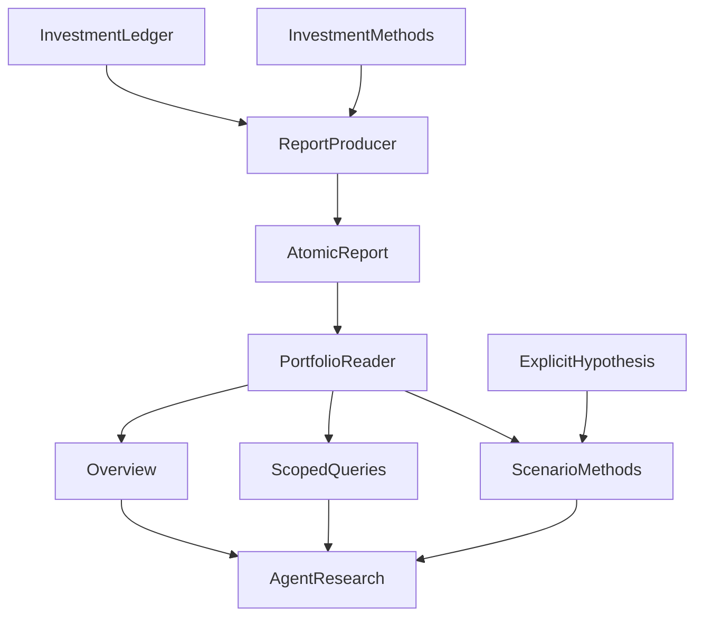

# Bringing Personal Holdings into an Agent: Designing a Read-Only Financial MCP

**A read-only financial MCP does not have to stop at converting holdings into JSON. It can help an investor calculate “what if I change this?” But it must always distinguish current account facts, hypothetical proposals, and actual executed trades.**

When a user asks, “What proportion is in technology?”, the answer needs the real portfolio denominator from a particular report and date. The follow-up, “If I reduce technology exposure, what happens to cash?”, calls for a scenario calculation with explicit weights, fees, and cash conditions. Even a feasible simulation does not authorize the model to confirm a decision or trade on the user's behalf.

In ETF Agent, we chose to have Portfolio MCP read an atomic `portfolio-report@1` produced by the underlying investment system. It provides an overview, details, and registered metrics and hypothetical scenarios on demand. Business calculations remain with the original domain methods, and the service has no tools for writing to the account. **The point is not to centralize all investment logic in one MCP. It is to bring every number into research with its original subject, time, denominator, and eligibility for use.**

The scenario below is explicitly constructed for teaching: a user wants to inspect the current allocation, locate technology funds, and calculate cash and constraints after changing target weights. The code, amounts, and dates do not represent a real personal account or completed trades.

## 1. Before the Tools, Establish Account Facts That Can Be Explained

Our underlying investment system already owns holdings, cash, deterministic calculations, and user confirmation. It assembles those results into a `portfolio-report@1` report. Portfolio MCP consumes that report rather than opening separate holdings files, cash files, and old recommendations for every answer and stitching together a new account state on the fly.

An “atomic report” is, first of all, a snapshot delivered under a shared report identity. Some parts may still be missing. It may also contain different business dates: holdings have a snapshot date, funds have net asset value dates, and the report has a generation time. Putting them in one file does not make those dates equal. What it enables is identifying, validating, and reading related parts together.

The reader finds canonically named report files in an authorized directory, checks paths and structure, preserves the report identifier, evidence version, generation time, and snapshot date, and computes a content hash. Downstream tools can therefore answer “Which report did these numbers come from?” instead of returning amounts stripped of context.



The arrows represent data dependencies. The underlying investment system produces the report, and the reader creates views for different queries. Scenario methods also require explicit hypotheses. Research then interprets the results; there is no path from research back into the investment ledger.

We once defined the entire data structure twice, in the report producer and the Agent reader, before extracting a shared structural contract and decoder. Both sides retained their own validation, however: the underlying system can represent a report whose snapshot date is unknown, while the Agent reader requires a usable date and will still reject it.

This is a practical trade-off. **Sharing field definitions reduces structural drift; eligibility for consumption remains the consumer's decision.** Importing the report-production module directly into the reader would also bring file-writing and investment-calculation dependencies. We ultimately shared the contract without those side effects, while the reader kept its requirements for dates and view completeness.

## 2. When the User Asks for an Overview, Give Them an Actual Overview

Return to the first question: “What does my overall allocation look like?”

The early no-argument portfolio query returned all holdings along with broader context about recurring investments, budgets, and execution. A user might only want the overall allocation, yet the model would already receive every fund, share quantity, net asset value, and unrelated decision field. We wanted to reduce default disclosure while giving the model a stable allocation overview.

`get_portfolio_overview` therefore provides a restricted presentation view: the portfolio total, eight display groups, and necessary classification information. It uses the presentation basis already established by the underlying report. Unknown categories have an explicit place, and overlapping risk labels are not added together as if they were mutually exclusive groups. The full account report stays inside the service; a tool receives only the projection needed for the current question.

The current overview also returns a small number of evidence-backed candidate fund relationships, helping further research find useful subjects to inspect. These candidates can contain fund codes, so “overview” does not mean a complete absence of product identities. Its boundary is: **do not expand all holdings, shares, net asset values, and decision sections by default, but preserve a way into further research.**

There is a real lesson worth retaining from this change. Initially, MCP was already returning the restricted overview, but the actual application injected both a direct data source and an MCP Host. Another context-assembly path still preferred the full report, so what the model ultimately saw bypassed the new overview. Testing only the MCP return value could not reveal that problem.

A later controlled regression covered the actual dual-injection entry point and changed the default model context to the restricted view. Data minimization must reach the point where data is actually consumed; a correct tool result does not prove the application used it.

An overview has costs, of course. Further analysis requires another detail request. Too little default information, however, turns every research task into mechanical paging. We therefore organized tools around questions rather than making every field a separate call.

| What the user needs now | Tool entry point | Focus of the result |
| --- | --- | --- |
| Understand the overall allocation | `get_portfolio_overview` | Total, display groups, coverage, and a few relationship clues |
| Inspect a fund or a group of holdings | `get_fund_position`, `get_portfolio_holdings` | Holding facts for an explicit product or portfolio scope |
| Assess relationships between products | `get_portfolio_relationships` | Feeder relationships, tracked indices, and existing constituent-overlap evidence |
| Query a metric or compare hypothetical proposals | `query_portfolio_metric` | Registered method, input scope, time, and calculation result |

## 3. From Overview to Detail: Return Every Number with Its Scope

The user next asks about technology. “Technology” can span multiple allocation groups. The model must first clarify whether this means one group or cross-fund sector exposure, then select the appropriate query. The current `get_portfolio_holdings` can also return the whole portfolio; full access is a reasonable capability when the question genuinely requires fund-by-fund analysis. A default overview and on-demand detail serve different questions.

Consider a teaching fund in the Nasdaq group. Suppose the report's allocatable portfolio total is RMB 100,000, with 1,000 shares of fictional fund `900001`, valued using a net asset value of RMB 12 in that snapshot. A single-fund query can take this input:

```json
{
  "fundCode": "900001"
}
```

The following excerpt shows fields relevant to understanding the result, omitting full protocol fields and the separately returned presentation projection. The numbers only illustrate the current interface's meaning:

```json
{
  "status": "available",
  "analysis": {
    "fundCode": "900001",
    "name": "教学科技基金",
    "category": "nasdaq",
    "shares": 1000,
    "nav": 12,
    "value": 12000,
    "weight": 0.12,
    "view": {
      "query": { "kind": "fund", "fundCode": "900001" },
      "snapshot": { "asOf": "2026-10-18", "freshness": "fresh" }
    }
  },
  "provenance": {
    "reportId": "demo-report-2026-10-18",
    "evidenceVersion": "demo-v1",
    "snapshotDate": "2026-10-18",
    "authority": "report-snapshot"
  }
}
```

The example name `教学科技基金` means “Teaching Technology Fund.” Here, 12% uses the underlying report's portfolio total as the denominator, not the fund's share within the technology group. `fresh` means the configured freshness requirements for reading are satisfied. The snapshot is still October 18; it must not be rewritten as “today's holdings.”

Presentation amounts also have a clear origin: the current implementation multiplies shares by net asset value within the same report, then calculates display weights. It does not fetch a newer market price and silently substitute a different account valuation. The model is explaining the snapshot it read. If it needs to research newer market developments, it can obtain separate market evidence and explain the time difference.

Multiple reads in a conversation should not automatically be treated as a single snapshot transaction, either. Current tools read the available report separately. If a new report is produced between calls, a later result may be newer. Cross-result comparisons must check report identities and dates. The teaching example uses one snapshot throughout only to make the mechanism clear.

### Change in Conditions 1: One Name May Refer to Different Funds

When the user says “that technology fund,” a tool cannot select a product just because its name looks similar. A single-name query with multiple matches reports ambiguity and requires a more precise identity; batch queries preserve matching candidates and ambiguity markers. A nonexistent fund has its own unavailable result. It is not disguised as a zero holding, nor must it cause every other fund in the batch to fail.

### Change in Conditions 2: Complete Holding Rows Do Not Guarantee Relationship Evidence

Two funds may be a feeder fund and its target product, track the same index, or share only some underlying companies. Each relationship requires different evidence.

Relationship queries therefore record holding-scope completeness separately from relationship-evidence completeness. Even when every holding row has been returned, a product without constituent data cannot be judged to have “no overlap.” The model can explain known relationships and identify where more research is needed. A tool-level success status does not supply the missing premises of a financial conclusion.

## 4. Why a Read-Only Service Can Still Calculate Proposals

The third question is: “What happens if I reduce technology exposure?” **Read-only constraints protect account state and external side effects; they do not prohibit calculations on an authorized snapshot.** A hypothetical proposal may show buy/sell differences, fees, and cash shortfalls, but it cannot be written back into actual holdings or interpreted as the user's agreement to execute. Original business methods own the calculation definitions; MCP provides only scoped read and invocation entry points.

The MCP [tool annotation specification](https://modelcontextprotocol.io/specification/2025-11-25/schema#toolannotations) defines `readOnlyHint` as a hint about whether a tool modifies its environment, and explicitly states that annotations are hints rather than guarantees of actual behavior. Our tools declare themselves read-only, but the concrete guarantees come from connecting only read capabilities, invoking explicit domain methods, and exposing no ledger-writing or trading entry point. A Boolean field cannot replace those implementations.

The current `query_portfolio_metric` permits queries for registered metrics. Each has a formula version, source fields, permitted dimensions, and freshness requirements. Results distinguish report snapshots from deterministic calculations. The model cannot invent a metric name and thereby make the service execute an arbitrary investment formula.

Rebalancing scenarios use the same query entry point but additionally invoke existing portfolio scenario methods. Research first reads `portfolio.rebalance.context` to obtain the identities of the report and current strategy, the portfolio denominator, cash roles, and missing scenario conditions, then supplies explicit hypotheses.

“Reduce technology a little” is not sufficient calculation input. The current method requires complete target weights, fee assumptions, a budget, and whether sale proceeds may fund purchases in that scenario. Targets must cover existing funds and remain within the currently confirmed allocation scope. The method does not choose optimal weights for the user or automatically introduce new products.

A scenario request also binds the report identifier, evidence version, report content hash, and strategy identity. Execution compares these with the content actually read for that call. If the report changed after the model constructed its hypotheses, a binding mismatch is rejected. This prevents targets based on old holdings from being applied directly to a new account state. It is a specific version check, not a guarantee that the entire conversation is locked to one report.

Once conditions are met, the method can calculate buy/sell differences, fees, cash shortfalls, and allocation constraints. Even when the result is `feasible-under-assumptions`, it explicitly retains `targetAuthority: "hypothesis"`, `stateChanged: false`, `executionEligibility: "unknown"`, and `executionAvailable: false`. These fields mean “the numbers work under these assumptions”; they do not create a trade fact.

Account facts, derived results, and confirmation status therefore require separate explanations:

| Content read | What it can establish | What remains missing |
| --- | --- | --- |
| Holdings and cash snapshot | Account state in a specified report and at a specified time | Account changes after that snapshot |
| Metrics, recommendations, or scenario results | Derived results under explicit methods and inputs | User confirmation and actual execution facts |
| A confirmed recurring-investment plan | The plan has reached the corresponding confirmation state | Actual trades, fund transfers, and receipts for later changes |

For example, `get_dca_plan` reads recommendations; `get_execution_status` reads confirmed plans and their current or last known state. Although the latter contains “execution” in its name, plan rows still cannot be translated into “these funds were bought today.” Tool descriptions must state these easily confused meanings directly, while result identities preserve the basis for later explanations.

## 5. How Queries Should Continue When Data Becomes Stale or Incomplete

Financial data does not update neatly in unison. Account uploads, fund net asset values, and daily report calculations follow different schedules; QDII funds may disclose net asset values later still. Availability, dates, estimation status, and coverage must therefore be expressed separately.

### Change in Conditions 3: A Valuation Suitable for Display May Not Qualify for Current Rebalancing

If a report contains explicitly labeled estimated holdings, the overview can give the model the known information and estimation coverage to explain. The current rebalancing scenario, however, requires actual, complete, matchable holding evidence, together with valid strategy and cash constraints. An amount being displayable in the overview does not automatically make it eligible for that calculation.

Likewise, if no snapshot exactly matches a historical date, a query cannot silently use the nearest available day and echo back the requested date. The user can research an available date instead or accept an explicit data gap. The data service should preserve that distinction.

Local failures must remain within the scope they affect. In a controlled path, we reproduced a case where a later cash-budget read became stale and the consumer consequently cleared a previously valid holdings total to an unverified state. After the fix, independent holding facts could still be presented while stale cash remained restricted. If the same field became invalid or the report identity changed, the relevant eligibility still had to be withdrawn.

That fix belonged to result consumption and publication-eligibility management. The Portfolio service supplied clear report identities, scopes, and field provenance. Together, these responsibilities make it possible to express “some data is insufficient” accurately: one failure need not leave the whole research task with nothing to say, and stale data cannot keep circulating on the strength of other valid results.

## 6. Three Boundaries Worth Protecting in a Read-Only Financial MCP

**Its value is not that the Agent knows more numbers. It is that account facts, hypothetical calculations, and actual operations no longer become one indistinguishable story in a fluent answer.**

The next time you design a personal investment data interface, test it with three questions:

1. **Where do the facts come from?** Do holdings, cash, and valuations come from the same identified report? Are names, share classes, dates, snapshot denominators, and freshness preserved?
2. **What exactly is this calculation?** Are the real method version, complete target weights, fees, and cash conditions explicit? If the report changes, can the old scenario binding prevent accidental use against a new snapshot?
3. **Has the real account changed?** A calculated `feasible-under-assumptions` result remains a scenario, not approval, an order, or a completed trade. Subsequent effects must be settled by the original authorization and execution process.

The read layer incurs the maintenance cost of report validation, view definitions, and consumption eligibility. That does not grant it authority over bookkeeping, confirmation, or investment decisions. The current implementation and controlled tests cover some engineering paths through these boundaries; whether real conversations consistently produce valuable allocation analysis requires separate observation.

**Let the Agent research “what if,” while reserving the right to declare “it happened” for the real ledger and execution receipts.**

## Further Reading

- [From Connecting MCP to Actually Using Tools: Building the Agent Integration Path](https://hpoenixf.com/eff-agent-article/en/articles/mcp-host-from-discovery-to-consumption)
- [Why a Financial Data MCP Grew into a Research Decision System](https://hpoenixf.com/eff-agent-article/en/articles/mcp-market-responsibility-retrospective)


<!-- agent-article-sync:guidance:start -->
## More Reading and Discussion

Visit the [independent reading site](https://hpoenixf.com/eff-agent-article/en/) to read the series with its catalog, architecture diagrams, and adjacent articles.

The series and illustrated materials are collected in the [GitHub repository](https://github.com/hpoenixf/eff-agent-article). If this article helped you, a **Star** is welcome, as are questions and discussion through Issues.
<!-- agent-article-sync:guidance:end -->
