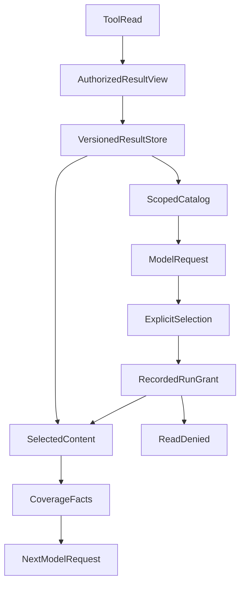

# Why Tool Results Should Not All Enter Model Context

A tool retrieves a 120-row table, but the model needs only three fields for its next step. Sending the whole table every turn is wasteful. Keeping only a summary may discard the exception that matters in the following step.

The current design retains **acquired, authorized result views** with their original result owner and lets the model read exact versions and selections. Storage is the easy part. The harder questions are how to disclose partial delivery, how to return to the same original later, and how to continue honestly when a successful read no longer fits the next request.

We follow that consumption path, using three evidenced counterexamples to explain the choices: 50 records projected as 20, old reads repeatedly carried forward, and two individually valid selections colliding with a local capacity limit. The public exercise at the end implements a narrower, runnable slice.

<span id="a-desk-does-not-need-to-hold-the-entire-archive"></span>
<span id="references-authorization-and-refresh-keep-different-meanings"></span>

## 1. Separate the Stored Result, Catalog and Current Selection

Context is the material available to the model during one inference step. Inserting complete tool results is like spreading every document across a desk. New queries and repeated results keep occupying more space as research continues.

Consider this simplified teaching example: “Are my technology funds too concentrated?” The model first needs fund names and amounts, then perhaps industry exposure. Comparing allocations before and after a proposed change requires another set of computational inputs. The relevant data changes from step to step; the complete holdings table need not travel with every request.

We separate data access into three parts:

| Part | Responsibility |
| --- | --- |
| Result store | Retain an acquired, authorized result view together with its version, source, acquisition time and access scope |
| Result catalog | Tell the model which materials are available and how to locate and select them |
| Read interface | Select fields, records or text ranges by reference; approved data may also go directly to Python for computation |

A catalog establishes that material exists. It does not establish that the model has read the content. This is a simplified illustration, not the production protocol:

```json
{
  "resultRef": "positions-v1",
  "kind": "table",
  "fields": ["fundCode", "name", "amount", "sector"],
  "rowCount": 120,
  "acquiredAt": "2026-10-07T10:00:00+08:00"
}
```

For a concentration analysis, the model might select:

```json
{
  "resultRef": "positions-v1",
  "fields": ["fundCode", "amount", "sector"],
  "offset": 0,
  "limit": 50
}
```

The target of this read is the selected range, not the entire 120-row table. Its response must report the actual range, whether more records remain and whether the selection was delivered completely. If the model already knows which fields it needs, it may include that selection in the initial fetch rather than making an obligatory extra catalog request.



The catalog and content follow different consumption paths. Explicit reads check the Run's recorded grant, account/scope and result-version identity; the same Run and its recovery do not requery current ACLs. Selection first obeys the original granted scope; request assembly then determines which bodies are actually presented. That last step must not upgrade the coverage facts.

The result store should retain the authorized data view. If private fields are filtered out but the unfiltered capture enters a readable store, a later reference read may bring those fields back. Each read must still fit that Run's recorded grant and preserve account, scope and content-version identity. A new Run requires independent admission; an old reference cannot supply permission. A reference is an address, not an access grant.

Reusing a previous fetch and automatically inserting its body require separate policies. A large response is not necessarily stable, and a read-only tool does not necessarily return the same data for identical parameters.

Only queries explicitly approved for reuse should match existing results by business arguments, tool/version identity, authorization identity and research scope. A requested refresh fetches again and creates a new version. A failed refresh retains both the failure fact and the old version's identity. A failed read of an exact version must not silently refetch upstream and present new data as the original snapshot.

Together, these boundaries let the model return to original material without gaining extra access or unknowingly changing the object being analyzed.

<span id="when-50-records-became-20-the-failure-was-before-the-model"></span>
<span id="completeness-needs-an-object-and-a-scope"></span>

## 2. Fifty Records Became Twenty: Success Is Not Complete Input

In the controlled investigation, the source contained 50 records, but an intermediate entry limit admitted only 20 into the model input. The logs showed no obvious error, and the model produced a coherent summary. The other 30 records had never entered its field of view.

Inspecting the actual input located the loss in the generic entry projection: the outer envelope could report 50/50 while the inner payload retained only 20. The model had never had an opportunity to see the tail. Telling it to “omit no entries” could not restore content absent from its request.

We made facts that had been scattered across reading, filtering and capacity handling explicit. This remains a teaching structure rather than the project's exact interface:

```json
{
  "requested": 50,
  "loaded": 20,
  "byteComplete": true,
  "filteredCount": 0,
  "inputComplete": false,
  "reason": "entry_limit"
}
```

The processing chain should produce these states from what actually happened. The model should not have to infer the denominator from prose. Counts are only one part of the check:

| Gap | Why “the call succeeded” misses it |
| --- | --- |
| Entry truncation | A request for 50 records returns the first 20, without telling later stages about the remaining 30 |
| Byte truncation | The count still says 20, but the twentieth record contains only half its content |
| Parsing or filtering loss | Malformed data, missing fields or failed transformations are skipped, silently changing the target set |
| Identity mismatch | The expected set is A, B, C, D, E, but the result is A, B, C, D, D; equal counts still leave E missing |

For finite sets with stable identities, also reconcile record IDs, page cursors, snapshot versions, ranges or source revisions. An ID set or appropriate digest may be useful; there is no requirement to use one particular hash scheme. The point is that **receiving five records does not establish that they are the correct five records**.

Authorization filtering can itself be correct. The issue is that the readable set after filtering and the original target are different objects. Later stages cannot silently keep using the old denominator. Coverage metadata must not redisclose fields that are prohibited from being read.

Input coverage and answer quality require separate judgments:

| Level | What it can establish | What it does not also establish |
| --- | --- | --- |
| The source set is defined | Which holdings snapshot, database result or document pages the task concerns | That every relevant source in the world has been found |
| The target input is covered | That known processing rules have not lost target records or bytes | That the model made meaningful use of every item |
| The answer is correct | Omissions, citations, attribution and reasoning require their own checks | Correctness does not follow automatically from `inputComplete=true` |

Even if both the source and the input contain 50 records, answer quality is not certified. The model might overlook entry 47 or misinterpret an important exception.

**Deliberately selecting a subset differs from silently losing a subset.** The 120-row holdings table above can be read in batches of 50. A partial read is reasonable when its selection and coverage are explicit. It simply cannot be described as the complete portfolio.

For example, after reading 80 of 100 holdings, the system can say:

> No gold ETF was found in the 80 holdings currently read. Another 20 holdings remain unread, so this does not establish that the complete portfolio has no gold exposure.

An earlier rule allowing only a draft whenever input was incomplete was too broad. The constraint should concern the population covered by the claim. It should not force vague wording into every sentence or prohibit all answers whenever a result is `partial`.

This coverage contract applies to finite sets such as holdings, database results, file manifests, fixed documents and paginated APIs. Open-ended web search has no naturally enumerable universe. Twenty returned search results can support a statement such as “the current search plan was executed”; they cannot prove that all relevant knowledge has been covered.

## 3. Why Not Return Everything, Summarize It, or Let a Framework Clear It?

These approaches overlap, but they do not replace one another.

| Approach | Strongest fit | What still needs an answer |
| --- | --- | --- |
| Inline tool results | Small, stable tasks completed in a few turns; simplest to implement and debug | Repeated large bodies and truthful coverage when later trimming occurs |
| Summaries or selected excerpts | An overview is enough, detail loss is acceptable and originals remain accessible | Exceptions may be lost; a summary does not establish original-source coverage |
| LangChain `ToolMessage.artifact` | Separating model-facing content from data needed by the application | The field alone does not define version storage, selected rereading or access lifetime |
| Claude tool-result clearing | Using its API to clear older results while retaining recent or excluded tools | The application still owns exact original access and source authorization |
| Authorized views, exact references and explicit reads | Long research repeatedly revisits sources and must explain versions and selections | Storage, availability, authorization, coverage and extra reads; the model must choose useful material |

[LangChain's message documentation](https://docs.langchain.com/oss/python/langchain/messages#tool-message) separates model-facing `content` from programmatically available `artifact` data that is not sent to the model. This is a useful foundation. Stable result identity and controlled rereading are additional application responsibilities, not automatic consequences of using that field.

[Claude context editing](https://platform.claude.com/docs/en/build-with-claude/context-editing#tool-result-clearing) clears older results server-side with placeholders while the client retains full history, with recent-result retention and tool exclusions. It removes some request-management work, but the application still decides how to recover originals. Clearing can also invalidate a cached prompt prefix, so a shorter request is not automatically cheaper.

We chose exact rereading because a temporarily omitted number, date or exception may matter again. Summaries can coexist with it: summaries aid understanding; references recover originals. The price is more state and potentially more read turns. If the result is a few dozen rows and the task ends in one turn, inline delivery may be the better choice.

<span id="three-limits-answer-three-different-questions"></span>

## 4. Three Limits Still Do Not Tell You Whether Two Reads Fit Together

Storage capacity, automatic insertion and explicit-read capacity answer different questions: how much can be retained, how much is inserted without a selection, and how much can be deliberately read at once. An earlier implementation used 24 KiB for automatic insertion and 128 KiB for explicit reads. Those are historical settings, not one current limit for every interface or universal best-practice values.

**“Do not insert automatically” must not mean “cannot be read.”** Conversely, two individually valid reads may not fit together with user text, tool definitions and history.

A concurrent-read investigation exposed both sides:

- Two explicit reads shared a fixed 192 KiB pool, leaving 96 KiB each. In a controlled case, two authorized selections of about 105 KB could fit together inside a complete 512,000-byte input window, yet the smaller local allocation made the first read incomplete.
- Simply enlarging the pool was insufficient. A fallback route might have a smaller window, and a later request might include a user correction that must remain exact. Earlier headroom cannot guarantee later capacity.

Current allocation uses the existing input window and necessary prepared-request overhead to establish a usable aggregate, then divides it among explicit reads in that turn while retaining per-result bounds. Each actual route request is fitted again as a complete input. Disabling local byte rejection does not establish unlimited provider capacity.

Historical material also identified four related capacity outcomes across three Runs, but original headroom was not fully recorded. They cannot all be causally attributed to the split pool. The controlled production-path case establishes the defect and repair discussed here; it is not a new live-model quality comparison.

<span id="a-successful-read-still-needs-a-check-at-the-actual-model-request"></span>

## 5. Request Assembly Can Still Change a Successful Read

“Data acquired,” “reference returned” and “body included in this request” need separate observations. A current selection should normally deliver content. With ample capacity, it must not be externalized again merely because it is a read result.

But **a soft working-set target is not an actual hard capacity limit**. Soft targets reduce old payloads without consuming latest-read protection. If the complete request still exceeds its route's hard envelope after ordinary fitting, the current fitter may replace a successful latest read as a whole with an exact reference independently confirmed by its original receipt.

That exception has specific conditions:

1. The original is retained and its reference, source identity and selection are uniquely verifiable. A model-authored ID or lookalike payload cannot authorize replacement.
2. The whole body is replaced, preserving selection, coverage and the hard-capacity omission reason. No half-value remains authoritative, and omitted content is not reported as presented.
3. Exact current user text, the original Run grant and durable result are not rewritten. Independently valid published text is not withdrawn by this capacity failure.
4. If an earlier omission of the exact same selection is receipt-confirmed and the reread still cannot fit, return local `STORED_RESULT_CAPACITY` guidance to narrow or page. Do not produce another reference-only success. Unproven or non-beneficial replacements cannot silently remove the body.

This preserves the original without creating “read A → receive A's reference → read A again” as an endless loop. Readable is not the same as read this time; useful pagination must actually change the selection.

A different conflict occurs earlier: the authorized source fits, but added derived fields make the result too large. Projection first tries the enriched value. If it overflows and **the same already-narrowed source projection** remains available, that view is measured again, including tool-call identity; another overflow yields `post.result_too_large`. Falling back to unfiltered capture or silently dropping selected rows is not allowed. The choice preserves the source already permitted for reading rather than letting optional explanation make it unavailable.

<span id="a-new-finding-old-reads-kept-reappearing-before-context-was-full"></span>

## 6. Old Bodies Can Keep Traveling Before Any Hard Limit Is Reached

In the later inputs of one real long-running research Run, Main made 37 Native requests and 20 explicit result reads, yet the same read-result messages appeared **279 more times across subsequent requests**. These are repeated message appearances, not 279 extra tool executions or token and billing measurements.

The aggregate tool-body soft target was about 192 KiB and was never crossed in that Run. It reasonably avoided retiring useful material too early, but did not prevent smaller old reads from traveling indefinitely.

The current policy retains that aggregate target and additionally handles older explicit reads. Above a secondary target based on the 24 KiB automatic-insertion size, only old bodies backed by a unique Host receipt and exact rereadability return to their original references. The latest two Native call groups are excluded from this early retirement; Child and finalization-only requests do not enable this extra optimization. It does not rank semantic relevance, merge similar text from different sources or delete durable originals. The latest-read exception in the previous section requires actual hard pressure, not routine cleanup.

Halving the global target would affect all tool results. Deleting content after one read could remove evidence needed immediately afterward. Summarizing would change meaning when the problem is repeated transport. References and the read-tool descriptor also occupy space; if the complete candidate grows, keep the original.

A controlled request with five read groups became more than 30,000 serialized bytes smaller. That establishes a smaller request, not lower paid tokens, fewer total calls or better answers. Frequent rereading could offset the gain.

The Run's bounded efficiency stream also retained footprint details for only 21 of 92 model requests. That gap must be named rather than treating missing records as absent activity. Later observation work prioritized request-level facts; efficiency and actual content exposure still require separate checks.

<span id="a-new-consumption-form-reviewable-is-not-a-second-answer"></span>

## 7. The Same Result Can Support Human Inspection

People may also want to inspect the inputs, selections and sources behind a conclusion. The existing optional Reviewable attachment, present in main by October 24, 2026, follows the original ownership chain: result and citation components retain identity, versions and lineage; Publication binds eligible details to its revision after final text transformation; History and the client expose the saved review view.

The attachment is neither a second answer nor a new requirement that review pass before publication. Oversized, unavailable or currently ineligible attachments degrade locally. Independently valid text remains governed by the original publication path. Reviewable explains material-to-result relationships; it does not certify conclusions or replace human financial review.

Reusing original identity matters for the same reason it matters during model rereading: a copied source registry could drift away from the version used by the answer. A connected display path also does not prove that natural research always has sufficient sources or that readers completed meaningful review.

<span id="put-decisive-records-at-the-tail-of-the-test"></span>

## 8. Tests Should Exercise the Boundary, Not Just a Small Success

The historical 50 → 20 investigation raised a generic entry limit to 60, solving the immediate 50-record case. That intermediate repair is not the final current contract for full holdings.

The original real-Host/model-projection regression with **65 holdings and gold at the tail** establishes **65/65 preservation**, including identity and precision. A result beyond the final byte limit gets an explicit size error, not a successful first-60 response. Full holdings and a deliberately selected page have different targets.

A teaching counterexample for a generic collection that permits truncation could request 65 records and return 60; it should report five missing and `entry_limit`. That hypothetical must not be presented as the actual holdings-test outcome. At least these cases should be separated:

| Counterexample | What to observe |
| --- | --- |
| A decisive tail record | Full-set contracts preserve it; selected reads claim only their scope; capacity failure does not impersonate the whole set |
| Equal counts but changed identities, or a half-record | Reconcile identity and bytes rather than counts alone; disclose filtering gaps within their scope |
| Two reads fit separately but enter one request | Inspect the serialized complete request, not just a single-result reader |
| A smaller fallback window or new user correction | Refit for the current route and content; exact references do not rewrite user text or durable results |
| Repeated reads of the same oversized selection | Deliver a real bounded page or actionable narrow/page guidance, not looping reference-only success |
| Failed refresh, foreign-Run reference or missing original | No substituted snapshot, enlarged authority or unfiltered fallback |

These checks answer which result, which selection and how much actually arrived. Correct interpretation, citation and reasoning remain a separate layer.

## Use the Public Code to Compare “Found” with “Read”

The public v0.4 slice of [Open ETF Agent](https://github.com/hpoenixf/open-etf-agent) narrows the problem to two synthetic documents: submit a query, obtain candidate pages, actually read them, retain immutable originals, reread an exact result through `read_result`, and save a report. The query is not a decorative parameter; it changes the pages passed to `read_page`. A scripted fixture chooses the actions, while retrieval, result persistence, rereading and report files use real implementations.

Use Node.js 26.11.1–26.x in a separate directory:

```bash
git clone https://github.com/hpoenixf/open-etf-agent.git open-etf-agent-results-demo
cd open-etf-agent-results-demo
git checkout --detach ecf6cb45b4062586614e83aed917c92d704cb63b
npm ci --ignore-scripts --no-audit --no-fund
npm run demo -- --case retrieve-reread --query "offline editing"
npm run demo -- --case retrieve-reread --query "Markdown"
```

Initial installation may use the network; the cases make no remote model calls. Open `manifest.json` and `report.md` in each Run directory printed by the console. `offline editing` acquires page two of both A and B. `Markdown` acquires only page one of B, so its report explicitly does not claim a complete two-document comparison. The important comparison is not prose style: **does changing the query change the set of sources actually acquired?**

In [`src/retrieval-demo.mjs`](https://github.com/hpoenixf/open-etf-agent/blob/ecf6cb45b4062586614e83aed917c92d704cb63b/src/retrieval-demo.mjs), a candidate hit is not yet a citable original. It must pass through `read_page` and receive source identity and a `resultRef` before rereading and saving. With no candidates, no page is read and no comparison report is fabricated. Interpret the unsuccessful outcome in terms of that missing material, rather than assuming a successful search already produced an answer.

[`src/results.mjs`](https://github.com/hpoenixf/open-etf-agent/blob/ecf6cb45b4062586614e83aed917c92d704cb63b/src/results.mjs) keeps original pages, source descriptions and exact references under one result owner; `manifest.json` records the references associated with the report. The [same-document version case](https://github.com/hpoenixf/open-etf-agent/blob/ecf6cb45b4062586614e83aed917c92d704cb63b/test/results.test.mjs) shows that after a new version appears, the old reference still reads the old version rather than silently returning the latest content. That is fundamentally different from fetching a document again by name.

<!-- open-etf-case:reread@e1b8e4edde724548fab16d8ca4b205379bfa7f30 -->
### Connect candidates, original-byte rereading, and the report

The [CLI at this fixed public snapshot](https://github.com/hpoenixf/open-etf-agent/blob/e1b8e4edde724548fab16d8ca4b205379bfa7f30/src/cli.mjs) lets you compare a search hit with an actual original-source read in one inspectable Run.

After installing dependencies according to the README at the linked fixed snapshot, run:

```bash
node src/cli.mjs --case retrieve-reread --output runs/article-reread
```

The terminal returns the Run's `directory` and save receipt. Inspect `report.md`, `manifest.json`, and `run.jsonl` there to follow a candidate into an acquired source, an exact result-reference reread, and the saved report.

Inputs are local synthetic documents and retrieval selects lexical candidates. This does not validate dynamic ACLs, revocation propagation, or real-model citation quality.
<!-- /open-etf-case -->

### How the public implementation handles capacity

[`src/context.mjs`](https://github.com/hpoenixf/open-etf-agent/blob/ecf6cb45b4062586614e83aed917c92d704cb63b/src/context.mjs) does not delete original history. It creates a copy for the current request and, when the byte budget is exceeded, attempts to replace original text in older, fully settled call groups with actionable exact-reread references. It retains the original question and the latest complete tool group. If those still do not fit, it fails explicitly rather than silently retaining half a tool result.

Nor can replacement rely on a payload merely looking like a source. The public [evolution record](https://github.com/hpoenixf/open-etf-agent/blob/ecf6cb45b4062586614e83aed917c92d704cb63b/docs/evolution/evidence-index.md) preserves a controlled counterexample: an earlier shortcut using `sourceId` and a hash could replace a lookalike tool payload with an original-source reference. Replacement now also requires a matching Host-issued `ResultRef`, a verified text hash and complete intrinsic source identity. Unconfirmed payloads do not gain source eligibility through projection. The [integration cases](https://github.com/hpoenixf/open-etf-agent/blob/ecf6cb45b4062586614e83aed917c92d704cb63b/test/research-integration.test.mjs) observe the next actual Gateway input, not merely whether the result store wrote a record.

This code reproduces local document scope, immutable originals and exact rereads. It does not reproduce the original system's 50 → 20 incident or implement its full field selection, coverage population, account authorization or Reviewable publication path. Its capacity limit counts bytes, not an estimate for every model's token window. The [first live-model batch](https://github.com/hpoenixf/open-etf-agent/blob/d075068ac99a6c798d012c46bff4fe0c33eb9979/docs/verification/live-v01-v05-first-batch.md) acquired result references but did not perform query-driven retrieval or `read_result`. These experiments therefore establish executable mechanisms, not whether a model correctly selects, uses and interprets the material.

Keeping the complete result outside the model's current context is an application of [principle 5, “Context is a workbench, not a fact database”](/en/principles#principle-5). The model may read only the slice needed for its current task; result identity, selection coverage, completeness and permissions must remain independently verifiable.
