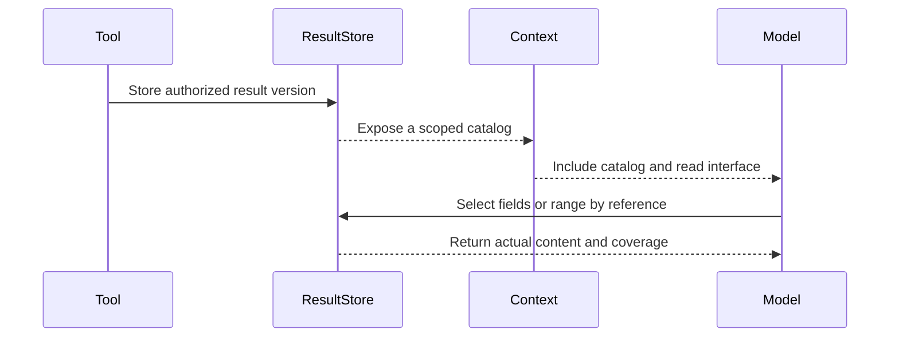

# Why Tool Results Should Not All Enter Model Context

When building an agent, the natural pattern is to send everything a tool retrieves straight to the model. Fetch portfolio holdings, return the holdings; fetch market data, return market data. The model reads the response and decides what to do next.

This is straightforward and works well for early tool integrations. But as research tasks grow longer, a question emerges: **Must every piece of retrieved data become part of the model's current context?**

During a holiday engineering iteration, we changed our investment research assistant to keep large tool results outside the prompt and let the model retrieve selected parts. The model did not suddenly gain a larger context window; it gained a different way to access data.

## A Desk Does Not Need to Hold the Entire Archive

The model's context is the material visible to it during a particular inference step. Injecting entire tool results is like spreading every document across a desk.

Research continues, however. New queries return more data, and the same portfolio may be fetched repeatedly. Putting every full response in context produces both growing volume and duplicate copies.

Consider this simplified teaching example: “Are my technology funds too concentrated?” The model initially needs fund names and amounts; later it needs industry exposure. Comparing allocations before and after a proposed change may require a different set of computational inputs.

An analyst typically starts with an inventory of documents and opens the relevant tables on demand. We wanted the agent to work similarly.

## The Design: Result Store, Catalog and Read Interface

The result working set has three conceptual parts.

**Result store:** retains data that has already been fetched and approved for use. Results have separate versions and carry source, acquisition time and access scope.

**Result catalog:** tells the model which resources are available, exposing only the information needed to locate and select them rather than copying every row into context.

**Read interface:** allows the model to select fields, records or text ranges through a reference. Approved data may also be supplied directly to an isolated Python computation environment.

This is a simplified illustration, not the production protocol:

```json
{
  "resultRef": "positions-v1",
  "kind": "table",
  "fields": ["fundCode", "name", "amount", "sector"],
  "rowCount": 120,
  "acquiredAt": "2026-10-07T10:00:00+08:00"
}
```

Instead of seeing all 120 rows, the model sees that a table exists. To analyze concentration, it can request:

```json
{
  "resultRef": "positions-v1",
  "fields": ["fundCode", "amount", "sector"],
  "offset": 0,
  "limit": 50
}
```

The response must report the actual range returned and whether more records remain. It must not silently truncate a result while claiming completeness. If the model already knows which fields it needs, the initial fetch may include that selection; a mandatory extra catalog lookup would add no value.



The catalog establishes that a result exists; an explicit read inserts selected content into the current request. Every read still checks the active run's permissions and the referenced result version.

## First Pitfall: Treating Different Limits as One Limit

Once large results live outside context, it is easy to reuse the small-response limit for everything.

This causes a contradiction: the system is allowed to store a large result, and the model explicitly requests it, but the read interface still applies the smaller threshold intended for automatic prompt insertion. The data exists but is difficult to use.

We separated three limits:

| Limit | Question |
| --- | --- |
| Storage capacity | How much authorized result data can be retained? |
| Automatic insertion | How much content should enter the prompt without explicit selection? |
| Explicit read capacity | How much may the model deliberately read at once? |

At the time of this implementation, automatic insertion was limited to **24 KiB**, while an explicit read defaulted to **128 KiB**, subject to the actual request's remaining capacity. These are implementation settings, not universal optimal values.

**“Do not insert automatically” must not silently become “cannot be read.”**

## Second Pitfall: An Explicit Selection That Disappears Before Inference

Before a tool result reaches the model, the request may go through assembly and context fitting. An unpleasant failure mode occurs when a selection succeeds but a later stage removes its content, leaving only a reference while the overall operation still reports success.

We therefore need to inspect the actual final model request, not merely the tool response.

The approach distinguishes the result catalog, older reads and reads made in the current turn. Catalog entries are optional context. Earlier reads may be compacted into their immutable version and selection parameters so they can be retrieved again. Newly selected content must not quietly become a successful response with no body.

“Data fetched,” “reference returned,” and “content included in the inference request” are three separate facts.

## Third Pitfall: Filtered Data Must Not Reappear Through Storage

Raw tool output sometimes contains fields that are not permitted to be disclosed. If the result store retains the unfiltered capture, those fields may disappear from the current prompt but return later through a reference.

The solution is to store the authorized data view, not the raw capture as if it were readable. Reference reads must also verify the current research scope and authorization.

A reference is an address, not a grant of access.

## Reuse and Refresh Require Different Policies

Once results are durable, we must decide whether a query may reuse an existing result.

“Automatically insert the body” and “reuse a previous fetch” are separate policies. A large response is not necessarily stable, and a read-only tool does not guarantee identical results across repeated calls.

Only explicitly approved queries are matched for reuse, using business arguments, tool/version identity, authorization identity and research scope. A repeated call may return an earlier version reference. A requested refresh fetches again and creates a new version.

A failed refresh must retain its failure fact and the old version's identity. A failed read of an exact version must not silently refetch upstream and present new data as the old snapshot.

## A Practical Starting Point

You do not need a full-fledged data platform on day one. Start with one category of large-result tools:

1. Store an immutable result after authorization and issue a versioned reference.
2. Expose a compact catalog with selective-field and paginated reads.
3. Configure storage, automatic insertion and explicit read limits independently.
4. Introduce reuse and refresh only for queries whose semantics have been reviewed.
5. Inspect the final inference request to confirm that current-turn selections actually entered context.

Tests should cover selected reads from large results, repeated queries without full-body duplication, refresh failures that never impersonate successful new data, and rejected cross-research references.

We did not establish how much this change reduced cost. The stronger lesson is about information access: giving the model better access to data does not require placing the entire archive on its desk.
