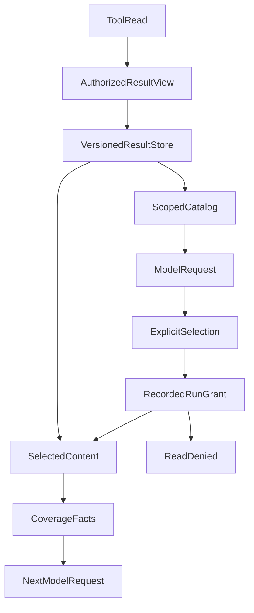

# Why Tool Results Should Not All Enter Model Context

A natural starting point for an agent is to send whatever a tool retrieves straight to the model. Fetch holdings, return the holdings; fetch market data, return the market data. The model reads the response and decides what to do next.

Longer research exposes two problems with that pattern. Repeated full results consume space needed for later work. Meanwhile, an intermediate layer may quietly remove records to satisfy a capacity limit, leaving the model to treat a subset as the complete dataset.

During a holiday engineering iteration, we moved some tool results outside the prompt and enabled selective reads. In a separate controlled investigation, we found that only 20 of 50 source records reached the actual model input. Both experiences lead to the same engineering question: **How can a model move less data while still knowing exactly what it has received?**

The sections below explain selection and coverage in the original system, then use a public code experiment to inspect the independently implemented slice: query-driven page reads, immutable results and exact rereads. That slice does not count the historical 50 → 20 case as its own execution result.

## A Desk Does Not Need to Hold the Entire Archive

Context is the material available to the model during one inference step. Inserting complete tool results is like spreading every document across a desk. New queries and repeated results keep occupying more space as research continues.

Consider this simplified teaching example: “Are my technology funds too concentrated?” The model first needs fund names and amounts, then perhaps industry exposure. Comparing allocations before and after a proposed change requires another set of computational inputs. The relevant data changes from step to step; the complete holdings table need not travel with every request.

We separate data access into three parts:

| Part | Responsibility |
| --- | --- |
| Result store | Retain an acquired, authorized result view together with its version, source, acquisition time and access scope |
| Result catalog | Tell the model which materials are available and how to locate and select them |
| Read interface | Select fields, records or text ranges by reference; approved data may also go directly to Python for computation |

A catalog establishes that material exists. It does not establish that the model has read the content. This is a simplified illustration, not the production protocol:

```json
{
  "resultRef": "positions-v1",
  "kind": "table",
  "fields": ["fundCode", "name", "amount", "sector"],
  "rowCount": 120,
  "acquiredAt": "2026-10-07T10:00:00+08:00"
}
```

For a concentration analysis, the model might select:

```json
{
  "resultRef": "positions-v1",
  "fields": ["fundCode", "amount", "sector"],
  "offset": 0,
  "limit": 50
}
```

The target of this read is the selected range, not the entire 120-row table. Its response must report the actual range, whether more records remain and whether the selection was delivered completely. If the model already knows which fields it needs, it may include that selection in the initial fetch rather than making an obligatory extra catalog request.



The catalog and content follow different consumption paths. Explicit reads check the Run's recorded grant, account/scope and result-version identity; the same Run and its recovery do not requery current ACLs. Only selections within that granted scope, together with their coverage facts, enter the subsequent request.

## Three Limits Answer Three Different Questions

After moving large results outside context, it is easy to keep applying the small automatic-response limit to explicit reads. The system permits storing a result and the model deliberately requests it, yet the smaller automatic-insertion threshold prevents useful access.

We therefore separated three boundaries:

| Limit | Question |
| --- | --- |
| Storage capacity | How much authorized data may one result retain? |
| Automatic insertion | How much content should enter context without an explicit selection? |
| Explicit read capacity | How much may the model deliberately request in one read? |

In the result-presentation implementation at that time, automatic insertion used a **24 KiB** threshold, while an explicit read defaulted to **128 KiB**, still subject to the actual request's remaining capacity. These were implementation settings, not universal optimal values.

**“Do not insert automatically” must not silently become “cannot be read.”** Permission to read does not imply that every possible selection will fit in one request, either. An oversized selection needs explicit coverage information or pagination; a shortened body must not masquerade as a complete response.

## When 50 Records Became 20, the Failure Was Before the Model

In the controlled investigation, the source contained 50 records, but an intermediate entry limit admitted only 20 into the model input. The logs showed no obvious error, and the model produced a coherent summary. The other 30 records had never entered its field of view.

The first suspicions concerned context length, model attention and the prompt. Inspecting the actual input changed the diagnosis: the model had not merely overlooked material it had received. It had never had an opportunity to see the tail of the dataset. Telling it to “omit no entries” could not restore content absent from its request.

We made facts that had been scattered across reading, filtering and capacity handling explicit. This remains a teaching structure rather than the project's exact interface:

```json
{
  "requested": 50,
  "loaded": 20,
  "byteComplete": true,
  "filteredCount": 0,
  "inputComplete": false,
  "reason": "entry_limit"
}
```

The processing chain should produce these states from what actually happened. The model should not have to infer the denominator from prose. Counts are only one part of the check:

| Gap | Why “the call succeeded” misses it |
| --- | --- |
| Entry truncation | A request for 50 records returns the first 20, without telling later stages about the remaining 30 |
| Byte truncation | The count still says 20, but the twentieth record contains only half its content |
| Parsing or filtering loss | Malformed data, missing fields or failed transformations are skipped, silently changing the target set |
| Identity mismatch | The expected set is A, B, C, D, E, but the result is A, B, C, D, D; equal counts still leave E missing |

For finite sets with stable identities, also reconcile record IDs, page cursors, snapshot versions, ranges or source revisions. An ID set or appropriate digest may be useful; there is no requirement to use one particular hash scheme. The point is that **receiving five records does not establish that they are the correct five records**.

Authorization filtering can itself be correct. The issue is that the readable set after filtering and the original target are different objects. Later stages cannot silently keep using the old denominator. Coverage metadata must not redisclose fields that are prohibited from being read.

## Completeness Needs an Object and a Scope

Input coverage and answer quality require separate judgments:

| Level | What it can establish | What it does not also establish |
| --- | --- | --- |
| The source set is defined | Which holdings snapshot, database result or document pages the task concerns | That every relevant source in the world has been found |
| The target input is covered | That known processing rules have not lost target records or bytes | That the model made meaningful use of every item |
| The answer is correct | Omissions, citations, attribution and reasoning require their own checks | Correctness does not follow automatically from `inputComplete=true` |

Even if both the source and the input contain 50 records, answer quality is not certified. The model might overlook entry 47 or misinterpret an important exception.

**Deliberately selecting a subset differs from silently losing a subset.** The 120-row holdings table above can be read in batches of 50. A partial read is reasonable when its selection and coverage are explicit. It simply cannot be described as the complete portfolio.

For example, after reading 80 of 100 holdings, the system can say:

> No gold ETF was found in the 80 holdings currently read. Another 20 holdings remain unread, so this does not establish that the complete portfolio has no gold exposure.

An earlier rule allowing only a draft whenever input was incomplete was too broad. The constraint should concern the population covered by the claim. It should not force vague wording into every sentence or prohibit all answers whenever a result is `partial`.

This coverage contract applies to finite sets such as holdings, database results, file manifests, fixed documents and paginated APIs. Open-ended web search has no naturally enumerable universe. Twenty returned search results can support a statement such as “the current search plan was executed”; they cannot prove that all relevant knowledge has been covered.

## A Successful Read Still Needs a Check at the Actual Model Request

Another gap can occur after a tool returns. The model explicitly selects content, but later request assembly trims it again, replacing the body with a reference while the call continues to report success.

The tool response therefore cannot be the last observation point. We distinguish the catalog, historical reads and current-turn reads:

- Catalog entries are auxiliary navigation information and may be fitted to capacity.
- Older reads may be reduced to their original version and selection parameters, allowing exact retrieval later.
- Newly selected content must not quietly become a “successful read” with no body.

“Data acquired,” “reference returned,” and “content included in the request” are separate facts. Coverage must follow the actual consumption path as well. Completeness at an earlier stage cannot prove that the final request still contains the complete selection.

## References, Authorization and Refresh Keep Different Meanings

The result store should retain the authorized data view. If private fields are filtered out but the unfiltered capture enters a readable store, a later reference read may bring those fields back. Each read must still fit that Run's recorded grant and preserve account, scope and content-version identity. A new Run requires independent admission; an old reference cannot supply permission. A reference is an address, not an access grant.

Reusing a previous fetch and automatically inserting its body require separate policies. A large response is not necessarily stable, and a read-only tool does not necessarily return the same data for identical parameters.

Only queries explicitly approved for reuse should match existing results by business arguments, tool/version identity, authorization identity and research scope. A requested refresh fetches again and creates a new version. A failed refresh retains both the failure fact and the old version's identity. A failed read of an exact version must not silently refetch upstream and present new data as the original snapshot.

Together, these boundaries let the model return to original material without gaining extra access or unknowingly changing the object being analyzed.

## A New Consumption Form: Reviewable Is Not a Second Answer

After a research result is saved, readers may want to inspect supporting detail, input and coverage. By October 24, 2026, ETF Agent main included an **optional Reviewable research attachment**. Original A16 still owns result identity, versions and source lineage. After the final text transformation, A23 binds eligible review details to the corresponding Publication revision; A24/A25 expose already-saved details through existing History and client reading surfaces.

This is not a new “the review must pass before publication” gate. When an attachment fails to load, exceeds its limits, or is no longer eligible for the current reader, the attachment degrades locally. Independently authorized answer text remains under the original Publication owner and is not erased by review-attachment errors. Reviewable can show **how materials were associated with a result**, but cannot certify the semantic truth of a conclusion or replace human financial review.

The implementation seams exist in main. A readable review panel, however, does not establish that every natural research answer has sufficient sources, that citations support each claim, or that users completed meaningful review. This change deepens **result consumption and inspection**, without creating a second Result Manager or duplicating the research fact ledger.

## Put Decisive Records at the Tail of the Test

Changing the entry limit from 20 to 60 solved the immediate problem for the 50-record input. Increasing capacity alone, however, could not establish that the next over-limit response would disclose its limitations.

We then prepared **65 records** with decisive information near the tail, causing the 60-entry limit to exercise the incomplete branch. The checks included:

| Condition | Fact to preserve |
| --- | --- |
| Request 65 records and load 60 | `inputComplete=false`, reason `entry_limit`, with 5 missing records made explicit |
| A byte budget cuts a record short | `byteComplete=false`; record count alone cannot establish completeness |
| Parsing or filtering skips records | Preserve `filteredCount` and the corresponding gap |
| Counts match but identities differ | Continue reporting identity mismatch; duplicates cannot fill the missing population |

A controlled test reproduced the silent **50 → 20** loss: later records disappeared while the result could still appear complete. The fix makes this incomplete state visible within the tested input boundary; it is not a guarantee for every possible dataset.

Externalized results need other checks too: large results yield the selected content; current selections reach the final request; failed refreshes never impersonate new snapshots; and cross-research references cannot be accessed. Data larger than one read can be processed in batches, but each batch must retain its coverage, and final aggregation must not erase the gaps.

These mechanisms make previously silent data loss observable and separate access to information from repeatedly moving the entire body. Whether the model fully uses the material it has seen still needs to be assessed at the answer layer.

The complete result can stay off the desk, and reading only part of it can be a sensible choice. What must remain explicit is **which result was retained, which part was selected, what the actual request received and which scope the current conclusion can support**.

## Use the Public Code to Compare “Found” with “Read”

The public v0.4 slice of [Open ETF Agent](https://github.com/hpoenixf/open-etf-agent) narrows the problem to two synthetic documents: submit a query, obtain candidate pages, actually read them, retain immutable originals, reread an exact result through `read_result`, and save a report. The query is not a decorative parameter; it changes the pages passed to `read_page`. A scripted fixture chooses the actions, while retrieval, result persistence, rereading and report files use real implementations.

Use Node.js 26.11.1–26.x in a separate directory:

```bash
git clone https://github.com/hpoenixf/open-etf-agent.git open-etf-agent-results-demo
cd open-etf-agent-results-demo
git checkout --detach ecf6cb45b4062586614e83aed917c92d704cb63b
npm ci --ignore-scripts --no-audit --no-fund
npm run demo -- --case retrieve-reread --query "offline editing"
npm run demo -- --case retrieve-reread --query "Markdown"
```

Initial installation may use the network; the cases make no remote model calls. Open `manifest.json` and `report.md` in each Run directory printed by the console. `offline editing` acquires page two of both A and B. `Markdown` acquires only page one of B, so its report explicitly does not claim a complete two-document comparison. The important comparison is not prose style: **does changing the query change the set of sources actually acquired?**

In [`src/retrieval-demo.mjs`](https://github.com/hpoenixf/open-etf-agent/blob/ecf6cb45b4062586614e83aed917c92d704cb63b/src/retrieval-demo.mjs), a candidate hit is not yet a citable original. It must pass through `read_page` and receive source identity and a `resultRef` before rereading and saving. With no candidates, no page is read and no comparison report is fabricated. Interpret the unsuccessful outcome in terms of that missing material, rather than assuming a successful search already produced an answer.

[`src/results.mjs`](https://github.com/hpoenixf/open-etf-agent/blob/ecf6cb45b4062586614e83aed917c92d704cb63b/src/results.mjs) keeps original pages, source descriptions and exact references under one result owner; `manifest.json` records the references associated with the report. The [same-document version case](https://github.com/hpoenixf/open-etf-agent/blob/ecf6cb45b4062586614e83aed917c92d704cb63b/test/results.test.mjs) shows that after a new version appears, the old reference still reads the old version rather than silently returning the latest content. That is fundamentally different from fetching a document again by name.

### How the public implementation handles capacity

[`src/context.mjs`](https://github.com/hpoenixf/open-etf-agent/blob/ecf6cb45b4062586614e83aed917c92d704cb63b/src/context.mjs) does not delete original history. It creates a copy for the current request and, when the byte budget is exceeded, attempts to replace original text in older, fully settled call groups with actionable exact-reread references. It retains the original question and the latest complete tool group. If those still do not fit, it fails explicitly rather than silently retaining half a tool result.

Nor can replacement rely on a payload merely looking like a source. The public [evolution record](https://github.com/hpoenixf/open-etf-agent/blob/ecf6cb45b4062586614e83aed917c92d704cb63b/docs/evolution/evidence-index.md) preserves a controlled counterexample: an earlier shortcut using `sourceId` and a hash could replace a lookalike tool payload with an original-source reference. Replacement now also requires a matching Host-issued `ResultRef`, a verified text hash and complete intrinsic source identity. Unconfirmed payloads do not gain source eligibility through projection. The [integration cases](https://github.com/hpoenixf/open-etf-agent/blob/ecf6cb45b4062586614e83aed917c92d704cb63b/test/research-integration.test.mjs) observe the next actual Gateway input, not merely whether the result store wrote a record.

This code reproduces local document scope, immutable originals and exact rereads. It does not reproduce the original system's 50 → 20 incident or implement its full field selection, coverage population, account authorization or Reviewable publication path. Its capacity limit counts bytes, not an estimate for every model's token window. The [first live-model batch](https://github.com/hpoenixf/open-etf-agent/blob/d075068ac99a6c798d012c46bff4fe0c33eb9979/docs/verification/live-v01-v05-first-batch.md) acquired result references but did not perform query-driven retrieval or `read_result`. These experiments therefore establish executable mechanisms, not whether a model correctly selects, uses and interprets the material.

Keeping the complete result outside the model's current context is an application of [principle 5, “Context is a workbench, not a fact database”](/en/principles#principle-5). The model may read only the slice needed for its current task; result identity, selection coverage, completeness and permissions must remain independently verifiable.
