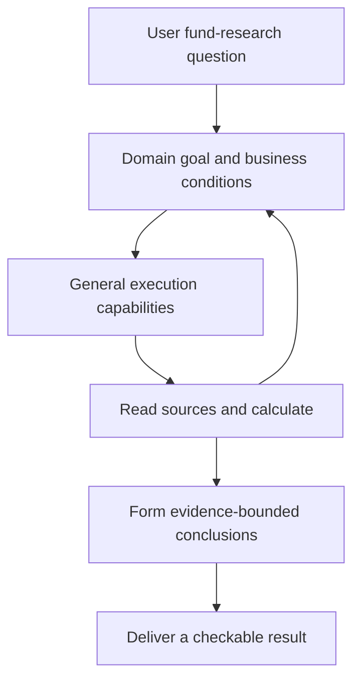
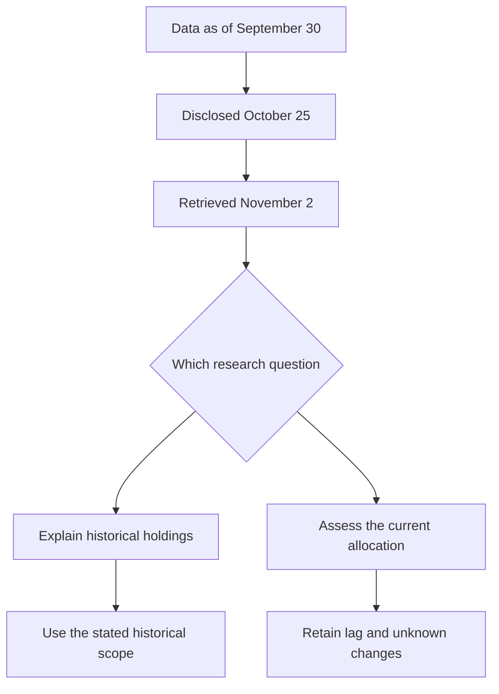
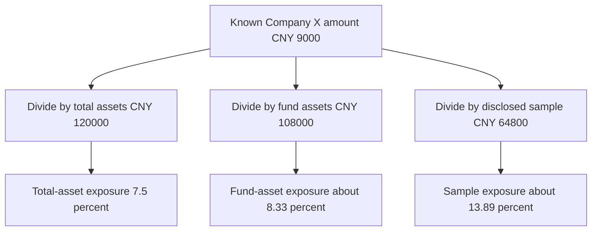
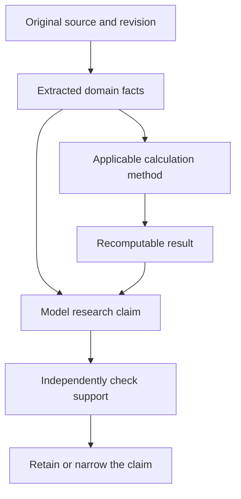
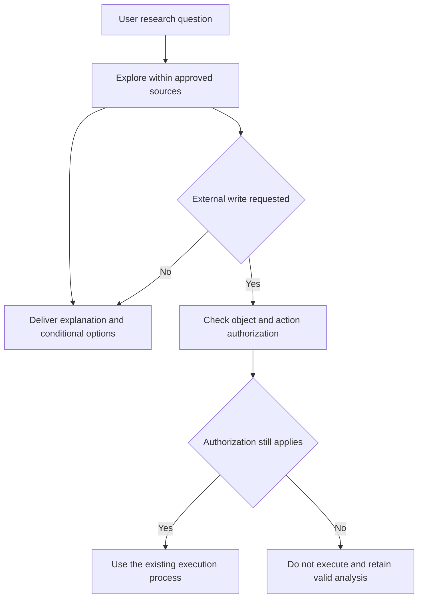
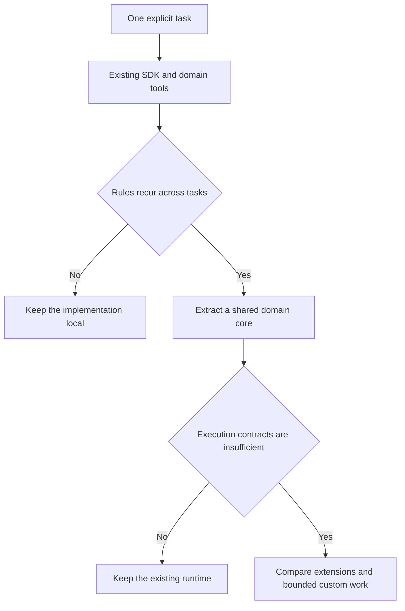
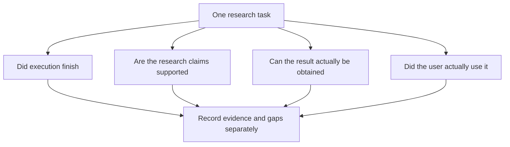

# After General-Purpose Agent Frameworks, Why Build Financial Domain Capabilities?

> Principles · Responsibilities, trade-offs and exit conditions for Pi, Claude Agent SDK, LangGraph and financial agents.

Once an agent can search the web, read reports, execute Python, delegate work and preserve a session, building a financial framework can look suspiciously like putting a new label around existing tools.

That suspicion is reasonable. Market-data access, financial prompts and a few fund-research skills do not automatically create architectural value. Yet finance also introduces specific questions about facts, calculations and accountability. A capable general-purpose framework does not make those questions disappear.

The central claim of this article is deliberately narrower than “finance needs its own framework”: **financial domain capabilities usually need to be built; an independent financial agent framework does not always need to be built; and a custom execution runtime requires a separate justification.** The three propositions must not be collapsed into one. Complex fund definitions do not, by themselves, justify rewriting an agent loop.

We will follow one portfolio-research task to see how domain rules change calculations, evidence limits claims, and autonomy should be allocated. All portfolio amounts, products and date combinations are teaching examples, not the author's or any customer's holdings. Framework descriptions use the official sources listed at the end, checked on November 2, 2026.

## 1. First establish what is being compared

### Four objects that are often conflated

A model, an execution framework, domain capabilities and a business product are different objects. The model interprets a task and proposes actions. The execution framework connects models, tools, context and task state. Domain capabilities define such things as fund identity and return methodology. A product additionally needs accounts, permissions, reports, interfaces, operations and a real usage process.

This distinction does not prescribe four directories or four services. It helps assign a problem to an appropriate responsibility. A single process can implement all of them. Where existing modules already express the responsibilities clearly, another abstraction is unnecessary.

A complete financial application will usually appear to have more features than a general SDK. But counting its data integrations, business workflows and interface as framework advantages does not answer which infrastructure the team should adopt.

### What Pi, Claude Agent SDK and LangGraph provide

Pi describes itself as a minimal, extensible agent harness: the working environment around the model. Sessions, tools and context can be adapted through extensions, skills, SDK and RPC integration. Its official material deliberately leaves features such as MCP, subagents and permission popups outside the minimal built-in core. They can be added for the environment; their absence is a design choice, not automatically a defect.[1]

Claude Agent SDK exposes the agent loop, tools and context management behind Claude Code in Python and TypeScript. MCP, permissions, hooks, subagents and session continuation are among its capabilities. A requirement for tools, recovery or specialists therefore does not, on its own, justify a new runtime.[2]

LangGraph is a low-level orchestration framework and runtime for stateful, long-running agents. Deterministic code and model-driven steps can coexist in a graph, with persistence and human interruption as explicit capabilities. Describing it as “only a fixed workflow engine” misses that a graph can orchestrate autonomous research.[3]

These are not perfectly interchangeable products, and there is no task-independent winner. The useful questions concern how much execution semantics the application must control, which integration work it accepts, what must survive process boundaries, and which tools and deployment facilities already exist.

### Figure 1. Domain goals and general execution capabilities

The return edge matters. Research is not merely a predetermined list of tool calls. New information may require changing the question or answering only part of it. The runtime enables the loop; the domain capabilities help interpret each observation.

## 2. Use one portfolio to distinguish an answer from completed research

### The teaching case: three funds and new capital

Consider a synthetic portfolio worth CNY 120,000: Fund A is 45%, Fund B 30%, Fund C 15%, and cash 10%. Product materials establish that A and B track the same index. C is an actively managed thematic fund. The user plans to add CNY 20,000 and asks:

“Have I bought overlapping funds? How could I allocate the new money to reduce concentration while retaining 10% cash? Explain what cannot be established, and do not trade for me.”

The request combines identification, calculation, conditional comparison and an authority limit. “A and B overlap; sell one” ignores the new contribution, cash target and prohibition on execution. A page of warnings would not answer the question either.

A reasonable objective is to establish what can be shown about the existing allocation, examine what the contribution could change, identify missing information and deliver conditional comparisons. Research output does not inherit permission to carry out transactions.

### The first conclusion can be made immediately

Once the account snapshot and both tracking benchmarks are confirmed, 75% of total assets can be described as allocated to products tracking the same index. That follows from 45% plus 30%. It is a benchmark-level conclusion and does not require complete security-level look-through.

It cannot automatically become “75% of assets are identical holdings,” nor does it establish which product should be sold. Cash balances, replication methods, actual positions, expenses and the user's holding conditions can affect the next judgment. A sound system preserves the supported finding instead of refusing the entire task because deeper information is missing.

Financial agents can fail in either direction: inventing precise figures to appear complete, or withholding useful established facts to appear safe. Neither extreme serves the user.

### Why an agent is useful here

Adding 45% and 30% requires no agent. Choosing an appropriate level of analysis, discovering C's disclosure gap, finding alternative sources, comparing ways to reduce concentration and revising the research question are different activities. Those are plausible uses for a model-directed research loop.

The agent's distinctive contribution is organizing evidence and methods around a goal, not reinventing arithmetic. Deterministic code should handle explicit calculations while the model explores and explains. The combination should improve the user's result, not merely increase tool-call counts.

## 3. The basic unit of a financial fact is not a bare number

### Objects, units and denominators give a number meaning

A tool response of “8% weight” is incomplete. It could mean a company's share of a fund, a fund's share of an account, or an industry's share of a research sample. The denominator might be net assets, total assets, equity assets or only disclosed top holdings.

Every number may come from a real source and the result can still be wrong because the definitions do not align. This is often more dangerous than missing data: the fields look complete and the model produces a polished calculation, but they answer different questions.

A usable fact needs an identifiable object, metric, original value, unit and scale, denominator, applicable time and source. Each JSON object need not duplicate every field, but consumers must be able to obtain these meanings through explicit relationships.

### Identity should follow the question, not mechanical deduplication

Different share classes of a fund may share some portfolio information while retaining distinct fee or distribution terms. Underlying-asset analysis may need to recognize a shared portfolio; holding-cost analysis still needs the selected share class, channel and applicable terms. One “unified fund ID” cannot justify merging every level.

Two products tracking the same index are not the same product. Two account records for the same fund are not necessarily duplicates to delete. Deduplicating research documents, product entities and invested capital are separate operations. Confusing them can remove real capital from the calculation.

These semantics are not unique to agents. If an existing financial-data service already maintains them correctly, reusing it is preferable to creating another agent-specific security master. A domain framework should reduce what callers must understand, not copy authoritative databases.

### Types prevent only some mistakes

Currency-tagged decimal amounts can prevent accidental addition of CNY and USD. Distinguishing shares from unit prices can help validate dimensional relationships. Correct types cannot establish the right fund identity or the applicability of a valuation date.

Types, runtime checks, source verification and business interpretation are complementary. Passing a structured-output schema is not a certificate that an entire financial report is correct.

## 4. Time is a set of questions, not one expiry field

### The time described and the time known are different

Suppose a teaching report describes holdings on September 30, is disclosed on October 25, and is retrieved on November 2. These dates concern portfolio state, public availability and the system's acquisition of the material respectively.

“The latest report obtained today” cannot be shortened to “today's holdings.” Historical holdings remain useful for explaining the reported period, checking a past judgment or conducting explicitly dated research. Validity depends on the task, not a universal age threshold.

For a backtest of what could have been known on October 1, the report disclosed on October 25 is unavailable information. A data-as-of field alone is insufficient in that case; disclosure or availability time also matters. Otherwise, future information is silently imported into the past.

### Figure 2. Three times associated with one source

### New information must not silently rewrite old conclusions

A corrected holdings import should affect later calculations, but an already published report retains its historical inputs. Overwriting the source and making an old report display new numbers destroys the user's ability to identify what was originally delivered.

Instead, associate source revisions with result revisions. Old results remain attached to old inputs; new results use the correction. Explain material differences and recalculate actual dependants rather than restarting every historical analysis whenever any source changes.

Immutability is not an instruction to retain everything forever. Retention still depends on access, minimization and applicable requirements. Revision identity distinguishes facts; it does not authorize indefinite preservation of private material.

### Time policies need an exit path too

A one-off reading of a public prospectus may need only source and version identity, not a bitemporal database. Richer time semantics become worthwhile when historical availability, longitudinal views or correction tracking actually affect the task.

Not every distinction in an explanation deserves an immediate field or subsystem. First identify which judgment, calculation or recovery action it changes. Otherwise, domain modeling becomes an encyclopedia-maintenance project.

## 5. A denominator error can invalidate precise look-through analysis

### Looking through the teaching portfolio to Company X

Assume compatible, confirmed inputs show that A allocates 8% to Company X, B 10% and C 6%. Known exposure as a share of total assets is 45%×8% + 30%×10% + 15%×6% = 7.5%, or CNY 9,000.

The calculation is a teaching example. Its premises include compatible fund and underlying weights, applicable dates, correct company identity and no unhandled duplication between parent and child asset levels. A simple formula does not make these premises simple.

Now suppose available underlying disclosures cover 60%, 70% and 40% of the three funds. Weighted against total assets, disclosed fund-underlying coverage is 54%. Cash is a separate 10%. The remaining 36% of total assets is fund-underlying allocation not explained by those disclosures.

### Three percentages can all be arithmetically correct

Company X is 7.5% of total assets; 7.5%÷90%, approximately 8.33%, of fund assets; and 7.5%÷54%, approximately 13.89%, of the disclosed underlying sample. The formulas answer different questions.

Placing 13.89% in a column labeled “actual portfolio company weight” would misuse sample normalization. Additional decimal places make the result look authoritative without correcting its meaning.

Missing data cannot be filled with zero. Zero means absence is known; unknown means exposure has not been established. A known component can be treated as an appropriate lower bound only under explicit assumptions such as nonnegative, unlevered exposure. Those assumptions cannot be generalized to every derivatives, short or net-exposure portfolio.

### Figure 3. One amount, three denominators

### The cash target uses the post-contribution denominator

The original cash amount is CNY 12,000. Adding CNY 20,000 produces total assets of CNY 140,000 under the teaching assumptions of no market movement, fees or other flows. A 10% cash target means CNY 14,000 in final cash. Only CNY 18,000 of the contribution is available for additional fund purchases.

Using the old CNY 120,000 denominator would incorrectly treat the original cash balance as sufficient. This error is not mathematically sophisticated, but multi-turn conversations can easily mix a new contribution, a target ratio and an old snapshot.

The same conservation and denominator rules can be reused by portfolio diagnosis, rebalancing, contribution comparisons and weekly reviews. That is a stronger reason to encapsulate a domain method than asking the model to regenerate the calculation procedure for each entry point.

## 6. Deterministic computation can still use the wrong method

### Executing a formula correctly does not establish applicability

Calling Python is often treated as the dividing line between unreliable language and reliable finance. Code can execute the wrong formula perfectly, or calculate precisely over the wrong objects. Arithmetic correctness, method applicability, truthful inputs and reasonable conclusions are separate requirements.

For example, a teaching fund's unit NAV moves from 1.00 to 0.99 and pays a cash distribution of 0.04 per unit. Assume the distribution is not reinvested and there are no other flows or fee adjustments. Single-period holding total return is 3%, not the negative 1% NAV change. Unlimited arithmetic precision would not fix a method that answers the wrong question.

Reinvestment additionally requires dates, reinvestment prices and share changes. External cash flows require a return measure suitable for the question. The important lesson is not to enumerate every formula, but to preserve method identity, input definitions and applicability as part of the result.

### Assumed fees, term-based estimates and actual charges differ

“Assume this fee rate,” “estimate from the applicable product terms,” and “the account receipt records this charge” are different facts. The first supports sensitivity analysis; the second needs share class, channel, holding conditions and effective dates; the third requires evidence of an actual event.

A single unexplained fee field hides those differences. Where expenses are already reflected in NAV, subtracting them again may double-count them. An explicit method contract, not the appearance of a fee-rate field, should determine whether an adjustment is needed.

Rules and product terms change. A domain invariant is therefore not that a particular rate remains fixed forever. It is that an estimate identifies the applicable rule version and charging basis. The stable relationship is distinct from its changeable parameters.

### Do not create another financial calculation center merely for uniformity

Where existing modules already maintain clear methods, standardize shared meaning and result interfaces rather than moving every formula into a global manager. Cash, attribution, fees and exposure can remain with the most appropriate domain owner.

Units, decimal operations, input references and revision conventions may be shared. Different return windows, fee sequences and statistical methods must retain their distinctions. Merge genuinely duplicated algorithms, not merely similar names.

With one consumer, fix the original module first. Extract a deeper common interface when multiple tasks repeatedly need the same rule. An abstraction earns its place by reducing caller knowledge, not replacing visible complexity with a larger configuration table.

## 7. Evidence should constrain claims without pretending to manufacture truth

### Separate source facts, calculations and interpretations

A row in a fund report is a source fact. Concentration calculated from it is a derived result. “The portfolio is sensitive to this risk” is a research judgment. All matter, but their evidential identities differ.

A specialist's summary is not automatically a new primary source. It can guide the main agent, but important amounts and table references should remain traceable to the corresponding source revision or deterministic result. Giving an expert response an ID does not grant it the authority of a formal disclosure.

Not every sentence needs a giant evidence object. Preserve the smallest useful chain for important claims: source, location, actual inputs, method, result and the portion used by the claim.

### Figure 4. Evidence supports a claim; it does not automatically certify it

### Links, hashes and lineage can accompany a wrong answer

A real link may not support the adjacent sentence. A hash can show that stored bytes are unchanged without establishing that they describe the correct product. Complete lineage can faithfully document an inappropriate method.

Evidence infrastructure primarily provides inspectability. It makes questions, recomputation and fault localization possible, reducing the chance that an error stays hidden inside prose. That value is substantial, but different from claiming that end-to-end provenance proves research quality.

Independent review also needs appropriate independence. A second model reading only the first model's summary may repeat the same mistake. Useful review can require primary material, independent calculations and counterevidence rather than a score for fluency.

### Local conclusions are more useful than one global trust flag

In the portfolio case, A and B's benchmark overlap can be confirmed, C's complete underlying exposure cannot, and the cash calculation can still be valid. These findings should retain their own scope instead of being compressed into a report-level trusted/untrusted switch.

A result can distinguish established facts, explicitly assumed scenarios and missing information. A calculation without essential inputs must not fabricate a value. But an unavailable optional diagnostic should not automatically revoke independent valid findings.

This is not weaker quality control. It avoids turning quality governance into excessive blocking. Users need to understand which conclusions are usable and what remains to be established, not receive an unexplained red label.

## 8. Put autonomy in research strategy, not in authorization facts

### The model may decide what to investigate next

When C's disclosure is incomplete, the model can seek manager reports, compare disclosure windows or conclude that only strategy-level risk discussion is presently supportable. It may revise the question to establish benchmark duplication first, then examine what the new contribution could improve.

That adaptability is precisely what an agent can add. A rigid instruction to query A, B and C and always produce an exact overlap percentage can force execution of a plan already shown to be inappropriate.

Strategic freedom does not make every rule model-owned. User identity, readable accounts, approved external recipients, investment ledgers and granted permissions must not change because the model considers a broader action convenient.

### Research, advice and execution differ, without requiring approval everywhere

Summarizing a public prospectus does not require a trading approval dialog. Read-only analysis should not trigger a transaction workflow merely because it mentions reducing concentration. Controls should match actual actions and consequences, not financial keywords.

Private customer data requires appropriate access and use checks. Real account writes require authorization for the concrete operation. This is an engineering separation of responsibilities, not a legal opinion covering every jurisdiction, institution or service.

A user's approval must also remain bound to the relevant object and version. Permission to read holdings is not permission to send them to every external model. Approval of one amount does not necessarily survive a later amount change. Binding matters more than the popup itself.

### Figure 5. Open-ended exploration, explicit authority for effects

### A prompt is guidance, not a security perimeter

Instructions such as read-only, do not trade and do not disclose accounts are useful. They do not establish an effective boundary when tools retain arbitrary database writes or unrestricted file access. The surrounding system must still limit effects if the model deviates.

The reverse mistake is turning every judgment into a mechanical rule. A keyword test cannot determine whether a research argument is persuasive. Deterministic mechanisms govern definable authorization, identity and arithmetic; semantic quality needs suitable evaluation and review.

## 9. Persistence preserves execution state; continuity needs domain meaning

### Continuing a session is not necessarily continuing the same research

General frameworks already provide substantial persistence. LangGraph distinguishes thread checkpoints from cross-thread stores; Claude Agent SDK supports session continuation and forking. Those capabilities deserve reuse, not erasure from the comparison.[2][4]

The application must still decide whether a resumed task answers the same question, uses the same source period, reflects a changed user objective, preserves or revises previous findings, and retains applicable authorization.

A complete conversation log may not distinguish last week's hypothesis from this week's fact. Longitudinal research therefore concerns relationships between goals, evidence, conclusions and reasons for change, not just a larger chat history.

### Recovery is not blind repetition

Retrying a failed read differs from resending an external instruction after losing its acknowledgment. The latter may already have taken effect. Even report storage has distinct pre-commit failure, committed-but-unacknowledged and unknown states.

LangGraph's interruption documentation explicitly notes that code before an interrupt can execute again on resumption, requiring appropriate idempotency for side effects. This is not a framework defect; the application and runtime jointly define execution semantics.[5]

A domain system contributes by defining identity, retries and reconciliation for concrete business operations. A local success flag cannot create exactly-once effects in an external system lacking the corresponding protocol.

### Many tasks need no long-term memory

A one-off public-document comparison may be best without long-term preferences or a cross-week workspace. Persistent memory introduces staleness, conflict, permission and deletion semantics. Real continuing work should justify it.

Where continuity is valuable, prioritize stable preferences and research goals rather than storing every generated opinion as fact. An earlier assistant statement that a fund suits the user must not silently become a user-confirmed investment preference.

## 10. There is an economic boundary between a skill and a framework

### Use skills for method guidance before building a platform

A skill is suitable for teaching a research sequence: confirm identity, locate disclosures and select applicable metrics. It can expose task-specific guidance on demand rather than stuffing every domain instruction into a permanent prompt.

A repeated deterministic formula belongs in a tool or domain module with explicit parameters, units and failure conditions. The skill explains when to use it. A longer skill is not a substitute for an implementable calculation rule.

A domain SDK or framework begins to make sense when multiple tasks share identity, timing, definitions, references and result structures that must evolve and be tested independently. It should emerge from reuse, not from an initial directory template.

### Test an abstraction by imagining its deletion

If removing a common module removes complexity and makes callers simpler, it may be an unnecessary pass-through. If the same fee definitions and evidence checks reappear in many callers, the module was concentrating real complexity.

This is more informative than asking whether an interface exists. Depth comes from hiding details callers should not need. An abstraction with one adapter can be useful, but cross-runtime portability remains unproven until exercised.

The same reasoning applies to deployment. Logical separation need not become microservices. Process boundaries should follow real isolation, resource or organizational requirements rather than diagram aesthetics.

### Ordinary requests also pay for elaborate architecture

Does an optional feature still add context, assembly steps, database access or failure surface when it is not used? Does adding a tool force edits to multiple registries, recovery protocols and test suites? These are normal-path cost and change-amplification cost.

No universal percentage is invented here; actual requests should be measured. Unmeasured cost is not zero cost. Showing only the benefits of sophisticated failure handling while ignoring the tax on everyday queries is incomplete analysis.

Prefer optional mechanisms: short tasks do not start long-term workspaces, inseparable work does not spawn specialists, sufficient results do not receive redundant review, and unavailable enhancements do not block independent authorized answers.

## 11. The strongest objection: why not put the rules in an existing framework?

### Often, that is exactly the right answer

Claude Agent SDK plus financial MCP tools and a domain calculation library can be sufficient. LangGraph nodes can organize the same reads, calculations and human checks. Pi extensions can expose the same capabilities.

If rules are centralized, tests are clear and outputs are checkable, there need not be a package called FinancialAgentFramework. A standalone framework is not intrinsically more valuable than well-designed business modules.

**Domain complexity establishes a need for domain modeling; it does not automatically establish a need for another runtime.** The team proposing a new execution system must provide execution-specific reasons.

### Conditions that might justify a custom runtime

A serious comparison becomes appropriate when a required execution contract cannot be met in the actual deployment environment, extension points are insufficient, or compatibility code becomes more complex than a bounded custom implementation. Protocols, resource admission, cross-process recovery or delivery semantics are possible reasons, but each needs a concrete counterexample.

“We want finer control” is too vague. Identify the action, failure condition, existing behavior, business mismatch and smaller extensions already considered. Otherwise, control merely transfers a mature framework's maintenance responsibilities to the team.

Even justified custom work inherits streaming fragments, cancellation races, retries, plugin lifecycles and state migrations. Such work can have engineering research value, but should not automatically be counted as financial differentiation.

### Figure 6. Start with a usable baseline, not a platform

### A reversed success criterion

Deleting substantial custom execution code after adopting a mature framework, while preserving financial calculations, evidence and authority, is a success rather than a loss of technical sophistication.

Conversely, if changing a model requires rewriting return definitions, execution details and domain meaning are too tightly coupled. A useful domain core should outlast a particular generation of harness.

## 12. Multi-agent architecture requires its own justification

### Several roles do not guarantee independent information

Giving the same material to bullish, bearish and risk specialists may produce useful counterarguments, or merely different wording. Three models using the same mistaken summary can amplify the error through agreement.

Context isolation, parallelizable subtasks, specialized instructions and restricted tools are concrete engineering benefits. Claude Agent SDK documents those uses. Whether they improve a financial judgment remains a task-specific empirical question.[6]

A disclosure-date reviewer, an independent cash-and-fee calculator and a specialist seeking disconfirming evidence provide more meaningful roles than three personalities. Even those roles may have no net benefit if one main agent already handles the checks cheaply.

### “The expert says it is fine” is not a sufficient handoff

A useful handoff states the subquestion, sources, method and remaining gaps. The main agent should distinguish original evidence from opinion and be able to inspect decisive material when necessary.

Otherwise, the system inserts an opaque language intermediary between the main agent and facts. Context may shrink while accountability becomes less clear. More specialists also increase permission, budget, cancellation and recovery complexity.

### Define when to turn it off

Do not start a specialist without an independent subproblem. Do not use extra roles to compensate for missing evidence. If review adds latency without finding additional important errors, return to the single-agent baseline.

The goal is improved research, not maximum agent concurrency. Demonstrating net value requires comparison against a simpler baseline on comparable questions, sources and model conditions, not one impressive coordinated demonstration.

## 13. Evaluate the user's task, not just tool events

### Execution, research, delivery and adoption are different observations

A terminal run establishes an execution state. A saved report establishes that bytes were persisted. A working download establishes delivery. Independent examination supports research quality only within its reviewed scope. These observations connect, but none substitutes for the others.

User comprehension and adoption also do not prove improved investment returns. Outcomes depend on markets and behavior, among other factors. Separating these observations gives engineering progress its proper credit without converting it into unsupported financial benefit.

### Figure 7. Four completion questions, not an automatic promotion ladder

### Use counterexamples that change the conclusion

Useful variants include missing C holdings, mismatched disclosure dates, new money actually transferred from existing cash, revoked account access, an inapplicable share-class fee rule, and lost acknowledgment after report storage.

The purpose is not more tests. Each variation changes an output, permitted action or delivery behavior. Merely renaming a fund while preserving the research structure is weak evidence of generality.

Preserve no-answer, partial-answer, unavailable-source and unreviewed attempts. Selecting only attractive final reports and removing failed attempts from the denominator misrepresents actual use.

### Candidate scores are not competitor win rates

An internal scorecard can organize gaps, provided its reference scale, weights and evidence stages are explicit. A score of 8.9 does not mean 89% of another SDK, and it does not mean 89% financial-answer accuracy.

Without paired execution under comparable tasks, resources and independent review, a precise four-way leaderboard is unjustified. Explain what is built in, what requires integration, what has been tested in the application and what remains unknown.

## 14. Turn the principles into a feasible first implementation

### Baseline: one main agent, read-only tools and an explicit method

For fund-overlap research, reuse a mature runtime. Supply identity-aware source tools, a reproducible portfolio calculation and a report artifact interface. Make ordinary inputs and decisive missing-data cases work before adding specialist conversations, persistent memory or a continuous-task platform.

The baseline should explain benchmark duplication, known company exposure, disclosure coverage, unknown allocation, the cash constraint after new capital and missing user conditions.

Its domain value is already concrete: users should not confuse a 13.89% disclosed-sample weight with 7.5% total-asset exposure, or keep using an old denominator after a contribution. Those improvements justify the system more directly than additional workflow nodes.

### Let actual tasks drive shared capabilities

Fund comparison may motivate shared return definitions and share-class identity. A continuing weekly review may require goals, source revisions and reasons for changed views. Cross-process waiting may justify stronger recovery and staged delivery.

Each addition should identify the problem solved and what can remain deferred. Continuous research need not wait for automated trading; specialist handoffs do not require unlimited nesting; readable history need not remain permanently in model context.

If a mechanism does not improve completeness, inspectability or use cost, shrink it. A coherent system grows while preserving responsibility; it need not contain every conceivable feature from the beginning.

### Preserve the possibility of replacement

Where execution gaps truly justify custom code, keep financial methods independent of model-message formats. Maintain stable source and result references, leave business authorization with its original system, avoid duplicating formulas in provider adapters, and do not recalculate old reports silently during recovery.

A second real runtime consumer can test portability. Compare the same inputs, calculations, permission refusals and delivery facts rather than demanding word-for-word identity in generated prose.

## 15. Will stronger models remove the domain core?

### Incidental complexity compensating for weak models should disappear

Better table reading, tool selection and conditional reasoning may make decomposed prompts, elaborate plans and corrective steps unnecessary. A healthy architecture allows those structures to be removed instead of preserving them because they were expensive to build.

Model improvement is therefore a reason to reassess existing mechanisms. Anything compensating for one model generation needs an exit condition and evaluation against the upgraded model.

### External facts and business responsibility do not disappear automatically

A stronger model does not change disclosure dates, make incompatible denominators comparable or grant access to an account. It may identify those conditions more reliably, but their authority still comes from the external world and business systems.

The domain core can become thinner as models improve. More interpretation may be model-owned, while explicit arithmetic and authorization remain with appropriate programs. Stable responsibility and meaning matter more than frozen implementation.

### Complexity is not a moat by itself

Data, verified methods, real user problems, longitudinal feedback and integration can create value. A complicated system is not necessarily difficult to reproduce or better than a simpler product that answers the user's question more effectively.

Reusable public domain tools also have value precisely because others can use them. Stable contracts, clear failures and reproducible examples reduce the cost of building correct systems. Engineering value does not depend on keeping everything closed.

## Conclusion: establish domain value before framework value

The synthetic user does not primarily need to know whether the application uses Pi, Claude Agent SDK or LangGraph. They need to understand the 75% same-benchmark allocation, the denominator behind 7.5% known company exposure, why 36% of total assets remains unexplained at the underlying level, and how to retain the requested cash after adding CNY 20,000.

The system should seek evidence when information is missing and narrow its claims when the gap cannot be closed. It should calculate what can be defined precisely, preserve judgment where calculation is insufficient, and keep research flexibility from expanding data access or execution authority.

General frameworks already absorb substantial execution complexity. Financial capabilities make that execution operate on the right objects, methods and checkable conclusions. A domain framework becomes worthwhile when those capabilities need reuse; a custom runtime still requires its own cost and alternatives analysis.

**What deserves preservation is not the amount of custom code, but financial research capability that remains explainable, independently testable and improvable after the model, tools or runtime changes.**

---

## Sources and further reading

[1] [Pi: positioning, extensions, sessions and deliberately omitted built-ins](https://pi.dev/). This article compares documented mechanisms, not measured performance of a particular release.

[2] [Claude Agent SDK overview](https://code.claude.com/docs/en/agent-sdk/overview). Agent SDK, the direct API Client SDK and hosted Managed Agents are distinct products.

[3] [LangGraph overview](https://docs.langchain.com/oss/python/langgraph/overview).

[4] [LangGraph persistence](https://docs.langchain.com/oss/python/langgraph/persistence).

[5] [LangGraph interrupts](https://docs.langchain.com/oss/python/langgraph/interrupts).

[6] [Claude Agent SDK subagents](https://code.claude.com/docs/en/agent-sdk/subagents). Isolation, restrictions and parallelism do not automatically establish better investment judgment.

[7] [Anthropic: Building effective agents](https://www.anthropic.com/engineering/building-effective-agents). Start with the simplest effective design and justify additional complexity with actual benefit.

The engineering companion is [From a General Harness to Financial Research: A Four-Way Architecture Comparison of ETF Agent](./etf-agent-framework-comparison-panorama). For a broader business map, see [Financial Agents in Context](./financial-agent-system-panorama).

Discuss the designs or star the [Agent engineering collection](https://github.com/hpoenixf/eff-agent-article). The separate [Open ETF Agent](https://github.com/hpoenixf/open-etf-agent) teaching implementation does not reproduce every capability of the private research system.
