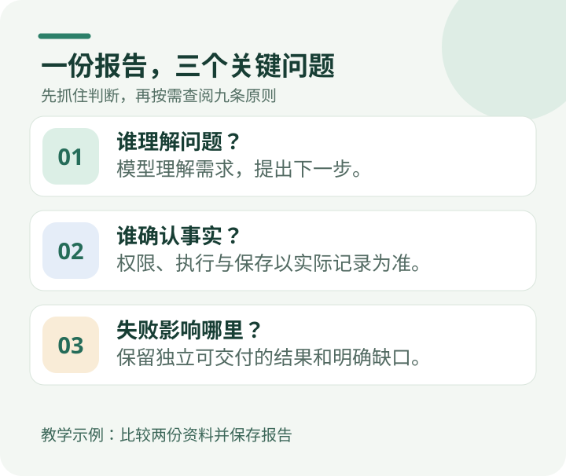

# Agent 架构判断：核心原则与外围方法

**这九条原则不是为了把 Agent 设计得更复杂，而是为了让用户真正拿到结果。**

下面用一个教学示例理解它们：同事请 AI 比较两份产品说明，回答“新版能不能导出 PDF”，然后保存一份带出处的报告。模型答对了，页面也显示“完成”，但保存接口没有返回确定的结果。**报告到底算不算交付了？**

这时不用先认识十几个模块，只需追问三件事：**谁负责读懂问题，谁知道文件有没有保存，出了错还能把哪些结果交给用户？** 前四条原则解决理解、授权和失败范围；第五到第七条帮助系统长期修改而不堆积旧机制；最后两条检查用户任务是否完成，以及改动是否真的带来收益。

如果第一次接触 Agent 架构，建议先读[一份报告背后的九个架构判断](/articles/one-report-nine-architecture-judgments)，跟着同一个例子走完；遇到具体问题，再回本页按原则查找。需要查看完整技术调用链，可读[六层系统全景](/articles/017-prompt-to-answer-six-layer-panorama-v3)。

这些是帮助作决策的判断，不是要新增九个审批步骤。模型可以提出计划；权限、保存结果和可追溯的记录，仍由真正掌握这些事实的程序确认。

<FlagshipEntry compact />

## 第一层 · 九条核心判断

**记住这一个目标：** 用户能得到一份可靠、可核对、能重新打开的成果。职责分清楚、故障影响有限、旧机制可退出，都是实现这个目标的手段。

**怎么查：** ①—④ 看“谁说了算、出了错影响谁”；⑤—⑦ 看“下次修改会不会更难”；⑧—⑨ 看“用户是否得到更好的结果”。不用让每个请求都经过九次检查。

| 原则 | 核心问题 | 值得记住的一句话 | 深入文章 |
| --- | --- | --- | --- |
|  **1. 模型负责语义，系统负责客观事实** | **谁负责理解？** | 模型可以看出新版增加了 PDF；但资料是否读到、工具是否获准、报告是否真的保存，要看程序的实际记录。 | [别让模型当状态机](/articles/runtime-model-protocol-boundary-agent-article-v2) · [职责分工](/articles/agent-model-runtime-mcp-skill-boundaries) · [六层全景中的执行链](/articles/017-prompt-to-answer-six-layer-panorama-v3) |
|  **2. 复杂度必须归属正确的 Owner** | **谁拥有决定权？** | 读取器决定怎样读文件，存储系统确认是否写入；不要再造一个同时替两者签字的“总管”。 | [Owner 分工](/articles/agent-model-runtime-mcp-skill-boundaries) · [工具表面归属](/articles/agent-model-capability-presentation-tool-surface) · [一次 Runtime 重构的真实代价](/articles/agent-runtime-refactor-one-day-blocked) |
|  **3. 提议、批准、执行、生效是不同事实** | **什么才算真正发生？** | 模型说“保存报告”只是请求；收到可靠保存回执才是结果。若结果未知，不能当作从未执行就盲目重试。 | [独立 Publication](/articles/019-agent-answer-publication) · [Memory 持久效果](/articles/026-agent-memory-forget-durable-effects) |
|  **4. 局部失败不能取得全局否决权** | **失败影响到哪里？** | 附图失败不应连带删除已经合格的正文；但缺少必需授权的内容不能绕过检查继续交付。 | [否决权与 Run 终结权](/articles/agent-veto-authority-and-run-termination) |
|  **5. Context 是工作台，不是事实数据库** | **事实如何在长任务中保留？** | 模型忘记了第 3 页，不等于原文消失了；需要核对时应重新读取保存的原始资料。 | [工具结果外置](/articles/tool-results-outside-model-context) · [Main 压缩](/articles/agent-main-run-context-compaction) |
|  **6. 坚持最小充分机制** | **需要多少机制才够？** | 比较两份短文档先完成读取、核对和保存，不必先搭一套通用规划与审批系统。 | [Entry 做减法](/articles/022-agent-entry-from-intent-to-direct-research) · [五不原则](/articles/code-cheaper-systems-harder-to-evolve) |
|  **7. 能力应当容易引入、撤退和替换** | **怎样持续升级而不堆积旧结构？** | 换文档读取器时，确认旧读取路径已无人依赖，再清理旧规则与测试；别让两套方式永久并存。 | [代码与架构演化](/articles/code-cheaper-systems-harder-to-evolve) · [Extension Host](/articles/020-agent-extension-host-smartphone) |
|  **8. 系统内部成功不等于用户任务成功** | **用户任务是否真正完成？** | 不仅要生成报告，还要确认用户能打开它、看懂比较结论并核对出处。 | [真实任务收敛](/articles/032-ai-development-from-bug-loop-to-task-convergence) · [HTML 交付](/articles/agent-html-evolution-challenges) · [全景中的结果与恢复](/articles/017-prompt-to-answer-six-layer-panorama-v3) |
|  **9. 局部改善不等于整体进步** | **怎样证明整体变好了？** | 搜索变快了，不代表报告更准确；比较相同任务的交付质量、耗时和成本，才知道改动值不值得。 | [局部改善与整体进步](/articles/local-improvement-is-not-system-progress) |

**为什么保留第八和第九条？** 第八条界定成功是否真正到达用户任务；第九条进一步核对一次改动是否产生可比较的端到端净收益，明确质量、成本、延迟与风险的取舍。不要把局部绿灯当作整体进步。

**不轻易加第十条：** 只有新认知真正改变一类问题的判断、可以跨多个模块使用、而且无法自然归入已有原则时，才考虑晋升。Budget 收尾、Memory 世代锁、特定 Schema parity 等属于值得查阅的实现经验，不必占据核心层。

## 第二层 · 七组外围系统方法

| 遇到的场景 | 按需使用的方法 | 已有正文 |
| --- | --- | --- |
|  **1. 新功能取舍** | 例如给报告加可选图表：没有选择图表的用户，是否也被迫等待渲染、承担额外输入成本？新功能未来能否安全撤掉？ | [五不与系统演化](/articles/code-cheaper-systems-harder-to-evolve) |
|  **2. 职责设计与拒绝评审** | 上传资料失败、引用失效或保存失败时，先查是谁记录了事实、谁有权拒绝、拒绝应该影响哪一部分，不额外设置万能审批者。 | [Model/Runtime/Skill 分工](/articles/agent-model-runtime-mcp-skill-boundaries) · [否决权复盘](/articles/agent-veto-authority-and-run-termination) · [Subagent 重构事件复盘](/articles/agent-runtime-refactor-one-day-blocked) |
|  **3. 证据传递与投影** | 报告引用一页资料时，确认那页确实被读取，引用对应原文，而不是只因为摘要里出现了一个链接就算有依据。 | [金融 Agent 证据链](/articles/financial-agent-trustworthy-evidence-chain) · [A34 Tool Surface](/articles/agent-model-capability-presentation-tool-surface) |
|  **4. 完整设计与分期交付** | 可以考虑完整方案，但实施先沿**首份用户可取得的结果**排序必要依赖；外围能力不自动提前，阶段完成和整个产品完成分开。 | [周报三期交付复盘](/articles/agent-weekly-review-staged-delivery) · [Spec 与 Evidence](/articles/026-agent-spec-evidence-workflow) · [任务收敛](/articles/032-ai-development-from-bug-loop-to-task-convergence) |
|  **5. 验证与故障归因** | 确定性不变量用工程判断和边界回归；模型行为及用户效果按风险选择实际对照；诊断必须先定位真正失败的 Owner。 | [假绿测试](/articles/honest-agent-evaluation) · [失败归因](/articles/agent-failure-is-a-boundary-problem) · [Spec 研发流程](/articles/026-agent-spec-evidence-workflow) |
|  **6. 机制退出与工程知识** | 旧方案不仅存在于代码，也可能留在 Spec、Skill、Prompt 与测试中；现行约束有唯一维护处，历史原样保留，知识按任务加载。 | [工程知识的加载、记忆与退役](/articles/027-agent-context-document-history) · [五不与删除成本](/articles/code-cheaper-systems-harder-to-evolve) |
|  **7. 按 Interface 区分稳定性与演进方式** | “报告已保存”这类对外承诺要稳定；摘要写法、检索方法可以继续试验。按具体使用者和后果决定测试强度，而不是把整个模块一律锁死。 | [差异化演进契约：稳定什么，改变什么](/articles/agent-differentiated-evolution-contracts) · [产生这一思考的 Runtime 重构](/articles/agent-runtime-refactor-one-day-blocked) |
